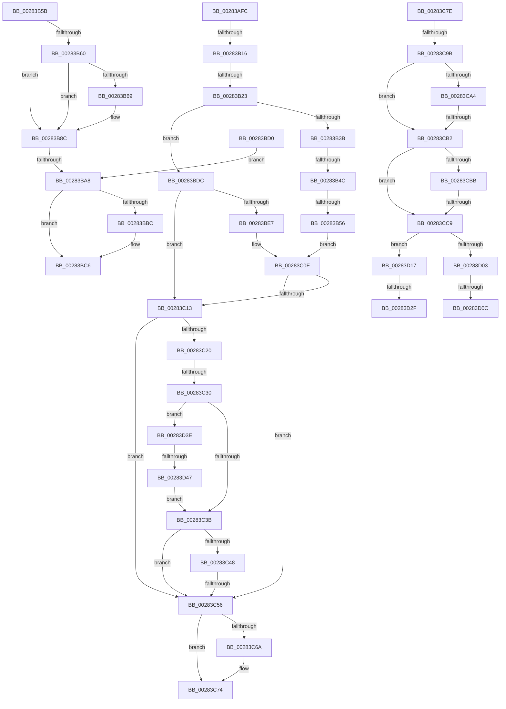

# sub_00283AFC

- RVA: `0x00283AFC`–`0x00283D4C` (길이 `592` bytes)
- VA: `0x0000000140283AFC`
- 실행 섹션: `.text`
- PDB 이름 있음: `아니요`; PDB Function 태그: `아니요`
- unwind 정보 RVA: `0x000668B0`
- 디코드: `133`개 명령, `592/592` bytes 표시
- 미해석 바이트: `0` (있으면 어셈블리에 `.byte`로 보존)

> 이 문서는 커널 이미지의 기계어와 PDB 기호를 분석해 생성했습니다. 4번과 5번은 함수 원형과 자료형을 바이너리 사용 방식에서 추정한 C 해석이며 원본 소스 복구 결과는 아닙니다.

## 1. Dependencies

- 직접 호출 지점: **12**; 고유 호출 대상: **7**
- 직접 호출자로 확인된 함수: **0**
- RIP 상대 이미지 참조: **2**

### Outgoing calls
- `0x00283B6B` → [MiLockVadTree](../27/MiLockVadTree_function_0027C0F0.md) (function, `0x0027C0F0`)
- `0x00283B73` → [MiLocateAddress](../31/MiLocateAddress_function_003168D0.md) (function, `0x003168D0`)
- `0x00283B87` → [MiUnlockVadTree](../29/MiUnlockVadTree_function_00297020.md) (function, `0x00297020`)
- `0x00283B95` → [MiMakeTransitionHeatBatch](../40/MiMakeTransitionHeatBatch_function_00409A94.md) (function, `0x00409A94`)
- `0x00283BC1` → [MiUnlockProtoPoolPage](../24/MiUnlockProtoPoolPage_function_00246090.md) (function, `0x00246090`)
- `0x00283BD5` → [MiDiscardTransitionPteEx](../37/MiDiscardTransitionPteEx_function_00375954.md) (function, `0x00375954`)
- `0x00283BE9` → [MiLockVadTree](../27/MiLockVadTree_function_0027C0F0.md) (function, `0x0027C0F0`)
- `0x00283BF6` → [MiLocateAddress](../31/MiLocateAddress_function_003168D0.md) (function, `0x003168D0`)
- `0x00283C04` → [MiUnlockVadTree](../29/MiUnlockVadTree_function_00297020.md) (function, `0x00297020`)
- `0x00283C6F` → [MiUnlockProtoPoolPage](../24/MiUnlockProtoPoolPage_function_00246090.md) (function, `0x00246090`)
- `0x00283CF6` → [MiIdealClusterPage](../4D/MiIdealClusterPage_function_004DB964.md) (function, `0x004DB964`)
- `0x00283D34` → [MiUnlockProtoPoolPage](../24/MiUnlockProtoPoolPage_function_00246090.md) (function, `0x00246090`)

### Direct callers
- 이 함수 시작 RVA로 연결되는 직접 call은 확인되지 않았습니다. 간접 호출은 완전히 역산할 수 없습니다.

### Static image references
- `0x00283B3B` → RVA `0x00FC6A88` (`ALMOSTRO`; read)
- `0x00283C82` → RVA `0x00014578` (`.rdata`; read)

## 2. Other-region calls and transfers

- 다른 실행 섹션으로 향하는 call: **0**
- call이 아닌 외부 분기/꼬리 이동: **17**
  - `0x00283B10` → [sub_00283850 + 0xB8](Unknown_function_00283850.md) (`tail-transfer`)
  - `0x00283B1D` → [sub_00283850 + 0xB8](Unknown_function_00283850.md) (`tail-transfer`)
  - `0x00283B46` → [sub_00283850 + 0xB8](Unknown_function_00283850.md) (`tail-transfer`)
  - `0x00283B50` → [sub_00283850 + 0xB8](Unknown_function_00283850.md) (`tail-transfer`)
  - `0x00283BA2` → [sub_00283850 + 0x58](Unknown_function_00283850.md) (`tail-transfer`)
  - `0x00283BCB` → [sub_00283850 + 0x256](Unknown_function_00283850.md) (`tail-transfer`)
  - `0x00283C2A` → [sub_00283850 + 0xB8](Unknown_function_00283850.md) (`tail-transfer`)
  - `0x00283C50` → [sub_00283850 + 0xB8](Unknown_function_00283850.md) (`tail-transfer`)
  - `0x00283C79` → [sub_00283850 + 0x256](Unknown_function_00283850.md) (`tail-transfer`)
  - `0x00283C95` → [sub_00283850 + 0x183](Unknown_function_00283850.md) (`tail-transfer`)
  - `0x00283CAC` → [sub_00283850 + 0x183](Unknown_function_00283850.md) (`tail-transfer`)
  - `0x00283CC3` → [sub_00283850 + 0x183](Unknown_function_00283850.md) (`tail-transfer`)
  - `0x00283D06` → [sub_00283850 + 0x183](Unknown_function_00283850.md) (`tail-transfer`)
  - `0x00283D12` → [sub_00283850 + 0x183](Unknown_function_00283850.md) (`tail-transfer`)
  - `0x00283D29` → [sub_00283850 + 0x183](Unknown_function_00283850.md) (`tail-transfer`)
  - `0x00283D39` → [sub_00283850 + 0x183](Unknown_function_00283850.md) (`tail-transfer`)
  - `0x00283D41` → [sub_00283850 + 0xB8](Unknown_function_00283850.md) (`tail-transfer`)

## 3. Assembly (complete function range)

```asm
00283AFC  48 8B C3                        mov rax, rbx
00283AFF  48 B9 F8 FF FF FF FF FF FF 7F   movabs rcx, 0x7ffffffffffffff8
00283B09  48 83 E0 F8                     and rax, 0xfffffffffffffff8
00283B0D  48 3B C1                        cmp rax, rcx
00283B10  0F 86 F2 FD FF FF               jbe 0x140283908
00283B16  0F B6 C3                        movzx eax, bl
00283B19  24 03                           and al, 3
00283B1B  3C 02                           cmp al, 2
00283B1D  0F 84 E5 FD FF FF               je 0x140283908
00283B23  48 B8 00 00 00 00 00 80 FF FF   movabs rax, 0xffff800000000000
00283B2D  48 39 84 24 B0 00 00 00         cmp qword ptr [rsp + 0xb0], rax
00283B35  0F 82 A1 00 00 00               jb 0x140283bdc
00283B3B  48 F7 05 42 2F D4 00 00 80 00 00  test qword ptr [rip + 0xd42f42], 0x8000
00283B46  0F 84 BC FD FF FF               je 0x140283908
00283B4C  F6 47 10 40                     test byte ptr [rdi + 0x10], 0x40
00283B50  0F 84 B2 FD FF FF               je 0x140283908
00283B56  E9 B3 00 00 00                  jmp 0x140283c0e
00283B5B  48 3B D9                        cmp rbx, rcx
00283B5E  77 2C                           ja 0x140283b8c
00283B60  49 8B 41 28                     mov rax, qword ptr [r9 + 0x28]
00283B64  48 85 C0                        test rax, rax
00283B67  78 23                           js 0x140283b8c
00283B69  8B CE                           mov ecx, esi
00283B6B  E8 80 85 FF FF                  call 0x14027c0f0
00283B70  48 8B CB                        mov rcx, rbx
00283B73  E8 58 2D 09 00                  call 0x1403168d0
00283B78  B2 11                           mov dl, 0x11
00283B7A  48 89 84 24 C0 00 00 00         mov qword ptr [rsp + 0xc0], rax
00283B82  8B CE                           mov ecx, esi
00283B84  4C 8B F0                        mov r14, rax
00283B87  E8 94 34 01 00                  call 0x140297020
00283B8C  45 33 C0                        xor r8d, r8d
00283B8F  49 8B D6                        mov rdx, r14
00283B92  48 8B CF                        mov rcx, rdi
00283B95  E8 FA 5E 18 00                  call 0x140409a94
00283B9A  49 89 44 24 78                  mov qword ptr [r12 + 0x78], rax
00283B9F  48 85 C0                        test rax, rax
00283BA2  0F 84 00 FD FF FF               je 0x1402838a8
00283BA8  48 B8 FF FF FF FF FF FF FF 7F   movabs rax, 0x7fffffffffffffff
00283BB2  F0 48 21 47 18                  lock and qword ptr [rdi + 0x18], rax
00283BB7  4D 85 ED                        test r13, r13
00283BBA  74 0A                           je 0x140283bc6
00283BBC  B2 11                           mov dl, 0x11
00283BBE  49 8B CD                        mov rcx, r13
00283BC1  E8 CA 24 FC FF                  call 0x140246090
00283BC6  B8 34 04 00 C0                  mov eax, 0xc0000434
00283BCB  E9 D6 FE FF FF                  jmp 0x140283aa6
00283BD0  33 D2                           xor edx, edx
00283BD2  48 8B CF                        mov rcx, rdi
00283BD5  E8 7A 1D 0F 00                  call 0x140375954
00283BDA  EB CC                           jmp 0x140283ba8
00283BDC  48 83 BC 24 C0 00 00 00 00      cmp qword ptr [rsp + 0xc0], 0
00283BE5  75 2C                           jne 0x140283c13
00283BE7  8B CE                           mov ecx, esi
00283BE9  E8 02 85 FF FF                  call 0x14027c0f0
00283BEE  48 8B 8C 24 B0 00 00 00         mov rcx, qword ptr [rsp + 0xb0]
00283BF6  E8 D5 2C 09 00                  call 0x1403168d0
00283BFB  B2 11                           mov dl, 0x11
00283BFD  48 89 44 24 40                  mov qword ptr [rsp + 0x40], rax
00283C02  8B CE                           mov ecx, esi
00283C04  E8 17 34 01 00                  call 0x140297020
00283C09  48 8B 54 24 40                  mov rdx, qword ptr [rsp + 0x40]
00283C0E  48 85 D2                        test rdx, rdx
00283C11  74 43                           je 0x140283c56
00283C13  8B 42 30                        mov eax, dword ptr [rdx + 0x30]
00283C16  8B C8                           mov ecx, eax
00283C18  80 E1 70                        and cl, 0x70
00283C1B  80 F9 20                        cmp cl, 0x20
00283C1E  75 36                           jne 0x140283c56
00283C20  25 80 0F 00 00                  and eax, 0xf80
00283C25  3D 80 00 00 00                  cmp eax, 0x80
00283C2A  0F 84 D8 FC FF FF               je 0x140283908
00283C30  8B 42 40                        mov eax, dword ptr [rdx + 0x40]
00283C33  A8 08                           test al, 8
00283C35  0F 85 03 01 00 00               jne 0x140283d3e
00283C3B  48 F7 05 42 2E D4 00 00 04 00 00  test qword ptr [rip + 0xd42e42], 0x400
00283C46  74 0E                           je 0x140283c56
00283C48  41 8B 46 20                     mov eax, dword ptr [r14 + 0x20]
00283C4C  0F BA E0 11                     bt eax, 0x11
00283C50  0F 82 B2 FC FF FF               jb 0x140283908
00283C56  48 B8 FF FF FF FF FF FF FF 7F   movabs rax, 0x7fffffffffffffff
00283C60  F0 48 21 47 18                  lock and qword ptr [rdi + 0x18], rax
00283C65  4D 85 ED                        test r13, r13
00283C68  74 0A                           je 0x140283c74
00283C6A  B2 11                           mov dl, 0x11
00283C6C  49 8B CD                        mov rcx, r13
00283C6F  E8 1C 24 FC FF                  call 0x140246090
00283C74  B8 28 04 00 C0                  mov eax, 0xc0000428
00283C79  E9 28 FE FF FF                  jmp 0x140283aa6
00283C7E  41 8B 46 30                     mov eax, dword ptr [r14 + 0x30]
00283C82  48 8D 0D EF 08 D9 FF            lea rcx, [rip - 0x26f711]
00283C89  48 C1 E8 13                     shr rax, 0x13
00283C8D  83 E0 03                        and eax, 3
00283C90  48 83 3C C1 10                  cmp qword ptr [rcx + rax*8], 0x10
00283C95  0F 85 38 FD FF FF               jne 0x1402839d3
00283C9B  48 8B 47 28                     mov rax, qword ptr [rdi + 0x28]
00283C9F  48 85 C0                        test rax, rax
00283CA2  79 0E                           jns 0x140283cb2
00283CA4  41 F7 46 30 00 00 20 00         test dword ptr [r14 + 0x30], 0x200000
00283CAC  0F 85 21 FD FF FF               jne 0x1402839d3
00283CB2  48 8B 47 28                     mov rax, qword ptr [rdi + 0x28]
00283CB6  48 85 C0                        test rax, rax
00283CB9  78 0E                           js 0x140283cc9
00283CBB  41 F7 46 30 00 00 20 00         test dword ptr [r14 + 0x30], 0x200000
00283CC3  0F 84 0A FD FF FF               je 0x1402839d3
00283CC9  4C 8B 8C 24 B8 00 00 00         mov r9, qword ptr [rsp + 0xb8]
00283CD1  48 8D 84 24 A8 00 00 00         lea rax, [rsp + 0xa8]
00283CD9  4C 8B 84 24 98 00 00 00         mov r8, qword ptr [rsp + 0x98]
00283CE1  49 8B D6                        mov rdx, r14
00283CE4  48 89 44 24 30                  mov qword ptr [rsp + 0x30], rax
00283CE9  49 8B CC                        mov rcx, r12
00283CEC  4C 89 6C 24 28                  mov qword ptr [rsp + 0x28], r13
00283CF1  48 89 7C 24 20                  mov qword ptr [rsp + 0x20], rdi
00283CF6  E8 69 7C 25 00                  call 0x1404db964
00283CFB  48 8B F0                        mov rsi, rax
00283CFE  48 85 C0                        test rax, rax
00283D01  74 14                           je 0x140283d17
00283D03  48 3B F8                        cmp rdi, rax
00283D06  0F 84 C7 FC FF FF               je 0x1402839d3
00283D0C  48 8B F8                        mov rdi, rax
00283D0F  49 89 07                        mov qword ptr [r15], rax
00283D12  E9 BC FC FF FF                  jmp 0x1402839d3
00283D17  48 B8 FF FF FF FF FF FF FF 7F   movabs rax, 0x7fffffffffffffff
00283D21  F0 48 21 47 18                  lock and qword ptr [rdi + 0x18], rax
00283D26  4D 85 ED                        test r13, r13
00283D29  0F 84 A4 FC FF FF               je 0x1402839d3
00283D2F  B2 11                           mov dl, 0x11
00283D31  49 8B CD                        mov rcx, r13
00283D34  E8 57 23 FC FF                  call 0x140246090
00283D39  E9 95 FC FF FF                  jmp 0x1402839d3
00283D3E  F6 C3 04                        test bl, 4
00283D41  0F 84 C1 FB FF FF               je 0x140283908
00283D47  E9 EF FE FF FF                  jmp 0x140283c3b
```

## 4. C-style interpretation (structured pseudocode)

```c
__int64 __fastcall sub_00283AFC(__int64 a1, __int64 a2, int a3, __int64 a4, __int64 a5, __int64 a6, __int64 a7, __int64 a8, __int64 a9, __int64 a10, __int64 a11, __int64 a12, __int64 a13, __int64 a14, __int64 a15, __int64 a16, __int64 a17, __int64 a18, __int64 a19, __int64 a20, __int64 a21, __int64 a22, __int64 a23, __int64 a24)
{
    __int64 result;
    unsigned __int64 v_stack_p20;
    unsigned __int64 v_stack_p28;
    unsigned __int64 v_stack_p30;
    unsigned __int64 v_stack_p40;
    unsigned __int64 v_stack_p98;
    unsigned __int64 v_stack_pA8;
    unsigned __int64 v_stack_pB8;
    unsigned __int64 v_stack_pC0;

    result = (v_rbx) & (-8);
    result = (unsigned __int8)(((unsigned __int8)(v_rbx)) & (3));
    if (a22 < result) goto loc_00283BDC;
    goto loc_00283C0E;
loc_00283BDC:
    if (a24 != 0) goto loc_00283C13;
    result = MiLockVadTree((unsigned int)((unsigned int)(v_rsi)), a2, a3, a4);
    result = MiLocateAddress(a22, a2, a3, a4);
    v_stack_p40 = result;
    result = MiUnlockVadTree((unsigned int)((unsigned int)(v_rsi)), 17, a3, a4);
loc_00283C0E:
    if (a8 == 0) goto loc_00283C56;
loc_00283C13:
    a1 = (unsigned __int8)(((unsigned int)((unsigned int)((unsigned int)(*(unsigned int *)(a8 + 48))))) & (112));
    if (((unsigned __int8)(a1)) != 32) goto loc_00283C56;
    result = (unsigned int)(((unsigned int)(*(unsigned int *)(a8 + 48))) & (0xF80ULL));
    if ((((unsigned __int8)((unsigned int)(*(unsigned int *)(a8 + 64)))) & (8)) != 0) goto loc_00283D3E;
loc_00283C3B:
    if (((*(unsigned __int64 *)(v_rip + 13905474)) & (0x400ULL)) == 0) goto loc_00283C56;
loc_00283C56:
    result = (unsigned int)(*(unsigned int *)(v_r14 + 32));
    if (v_r13 != 0) {
        a2 = 17;
        a1 = v_r13;
        result = MiUnlockProtoPoolPage(a1, a2, a3, a4);
    }
loc_00283D3E:
    goto loc_00283C3B;
}
```

## 5. (Beta) C Style

```c
int64_t sub_00283AFC(int64_t Arg1, int64_t Arg2, int32_t Arg3, int64_t Arg4, uint64_t Arg5, uint64_t Arg6, uint64_t Arg7, int64_t Arg8, uint64_t Arg9, uint64_t Arg10, uint64_t Arg11, uint64_t Arg12, uint64_t Arg13, uint64_t Arg14, uint64_t Arg15, uint64_t Arg16, uint64_t Arg17, uint64_t Arg18, uint64_t Arg19, uint64_t Arg20, uint64_t Arg21, int64_t Arg22, uint64_t Arg23, int64_t Arg24)
{
    int64_t result;
    uint64_t v_stack_p20;
    uint64_t v_stack_p28;
    uint64_t v_stack_p30;
    uint64_t v_stack_p40;
    uint64_t v_stack_p98;
    uint64_t v_stack_pA8;
    uint64_t v_stack_pB8;
    uint64_t v_stack_pC0;

    result = (local_rbx) & (-8);
    result = (uint8_t)(((uint8_t)(local_rbx)) & (3));
    if (Arg22 < result) goto loc_00283BDC;
    goto loc_00283C0E;
loc_00283BDC:
    if (Arg24 != 0) goto loc_00283C13;
    result = MiLockVadTree((uint32_t)((uint32_t)(local_rsi)), Arg2, Arg3, Arg4);
    result = MiLocateAddress(Arg22, Arg2, Arg3, Arg4);
    v_stack_p40 = result;
    result = MiUnlockVadTree((uint32_t)((uint32_t)(local_rsi)), 17, Arg3, Arg4);
loc_00283C0E:
    if (Arg8 == 0) goto loc_00283C56;
loc_00283C13:
    Arg1 = (uint8_t)(((uint32_t)((uint32_t)((uint32_t)(*(uint32_t *)(Arg8 + 0x30))))) & (112));
    if (((uint8_t)(Arg1)) != 32) goto loc_00283C56;
    result = (uint32_t)(((uint32_t)(*(uint32_t *)(Arg8 + 0x30))) & (0xF80ULL));
    if ((((uint8_t)((uint32_t)(*(uint32_t *)(Arg8 + 0x40)))) & (8)) != 0) goto loc_00283D3E;
loc_00283C3B:
    if (((*(uint64_t *)(v_rip + 0xD42E42)) & (0x400ULL)) == 0) goto loc_00283C56;
loc_00283C56:
    result = (uint32_t)(*(uint32_t *)(local_r14 + 0x20));
    if (local_r13 != 0) {
        Arg2 = 17;
        Arg1 = local_r13;
        result = MiUnlockProtoPoolPage(Arg1, Arg2, Arg3, Arg4);
    }
loc_00283D3E:
    goto loc_00283C3B;
}
```

## 6. Execution-region graph

[열기: 2D/3D 그래프와 함수 탐색 컨트롤 패널](../../../control-panel.html?section=text&rva=0x00283AFC&view=graph)

- 2D 그래프는 위에서 아래로 흐르고, 3D 그래프는 빈 공간을 드래그해 회전합니다. Shift+드래그는 이동, 휠은 확대·축소, 함수 노드 선택은 대상 보고서 이동입니다.

### Static fallback


