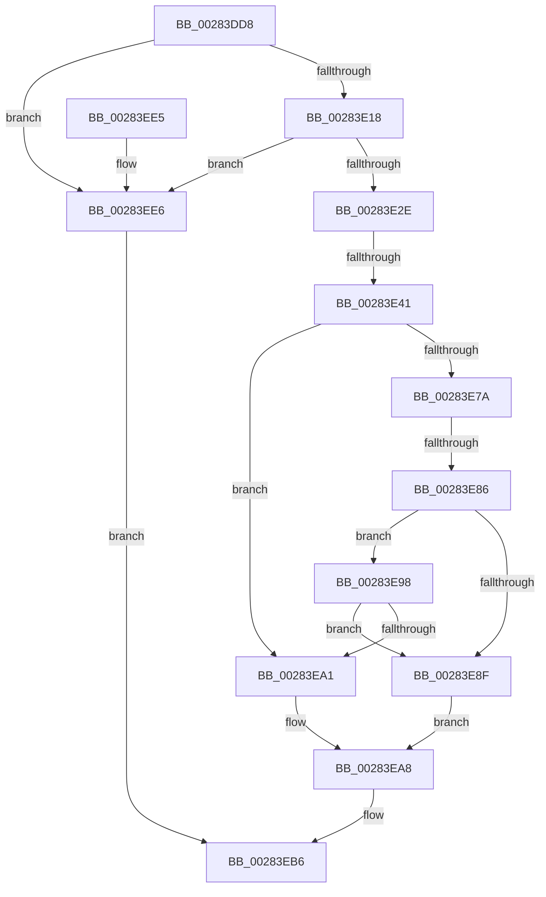

# sub_00283DD8

- RVA: `0x00283DD8`–`0x00283EED` (길이 `277` bytes)
- VA: `0x0000000140283DD8`
- 실행 섹션: `.text`
- PDB 이름 있음: `아니요`; PDB Function 태그: `아니요`
- unwind 정보 RVA: `0x000668DC`
- 디코드: `59`개 명령, `277/277` bytes 표시
- 미해석 바이트: `0` (있으면 어셈블리에 `.byte`로 보존)

> 이 문서는 커널 이미지의 기계어와 PDB 기호를 분석해 생성했습니다. 4번과 5번은 함수 원형과 자료형을 바이너리 사용 방식에서 추정한 C 해석이며 원본 소스 복구 결과는 아닙니다.

## 1. Dependencies

- 직접 호출 지점: **0**; 고유 호출 대상: **0**
- 직접 호출자로 확인된 함수: **0**
- RIP 상대 이미지 참조: **4**

### Outgoing calls
- 직접 디코드된 call 명령이 없습니다.

### Direct callers
- 이 함수 시작 RVA로 연결되는 직접 call은 확인되지 않았습니다. 간접 호출은 완전히 역산할 수 없습니다.

### Static image references
- `0x00283E86` → RVA `0x00E2F380` (`.data`; read)
- `0x00283E8F` → RVA `0x00E2EE84` (`.data`; read)
- `0x00283E98` → RVA `0x00E2F390` (`.data`; read)
- `0x00283EA1` → RVA `0x00E2EE85` (`.data`; read)

## 2. Other-region calls and transfers

- 다른 실행 섹션으로 향하는 call: **0**
- call이 아닌 외부 분기/꼬리 이동: **2**
  - `0x00283E3B` → [sub_00283F59](Unknown_function_00283F59.md) (`tail-transfer`)
  - `0x00283E80` → [sub_00283F59 + 0x48](Unknown_function_00283F59.md) (`tail-transfer`)

## 3. Assembly (complete function range)

```asm
00283DD8  48 89 6C 24 30                  mov qword ptr [rsp + 0x30], rbp
00283DDD  48 BE 00 00 00 00 80 F6 FF FF   movabs rsi, 0xfffff68000000000
00283DE7  48 8B 1C C3                     mov rbx, qword ptr [rbx + rax*8]
00283DEB  48 B8 7F 0E 00 00 00 00 F0 FF   movabs rax, 0xfff0000000000e7f
00283DF5  48 23 D8                        and rbx, rax
00283DF8  48 B8 00 F0 FF FF FF FF 0F 00   movabs rax, 0xffffffffff000
00283E02  48 23 C8                        and rcx, rax
00283E05  48 0B D9                        or rbx, rcx
00283E08  48 83 CB 21                     or rbx, 0x21
00283E0C  48 8B C6                        mov rax, rsi
00283E0F  48 3B F8                        cmp rdi, rax
00283E12  0F 82 CE 00 00 00               jb 0x140283ee6
00283E18  48 BD FF FF FF FF FF F6 FF FF   movabs rbp, 0xfffff6ffffffffff
00283E22  48 8B C5                        mov rax, rbp
00283E25  48 3B F8                        cmp rdi, rax
00283E28  0F 87 B8 00 00 00               ja 0x140283ee6
00283E2E  48 B8 00 00 00 40 FB F6 FF FF   movabs rax, 0xfffff6fb40000000
00283E38  48 3B F8                        cmp rdi, rax
00283E3B  0F 83 18 01 00 00               jae 0x140283f59
00283E41  48 8B C6                        mov rax, rsi
00283E44  48 C1 E0 19                     shl rax, 0x19
00283E48  48 8B CB                        mov rcx, rbx
00283E4B  48 C1 E7 19                     shl rdi, 0x19
00283E4F  48 83 C9 04                     or rcx, 4
00283E53  48 2B F8                        sub rdi, rax
00283E56  48 B8 FF FF FE FF FF 7F 00 00   movabs rax, 0x7ffffffeffff
00283E60  48 C1 FF 10                     sar rdi, 0x10
00283E64  48 3B F8                        cmp rdi, rax
00283E67  48 B8 00 00 00 00 00 80 FF FF   movabs rax, 0xffff800000000000
00283E71  48 0F 47 CB                     cmova rcx, rbx
00283E75  48 3B F8                        cmp rdi, rax
00283E78  72 27                           jb 0x140283ea1
00283E7A  48 8B C6                        mov rax, rsi
00283E7D  48 3B F8                        cmp rdi, rax
00283E80  0F 83 1B 01 00 00               jae 0x140283fa1
00283E86  48 3B 3D F3 B4 BA 00            cmp rdi, qword ptr [rip + 0xbab4f3]
00283E8D  73 09                           jae 0x140283e98
00283E8F  0F B6 05 EE AF BA 00            movzx eax, byte ptr [rip + 0xbaafee]
00283E96  EB 10                           jmp 0x140283ea8
00283E98  48 3B 3D F1 B4 BA 00            cmp rdi, qword ptr [rip + 0xbab4f1]
00283E9F  77 EE                           ja 0x140283e8f
00283EA1  0F B6 05 DD AF BA 00            movzx eax, byte ptr [rip + 0xbaafdd]
00283EA8  48 8B D9                        mov rbx, rcx
00283EAB  48 0F BA EB 08                  bts rbx, 8
00283EB0  85 C0                           test eax, eax
00283EB2  48 0F 44 D9                     cmove rbx, rcx
00283EB6  48 8B 6C 24 30                  mov rbp, qword ptr [rsp + 0x30]
00283EBB  48 B8 FF FF FF FF FF FF FF FA   movabs rax, 0xfaffffffffffffff
00283EC5  48 8B 74 24 40                  mov rsi, qword ptr [rsp + 0x40]
00283ECA  48 23 D8                        and rbx, rax
00283ECD  48 B8 00 00 00 00 00 00 00 0A   movabs rax, 0xa00000000000000
00283ED7  48 0B C3                        or rax, rbx
00283EDA  48 8B 5C 24 38                  mov rbx, qword ptr [rsp + 0x38]
00283EDF  48 83 C4 20                     add rsp, 0x20
00283EE3  5F                              pop rdi
00283EE4  C3                              ret
00283EE5  CC                              int3
00283EE6  48 0F BA EB 08                  bts rbx, 8
00283EEB  EB C9                           jmp 0x140283eb6
```

## 4. C-style interpretation (structured pseudocode)

```c
__int64 __fastcall sub_00283DD8(__int64 a1, __int64 a2, __int64 a3, __int64 a4, __int64 a5, __int64 a6, __int64 a7, __int64 a8)
{
    __int64 result;
    __int64 v_rbx;
    __int64 v_rdi;
    __int64 v_rsp;
    unsigned __int64 v_stack_p30;

    v_stack_p30 = v_rbp;
    v_rbx = (*(unsigned __int64 *)(v_rbx + result * 8)) & (result);
    a1 = (a1) & (result);
    v_rbx = (v_rbx) | (a1);
    v_rbx = (v_rbx) | (33);
    if (v_rdi < v_rsi) goto loc_00283EE6;
    if (v_rdi > v_rbp) goto loc_00283EE6;
    result = (v_rsi) << (25);
    v_rdi = (v_rdi) << (25);
    a1 = (v_rbx) | (4);
    v_rdi = (v_rdi) - (result);
    v_rdi = (v_rdi) >> (16);
    if (v_rdi > result) { a1 = v_rbx; }
    if (v_rdi < result) goto loc_00283EA1;
    if (v_rdi >= (*(unsigned __int64 *)(v_rip + 12236019))) goto loc_00283E98;
loc_00283E8F:
    goto loc_00283EA8;
loc_00283E98:
    if (v_rdi > (*(unsigned __int64 *)(v_rip + 12236017))) goto loc_00283E8F;
loc_00283EA1:
loc_00283EA8:
    if ((unsigned int)(*(unsigned __int8 *)(v_rip + 12234717)) == 0) { a1 = a1; }
loc_00283EB6:
    v_rbx = (a1) & (*(unsigned __int8 *)(v_rip + 12234717));
    result = (*(unsigned __int8 *)(v_rip + 12234717)) | (v_rbx);
    v_rsp = (v_rsp) + (32);
    return result;
loc_00283EE6:
    goto loc_00283EB6;
}
```

## 5. (Beta) C Style

```c
int64_t sub_00283DD8(int64_t Arg1, int64_t Arg2, int64_t Arg3, int64_t Arg4, uint64_t Arg5, int64_t Arg6, int64_t Arg7, int64_t Arg8)
{
    int64_t result;
    int64_t local_rbx;
    int64_t local_rdi;
    int64_t local_rsp;
    uint64_t v_stack_p30;

    v_stack_p30 = local_rbp;
    local_rbx = (*(uint64_t *)(local_rbx + result * 8)) & (result);
    Arg1 = (Arg1) & (result);
    local_rbx = (local_rbx) | (Arg1);
    local_rbx = (local_rbx) | (33);
    if (local_rdi < local_rsi) goto loc_00283EE6;
    if (local_rdi > local_rbp) goto loc_00283EE6;
    result = (local_rsi) << (25);
    local_rdi = (local_rdi) << (25);
    Arg1 = (local_rbx) | (4);
    local_rdi = (local_rdi) - (result);
    local_rdi = (local_rdi) >> (16);
    if (local_rdi > result) { Arg1 = local_rbx; }
    if (local_rdi < result) goto loc_00283EA1;
    if (local_rdi >= (*(uint64_t *)(v_rip + 0xBAB4F3))) goto loc_00283E98;
loc_00283E8F:
    goto loc_00283EA8;
loc_00283E98:
    if (local_rdi > (*(uint64_t *)(v_rip + 0xBAB4F1))) goto loc_00283E8F;
loc_00283EA1:
loc_00283EA8:
    if ((uint32_t)(*(uint8_t *)(v_rip + 0xBAAFDD)) == 0) { Arg1 = Arg1; }
loc_00283EB6:
    local_rbx = (Arg1) & (*(uint8_t *)(v_rip + 0xBAAFDD));
    result = (*(uint8_t *)(v_rip + 0xBAAFDD)) | (local_rbx);
    local_rsp = (local_rsp) + (32);
    return result;
loc_00283EE6:
    goto loc_00283EB6;
}
```

## 6. Execution-region graph

[열기: 2D/3D 그래프와 함수 탐색 컨트롤 패널](../../../control-panel.html?section=text&rva=0x00283DD8&view=graph)

- 2D 그래프는 위에서 아래로 흐르고, 3D 그래프는 빈 공간을 드래그해 회전합니다. Shift+드래그는 이동, 휠은 확대·축소, 함수 노드 선택은 대상 보고서 이동입니다.

### Static fallback


