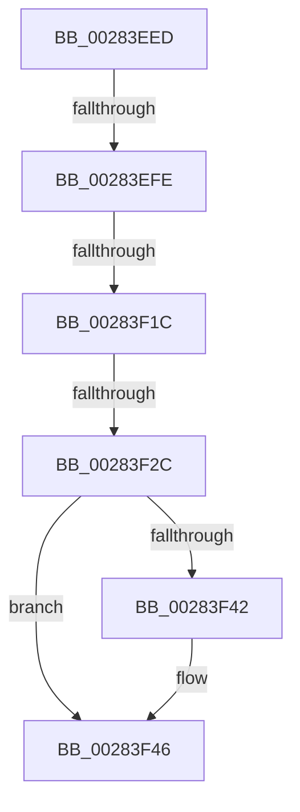

# sub_00283EED

- RVA: `0x00283EED`–`0x00283F59` (길이 `108` bytes)
- VA: `0x0000000140283EED`
- 실행 섹션: `.text`
- PDB 이름 있음: `아니요`; PDB Function 태그: `아니요`
- unwind 정보 RVA: `0x000668F4`
- 디코드: `21`개 명령, `108/108` bytes 표시
- 미해석 바이트: `0` (있으면 어셈블리에 `.byte`로 보존)

> 이 문서는 커널 이미지의 기계어와 PDB 기호를 분석해 생성했습니다. 4번과 5번은 함수 원형과 자료형을 바이너리 사용 방식에서 추정한 C 해석이며 원본 소스 복구 결과는 아닙니다.

## 1. Dependencies

- 직접 호출 지점: **0**; 고유 호출 대상: **0**
- 직접 호출자로 확인된 함수: **0**
- RIP 상대 이미지 참조: **1**

### Outgoing calls
- 직접 디코드된 call 명령이 없습니다.

### Direct callers
- 이 함수 시작 RVA로 연결되는 직접 call은 확인되지 않았습니다. 간접 호출은 완전히 역산할 수 없습니다.

### Static image references
- `0x00283EED` → RVA `0x00FC6A88` (`ALMOSTRO`; read)

## 2. Other-region calls and transfers

- 다른 실행 섹션으로 향하는 call: **0**
- call이 아닌 외부 분기/꼬리 이동: **4**
  - `0x00283EF8` → [MiMakeTransitionPteValid + 0x4E](MiMakeTransitionPteValid_function_00283D60.md) (`tail-transfer`)
  - `0x00283F16` → [MiMakeTransitionPteValid + 0x4E](MiMakeTransitionPteValid_function_00283D60.md) (`tail-transfer`)
  - `0x00283F26` → [MiMakeTransitionPteValid + 0x4E](MiMakeTransitionPteValid_function_00283D60.md) (`tail-transfer`)
  - `0x00283F54` → [MiMakeTransitionPteValid + 0x4E](MiMakeTransitionPteValid_function_00283D60.md) (`tail-transfer`)

## 3. Assembly (complete function range)

```asm
00283EED  48 F7 05 90 2B D4 00 00 00 60 00  test qword ptr [rip + 0xd42b90], 0x600000
00283EF8  0F 84 B0 FE FF FF               je 0x140283dae
00283EFE  65 48 8B 0C 25 88 01 00 00      mov rcx, qword ptr gs:[0x188]
00283F07  4C 8B 81 B8 00 00 00            mov r8, qword ptr [rcx + 0xb8]
00283F0E  41 80 B8 60 01 00 00 01         cmp byte ptr [r8 + 0x160], 1
00283F16  0F 84 92 FE FF FF               je 0x140283dae
00283F1C  4D 8B 88 08 05 00 00            mov r9, qword ptr [r8 + 0x508]
00283F23  4D 85 C9                        test r9, r9
00283F26  0F 84 82 FE FF FF               je 0x140283dae
00283F2C  48 8B CF                        mov rcx, rdi
00283F2F  48 C1 E9 03                     shr rcx, 3
00283F33  81 E1 FF 01 00 00               and ecx, 0x1ff
00283F39  49 8B 0C C9                     mov rcx, qword ptr [r9 + rcx*8]
00283F3D  F6 C1 20                        test cl, 0x20
00283F40  74 04                           je 0x140283f46
00283F42  48 83 CA 20                     or rdx, 0x20
00283F46  48 8B C2                        mov rax, rdx
00283F49  48 83 C8 42                     or rax, 0x42
00283F4D  F6 C1 42                        test cl, 0x42
00283F50  48 0F 44 C2                     cmove rax, rdx
00283F54  E9 55 FE FF FF                  jmp 0x140283dae
```

## 4. C-style interpretation (structured pseudocode)

```c
__int64 __fastcall sub_00283EED(__int64 a1, __int64 a2)
{
    __int64 result;

    a1 = (v_rdi) >> (3);
    a1 = (unsigned int)((a1) & (511));
    if ((((unsigned __int8)(*(unsigned __int64 *)(*(unsigned __int64 *)(*(unsigned __int64 *)(*(unsigned __int64 *)(gs_base + (0 + 392)) + 184) + 1288) + a1 * 8))) & (32)) != 0) {
        a2 = (a2) | (32);
    }
    result = (a2) | (66);
    if ((((unsigned __int8)(*(unsigned __int64 *)(*(unsigned __int64 *)(*(unsigned __int64 *)(*(unsigned __int64 *)(gs_base + (0 + 392)) + 184) + 1288) + a1 * 8))) & (66)) == 0) { result = a2; }
}
```

## 5. (Beta) C Style

```c
int64_t sub_00283EED(int64_t Arg1, int64_t Arg2)
{
    int64_t result;

    Arg1 = (local_rdi) >> (3);
    Arg1 = (uint32_t)((Arg1) & (511));
    if ((((uint8_t)(*(uint64_t *)(*(uint64_t *)(*(uint64_t *)(*(uint64_t *)(gs_base + (0 + 0x188)) + 0xB8) + 0x508) + Arg1 * 8))) & (32)) != 0) {
        Arg2 = (Arg2) | (32);
    }
    result = (Arg2) | (66);
    if ((((uint8_t)(*(uint64_t *)(*(uint64_t *)(*(uint64_t *)(*(uint64_t *)(gs_base + (0 + 0x188)) + 0xB8) + 0x508) + Arg1 * 8))) & (66)) == 0) { result = Arg2; }
}
```

## 6. Execution-region graph

[열기: 2D/3D 그래프와 함수 탐색 컨트롤 패널](../../../control-panel.html?section=text&rva=0x00283EED&view=graph)

- 2D 그래프는 위에서 아래로 흐르고, 3D 그래프는 빈 공간을 드래그해 회전합니다. Shift+드래그는 이동, 휠은 확대·축소, 함수 노드 선택은 대상 보고서 이동입니다.

### Static fallback


