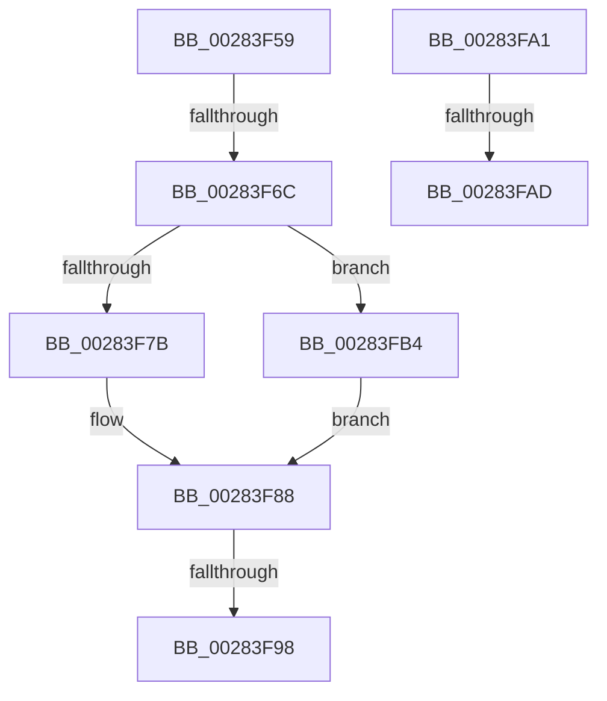

# sub_00283F59

- RVA: `0x00283F59`–`0x00283FC3` (길이 `106` bytes)
- VA: `0x0000000140283F59`
- 실행 섹션: `.text`
- PDB 이름 있음: `아니요`; PDB Function 태그: `아니요`
- unwind 정보 RVA: `0x00066904`
- 디코드: `22`개 명령, `106/106` bytes 표시
- 미해석 바이트: `0` (있으면 어셈블리에 `.byte`로 보존)

> 이 문서는 커널 이미지의 기계어와 PDB 기호를 분석해 생성했습니다. 4번과 5번은 함수 원형과 자료형을 바이너리 사용 방식에서 추정한 C 해석이며 원본 소스 복구 결과는 아닙니다.

## 1. Dependencies

- 직접 호출 지점: **1**; 고유 호출 대상: **1**
- 직접 호출자로 확인된 함수: **0**
- RIP 상대 이미지 참조: **0**

### Outgoing calls
- `0x00283F8B` → [MiUserPdeOrAbove](../2C/MiUserPdeOrAbove_function_002C57F0.md) (function, `0x002C57F0`)

### Direct callers
- 이 함수 시작 RVA로 연결되는 직접 call은 확인되지 않았습니다. 간접 호출은 완전히 역산할 수 없습니다.

### Static image references
- 디코드된 RIP-relative 메모리 참조가 없습니다.

## 2. Other-region calls and transfers

- 다른 실행 섹션으로 향하는 call: **0**
- call이 아닌 외부 분기/꼬리 이동: **5**
  - `0x00283F66` → [sub_00283DD8 + 0x69](Unknown_function_00283DD8.md) (`tail-transfer`)
  - `0x00283F92` → [sub_00283DD8 + 0x69](Unknown_function_00283DD8.md) (`tail-transfer`)
  - `0x00283F9C` → [sub_00283DD8 + 0x69](Unknown_function_00283DD8.md) (`tail-transfer`)
  - `0x00283FA7` → [sub_00283DD8 + 0xAE](Unknown_function_00283DD8.md) (`tail-transfer`)
  - `0x00283FAF` → [sub_00283DD8 + 0xD0](Unknown_function_00283DD8.md) (`tail-transfer`)

## 3. Assembly (complete function range)

```asm
00283F59  48 B8 FF FF FF 7F FB F6 FF FF   movabs rax, 0xfffff6fb7fffffff
00283F63  48 3B F8                        cmp rdi, rax
00283F66  0F 87 D5 FE FF FF               ja 0x140283e41
00283F6C  48 B8 68 DF BE 7D FB F6 FF FF   movabs rax, 0xfffff6fb7dbedf68
00283F76  48 3B F8                        cmp rdi, rax
00283F79  74 39                           je 0x140283fb4
00283F7B  48 B8 FF FF FF FF FF FF FF 7F   movabs rax, 0x7fffffffffffffff
00283F85  48 23 D8                        and rbx, rax
00283F88  48 8B CF                        mov rcx, rdi
00283F8B  E8 60 18 04 00                  call 0x1402c57f0
00283F90  85 C0                           test eax, eax
00283F92  0F 84 A9 FE FF FF               je 0x140283e41
00283F98  48 83 CB 04                     or rbx, 4
00283F9C  E9 A0 FE FF FF                  jmp 0x140283e41
00283FA1  48 8B C5                        mov rax, rbp
00283FA4  48 3B F8                        cmp rdi, rax
00283FA7  0F 87 D9 FE FF FF               ja 0x140283e86
00283FAD  33 C0                           xor eax, eax
00283FAF  E9 F4 FE FF FF                  jmp 0x140283ea8
00283FB4  48 B8 00 00 00 00 00 00 00 80   movabs rax, 0x8000000000000000
00283FBE  48 0B D8                        or rbx, rax
00283FC1  EB C5                           jmp 0x140283f88
```

## 4. C-style interpretation (structured pseudocode)

```c
__int64 __fastcall sub_00283F59(void)
{
    __int64 result;
    __int64 v_rbx;

    if (v_rdi == result) goto loc_00283FB4;
    v_rbx = (v_rbx) & (result);
loc_00283F88:
    result = MiUserPdeOrAbove(v_rdi, a2, a3, a4);
    v_rbx = (v_rbx) | (4);
loc_00283FB4:
    v_rbx = (v_rbx) | (result);
    goto loc_00283F88;
}
```

## 5. (Beta) C Style

```c
void sub_00283F59(void)
{
    int64_t result;
    int64_t local_rbx;

    if (local_rdi == result) goto loc_00283FB4;
    local_rbx = (local_rbx) & (result);
loc_00283F88:
    result = MiUserPdeOrAbove(local_rdi, a2, a3, a4);
    local_rbx = (local_rbx) | (4);
loc_00283FB4:
    local_rbx = (local_rbx) | (result);
    goto loc_00283F88;
}
```

## 6. Execution-region graph

[열기: 2D/3D 그래프와 함수 탐색 컨트롤 패널](../../../control-panel.html?section=text&rva=0x00283F59&view=graph)

- 2D 그래프는 위에서 아래로 흐르고, 3D 그래프는 빈 공간을 드래그해 회전합니다. Shift+드래그는 이동, 휠은 확대·축소, 함수 노드 선택은 대상 보고서 이동입니다.

### Static fallback


