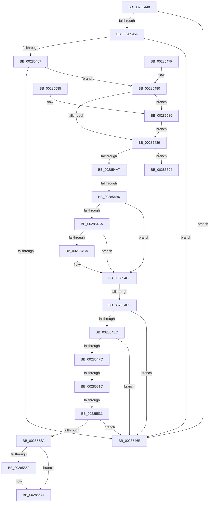

# sub_00285448

- RVA: `0x00285448`–`0x0028559F` (길이 `343` bytes)
- VA: `0x0000000140285448`
- 실행 섹션: `.text`
- PDB 이름 있음: `아니요`; PDB Function 태그: `아니요`
- unwind 정보 RVA: `0x00066974`
- 디코드: `92`개 명령, `343/343` bytes 표시
- 미해석 바이트: `0` (있으면 어셈블리에 `.byte`로 보존)

> 이 문서는 커널 이미지의 기계어와 PDB 기호를 분석해 생성했습니다. 4번과 5번은 함수 원형과 자료형을 바이너리 사용 방식에서 추정한 C 해석이며 원본 소스 복구 결과는 아닙니다.

## 1. Dependencies

- 직접 호출 지점: **0**; 고유 호출 대상: **0**
- 직접 호출자로 확인된 함수: **0**
- RIP 상대 이미지 참조: **2**

### Outgoing calls
- 직접 디코드된 call 명령이 없습니다.

### Direct callers
- 이 함수 시작 RVA로 연결되는 직접 call은 확인되지 않았습니다. 간접 호출은 완전히 역산할 수 없습니다.

### Static image references
- `0x002854B6` → RVA `0x00E2DC80` (`.data`; read)
- `0x00285520` → RVA `0x00FC6A88` (`ALMOSTRO`; read)

## 2. Other-region calls and transfers

- 다른 실행 섹션으로 향하는 call: **0**
- call이 아닌 외부 분기/꼬리 이동: **4**
  - `0x002854B0` → [sub_00285769](Unknown_function_00285769.md) (`tail-transfer`)
  - `0x002854DD` → [sub_00285769 + 0x26](Unknown_function_00285769.md) (`tail-transfer`)
  - `0x00285516` → [sub_002856D5](Unknown_function_002856D5.md) (`tail-transfer`)
  - `0x0028552B` → [sub_002856D5 + 0x25](Unknown_function_002856D5.md) (`tail-transfer`)

## 3. Assembly (complete function range)

```asm
00285448  48 89 6C 24 50                  mov qword ptr [rsp + 0x50], rbp
0028544D  48 0F BA E0 0C                  bt rax, 0xc
00285452  73 1A                           jae 0x14028546e
00285454  48 8B 51 28                     mov rdx, qword ptr [rcx + 0x28]
00285458  48 8B CA                        mov rcx, rdx
0028545B  48 C1 E9 3C                     shr rcx, 0x3c
0028545F  80 E1 07                        and cl, 7
00285462  80 F9 03                        cmp cl, 3
00285465  75 07                           jne 0x14028546e
00285467  48 0F BA E2 35                  bt rdx, 0x35
0028546C  73 12                           jae 0x140285480
0028546E  33 C0                           xor eax, eax
00285470  48 8B 6C 24 50                  mov rbp, qword ptr [rsp + 0x50]
00285475  48 83 C4 28                     add rsp, 0x28
00285479  41 5D                           pop r13
0028547B  5F                              pop rdi
0028547C  5E                              pop rsi
0028547D  5B                              pop rbx
0028547E  C3                              ret
0028547F  CC                              int3
00285480  48 85 DB                        test rbx, rbx
00285483  0F 85 FD 00 00 00               jne 0x140285586
00285489  48 8B 6F 08                     mov rbp, qword ptr [rdi + 8]
0028548D  48 B8 00 00 00 00 00 00 00 80   movabs rax, 0x8000000000000000
00285497  48 0B E8                        or rbp, rax
0028549A  48 8B 47 28                     mov rax, qword ptr [rdi + 0x28]
0028549E  48 85 C0                        test rax, rax
002854A1  0F 89 ED 00 00 00               jns 0x140285594
002854A7  4C 8B 47 10                     mov r8, qword ptr [rdi + 0x10]
002854AB  49 0F BA E0 0A                  bt r8, 0xa
002854B0  0F 83 B3 02 00 00               jae 0x140285769
002854B6  48 8B 05 C3 87 BA 00            mov rax, qword ptr [rip + 0xba87c3]
002854BD  49 8B D0                        mov rdx, r8
002854C0  48 85 C0                        test rax, rax
002854C3  74 0B                           je 0x1402854d0
002854C5  F6 C2 10                        test dl, 0x10
002854C8  75 06                           jne 0x1402854d0
002854CA  48 F7 D0                        not rax
002854CD  48 23 D0                        and rdx, rax
002854D0  48 C1 FA 10                     sar rdx, 0x10
002854D4  4C 8B 0A                        mov r9, qword ptr [rdx]
002854D7  41 8B 41 38                     mov eax, dword ptr [r9 + 0x38]
002854DB  A8 20                           test al, 0x20
002854DD  0F 84 AC 02 00 00               je 0x14028578f
002854E3  48 8B 4A 08                     mov rcx, qword ptr [rdx + 8]
002854E7  48 3B E9                        cmp rbp, rcx
002854EA  72 82                           jb 0x14028546e
002854EC  8B 42 2C                        mov eax, dword ptr [rdx + 0x2c]
002854EF  48 8D 0C C1                     lea rcx, [rcx + rax*8]
002854F3  48 3B E9                        cmp rbp, rcx
002854F6  0F 83 72 FF FF FF               jae 0x14028546e
002854FC  41 8B 41 5C                     mov eax, dword ptr [r9 + 0x5c]
00285500  44 8B D0                        mov r10d, eax
00285503  41 81 E2 00 00 0C 00            and r10d, 0xc0000
0028550A  0F 95 C1                        setne cl
0028550D  0F BA E0 11                     bt eax, 0x11
00285511  0F 92 C0                        setb al
00285514  84 C8                           test al, cl
00285516  0F 85 B9 01 00 00               jne 0x1402856d5
0028551C  49 C1 E8 05                     shr r8, 5
00285520  48 F7 05 5D 15 D4 00 00 00 02 00  test qword ptr [rip + 0xd4155d], 0x20000
0028552B  0F 85 C9 01 00 00               jne 0x1402856fa
00285531  45 85 D2                        test r10d, r10d
00285534  0F 84 34 FF FF FF               je 0x14028546e
0028553A  BA 0B 00 00 00                  mov edx, 0xb
0028553F  41 F6 C0 02                     test r8b, 2
00285543  B8 08 00 00 00                  mov eax, 8
00285548  0F 45 C2                        cmovne eax, edx
0028554B  8B D0                           mov edx, eax
0028554D  48 85 DB                        test rbx, rbx
00285550  74 22                           je 0x140285574
00285552  49 8B 49 60                     mov rcx, qword ptr [r9 + 0x60]
00285556  48 83 E1 F8                     and rcx, 0xfffffffffffffff8
0028555A  48 8B 49 40                     mov rcx, qword ptr [rcx + 0x40]
0028555E  48 89 4B 08                     mov qword ptr [rbx + 8], rcx
00285562  49 2B A9 88 00 00 00            sub rbp, qword ptr [r9 + 0x88]
00285569  48 C1 FD 03                     sar rbp, 3
0028556D  48 C1 E5 0C                     shl rbp, 0xc
00285571  48 89 2B                        mov qword ptr [rbx], rbp
00285574  8B C2                           mov eax, edx
00285576  48 8B 6C 24 50                  mov rbp, qword ptr [rsp + 0x50]
0028557B  48 83 C4 28                     add rsp, 0x28
0028557F  41 5D                           pop r13
00285581  5F                              pop rdi
00285582  5E                              pop rsi
00285583  5B                              pop rbx
00285584  C3                              ret
00285585  CC                              int3
00285586  48 0F BA E0 0E                  bt rax, 0xe
0028558B  49 0F 43 DD                     cmovae rbx, r13
0028558F  E9 F5 FE FF FF                  jmp 0x140285489
00285594  48 F7 05 E9 14 D4 00 00 00 02 00  test qword ptr [rip + 0xd414e9], 0x20000
```

## 4. C-style interpretation (structured pseudocode)

```c
__int64 __fastcall sub_00285448(__int64 a1, __int64 a2, __int64 a3, __int64 a4, __int64 a5, __int64 a6, __int64 a7, __int64 a8, __int64 a9, __int64 a10)
{
    __int64 result;
    __int64 v_r10;
    __int64 v_rbp;
    __int64 v_rbx;
    __int64 v_rsp;
    unsigned __int64 v_stack_p50;

    v_stack_p50 = v_rbp;
    if (condition_is_above_or_equal) goto loc_0028546E;
    a1 = (*(unsigned __int64 *)(a1 + 40)) >> (60);
    a1 = (unsigned __int8)((a1) & (7));
    if (((unsigned __int8)(a1)) != 3) goto loc_0028546E;
    if (((unsigned __int8)(a1)) >= 3) goto loc_00285480;
loc_0028546E:
    result = 0;
    v_rsp = (v_rsp) + (40);
    return result;
loc_00285480:
    if (v_rbx != 0) goto loc_00285586;
loc_00285489:
    v_rbp = (*(unsigned __int64 *)(v_rdi + 8)) | (0);
    if (!sign_flag) goto loc_00285594;
    if (*(unsigned __int64 *)(v_rip + 12224451) == 0) goto loc_002854D0;
    result = *(unsigned __int64 *)(v_rip + 12224451);
    if ((((unsigned __int8)(*(unsigned __int64 *)(v_rdi + 16))) & (16)) == 0) {
        result = ~(*(unsigned __int64 *)(v_rip + 12224451));
        a2 = (*(unsigned __int64 *)(v_rdi + 16)) & (result);
    }
    a2 = (a2) >> (16);
    if (v_rbp < (*(unsigned __int64 *)(a2 + 8))) goto loc_0028546E;
    if (v_rbp >= (*(unsigned __int64 *)(a2 + 8) + (unsigned int)(*(unsigned int *)(a2 + 44)) * 8)) goto loc_0028546E;
    v_r10 = (unsigned int)(((unsigned int)((unsigned int)((unsigned int)(*(unsigned int *)(*(unsigned __int64 *)(a2) + 92))))) & (0xC0000ULL));
    a1 = (condition_is_not_equal) ? 1 : 0;
    result = (condition_is_below) ? 1 : 0;
    a3 = (*(unsigned __int64 *)(v_rdi + 16)) >> (5);
    if ((unsigned int)(v_r10) == 0) goto loc_0028546E;
    result = 8;
    if ((((unsigned __int8)(a3)) & (2)) != 0) { result = 11; }
    if (v_rbx != 0) {
        a1 = *(unsigned __int64 *)(*(unsigned __int64 *)(a2) + 96);
        a1 = (a1) & (-8);
        a1 = *(unsigned __int64 *)(a1 + 64);
        *(unsigned __int64 *)(v_rbx + 8) = a1;
        v_rbp = (v_rbp) - (*(unsigned __int64 *)(*(unsigned __int64 *)(a2) + 136));
        v_rbp = (v_rbp) >> (3);
        v_rbp = (v_rbp) << (12);
        *(unsigned __int64 *)(v_rbx) = v_rbp;
    }
    v_rsp = (v_rsp) + (40);
    return (unsigned int)((unsigned int)((unsigned int)((unsigned int)(result))));
loc_00285586:
    if (condition_is_above_or_equal) { v_rbx = v_r13; }
    goto loc_00285489;
loc_00285594:
    return (unsigned int)((unsigned int)((unsigned int)((unsigned int)(result))));
}
```

## 5. (Beta) C Style

```c
int64_t sub_00285448(void *Arg1, int64_t Arg2, int64_t Arg3, int64_t Arg4, uint64_t Arg5, uint64_t Arg6, uint64_t Arg7, uint64_t Arg8, uint64_t Arg9, int64_t Arg10)
{
    uint8_t *arg1 = (uint8_t *)Arg1;

    int64_t result;
    int64_t local_r10;
    int64_t local_rbp;
    int64_t local_rbx;
    int64_t local_rsp;
    uint64_t v_stack_p50;

    v_stack_p50 = local_rbp;
    if (condition_is_above_or_equal) goto loc_0028546E;
    Arg1 = (*(uint64_t *)(arg1 + 0x28)) >> (60);
    Arg1 = (uint8_t)((Arg1) & (7));
    if (((uint8_t)(Arg1)) != 3) goto loc_0028546E;
    if (((uint8_t)(Arg1)) >= 3) goto loc_00285480;
loc_0028546E:
    result = 0;
    local_rsp = (local_rsp) + (40);
    return result;
loc_00285480:
    if (local_rbx != 0) goto loc_00285586;
loc_00285489:
    local_rbp = (*(uint64_t *)(local_rdi + 0x8)) | (0);
    if (!sign_flag) goto loc_00285594;
    if (*(uint64_t *)(v_rip + 0xBA87C3) == 0) goto loc_002854D0;
    result = *(uint64_t *)(v_rip + 0xBA87C3);
    if ((((uint8_t)(*(uint64_t *)(local_rdi + 0x10))) & (16)) == 0) {
        result = ~(*(uint64_t *)(v_rip + 0xBA87C3));
        Arg2 = (*(uint64_t *)(local_rdi + 0x10)) & (result);
    }
    Arg2 = (Arg2) >> (16);
    if (local_rbp < (*(uint64_t *)(Arg2 + 0x8))) goto loc_0028546E;
    if (local_rbp >= (*(uint64_t *)(Arg2 + 0x8) + (uint32_t)(*(uint32_t *)(Arg2 + 0x2C)) * 8)) goto loc_0028546E;
    local_r10 = (uint32_t)(((uint32_t)((uint32_t)((uint32_t)(*(uint32_t *)(*(uint64_t *)(Arg2) + 0x5C))))) & (0xC0000ULL));
    Arg1 = (condition_is_not_equal) ? 1 : 0;
    result = (condition_is_below) ? 1 : 0;
    Arg3 = (*(uint64_t *)(local_rdi + 0x10)) >> (5);
    if ((uint32_t)(local_r10) == 0) goto loc_0028546E;
    result = 8;
    if ((((uint8_t)(Arg3)) & (2)) != 0) { result = 11; }
    if (local_rbx != 0) {
        Arg1 = *(uint64_t *)(*(uint64_t *)(Arg2) + 0x60);
        Arg1 = (Arg1) & (-8);
        Arg1 = *(uint64_t *)(arg1 + 0x40);
        *(void **)(local_rbx + 0x8) = Arg1;
        local_rbp = (local_rbp) - (*(uint64_t *)(*(uint64_t *)(Arg2) + 0x88));
        local_rbp = (local_rbp) >> (3);
        local_rbp = (local_rbp) << (12);
        *(uint64_t *)(local_rbx) = local_rbp;
    }
    local_rsp = (local_rsp) + (40);
    return (uint32_t)((uint32_t)((uint32_t)((uint32_t)(result))));
loc_00285586:
    if (condition_is_above_or_equal) { local_rbx = local_r13; }
    goto loc_00285489;
loc_00285594:
    return (uint32_t)((uint32_t)((uint32_t)((uint32_t)(result))));
}
```

### 관측된 메모리 오프셋

구조체 형식이 확인되지 않은 접근은 인자 기준의 오프셋으로만 기록했습니다.

| 기준 인자 | 오프셋 표현 | 폭 (bit) | 접근 |
|---|---:|---:|---|
| `Arg1` | `+ 0x28` | `64` | `R` |

## 6. Execution-region graph

[열기: 2D/3D 그래프와 함수 탐색 컨트롤 패널](../../../control-panel.html?section=text&rva=0x00285448&view=graph)

- 2D 그래프는 위에서 아래로 흐르고, 3D 그래프는 빈 공간을 드래그해 회전합니다. Shift+드래그는 이동, 휠은 확대·축소, 함수 노드 선택은 대상 보고서 이동입니다.

### Static fallback


