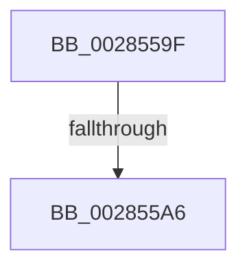

# sub_0028559F

- RVA: `0x0028559F`–`0x002855F5` (길이 `86` bytes)
- VA: `0x000000014028559F`
- 실행 섹션: `.text`
- PDB 이름 있음: `아니요`; PDB Function 태그: `아니요`
- unwind 정보 RVA: `0x00066990`
- 디코드: `22`개 명령, `86/86` bytes 표시
- 미해석 바이트: `0` (있으면 어셈블리에 `.byte`로 보존)

> 이 문서는 커널 이미지의 기계어와 PDB 기호를 분석해 생성했습니다. 4번과 5번은 함수 원형과 자료형을 바이너리 사용 방식에서 추정한 C 해석이며 원본 소스 복구 결과는 아닙니다.

## 1. Dependencies

- 직접 호출 지점: **0**; 고유 호출 대상: **0**
- 직접 호출자로 확인된 함수: **0**
- RIP 상대 이미지 참조: **0**

### Outgoing calls
- 직접 디코드된 call 명령이 없습니다.

### Direct callers
- 이 함수 시작 RVA로 연결되는 직접 call은 확인되지 않았습니다. 간접 호출은 완전히 역산할 수 없습니다.

### Static image references
- 디코드된 RIP-relative 메모리 참조가 없습니다.

## 2. Other-region calls and transfers

- 다른 실행 섹션으로 향하는 call: **0**
- call이 아닌 외부 분기/꼬리 이동: **1**
  - `0x002855A4` → [sub_002855F6](Unknown_function_002855F6.md) (`tail-transfer`)

## 3. Assembly (complete function range)

```asm
0028559F  4C 89 74 24 68                  mov qword ptr [rsp + 0x68], r14
002855A4  74 50                           je 0x1402855f6
002855A6  48 C1 E5 19                     shl rbp, 0x19
002855AA  48 B8 00 00 00 00 80 F6 FF FF   movabs rax, 0xfffff68000000000
002855B4  48 8B C0                        mov rax, rax
002855B7  48 C1 E0 19                     shl rax, 0x19
002855BB  BA 02 00 00 00                  mov edx, 2
002855C0  48 2B E8                        sub rbp, rax
002855C3  41 BE 11 00 00 00               mov r14d, 0x11
002855C9  48 C1 FD 10                     sar rbp, 0x10
002855CD  48 B8 00 00 00 00 00 80 FF FF   movabs rax, 0xffff800000000000
002855D7  48 3B E8                        cmp rbp, rax
002855DA  44 0F 42 F2                     cmovb r14d, edx
002855DE  41 8B C6                        mov eax, r14d
002855E1  4C 8B 74 24 68                  mov r14, qword ptr [rsp + 0x68]
002855E6  48 8B 6C 24 50                  mov rbp, qword ptr [rsp + 0x50]
002855EB  48 83 C4 28                     add rsp, 0x28
002855EF  41 5D                           pop r13
002855F1  5F                              pop rdi
002855F2  5E                              pop rsi
002855F3  5B                              pop rbx
002855F4  C3                              ret
```

## 4. C-style interpretation (structured pseudocode)

```c
__int64 __fastcall sub_0028559F(__int64 a1, __int64 a2, __int64 a3, __int64 a4, __int64 a5, __int64 a6, __int64 a7, __int64 a8, __int64 a9, __int64 a10, __int64 a11, __int64 a12, __int64 a13)
{
    __int64 result;
    __int64 v_r14;
    __int64 v_rbp;
    __int64 v_rsp;
    unsigned __int64 v_stack_p68;

    v_stack_p68 = v_r14;
    v_rbp = (v_rbp) << (25);
    result = (result) << (25);
    v_rbp = (v_rbp) - (result);
    v_rbp = (v_rbp) >> (16);
    v_r14 = 17;
    if (v_rbp < result) { v_r14 = 2; }
    v_rsp = (v_rsp) + (40);
    return (unsigned int)((unsigned int)(v_r14));
}
```

## 5. (Beta) C Style

```c
int64_t sub_0028559F(int64_t Arg1, int64_t Arg2, int64_t Arg3, int64_t Arg4, uint64_t Arg5, uint64_t Arg6, uint64_t Arg7, uint64_t Arg8, uint64_t Arg9, int64_t Arg10, uint64_t Arg11, uint64_t Arg12, int64_t Arg13)
{
    int64_t result;
    int64_t local_r14;
    int64_t local_rbp;
    int64_t local_rsp;
    uint64_t v_stack_p68;

    v_stack_p68 = local_r14;
    local_rbp = (local_rbp) << (25);
    result = (result) << (25);
    local_rbp = (local_rbp) - (result);
    local_rbp = (local_rbp) >> (16);
    local_r14 = 17;
    if (local_rbp < result) { local_r14 = 2; }
    local_rsp = (local_rsp) + (40);
    return (uint32_t)((uint32_t)(local_r14));
}
```

## 6. Execution-region graph

[열기: 2D/3D 그래프와 함수 탐색 컨트롤 패널](../../../control-panel.html?section=text&rva=0x0028559F&view=graph)

- 2D 그래프는 위에서 아래로 흐르고, 3D 그래프는 빈 공간을 드래그해 회전합니다. Shift+드래그는 이동, 휠은 확대·축소, 함수 노드 선택은 대상 보고서 이동입니다.

### Static fallback


