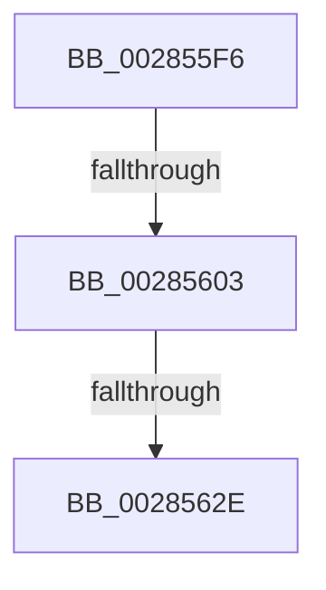

# sub_002855F6

- RVA: `0x002855F6`–`0x00285639` (길이 `67` bytes)
- VA: `0x00000001402855F6`
- 실행 섹션: `.text`
- PDB 이름 있음: `아니요`; PDB Function 태그: `아니요`
- unwind 정보 RVA: `0x000669B8`
- 디코드: `15`개 명령, `67/67` bytes 표시
- 미해석 바이트: `0` (있으면 어셈블리에 `.byte`로 보존)

> 이 문서는 커널 이미지의 기계어와 PDB 기호를 분석해 생성했습니다. 4번과 5번은 함수 원형과 자료형을 바이너리 사용 방식에서 추정한 C 해석이며 원본 소스 복구 결과는 아닙니다.

## 1. Dependencies

- 직접 호출 지점: **0**; 고유 호출 대상: **0**
- 직접 호출자로 확인된 함수: **0**
- RIP 상대 이미지 참조: **0**

### Outgoing calls
- 직접 디코드된 call 명령이 없습니다.

### Direct callers
- 이 함수 시작 RVA로 연결되는 직접 call은 확인되지 않았습니다. 간접 호출은 완전히 역산할 수 없습니다.

### Static image references
- 디코드된 RIP-relative 메모리 참조가 없습니다.

## 2. Other-region calls and transfers

- 다른 실행 섹션으로 향하는 call: **0**
- call이 아닌 외부 분기/꼬리 이동: **3**
  - `0x002855FD` → [sub_00285729](Unknown_function_00285729.md) (`tail-transfer`)
  - `0x0028562C` → [sub_002856A9](Unknown_function_002856A9.md) (`tail-transfer`)
  - `0x00285637` → [sub_0028559F + 0x3F](Unknown_function_0028559F.md) (`tail-transfer`)

## 3. Assembly (complete function range)

```asm
002855F6  48 8B 47 08                     mov rax, qword ptr [rdi + 8]
002855FA  48 85 C0                        test rax, rax
002855FD  0F 84 26 01 00 00               je 0x140285729
00285603  48 C1 E5 19                     shl rbp, 0x19
00285607  48 B8 00 00 00 00 80 F6 FF FF   movabs rax, 0xfffff68000000000
00285611  48 8B C0                        mov rax, rax
00285614  48 C1 E0 19                     shl rax, 0x19
00285618  48 2B E8                        sub rbp, rax
0028561B  48 B8 00 00 00 00 00 80 FF FF   movabs rax, 0xffff800000000000
00285625  48 C1 FD 10                     sar rbp, 0x10
00285629  48 3B E8                        cmp rbp, rax
0028562C  73 7B                           jae 0x1402856a9
0028562E  41 BE 14 00 00 00               mov r14d, 0x14
00285634  48 85 DB                        test rbx, rbx
00285637  74 A5                           je 0x1402855de
```

## 4. C-style interpretation (structured pseudocode)

```c
__int64 __fastcall sub_002855F6(void)
{
    __int64 result;
    __int64 v_rbp;

    v_rbp = (v_rbp) << (25);
    result = (*(unsigned __int64 *)(v_rdi + 8)) << (25);
    v_rbp = (v_rbp) - (result);
    v_rbp = (v_rbp) >> (16);
}
```

## 5. (Beta) C Style

```c
void sub_002855F6(void)
{
    int64_t result;
    int64_t local_rbp;

    local_rbp = (local_rbp) << (25);
    result = (*(uint64_t *)(local_rdi + 0x8)) << (25);
    local_rbp = (local_rbp) - (result);
    local_rbp = (local_rbp) >> (16);
}
```

## 6. Execution-region graph

[열기: 2D/3D 그래프와 함수 탐색 컨트롤 패널](../../../control-panel.html?section=text&rva=0x002855F6&view=graph)

- 2D 그래프는 위에서 아래로 흐르고, 3D 그래프는 빈 공간을 드래그해 회전합니다. Shift+드래그는 이동, 휠은 확대·축소, 함수 노드 선택은 대상 보고서 이동입니다.

### Static fallback


