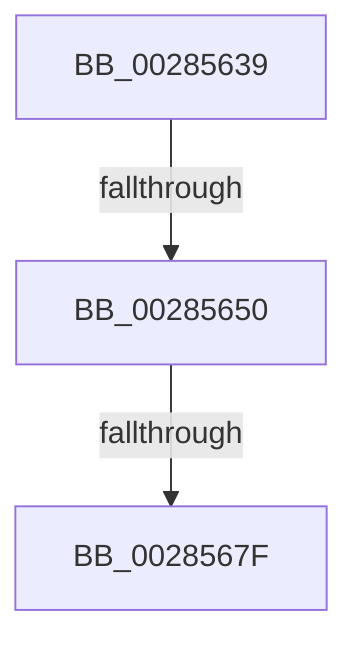

# sub_00285639

- RVA: `0x00285639`–`0x00285691` (길이 `88` bytes)
- VA: `0x0000000140285639`
- 실행 섹션: `.text`
- PDB 이름 있음: `아니요`; PDB Function 태그: `아니요`
- unwind 정보 RVA: `0x000669CC`
- 디코드: `18`개 명령, `88/88` bytes 표시
- 미해석 바이트: `0` (있으면 어셈블리에 `.byte`로 보존)

> 이 문서는 커널 이미지의 기계어와 PDB 기호를 분석해 생성했습니다. 4번과 5번은 함수 원형과 자료형을 바이너리 사용 방식에서 추정한 C 해석이며 원본 소스 복구 결과는 아닙니다.

## 1. Dependencies

- 직접 호출 지점: **2**; 고유 호출 대상: **2**
- 직접 호출자로 확인된 함수: **0**
- RIP 상대 이미지 참조: **0**

### Outgoing calls
- `0x00285653` → [MiGetTopLevelPfn](../2B/MiGetTopLevelPfn_function_002B44E0.md) (function, `0x002B44E0`)
- `0x0028565E` → [MiGetPageTablePfnBuddyRaw](../2B/MiGetPageTablePfnBuddyRaw_function_002B4470.md) (function, `0x002B4470`)

### Direct callers
- 이 함수 시작 RVA로 연결되는 직접 call은 확인되지 않았습니다. 간접 호출은 완전히 역산할 수 없습니다.

### Static image references
- 디코드된 RIP-relative 메모리 참조가 없습니다.

## 2. Other-region calls and transfers

- 다른 실행 섹션으로 향하는 call: **0**
- call이 아닌 외부 분기/꼬리 이동: **3**
  - `0x0028564A` → [sub_00285744](Unknown_function_00285744.md) (`tail-transfer`)
  - `0x00285679` → [sub_00285744 + 0x14](Unknown_function_00285744.md) (`tail-transfer`)
  - `0x0028568B` → [sub_00285721](Unknown_function_00285721.md) (`tail-transfer`)

## 3. Assembly (complete function range)

```asm
00285639  4C 89 64 24 60                  mov qword ptr [rsp + 0x60], r12
0028563E  41 B4 11                        mov r12b, 0x11
00285641  4C 89 7C 24 20                  mov qword ptr [rsp + 0x20], r15
00285646  40 F6 C6 01                     test sil, 1
0028564A  0F 84 F4 00 00 00               je 0x140285744
00285650  48 8B CF                        mov rcx, rdi
00285653  E8 88 EE 02 00                  call 0x1402b44e0
00285658  48 8B C8                        mov rcx, rax
0028565B  4C 8B C0                        mov r8, rax
0028565E  E8 0D EE 02 00                  call 0x1402b4470
00285663  4C 8B F8                        mov r15, rax
00285666  48 B8 FF FF FF FF FF FF FF 7F   movabs rax, 0x7fffffffffffffff
00285670  F0 49 21 40 18                  lock and qword ptr [r8 + 0x18], rax
00285675  40 F6 C6 05                     test sil, 5
00285679  0F 84 D9 00 00 00               je 0x140285758
0028567F  4C 8B 64 24 60                  mov r12, qword ptr [rsp + 0x60]
00285684  4D 39 AF 70 01 00 00            cmp qword ptr [r15 + 0x170], r13
0028568B  0F 84 90 00 00 00               je 0x140285721
```

## 4. C-style interpretation (structured pseudocode)

```c
__int64 __fastcall sub_00285639(__int64 a1, __int64 a2, __int64 a3, __int64 a4, __int64 a5, __int64 a6, __int64 a7, __int64 a8, __int64 a9, __int64 a10, __int64 a11, __int64 a12)
{
    __int64 result;
    unsigned __int64 v_stack_p20;
    unsigned __int64 v_stack_p60;

    v_stack_p60 = v_r12;
    v_stack_p20 = v_r15;
    result = MiGetTopLevelPfn(v_rdi, a2, a3, a4);
    result = MiGetPageTablePfnBuddyRaw(result, a2, result, a4);
}
```

## 5. (Beta) C Style

```c
int64_t sub_00285639(int64_t Arg1, int64_t Arg2, int64_t Arg3, int64_t Arg4, uint64_t Arg5, uint64_t Arg6, uint64_t Arg7, uint64_t Arg8, uint64_t Arg9, uint64_t Arg10, uint64_t Arg11, int64_t Arg12)
{
    int64_t result;
    uint64_t v_stack_p20;
    uint64_t v_stack_p60;

    v_stack_p60 = local_r12;
    v_stack_p20 = local_r15;
    result = MiGetTopLevelPfn(local_rdi, Arg2, Arg3, Arg4);
    result = MiGetPageTablePfnBuddyRaw(result, Arg2, result, Arg4);
}
```

## 6. Execution-region graph

[열기: 2D/3D 그래프와 함수 탐색 컨트롤 패널](../../../control-panel.html?section=text&rva=0x00285639&view=graph)

- 2D 그래프는 위에서 아래로 흐르고, 3D 그래프는 빈 공간을 드래그해 회전합니다. Shift+드래그는 이동, 휠은 확대·축소, 함수 노드 선택은 대상 보고서 이동입니다.

### Static fallback


