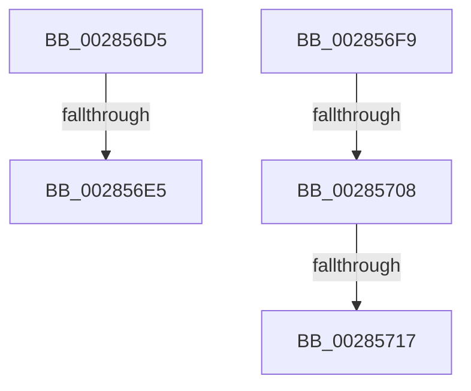

# sub_002856D5

- RVA: `0x002856D5`–`0x00285721` (길이 `76` bytes)
- VA: `0x00000001402856D5`
- 실행 섹션: `.text`
- PDB 이름 있음: `아니요`; PDB Function 태그: `아니요`
- unwind 정보 RVA: `0x00066A08`
- 디코드: `20`개 명령, `76/76` bytes 표시
- 미해석 바이트: `0` (있으면 어셈블리에 `.byte`로 보존)

> 이 문서는 커널 이미지의 기계어와 PDB 기호를 분석해 생성했습니다. 4번과 5번은 함수 원형과 자료형을 바이너리 사용 방식에서 추정한 C 해석이며 원본 소스 복구 결과는 아닙니다.

## 1. Dependencies

- 직접 호출 지점: **0**; 고유 호출 대상: **0**
- 직접 호출자로 확인된 함수: **0**
- RIP 상대 이미지 참조: **0**

### Outgoing calls
- 직접 디코드된 call 명령이 없습니다.

### Direct callers
- 이 함수 시작 RVA로 연결되는 직접 call은 확인되지 않았습니다. 간접 호출은 완전히 역산할 수 없습니다.

### Static image references
- 디코드된 RIP-relative 메모리 참조가 없습니다.

## 2. Other-region calls and transfers

- 다른 실행 섹션으로 향하는 call: **0**
- call이 아닌 외부 분기/꼬리 이동: **4**
  - `0x002856DF` → [sub_00285448 + 0xD4](Unknown_function_00285448.md) (`tail-transfer`)
  - `0x00285702` → [sub_00285448 + 0x105](Unknown_function_00285448.md) (`tail-transfer`)
  - `0x00285711` → [sub_00285448 + 0x105](Unknown_function_00285448.md) (`tail-transfer`)
  - `0x0028571C` → [sub_00285448 + 0x105](Unknown_function_00285448.md) (`tail-transfer`)

## 3. Assembly (complete function range)

```asm
002856D5  49 8D 81 80 00 00 00            lea rax, [r9 + 0x80]
002856DC  48 3B D0                        cmp rdx, rax
002856DF  0F 84 37 FE FF FF               je 0x14028551c
002856E5  48 8B 6C 24 50                  mov rbp, qword ptr [rsp + 0x50]
002856EA  B8 28 00 00 00                  mov eax, 0x28
002856EF  48 83 C4 28                     add rsp, 0x28
002856F3  41 5D                           pop r13
002856F5  5F                              pop rdi
002856F6  5E                              pop rsi
002856F7  5B                              pop rbx
002856F8  C3                              ret
002856F9  CC                              int3
002856FA  BA 02 00 00 00                  mov edx, 2
002856FF  45 85 D2                        test r10d, r10d
00285702  0F 84 45 FE FF FF               je 0x14028554d
00285708  BA 0A 00 00 00                  mov edx, 0xa
0028570D  41 F6 C0 02                     test r8b, 2
00285711  0F 84 36 FE FF FF               je 0x14028554d
00285717  BA 0B 00 00 00                  mov edx, 0xb
0028571C  E9 2C FE FF FF                  jmp 0x14028554d
```

## 4. C-style interpretation (structured pseudocode)

```c
__int64 __fastcall sub_002856D5(__int64 a1, __int64 a2, unsigned __int8 a3, __int64 a4, __int64 a5, __int64 a6, __int64 a7, __int64 a8, __int64 a9, __int64 a10)
{
    __int64 v_rsp;

    v_rsp = (v_rsp) + (40);
    return 40;
}
```

## 5. (Beta) C Style

```c
int64_t sub_002856D5(int64_t Arg1, int64_t Arg2, uint8_t Arg3, void *Arg4, uint64_t Arg5, uint64_t Arg6, uint64_t Arg7, uint64_t Arg8, uint64_t Arg9, int64_t Arg10)
{
    uint8_t *arg4 = (uint8_t *)Arg4;

    int64_t local_rsp;

    local_rsp = (local_rsp) + (40);
    return 40;
}
```

### 관측된 메모리 오프셋

구조체 형식이 확인되지 않은 접근은 인자 기준의 오프셋으로만 기록했습니다.

| 기준 인자 | 오프셋 표현 | 폭 (bit) | 접근 |
|---|---:|---:|---|
| `Arg4` | `+ 0x80` | `64` | `R` |

## 6. Execution-region graph

[열기: 2D/3D 그래프와 함수 탐색 컨트롤 패널](../../../control-panel.html?section=text&rva=0x002856D5&view=graph)

- 2D 그래프는 위에서 아래로 흐르고, 3D 그래프는 빈 공간을 드래그해 회전합니다. Shift+드래그는 이동, 휠은 확대·축소, 함수 노드 선택은 대상 보고서 이동입니다.

### Static fallback


