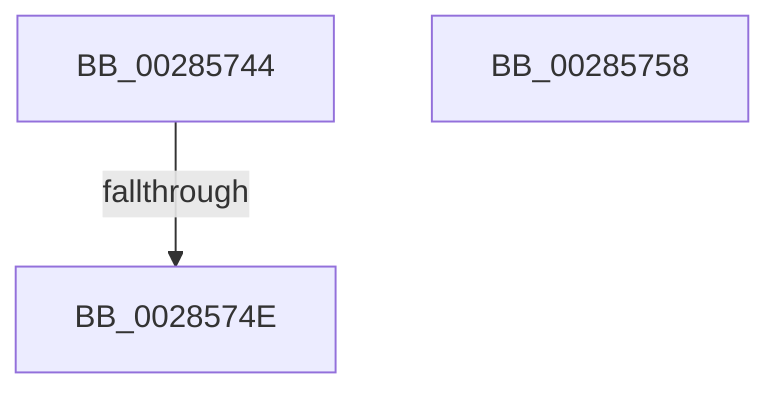

# sub_00285744

- RVA: `0x00285744`–`0x00285769` (길이 `37` bytes)
- VA: `0x0000000140285744`
- 실행 섹션: `.text`
- PDB 이름 있음: `아니요`; PDB Function 태그: `아니요`
- unwind 정보 RVA: `0x00066A48`
- 디코드: `8`개 명령, `37/37` bytes 표시
- 미해석 바이트: `0` (있으면 어셈블리에 `.byte`로 보존)

> 이 문서는 커널 이미지의 기계어와 PDB 기호를 분석해 생성했습니다. 4번과 5번은 함수 원형과 자료형을 바이너리 사용 방식에서 추정한 C 해석이며 원본 소스 복구 결과는 아닙니다.

## 1. Dependencies

- 직접 호출 지점: **1**; 고유 호출 대상: **1**
- 직접 호출자로 확인된 함수: **0**
- RIP 상대 이미지 참조: **0**

### Outgoing calls
- `0x0028575F` → [MiUnlockPage](../31/MiUnlockPage_function_0031A3E0.md) (function, `0x0031A3E0`)

### Direct callers
- 이 함수 시작 RVA로 연결되는 직접 call은 확인되지 않았습니다. 간접 호출은 완전히 역산할 수 없습니다.

### Static image references
- 디코드된 RIP-relative 메모리 참조가 없습니다.

## 2. Other-region calls and transfers

- 다른 실행 섹션으로 향하는 call: **0**
- call이 아닌 외부 분기/꼬리 이동: **3**
  - `0x00285748` → [sub_006DA208 + 0x22](../6D/Unknown_function_006DA208.md) (`tail-transfer`)
  - `0x00285753` → [sub_006DA208](../6D/Unknown_function_006DA208.md) (`tail-transfer`)
  - `0x00285764` → [sub_00285639 + 0x46](Unknown_function_00285639.md) (`tail-transfer`)

## 3. Assembly (complete function range)

```asm
00285744  40 F6 C6 02                     test sil, 2
00285748  0F 84 DC 4A 45 00               je 0x1406da22a
0028574E  44 89 6C 24 58                  mov dword ptr [rsp + 0x58], r13d
00285753  E9 B0 4A 45 00                  jmp 0x1406da208
00285758  41 0F B6 D4                     movzx edx, r12b
0028575C  48 8B CF                        mov rcx, rdi
0028575F  E8 7C 4C 09 00                  call 0x14031a3e0
00285764  E9 16 FF FF FF                  jmp 0x14028567f
```

## 4. C-style interpretation (structured pseudocode)

```c
__int64 __fastcall sub_00285744(void)
{
    unsigned int v_stack_p58;

    v_stack_p58 = (unsigned int)(v_r13);
}
```

## 5. (Beta) C Style

```c
void sub_00285744(void)
{
    uint32_t v_stack_p58;

    v_stack_p58 = (uint32_t)(local_r13);
}
```

## 6. Execution-region graph

[열기: 2D/3D 그래프와 함수 탐색 컨트롤 패널](../../../control-panel.html?section=text&rva=0x00285744&view=graph)

- 2D 그래프는 위에서 아래로 흐르고, 3D 그래프는 빈 공간을 드래그해 회전합니다. Shift+드래그는 이동, 휠은 확대·축소, 함수 노드 선택은 대상 보고서 이동입니다.

### Static fallback


