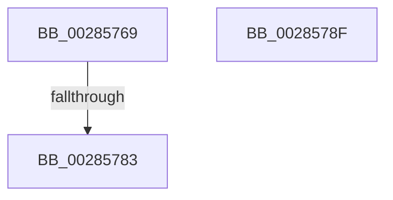

# sub_00285769

- RVA: `0x00285769`–`0x00285799` (길이 `48` bytes)
- VA: `0x0000000140285769`
- 실행 섹션: `.text`
- PDB 이름 있음: `아니요`; PDB Function 태그: `아니요`
- unwind 정보 RVA: `0x00066A64`
- 디코드: `11`개 명령, `48/48` bytes 표시
- 미해석 바이트: `0` (있으면 어셈블리에 `.byte`로 보존)

> 이 문서는 커널 이미지의 기계어와 PDB 기호를 분석해 생성했습니다. 4번과 5번은 함수 원형과 자료형을 바이너리 사용 방식에서 추정한 C 해석이며 원본 소스 복구 결과는 아닙니다.

## 1. Dependencies

- 직접 호출 지점: **0**; 고유 호출 대상: **0**
- 직접 호출자로 확인된 함수: **0**
- RIP 상대 이미지 참조: **1**

### Outgoing calls
- 직접 디코드된 call 명령이 없습니다.

### Direct callers
- 이 함수 시작 RVA로 연결되는 직접 call은 확인되지 않았습니다. 간접 호출은 완전히 역산할 수 없습니다.

### Static image references
- `0x00285769` → RVA `0x00FC6A88` (`ALMOSTRO`; read)

## 2. Other-region calls and transfers

- 다른 실행 섹션으로 향하는 call: **0**
- call이 아닌 외부 분기/꼬리 이동: **3**
  - `0x0028577D` → [sub_00285448 + 0x28](Unknown_function_00285448.md) (`tail-transfer`)
  - `0x0028578A` → [sub_00285448 + 0x28](Unknown_function_00285448.md) (`tail-transfer`)
  - `0x00285794` → [sub_00285448 + 0x28](Unknown_function_00285448.md) (`tail-transfer`)

## 3. Assembly (complete function range)

```asm
00285769  48 8B 05 18 13 D4 00            mov rax, qword ptr [rip + 0xd41318]
00285770  48 C1 E8 0D                     shr rax, 0xd
00285774  83 E0 10                        and eax, 0x10
00285777  83 C8 03                        or eax, 3
0028577A  48 85 DB                        test rbx, rbx
0028577D  0F 84 ED FC FF FF               je 0x140285470
00285783  4C 89 2B                        mov qword ptr [rbx], r13
00285786  4C 89 6B 08                     mov qword ptr [rbx + 8], r13
0028578A  E9 E1 FC FF FF                  jmp 0x140285470
0028578F  B8 02 00 00 00                  mov eax, 2
00285794  E9 D7 FC FF FF                  jmp 0x140285470
```

## 4. C-style interpretation (structured pseudocode)

```c
__int64 __fastcall sub_00285769(void)
{
    __int64 result;

    result = (*(unsigned __int64 *)(v_rip + 13898520)) >> (13);
    result = (unsigned int)((result) & (16));
    result = (unsigned int)((result) | (3));
    *(unsigned __int64 *)(v_rbx) = v_r13;
    *(unsigned __int64 *)(v_rbx + 8) = v_r13;
}
```

## 5. (Beta) C Style

```c
void sub_00285769(void)
{
    int64_t result;

    result = (*(uint64_t *)(v_rip + 0xD41318)) >> (13);
    result = (uint32_t)((result) & (16));
    result = (uint32_t)((result) | (3));
    *(uint64_t *)(local_rbx) = local_r13;
    *(uint64_t *)(local_rbx + 0x8) = local_r13;
}
```

## 6. Execution-region graph

[열기: 2D/3D 그래프와 함수 탐색 컨트롤 패널](../../../control-panel.html?section=text&rva=0x00285769&view=graph)

- 2D 그래프는 위에서 아래로 흐르고, 3D 그래프는 빈 공간을 드래그해 회전합니다. Shift+드래그는 이동, 휠은 확대·축소, 함수 노드 선택은 대상 보고서 이동입니다.

### Static fallback


