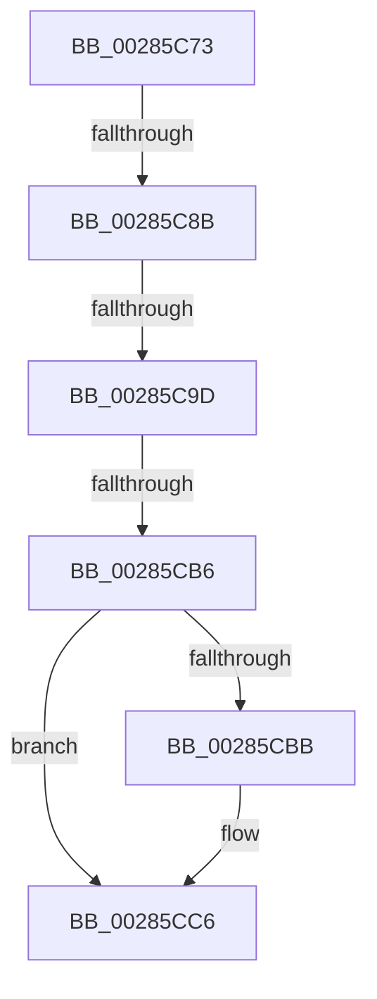

# sub_00285C73

- RVA: `0x00285C73`–`0x00285CD2` (길이 `95` bytes)
- VA: `0x0000000140285C73`
- 실행 섹션: `.text`
- PDB 이름 있음: `아니요`; PDB Function 태그: `아니요`
- unwind 정보 RVA: `0x00066AF4`
- 디코드: `26`개 명령, `95/95` bytes 표시
- 미해석 바이트: `0` (있으면 어셈블리에 `.byte`로 보존)

> 이 문서는 커널 이미지의 기계어와 PDB 기호를 분석해 생성했습니다. 4번과 5번은 함수 원형과 자료형을 바이너리 사용 방식에서 추정한 C 해석이며 원본 소스 복구 결과는 아닙니다.

## 1. Dependencies

- 직접 호출 지점: **2**; 고유 호출 대상: **2**
- 직접 호출자로 확인된 함수: **0**
- RIP 상대 이미지 참조: **0**

### Outgoing calls
- `0x00285CA9` → [MiChargeCommit](MiChargeCommit_function_00286EB0.md) (function, `0x00286EB0`)
- `0x00285CC1` → [MiReturnResident](MiReturnResident_function_00286890.md) (function, `0x00286890`)

### Direct callers
- 이 함수 시작 RVA로 연결되는 직접 call은 확인되지 않았습니다. 간접 호출은 완전히 역산할 수 없습니다.

### Static image references
- 디코드된 RIP-relative 메모리 참조가 없습니다.

## 2. Other-region calls and transfers

- 다른 실행 섹션으로 향하는 call: **0**
- call이 아닌 외부 분기/꼬리 이동: **3**
  - `0x00285C85` → [sub_00285D62](Unknown_function_00285D62.md) (`tail-transfer`)
  - `0x00285C97` → [sub_00285DBF](Unknown_function_00285DBF.md) (`tail-transfer`)
  - `0x00285CB0` → [sub_00285DBF](Unknown_function_00285DBF.md) (`tail-transfer`)

## 3. Assembly (complete function range)

```asm
00285C73  4C 89 64 24 40                  mov qword ptr [rsp + 0x40], r12
00285C78  4D 8B 26                        mov r12, qword ptr [r14]
00285C7B  4C 89 7C 24 48                  mov qword ptr [rsp + 0x48], r15
00285C80  44 8B FD                        mov r15d, ebp
00285C83  85 DB                           test ebx, ebx
00285C85  0F 85 D7 00 00 00               jne 0x140285d62
00285C8B  8B C6                           mov eax, esi
00285C8D  83 E0 01                        and eax, 1
00285C90  85 DB                           test ebx, ebx
00285C92  0F 44 C6                        cmove eax, esi
00285C95  85 C0                           test eax, eax
00285C97  0F 84 22 01 00 00               je 0x140285dbf
00285C9D  41 B8 01 00 00 00               mov r8d, 1
00285CA3  48 8B D7                        mov rdx, rdi
00285CA6  49 8B CC                        mov rcx, r12
00285CA9  E8 02 12 00 00                  call 0x140286eb0
00285CAE  85 C0                           test eax, eax
00285CB0  0F 85 09 01 00 00               jne 0x140285dbf
00285CB6  45 85 FF                        test r15d, r15d
00285CB9  74 0B                           je 0x140285cc6
00285CBB  49 8B 0E                        mov rcx, qword ptr [r14]
00285CBE  48 8B D7                        mov rdx, rdi
00285CC1  E8 CA 0B 00 00                  call 0x140286890
00285CC6  4C 8B 7C 24 48                  mov r15, qword ptr [rsp + 0x48]
00285CCB  8B C5                           mov eax, ebp
00285CCD  4C 8B 64 24 40                  mov r12, qword ptr [rsp + 0x40]
```

## 4. C-style interpretation (structured pseudocode)

```c
__int64 __fastcall sub_00285C73(__int64 a1, __int64 a2, __int64 a3, __int64 a4, __int64 a5, __int64 a6, __int64 a7, __int64 a8, __int64 a9)
{
    __int64 result;
    unsigned __int64 v_stack_p40;
    unsigned __int64 v_stack_p48;

    v_stack_p40 = v_r12;
    v_stack_p48 = v_r15;
    result = (unsigned int)(((unsigned int)((unsigned int)(v_rsi))) & (1));
    if ((unsigned int)(v_rbx) == 0) { result = (unsigned int)(v_rsi); }
    result = MiChargeCommit(*(unsigned __int64 *)(v_r14), v_rdi, 1, a4);
    if ((unsigned int)((unsigned int)((unsigned int)(v_rbp))) != 0) {
        a1 = *(unsigned __int64 *)(v_r14);
        a2 = v_rdi;
        result = MiReturnResident(a1, a2, 1, a4);
    }
    return (unsigned int)((unsigned int)(v_rbp));
}
```

## 5. (Beta) C Style

```c
int64_t sub_00285C73(int64_t Arg1, int64_t Arg2, int64_t Arg3, int64_t Arg4, uint64_t Arg5, uint64_t Arg6, uint64_t Arg7, int64_t Arg8, int64_t Arg9)
{
    int64_t result;
    uint64_t v_stack_p40;
    uint64_t v_stack_p48;

    v_stack_p40 = local_r12;
    v_stack_p48 = local_r15;
    result = (uint32_t)(((uint32_t)((uint32_t)(local_rsi))) & (1));
    if ((uint32_t)(local_rbx) == 0) { result = (uint32_t)(local_rsi); }
    result = MiChargeCommit(*(uint64_t *)(local_r14), local_rdi, 1, Arg4);
    if ((uint32_t)((uint32_t)((uint32_t)(local_rbp))) != 0) {
        Arg1 = *(uint64_t *)(local_r14);
        Arg2 = local_rdi;
        result = MiReturnResident(Arg1, Arg2, 1, Arg4);
    }
    return (uint32_t)((uint32_t)(local_rbp));
}
```

## 6. Execution-region graph

[열기: 2D/3D 그래프와 함수 탐색 컨트롤 패널](../../../control-panel.html?section=text&rva=0x00285C73&view=graph)

- 2D 그래프는 위에서 아래로 흐르고, 3D 그래프는 빈 공간을 드래그해 회전합니다. Shift+드래그는 이동, 휠은 확대·축소, 함수 노드 선택은 대상 보고서 이동입니다.

### Static fallback


