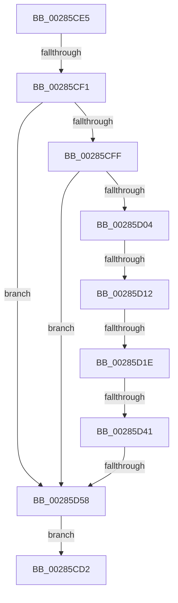

# sub_00285CD2

- RVA: `0x00285CD2`–`0x00285D62` (길이 `144` bytes)
- VA: `0x0000000140285CD2`
- 실행 섹션: `.text`
- PDB 이름 있음: `아니요`; PDB Function 태그: `아니요`
- unwind 정보 RVA: `0x00066B0C`
- 디코드: `38`개 명령, `144/144` bytes 표시
- 미해석 바이트: `0` (있으면 어셈블리에 `.byte`로 보존)

> 이 문서는 커널 이미지의 기계어와 PDB 기호를 분석해 생성했습니다. 4번과 5번은 함수 원형과 자료형을 바이너리 사용 방식에서 추정한 C 해석이며 원본 소스 복구 결과는 아닙니다.

## 1. Dependencies

- 직접 호출 지점: **0**; 고유 호출 대상: **0**
- 직접 호출자로 확인된 함수: **0**
- RIP 상대 이미지 참조: **1**

### Outgoing calls
- 직접 디코드된 call 명령이 없습니다.

### Direct callers
- 이 함수 시작 RVA로 연결되는 직접 call은 확인되지 않았습니다. 간접 호출은 완전히 역산할 수 없습니다.

### Static image references
- `0x00285D12` → RVA `0x00E38D00` (`.data`; read)

## 2. Other-region calls and transfers

- 다른 실행 섹션으로 향하는 call: **0**
- call이 아닌 외부 분기/꼬리 이동: **5**
  - `0x00285CEB` → [sub_00285D83 + 0x2C](Unknown_function_00285D83.md) (`tail-transfer`)
  - `0x00285D0C` → [sub_00285DC9](Unknown_function_00285DC9.md) (`tail-transfer`)
  - `0x00285D1C` → [sub_00285D83](Unknown_function_00285D83.md) (`tail-transfer`)
  - `0x00285D3F` → [sub_00285D83](Unknown_function_00285D83.md) (`tail-transfer`)
  - `0x00285D56` → [sub_00285D83 + 0x27](Unknown_function_00285D83.md) (`tail-transfer`)

## 3. Assembly (complete function range)

```asm
00285CD2  48 8B 5C 24 50                  mov rbx, qword ptr [rsp + 0x50]
00285CD7  48 8B 6C 24 58                  mov rbp, qword ptr [rsp + 0x58]
00285CDC  48 83 C4 20                     add rsp, 0x20
00285CE0  41 5E                           pop r14
00285CE2  5F                              pop rdi
00285CE3  5E                              pop rsi
00285CE4  C3                              ret
00285CE5  CC                              int3
00285CE6  49 8B 2E                        mov rbp, qword ptr [r14]
00285CE9  85 DB                           test ebx, ebx
00285CEB  0F 85 BE 00 00 00               jne 0x140285daf
00285CF1  8B C6                           mov eax, esi
00285CF3  83 E0 01                        and eax, 1
00285CF6  85 DB                           test ebx, ebx
00285CF8  0F 44 C6                        cmove eax, esi
00285CFB  85 C0                           test eax, eax
00285CFD  74 59                           je 0x140285d58
00285CFF  48 85 FF                        test rdi, rdi
00285D02  74 54                           je 0x140285d58
00285D04  48 83 BD 08 42 00 00 00         cmp qword ptr [rbp + 0x4208], 0
00285D0C  0F 85 B7 00 00 00               jne 0x140285dc9
00285D12  48 8D 05 E7 2F BB 00            lea rax, [rip + 0xbb2fe7]
00285D19  48 3B E8                        cmp rbp, rax
00285D1C  75 65                           jne 0x140285d83
00285D1E  65 48 8B 14 25 20 00 00 00      mov rdx, qword ptr gs:[0x20]
00285D27  0F 0D 8A 98 8B 00 00            prefetchw byte ptr [rdx + 0x8b98]
00285D2E  44 8B 82 98 8B 00 00            mov r8d, dword ptr [rdx + 0x8b98]
00285D35  49 8D 04 38                     lea rax, [r8 + rdi]
00285D39  48 3D 00 01 00 00               cmp rax, 0x100
00285D3F  77 42                           ja 0x140285d83
00285D41  41 8D 0C 38                     lea ecx, [r8 + rdi]
00285D45  41 8B C0                        mov eax, r8d
00285D48  F0 0F B1 8A 98 8B 00 00         lock cmpxchg dword ptr [rdx + 0x8b98], ecx
00285D50  48 63 C8                        movsxd rcx, eax
00285D53  49 3B C8                        cmp rcx, r8
00285D56  75 52                           jne 0x140285daa
00285D58  B8 01 00 00 00                  mov eax, 1
00285D5D  E9 70 FF FF FF                  jmp 0x140285cd2
```

## 4. C-style interpretation (structured pseudocode)

```c
__int64 __fastcall sub_00285CD2(__int64 a1, __int64 a2, __int64 a3, __int64 a4, __int64 a5, __int64 a6, __int64 a7, __int64 a8, __int64 a9, __int64 a10, __int64 a11)
{
    __int64 v_rsp;

    v_rsp = (v_rsp) + (32);
    return result;
}
```

## 5. (Beta) C Style

```c
int64_t sub_00285CD2(int64_t Arg1, int64_t Arg2, int64_t Arg3, int64_t Arg4, uint64_t Arg5, uint64_t Arg6, uint64_t Arg7, uint64_t Arg8, uint64_t Arg9, int64_t Arg10, int64_t Arg11)
{
    int64_t local_rsp;

    local_rsp = (local_rsp) + (32);
    return result;
}
```

## 6. Execution-region graph

[열기: 2D/3D 그래프와 함수 탐색 컨트롤 패널](../../../control-panel.html?section=text&rva=0x00285CD2&view=graph)

- 2D 그래프는 위에서 아래로 흐르고, 3D 그래프는 빈 공간을 드래그해 회전합니다. Shift+드래그는 이동, 휠은 확대·축소, 함수 노드 선택은 대상 보고서 이동입니다.

### Static fallback


