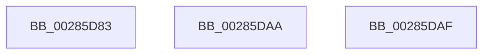

# sub_00285D83

- RVA: `0x00285D83`–`0x00285DBF` (길이 `60` bytes)
- VA: `0x0000000140285D83`
- 실행 섹션: `.text`
- PDB 이름 있음: `아니요`; PDB Function 태그: `아니요`
- unwind 정보 RVA: `0x00066B38`
- 디코드: `15`개 명령, `60/60` bytes 표시
- 미해석 바이트: `0` (있으면 어셈블리에 `.byte`로 보존)

> 이 문서는 커널 이미지의 기계어와 PDB 기호를 분석해 생성했습니다. 4번과 5번은 함수 원형과 자료형을 바이너리 사용 방식에서 추정한 C 해석이며 원본 소스 복구 결과는 아닙니다.

## 1. Dependencies

- 직접 호출 지점: **2**; 고유 호출 대상: **2**
- 직접 호출자로 확인된 함수: **0**
- RIP 상대 이미지 참조: **0**

### Outgoing calls
- `0x00285DA3` → [MiSignalCommitSignals](../24/MiSignalCommitSignals_function_00249090.md) (function, `0x00249090`)
- `0x00285DB5` → [MiReturnResident](MiReturnResident_function_00286890.md) (function, `0x00286890`)

### Direct callers
- 이 함수 시작 RVA로 연결되는 직접 call은 확인되지 않았습니다. 간접 호출은 완전히 역산할 수 없습니다.

### Static image references
- 디코드된 RIP-relative 메모리 참조가 없습니다.

## 2. Other-region calls and transfers

- 다른 실행 섹션으로 향하는 call: **0**
- call이 아닌 외부 분기/꼬리 이동: **3**
  - `0x00285DA8` → [sub_00285CD2 + 0x86](Unknown_function_00285CD2.md) (`tail-transfer`)
  - `0x00285DAD` → [sub_00285CD2 + 0x63](Unknown_function_00285CD2.md) (`tail-transfer`)
  - `0x00285DBA` → [sub_00285CD2 + 0x1F](Unknown_function_00285CD2.md) (`tail-transfer`)

## 3. Assembly (complete function range)

```asm
00285D83  4C 8B C7                        mov r8, rdi
00285D86  49 F7 D8                        neg r8
00285D89  F0 4C 01 85 80 4B 00 00         lock add qword ptr [rbp + 0x4b80], r8
00285D91  F0 4C 0F C1 85 40 4B 00 00      lock xadd qword ptr [rbp + 0x4b40], r8
00285D9A  49 8B D0                        mov rdx, r8
00285D9D  48 8B CD                        mov rcx, rbp
00285DA0  48 2B D7                        sub rdx, rdi
00285DA3  E8 E8 32 FC FF                  call 0x140249090
00285DA8  EB AE                           jmp 0x140285d58
00285DAA  4C 8B C1                        mov r8, rcx
00285DAD  EB 86                           jmp 0x140285d35
00285DAF  48 8B D7                        mov rdx, rdi
00285DB2  48 8B CD                        mov rcx, rbp
00285DB5  E8 D6 0A 00 00                  call 0x140286890
00285DBA  E9 32 FF FF FF                  jmp 0x140285cf1
```

## 4. C-style interpretation (structured pseudocode)

```c
__int64 __fastcall sub_00285D83(void)
{
    __int64 result;

    a3 = -(v_rdi);
    a2 = (a3) - (v_rdi);
    result = MiSignalCommitSignals(v_rbp, a2, a3, a4);
}
```

## 5. (Beta) C Style

```c
void sub_00285D83(void)
{
    int64_t result;

    a3 = -(local_rdi);
    a2 = (a3) - (local_rdi);
    result = MiSignalCommitSignals(local_rbp, a2, a3, a4);
}
```

## 6. Execution-region graph

[열기: 2D/3D 그래프와 함수 탐색 컨트롤 패널](../../../control-panel.html?section=text&rva=0x00285D83&view=graph)

- 2D 그래프는 위에서 아래로 흐르고, 3D 그래프는 빈 공간을 드래그해 회전합니다. Shift+드래그는 이동, 휠은 확대·축소, 함수 노드 선택은 대상 보고서 이동입니다.

### Static fallback


