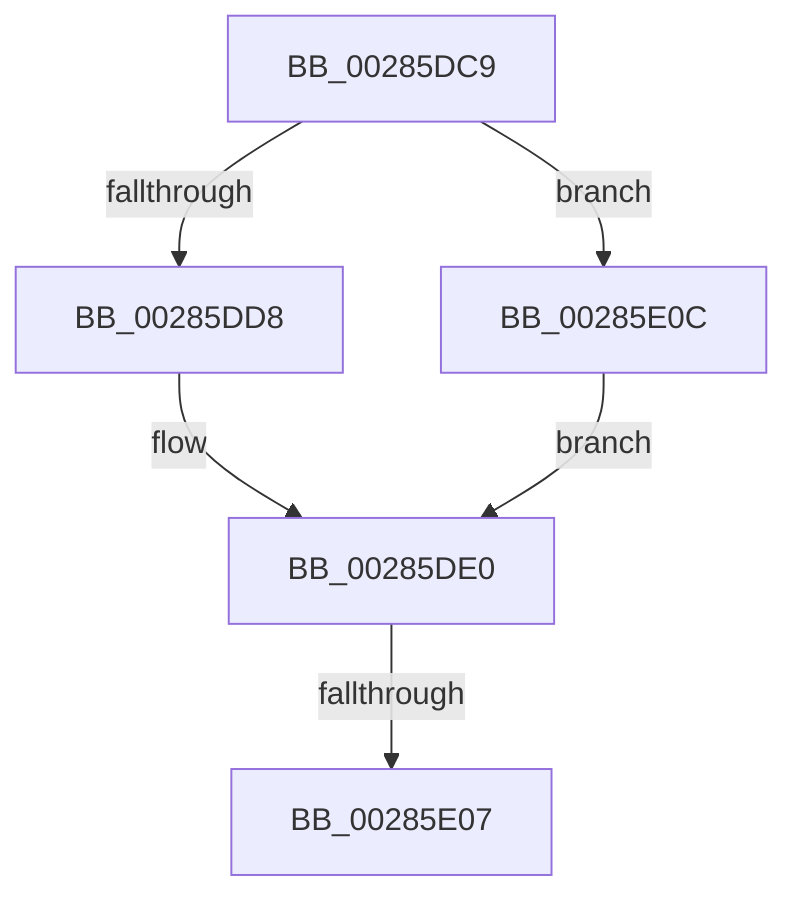

# sub_00285DC9

- RVA: `0x00285DC9`–`0x00285E16` (길이 `77` bytes)
- VA: `0x0000000140285DC9`
- 실행 섹션: `.text`
- PDB 이름 있음: `아니요`; PDB Function 태그: `아니요`
- unwind 정보 RVA: `0x00066B60`
- 디코드: `19`개 명령, `77/77` bytes 표시
- 미해석 바이트: `0` (있으면 어셈블리에 `.byte`로 보존)

> 이 문서는 커널 이미지의 기계어와 PDB 기호를 분석해 생성했습니다. 4번과 5번은 함수 원형과 자료형을 바이너리 사용 방식에서 추정한 C 해석이며 원본 소스 복구 결과는 아닙니다.

## 1. Dependencies

- 직접 호출 지점: **4**; 고유 호출 대상: **4**
- 직접 호출자로 확인된 함수: **0**
- RIP 상대 이미지 참조: **0**

### Outgoing calls
- `0x00285DD8` → [ExAcquireSpinLockExclusive](../24/ExAcquireSpinLockExclusive_function_00248690.md) (function, `0x00248690`)
- `0x00285DE6` → [MiRestockOverCommit](../40/MiRestockOverCommit_function_00407D94.md) (function, `0x00407D94`)
- `0x00285DF9` → [MiReleaseSpinLockExclusive](../24/MiReleaseSpinLockExclusive_function_002482C0.md) (function, `0x002482C0`)
- `0x00285E0F` → [ExAcquireSpinLockExclusiveAtDpcLevel](../24/ExAcquireSpinLockExclusiveAtDpcLevel_function_00248E80.md) (function, `0x00248E80`)

### Direct callers
- 이 함수 시작 RVA로 연결되는 직접 call은 확인되지 않았습니다. 간접 호출은 완전히 역산할 수 없습니다.

### Static image references
- 디코드된 RIP-relative 메모리 참조가 없습니다.

## 2. Other-region calls and transfers

- 다른 실행 섹션으로 향하는 call: **0**
- call이 아닌 외부 분기/꼬리 이동: **2**
  - `0x00285E01` → [sub_00285CD2 + 0x86](Unknown_function_00285CD2.md) (`tail-transfer`)
  - `0x00285E07` → [sub_00285CD2 + 0x40](Unknown_function_00285CD2.md) (`tail-transfer`)

## 3. Assembly (complete function range)

```asm
00285DC9  44 0F 20 C0                     mov rax, cr8
00285DCD  48 8D 8D F8 41 00 00            lea rcx, [rbp + 0x41f8]
00285DD4  3C 02                           cmp al, 2
00285DD6  74 34                           je 0x140285e0c
00285DD8  E8 B3 28 FC FF                  call 0x140248690
00285DDD  0F B6 F0                        movzx esi, al
00285DE0  48 8B D7                        mov rdx, rdi
00285DE3  48 8B CD                        mov rcx, rbp
00285DE6  E8 A9 1F 18 00                  call 0x140407d94
00285DEB  40 0F B6 D6                     movzx edx, sil
00285DEF  48 8D 8D F8 41 00 00            lea rcx, [rbp + 0x41f8]
00285DF6  48 8B F8                        mov rdi, rax
00285DF9  E8 C2 24 FC FF                  call 0x1402482c0
00285DFE  48 85 FF                        test rdi, rdi
00285E01  0F 84 51 FF FF FF               je 0x140285d58
00285E07  E9 06 FF FF FF                  jmp 0x140285d12
00285E0C  40 B6 11                        mov sil, 0x11
00285E0F  E8 6C 30 FC FF                  call 0x140248e80
00285E14  EB CA                           jmp 0x140285de0
```

## 4. C-style interpretation (structured pseudocode)

```c
__int64 __fastcall sub_00285DC9(void)
{
    __int64 result;

    if (((unsigned __int8)(v_cr8)) == 2) goto loc_00285E0C;
    result = ExAcquireSpinLockExclusive(v_rbp + 16888, a2, a3, a4);
loc_00285DE0:
    result = MiRestockOverCommit(v_rbp, v_rdi, a3, a4);
    result = MiReleaseSpinLockExclusive(v_rbp + 16888, (unsigned __int8)((unsigned __int8)(result)), a3, a4);
loc_00285E0C:
    result = ExAcquireSpinLockExclusiveAtDpcLevel(v_rbp + 16888, (unsigned __int8)((unsigned __int8)(result)), a3, a4);
    goto loc_00285DE0;
}
```

## 5. (Beta) C Style

```c
void sub_00285DC9(void)
{
    int64_t result;

    if (((uint8_t)(v_cr8)) == 2) goto loc_00285E0C;
    result = ExAcquireSpinLockExclusive(local_rbp + 16888, a2, a3, a4);
loc_00285DE0:
    result = MiRestockOverCommit(local_rbp, local_rdi, a3, a4);
    result = MiReleaseSpinLockExclusive(local_rbp + 16888, (uint8_t)((uint8_t)(result)), a3, a4);
loc_00285E0C:
    result = ExAcquireSpinLockExclusiveAtDpcLevel(local_rbp + 16888, (uint8_t)((uint8_t)(result)), a3, a4);
    goto loc_00285DE0;
}
```

## 6. Execution-region graph

[열기: 2D/3D 그래프와 함수 탐색 컨트롤 패널](../../../control-panel.html?section=text&rva=0x00285DC9&view=graph)

- 2D 그래프는 위에서 아래로 흐르고, 3D 그래프는 빈 공간을 드래그해 회전합니다. Shift+드래그는 이동, 휠은 확대·축소, 함수 노드 선택은 대상 보고서 이동입니다.

### Static fallback


