# sub_00285E76

- RVA: `0x00285E76`–`0x0028609E` (길이 `552` bytes)
- VA: `0x0000000140285E76`
- 실행 섹션: `.text`
- PDB 이름 있음: `아니요`; PDB Function 태그: `아니요`
- unwind 정보 RVA: `0x00066B84`
- 디코드: `146`개 명령, `552/552` bytes 표시
- 미해석 바이트: `0` (있으면 어셈블리에 `.byte`로 보존)

> 이 문서는 커널 이미지의 기계어와 PDB 기호를 분석해 생성했습니다. 4번과 5번은 함수 원형과 자료형을 바이너리 사용 방식에서 추정한 C 해석이며 원본 소스 복구 결과는 아닙니다.

## 1. Dependencies

- 직접 호출 지점: **6**; 고유 호출 대상: **5**
- 직접 호출자로 확인된 함수: **0**
- RIP 상대 이미지 참조: **4**

### Outgoing calls
- `0x00285E97` → [ExpWaitForSpinLockExclusiveAndAcquire](../32/ExpWaitForSpinLockExclusiveAndAcquire_function_003239A0.md) (function, `0x003239A0`)
- `0x00285F40` → [MiCheckControlArea](MiCheckControlArea_function_002861B0.md) (function, `0x002861B0`)
- `0x00285F95` → [KeBugCheckEx](../4F/KeBugCheckEx_function_004FD660.md) (function, `0x004FD660`)
- `0x0028603C` → [MiInsertUnusedSubsection](../29/MiInsertUnusedSubsection_function_00298D50.md) (function, `0x00298D50`)
- `0x00286078` → [KeBugCheckEx](../4F/KeBugCheckEx_function_004FD660.md) (function, `0x004FD660`)
- `0x00286094` → [ExpAcquireSpinLockExclusiveAtDpcLevelInstrumented](../32/ExpAcquireSpinLockExclusiveAtDpcLevelInstrumented_function_00323A70.md) (function, `0x00323A70`)

### Direct callers
- 이 함수 시작 RVA로 연결되는 직접 call은 확인되지 않았습니다. 간접 호출은 완전히 역산할 수 없습니다.

### Static image references
- `0x00285EC1` → RVA `0x00FC52AC` (`ALMOSTRO`; reference)
- `0x00285F18` → RVA `0x00010850` (`.rdata`; read)
- `0x00285FC2` → RVA `0x00E30088` (`.data`; read)
- `0x0028607E` → RVA `0x00F0DE58` (`.data`; read)

## 2. Other-region calls and transfers

- 다른 실행 섹션으로 향하는 call: **0**
- call이 아닌 외부 분기/꼬리 이동: **6**
  - `0x00285EC7` → [sub_002860AF + 0xC](Unknown_function_002860AF.md) (`tail-transfer`)
  - `0x00285F37` → [sub_002860AF + 0x95](Unknown_function_002860AF.md) (`tail-transfer`)
  - `0x00285FD6` → [sub_002860AF + 0x33](Unknown_function_002860AF.md) (`tail-transfer`)
  - `0x00285FDF` → [sub_002860AF + 0x3B](Unknown_function_002860AF.md) (`tail-transfer`)
  - `0x0028600A` → [sub_002860AF + 0x47](Unknown_function_002860AF.md) (`tail-transfer`)
  - `0x00286063` → [sub_002860AF](Unknown_function_002860AF.md) (`tail-transfer`)

## 3. Assembly (complete function range)

```asm
00285E76  48 89 B4 24 80 00 00 00         mov qword ptr [rsp + 0x80], rsi
00285E7E  0F 85 FA 01 00 00               jne 0x14028607e
00285E84  F0 41 0F BA 6E 48 1F            lock bts dword ptr [r14 + 0x48], 0x1f
00285E8B  8B F5                           mov esi, ebp
00285E8D  73 0F                           jae 0x140285e9e
00285E8F  41 0F B6 D4                     movzx edx, r12b
00285E93  49 8D 4E 48                     lea rcx, [r14 + 0x48]
00285E97  E8 04 DB 09 00                  call 0x1403239a0
00285E9C  8B F0                           mov esi, eax
00285E9E  41 8B 56 48                     mov edx, dword ptr [r14 + 0x48]
00285EA2  8B CA                           mov ecx, edx
00285EA4  0F BA F1 1E                     btr ecx, 0x1e
00285EA8  81 F9 00 00 00 80               cmp ecx, 0x80000000
00285EAE  74 30                           je 0x140285ee0
00285EB0  0F BA E2 1E                     bt edx, 0x1e
00285EB4  72 09                           jb 0x140285ebf
00285EB6  F0 41 81 4E 48 00 00 00 40      lock or dword ptr [r14 + 0x48], 0x40000000
00285EBF  FF C6                           inc esi
00285EC1  85 35 E5 F3 D3 00               test dword ptr [rip + 0xd3f3e5], esi
00285EC7  0F 84 EE 01 00 00               je 0x1402860bb
00285ECD  F3 90                           pause
00285ECF  41 8B 56 48                     mov edx, dword ptr [r14 + 0x48]
00285ED3  8B C2                           mov eax, edx
00285ED5  0F BA F0 1E                     btr eax, 0x1e
00285ED9  3D 00 00 00 80                  cmp eax, 0x80000000
00285EDE  75 D0                           jne 0x140285eb0
00285EE0  48 85 DB                        test rbx, rbx
00285EE3  74 33                           je 0x140285f18
00285EE5  48 8B 03                        mov rax, qword ptr [rbx]
00285EE8  BE 08 00 00 00                  mov esi, 8
00285EED  48 8B FD                        mov rdi, rbp
00285EF0  4C 8B 68 40                     mov r13, qword ptr [rax + 0x40]
00285EF4  48 39 6B 08                     cmp qword ptr [rbx + 8], rbp
00285EF8  75 64                           jne 0x140285f5e
00285EFA  49 3B DF                        cmp rbx, r15
00285EFD  74 11                           je 0x140285f10
00285EFF  48 8B 5B 10                     mov rbx, qword ptr [rbx + 0x10]
00285F03  4D 85 ED                        test r13, r13
00285F06  75 03                           jne 0x140285f0b
00285F08  83 E6 F7                        and esi, 0xfffffff7
00285F0B  48 85 DB                        test rbx, rbx
00285F0E  75 E4                           jne 0x140285ef4
00285F10  44 8B 6C 24 70                  mov r13d, dword ptr [rsp + 0x70]
00285F15  48 8B EF                        mov rbp, rdi
00285F18  66 0F 6F 0D 30 A9 D8 FF         movdqa xmm1, xmmword ptr [rip - 0x2756d0]
00285F20  41 0F B6 D4                     movzx edx, r12b
00285F24  F3 41 0F 6F 46 28               movdqu xmm0, xmmword ptr [r14 + 0x28]
00285F2A  66 0F D4 C8                     paddq xmm1, xmm0
00285F2E  F3 41 0F 7F 4E 28               movdqu xmmword ptr [r14 + 0x28], xmm1
00285F34  48 85 ED                        test rbp, rbp
00285F37  0F 85 07 02 00 00               jne 0x140286144
00285F3D  49 8B CE                        mov rcx, r14
00285F40  E8 6B 02 00 00                  call 0x1402861b0
00285F45  48 8B B4 24 80 00 00 00         mov rsi, qword ptr [rsp + 0x80]
00285F4D  48 83 C4 30                     add rsp, 0x30
00285F51  41 5F                           pop r15
00285F53  41 5E                           pop r14
00285F55  41 5D                           pop r13
00285F57  41 5C                           pop r12
00285F59  5F                              pop rdi
00285F5A  5D                              pop rbp
00285F5B  5B                              pop rbx
00285F5C  C3                              ret
00285F5D  CC                              int3
00285F5E  4C 8B 03                        mov r8, qword ptr [rbx]
00285F61  4C 8B D3                        mov r10, rbx
00285F64  49 39 68 40                     cmp qword ptr [r8 + 0x40], rbp
00285F68  74 31                           je 0x140285f9b
00285F6A  41 8B 40 38                     mov eax, dword ptr [r8 + 0x38]
00285F6E  A8 20                           test al, 0x20
00285F70  75 29                           jne 0x140285f9b
00285F72  8B 43 20                        mov eax, dword ptr [rbx + 0x20]
00285F75  0F BA E0 10                     bt eax, 0x10
00285F79  72 20                           jb 0x140285f9b
00285F7B  48 39 6B 50                     cmp qword ptr [rbx + 0x50], rbp
00285F7F  75 1A                           jne 0x140285f9b
00285F81  45 33 C9                        xor r9d, r9d
00285F84  48 89 6C 24 20                  mov qword ptr [rsp + 0x20], rbp
00285F89  4C 8B C3                        mov r8, rbx
00285F8C  BA 01 20 04 00                  mov edx, 0x42001
00285F91  41 8D 49 1A                     lea ecx, [r9 + 0x1a]
00285F95  E8 C6 76 27 00                  call 0x1404fd660
00285F9A  CC                              int3
00285F9B  8B C6                           mov eax, esi
00285F9D  4C 8B CD                        mov r9, rbp
00285FA0  24 0C                           and al, 0xc
00285FA2  3C 08                           cmp al, 8
00285FA4  75 6A                           jne 0x140286010
00285FA6  41 F6 40 3E 0C                  test byte ptr [r8 + 0x3e], 0xc
00285FAB  75 63                           jne 0x140286010
00285FAD  49 39 68 40                     cmp qword ptr [r8 + 0x40], rbp
00285FB1  75 0A                           jne 0x140285fbd
00285FB3  41 F7 40 5C 00 00 01 00         test dword ptr [r8 + 0x5c], 0x10000
00285FBB  75 53                           jne 0x140286010
00285FBD  41 0F B7 40 3C                  movzx eax, word ptr [r8 + 0x3c]
00285FC2  48 8B 0D BF A0 BA 00            mov rcx, qword ptr [rip + 0xbaa0bf]
00285FC9  25 FF 03 00 00                  and eax, 0x3ff
00285FCE  48 8B 14 C1                     mov rdx, qword ptr [rcx + rax*8]
00285FD2  40 F6 C6 10                     test sil, 0x10
00285FD6  0F 85 06 01 00 00               jne 0x1402860e2
00285FDC  40 84 F6                        test sil, sil
00285FDF  0F 88 05 01 00 00               js 0x1402860ea
00285FE5  65 48 8B 04 25 88 01 00 00      mov rax, qword ptr gs:[0x188]
00285FEE  48 8B 88 B8 00 00 00            mov rcx, qword ptr [rax + 0xb8]
00285FF5  0F B7 81 AE 04 00 00            movzx eax, word ptr [rcx + 0x4ae]
00285FFC  48 8B 0D 85 A0 BA 00            mov rcx, qword ptr [rip + 0xbaa085]
00286003  48 8B 04 C1                     mov rax, qword ptr [rcx + rax*8]
00286007  48 3B C2                        cmp rax, rdx
0028600A  0F 85 E6 00 00 00               jne 0x1402860f6
00286010  49 39 68 40                     cmp qword ptr [r8 + 0x40], rbp
00286014  75 33                           jne 0x140286049
00286016  49 03 F9                        add rdi, r9
00286019  4D 85 ED                        test r13, r13
0028601C  0F 84 D8 FE FF FF               je 0x140285efa
00286022  48 39 6B 50                     cmp qword ptr [rbx + 0x50], rbp
00286026  0F 85 CE FE FF FF               jne 0x140285efa
0028602C  8B 43 20                        mov eax, dword ptr [rbx + 0x20]
0028602F  0F BA E0 10                     bt eax, 0x10
00286033  0F 82 C1 FE FF FF               jb 0x140285efa
00286039  48 8B CB                        mov rcx, rbx
0028603C  E8 0F 2D 01 00                  call 0x140298d50
00286041  48 03 F8                        add rdi, rax
00286044  E9 B1 FE FF FF                  jmp 0x140285efa
00286049  41 8B 48 38                     mov ecx, dword ptr [r8 + 0x38]
0028604D  F6 C1 20                        test cl, 0x20
00286050  75 C4                           jne 0x140286016
00286052  41 8B 4A 20                     mov ecx, dword ptr [r10 + 0x20]
00286056  0F BA E1 10                     bt ecx, 0x10
0028605A  72 BA                           jb 0x140286016
0028605C  49 8B 42 50                     mov rax, qword ptr [r10 + 0x50]
00286060  48 85 C0                        test rax, rax
00286063  75 4A                           jne 0x1402860af
00286065  45 33 C9                        xor r9d, r9d
00286068  48 89 6C 24 20                  mov qword ptr [rsp + 0x20], rbp
0028606D  4D 8B C2                        mov r8, r10
00286070  8D 48 1A                        lea ecx, [rax + 0x1a]
00286073  BA 01 20 04 00                  mov edx, 0x42001
00286078  E8 E3 75 27 00                  call 0x1404fd660
0028607D  CC                              int3
0028607E  8B 05 D4 7D C8 00               mov eax, dword ptr [rip + 0xc87dd4]
00286084  85 C0                           test eax, eax
00286086  0F 85 F8 FD FF FF               jne 0x140285e84
0028608C  41 0F B6 D4                     movzx edx, r12b
00286090  49 8D 4E 48                     lea rcx, [r14 + 0x48]
00286094  E8 D7 D9 09 00                  call 0x140323a70
00286099  E9 42 FE FF FF                  jmp 0x140285ee0
```

## 4. C-style interpretation (structured pseudocode)

```c
__int64 __fastcall sub_00285E76(__int64 a1, __int64 a2, __int64 a3, int a4, __int64 a5, __int64 a6, __int64 a7, __int64 a8, __int64 a9, __int64 a10, __int64 a11, __int64 a12, __int64 a13, unsigned int a14, __int64 a15, __int64 a16)
{
    __int64 result;
    __int64 v_rdi;
    __int64 v_rsi;
    __int64 v_rsp;
    unsigned __int64 v_stack_p80;
    unsigned __int64 v_stack_p88;

    v_stack_p80 = v_rsi;
    if (condition_is_not_equal) goto loc_0028607E;
loc_00285E84:
    v_rsi = (unsigned int)((unsigned int)(v_rbp));
    if (!(condition_is_above_or_equal)) {
        a2 = (unsigned __int8)(v_r12);
        a1 = v_r14 + 72;
        result = ExpWaitForSpinLockExclusiveAndAcquire(a1, a2, a3, a4);
        v_rsi = (unsigned int)(result);
    }
    if (((unsigned int)((unsigned int)((unsigned int)((unsigned int)(*(unsigned int *)(v_r14 + 72)))))) == 0x80000000ULL) goto loc_00285EE0;
loc_00285EB0:
    if (((unsigned int)((unsigned int)((unsigned int)((unsigned int)(*(unsigned int *)(v_r14 + 72)))))) >= 0x80000000ULL) {
    }
    v_rsi = (unsigned int)((v_rsi) + 1);
    if (((unsigned int)((unsigned int)((unsigned int)((unsigned int)(*(unsigned int *)(v_r14 + 72)))))) != 0x80000000ULL) goto loc_00285EB0;
loc_00285EE0:
    if (v_rbx == 0) goto loc_00285F18;
loc_00285EF4:
    if ((*(unsigned __int64 *)(v_rbx + 8)) != v_rbp) goto loc_00285F5E;
loc_00285EFA:
    if (v_rbx == v_r15) goto loc_00285F10;
    v_rsi = 8;
    if (*(unsigned __int64 *)(*(unsigned __int64 *)(v_rbx) + 64) == 0) {
        v_rsi = (unsigned int)((8) & (0xFFFFFFF7ULL));
    }
    if (*(unsigned __int64 *)(v_rbx + 16) != 0) goto loc_00285EF4;
loc_00285F10:
loc_00285F18:
    *(unsigned __int64 *)(v_r14 + 40) = v_xmm1;
    result = MiCheckControlArea(v_r14, (unsigned __int8)(v_r12), a3, a4);
    v_rsp = (v_rsp) + (48);
    return result;
loc_00285F5E:
    if ((*(unsigned __int64 *)(*(unsigned __int64 *)(*(unsigned __int64 *)(v_rbx + 16)) + 64)) == v_rbp) goto loc_00285F9B;
    if ((((unsigned __int8)((unsigned int)(*(unsigned int *)(*(unsigned __int64 *)(*(unsigned __int64 *)(v_rbx + 16)) + 56)))) & (32)) != 0) goto loc_00285F9B;
    if (condition_is_below) goto loc_00285F9B;
    result = (unsigned int)(*(unsigned int *)(*(unsigned __int64 *)(v_rbx + 16) + 32));
    if ((*(unsigned __int64 *)(*(unsigned __int64 *)(v_rbx + 16) + 80)) == v_rbp) {
        a4 = 0;
        v_stack_p88 = v_rbp;
        a3 = *(unsigned __int64 *)(v_rbx + 16);
        a2 = 0x42001ULL;
        a1 = a4 + 26;
        result = KeBugCheckEx(a1, a2, a3, a4);
    }
    result = (unsigned __int8)(((unsigned int)((unsigned int)(a16))) & (12));
    if (((unsigned __int8)(result)) != 8) goto loc_00286010;
    if (((*(unsigned __int8 *)(a3 + 62)) & (12)) != 0) goto loc_00286010;
    if ((*(unsigned __int64 *)(a3 + 64)) != v_rbp) goto loc_00285FBD;
    if (((*(unsigned int *)(a3 + 92)) & (0x10000ULL)) != 0) goto loc_00286010;
loc_00285FBD:
    result = (unsigned int)((*(unsigned __int16 *)(a3 + 60)) & (0x3FFULL));
loc_00286010:
    if ((*(unsigned __int64 *)(a3 + 64)) != v_rbp) goto loc_00286049;
loc_00286016:
    v_rdi = (v_rbp) + (v_rbp);
    if ((unsigned int)(a14) == 0) goto loc_00285EFA;
    if ((*(unsigned __int64 *)(*(unsigned __int64 *)(v_rbx + 16) + 80)) != v_rbp) goto loc_00285EFA;
    if ((*(unsigned __int64 *)(*(unsigned __int64 *)(v_rbx + 16) + 80)) < v_rbp) goto loc_00285EFA;
    result = MiInsertUnusedSubsection(*(unsigned __int64 *)(v_rbx + 16), *(unsigned __int64 *)(*(unsigned __int64 *)(v_rip + 12230847) + result * 8), a3, v_rbp);
    v_rdi = (v_rdi) + (result);
    goto loc_00285EFA;
loc_00286049:
    if ((((unsigned __int8)((unsigned int)(*(unsigned int *)(a3 + 56)))) & (32)) != 0) goto loc_00286016;
    if (condition_is_below) goto loc_00286016;
    a4 = 0;
    v_stack_p88 = v_rbp;
    result = KeBugCheckEx(*(unsigned __int64 *)(*(unsigned __int64 *)(v_rbx + 16) + 80) + 26, (unsigned int)(0x42001ULL), *(unsigned __int64 *)(v_rbx + 16), a4);
loc_0028607E:
    if ((unsigned int)((unsigned int)(*(unsigned int *)(v_rip + 13139412))) != 0) goto loc_00285E84;
    result = ExpAcquireSpinLockExclusiveAtDpcLevelInstrumented(v_r14 + 72, (unsigned __int8)(v_r12), *(unsigned __int64 *)(v_rbx + 16), a4);
    goto loc_00285EE0;
}
```

## 5. (Beta) C Style

```c
int64_t sub_00285E76(int64_t Arg1, int64_t Arg2, int64_t Arg3, int32_t Arg4, uint64_t Arg5, uint64_t Arg6, uint64_t Arg7, uint64_t Arg8, uint64_t Arg9, uint64_t Arg10, uint64_t Arg11, uint64_t Arg12, uint64_t Arg13, uint32_t Arg14, uint64_t Arg15, int64_t Arg16)
{
    int64_t result;
    int64_t local_rdi;
    int64_t local_rsi;
    int64_t local_rsp;
    uint64_t v_stack_p80;
    uint64_t v_stack_p88;

    v_stack_p80 = local_rsi;
    if (condition_is_not_equal) goto loc_0028607E;
loc_00285E84:
    local_rsi = (uint32_t)((uint32_t)(local_rbp));
    if (!(condition_is_above_or_equal)) {
        Arg2 = (uint8_t)(local_r12);
        Arg1 = local_r14 + 72;
        result = ExpWaitForSpinLockExclusiveAndAcquire(Arg1, Arg2, Arg3, Arg4);
        local_rsi = (uint32_t)(result);
    }
    if (((uint32_t)((uint32_t)((uint32_t)((uint32_t)(*(uint32_t *)(local_r14 + 0x48)))))) == 0x80000000ULL) goto loc_00285EE0;
loc_00285EB0:
    if (((uint32_t)((uint32_t)((uint32_t)((uint32_t)(*(uint32_t *)(local_r14 + 0x48)))))) >= 0x80000000ULL) {
    }
    local_rsi = (uint32_t)((local_rsi) + 1);
    if (((uint32_t)((uint32_t)((uint32_t)((uint32_t)(*(uint32_t *)(local_r14 + 0x48)))))) != 0x80000000ULL) goto loc_00285EB0;
loc_00285EE0:
    if (local_rbx == 0) goto loc_00285F18;
loc_00285EF4:
    if ((*(uint64_t *)(local_rbx + 0x8)) != local_rbp) goto loc_00285F5E;
loc_00285EFA:
    if (local_rbx == local_r15) goto loc_00285F10;
    local_rsi = 8;
    if (*(uint64_t *)(*(uint64_t *)(local_rbx) + 0x40) == 0) {
        local_rsi = (uint32_t)((8) & (0xFFFFFFF7ULL));
    }
    if (*(uint64_t *)(local_rbx + 0x10) != 0) goto loc_00285EF4;
loc_00285F10:
loc_00285F18:
    *(uint64_t *)(local_r14 + 0x28) = v_xmm1;
    result = MiCheckControlArea(local_r14, (uint8_t)(local_r12), Arg3, Arg4);
    local_rsp = (local_rsp) + (48);
    return result;
loc_00285F5E:
    if ((*(uint64_t *)(*(uint64_t *)(*(uint64_t *)(local_rbx + 0x10)) + 0x40)) == local_rbp) goto loc_00285F9B;
    if ((((uint8_t)((uint32_t)(*(uint32_t *)(*(uint64_t *)(*(uint64_t *)(local_rbx + 0x10)) + 0x38)))) & (32)) != 0) goto loc_00285F9B;
    if (condition_is_below) goto loc_00285F9B;
    result = (uint32_t)(*(uint32_t *)(*(uint64_t *)(local_rbx + 0x10) + 0x20));
    if ((*(uint64_t *)(*(uint64_t *)(local_rbx + 0x10) + 0x50)) == local_rbp) {
        Arg4 = 0;
        v_stack_p88 = local_rbp;
        Arg3 = *(uint64_t *)(local_rbx + 0x10);
        Arg2 = 0x42001ULL;
        Arg1 = Arg4 + 26;
        result = KeBugCheckEx(Arg1, Arg2, Arg3, Arg4);
    }
    result = (uint8_t)(((uint32_t)((uint32_t)(Arg16))) & (12));
    if (((uint8_t)(result)) != 8) goto loc_00286010;
    if (((*(uint8_t *)(Arg3 + 0x3E)) & (12)) != 0) goto loc_00286010;
    if ((*(uint64_t *)(Arg3 + 0x40)) != local_rbp) goto loc_00285FBD;
    if (((*(uint32_t *)(Arg3 + 0x5C)) & (0x10000ULL)) != 0) goto loc_00286010;
loc_00285FBD:
    result = (uint32_t)((*(uint16_t *)(Arg3 + 0x3C)) & (0x3FFULL));
loc_00286010:
    if ((*(uint64_t *)(Arg3 + 0x40)) != local_rbp) goto loc_00286049;
loc_00286016:
    local_rdi = (local_rbp) + (local_rbp);
    if ((uint32_t)(Arg14) == 0) goto loc_00285EFA;
    if ((*(uint64_t *)(*(uint64_t *)(local_rbx + 0x10) + 0x50)) != local_rbp) goto loc_00285EFA;
    if ((*(uint64_t *)(*(uint64_t *)(local_rbx + 0x10) + 0x50)) < local_rbp) goto loc_00285EFA;
    result = MiInsertUnusedSubsection(*(uint64_t *)(local_rbx + 0x10), *(uint64_t *)(*(uint64_t *)(v_rip + 0xBAA0BF) + result * 8), Arg3, local_rbp);
    local_rdi = (local_rdi) + (result);
    goto loc_00285EFA;
loc_00286049:
    if ((((uint8_t)((uint32_t)(*(uint32_t *)(Arg3 + 0x38)))) & (32)) != 0) goto loc_00286016;
    if (condition_is_below) goto loc_00286016;
    Arg4 = 0;
    v_stack_p88 = local_rbp;
    result = KeBugCheckEx(*(uint64_t *)(*(uint64_t *)(local_rbx + 0x10) + 0x50) + 26, (uint32_t)(0x42001ULL), *(uint64_t *)(local_rbx + 0x10), Arg4);
loc_0028607E:
    if ((uint32_t)((uint32_t)(*(uint32_t *)(v_rip + 0xC87DD4))) != 0) goto loc_00285E84;
    result = ExpAcquireSpinLockExclusiveAtDpcLevelInstrumented(local_r14 + 72, (uint8_t)(local_r12), *(uint64_t *)(local_rbx + 0x10), Arg4);
    goto loc_00285EE0;
}
```

## 6. Execution-region graph

[열기: 2D/3D 그래프와 함수 탐색 컨트롤 패널](../../../control-panel.html?section=text&rva=0x00285E76&view=graph)

- 2D 그래프는 위에서 아래로 흐르고, 3D 그래프는 빈 공간을 드래그해 회전합니다. Shift+드래그는 이동, 휠은 확대·축소, 함수 노드 선택은 대상 보고서 이동입니다.

### Static fallback

```mermaid
flowchart TD
  bb_00285E76[BB_00285E76]
  bb_00285E84[BB_00285E84]
  bb_00285E8F[BB_00285E8F]
  bb_00285E9E[BB_00285E9E]
  bb_00285EB0[BB_00285EB0]
  bb_00285EB6[BB_00285EB6]
  bb_00285EBF[BB_00285EBF]
  bb_00285ECD[BB_00285ECD]
  bb_00285EE0[BB_00285EE0]
  bb_00285EE5[BB_00285EE5]
  bb_00285EF4[BB_00285EF4]
  bb_00285EFA[BB_00285EFA]
  bb_00285EFF[BB_00285EFF]
  bb_00285F08[BB_00285F08]
  bb_00285F0B[BB_00285F0B]
  bb_00285F10[BB_00285F10]
  bb_00285F18[BB_00285F18]
  bb_00285F3D[BB_00285F3D]
  bb_00285F5D[BB_00285F5D]
  bb_00285F5E[BB_00285F5E]
  bb_00285F6A[BB_00285F6A]
  bb_00285F72[BB_00285F72]
  bb_00285F7B[BB_00285F7B]
  bb_00285F81[BB_00285F81]
  bb_00285F9B[BB_00285F9B]
  bb_00285FA6[BB_00285FA6]
  bb_00285FAD[BB_00285FAD]
  bb_00285FB3[BB_00285FB3]
  bb_00285FBD[BB_00285FBD]
  bb_00285FDC[BB_00285FDC]
  bb_00285FE5[BB_00285FE5]
  bb_00286010[BB_00286010]
  bb_00286016[BB_00286016]
  bb_00286022[BB_00286022]
  bb_0028602C[BB_0028602C]
  bb_00286039[BB_00286039]
  bb_00286049[BB_00286049]
  bb_00286052[BB_00286052]
  bb_0028605C[BB_0028605C]
  bb_00286065[BB_00286065]
  bb_0028607E[BB_0028607E]
  bb_0028608C[BB_0028608C]
  bb_00285E76 -->|branch| bb_0028607E
  bb_00285E76 -->|fallthrough| bb_00285E84
  bb_00285E84 -->|branch| bb_00285E9E
  bb_00285E84 -->|fallthrough| bb_00285E8F
  bb_00285E8F -->|flow| bb_00285E9E
  bb_00285E9E -->|branch| bb_00285EE0
  bb_00285E9E -->|fallthrough| bb_00285EB0
  bb_00285EB0 -->|branch| bb_00285EBF
  bb_00285EB0 -->|fallthrough| bb_00285EB6
  bb_00285EB6 -->|flow| bb_00285EBF
  bb_00285EBF -->|fallthrough| bb_00285ECD
  bb_00285ECD -->|branch| bb_00285EB0
  bb_00285ECD -->|fallthrough| bb_00285EE0
  bb_00285EE0 -->|branch| bb_00285F18
  bb_00285EE0 -->|fallthrough| bb_00285EE5
  bb_00285EE5 -->|flow| bb_00285EF4
  bb_00285EF4 -->|branch| bb_00285F5E
  bb_00285EF4 -->|fallthrough| bb_00285EFA
  bb_00285EFA -->|branch| bb_00285F10
  bb_00285EFA -->|fallthrough| bb_00285EFF
  bb_00285EFF -->|branch| bb_00285F0B
  bb_00285EFF -->|fallthrough| bb_00285F08
  bb_00285F08 -->|flow| bb_00285F0B
  bb_00285F0B -->|branch| bb_00285EF4
  bb_00285F0B -->|fallthrough| bb_00285F10
  bb_00285F10 -->|flow| bb_00285F18
  bb_00285F18 -->|fallthrough| bb_00285F3D
  bb_00285F5D -->|flow| bb_00285F5E
  bb_00285F5E -->|branch| bb_00285F9B
  bb_00285F5E -->|fallthrough| bb_00285F6A
  bb_00285F6A -->|branch| bb_00285F9B
  bb_00285F6A -->|fallthrough| bb_00285F72
  bb_00285F72 -->|branch| bb_00285F9B
  bb_00285F72 -->|fallthrough| bb_00285F7B
  bb_00285F7B -->|branch| bb_00285F9B
  bb_00285F7B -->|fallthrough| bb_00285F81
  bb_00285F81 -->|flow| bb_00285F9B
  bb_00285F9B -->|branch| bb_00286010
  bb_00285F9B -->|fallthrough| bb_00285FA6
  bb_00285FA6 -->|branch| bb_00286010
  bb_00285FA6 -->|fallthrough| bb_00285FAD
  bb_00285FAD -->|branch| bb_00285FBD
  bb_00285FAD -->|fallthrough| bb_00285FB3
  bb_00285FB3 -->|branch| bb_00286010
  bb_00285FB3 -->|fallthrough| bb_00285FBD
  bb_00285FBD -->|fallthrough| bb_00285FDC
  bb_00285FDC -->|fallthrough| bb_00285FE5
  bb_00285FE5 -->|fallthrough| bb_00286010
  bb_00286010 -->|branch| bb_00286049
  bb_00286010 -->|fallthrough| bb_00286016
  bb_00286016 -->|branch| bb_00285EFA
  bb_00286016 -->|fallthrough| bb_00286022
  bb_00286022 -->|branch| bb_00285EFA
  bb_00286022 -->|fallthrough| bb_0028602C
  bb_0028602C -->|branch| bb_00285EFA
  bb_0028602C -->|fallthrough| bb_00286039
  bb_00286039 -->|branch| bb_00285EFA
  bb_00286049 -->|branch| bb_00286016
  bb_00286049 -->|fallthrough| bb_00286052
  bb_00286052 -->|branch| bb_00286016
  bb_00286052 -->|fallthrough| bb_0028605C
  bb_0028605C -->|fallthrough| bb_00286065
  bb_00286065 -->|flow| bb_0028607E
  bb_0028607E -->|branch| bb_00285E84
  bb_0028607E -->|fallthrough| bb_0028608C
  bb_0028608C -->|branch| bb_00285EE0
```


