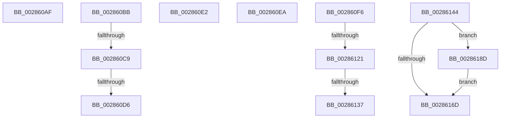

# sub_002860AF

- RVA: `0x002860AF`–`0x0028619D` (길이 `238` bytes)
- VA: `0x00000001402860AF`
- 실행 섹션: `.text`
- PDB 이름 있음: `아니요`; PDB Function 태그: `아니요`
- unwind 정보 RVA: `0x00066BAC`
- 디코드: `55`개 명령, `238/238` bytes 표시
- 미해석 바이트: `0` (있으면 어셈블리에 `.byte`로 보존)

> 이 문서는 커널 이미지의 기계어와 PDB 기호를 분석해 생성했습니다. 4번과 5번은 함수 원형과 자료형을 바이너리 사용 방식에서 추정한 C 해석이며 원본 소스 복구 결과는 아닙니다.

## 1. Dependencies

- 직접 호출 지점: **10**; 고유 호출 대상: **9**
- 직접 호출자로 확인된 함수: **0**
- RIP 상대 이미지 참조: **3**

### Outgoing calls
- `0x002860C9` → [KiCheckVpBackingLongSpinWaitHypercall](../30/KiCheckVpBackingLongSpinWaitHypercall_function_0030F490.md) (function, `0x0030F490`)
- `0x002860D8` → [HvlNotifyLongSpinWait](../30/HvlNotifyLongSpinWait_function_0030F460.md) (function, `0x0030F460`)
- `0x002860F9` → [MiGetSubsectionHoldingCrossPartitionReferences](../45/MiGetSubsectionHoldingCrossPartitionReferences_function_004589E4.md) (function, `0x004589E4`)
- `0x00286104` → [MiGetSubsectionHoldingCrossPartitionReferences](../45/MiGetSubsectionHoldingCrossPartitionReferences_function_004589E4.md) (function, `0x004589E4`)
- `0x00286128` → [MiUpdateSubsectionCrossPartitionRefs](../4F/MiUpdateSubsectionCrossPartitionRefs_function_004FB5DC.md) (function, `0x004FB5DC`)
- `0x00286137` → [MiComputeCrossPartitionSectionCharges](../32/MiComputeCrossPartitionSectionCharges_function_00325BBC.md) (function, `0x00325BBC`)
- `0x0028615D` → [MiCheckControlArea](MiCheckControlArea_function_002861B0.md) (function, `0x002861B0`)
- `0x00286173` → [MiReturnResident](MiReturnResident_function_00286890.md) (function, `0x00286890`)
- `0x00286183` → [MiReturnCrossPartitionCharges](MiReturnCrossPartitionCharges_function_002867D0.md) (function, `0x002867D0`)
- `0x00286196` → [MiReturnCommit](../24/MiReturnCommit_function_00248410.md) (function, `0x00248410`)

### Direct callers
- 이 함수 시작 RVA로 연결되는 직접 call은 확인되지 않았습니다. 간접 호출은 완전히 역산할 수 없습니다.

### Static image references
- `0x002860BB` → RVA `0x00FC6AB8` (`ALMOSTRO`; read)
- `0x002860EA` → RVA `0x00E38D00` (`.data`; read)
- `0x00286149` → RVA `0x00E30088` (`.data`; read)

## 2. Other-region calls and transfers

- 다른 실행 섹션으로 향하는 call: **0**
- call이 아닌 외부 분기/꼬리 이동: **10**
  - `0x002860B6` → [sub_00285E76 + 0x1A0](Unknown_function_00285E76.md) (`tail-transfer`)
  - `0x002860C3` → [sub_00285E76 + 0x57](Unknown_function_00285E76.md) (`tail-transfer`)
  - `0x002860D0` → [sub_00285E76 + 0x57](Unknown_function_00285E76.md) (`tail-transfer`)
  - `0x002860DD` → [sub_00285E76 + 0x59](Unknown_function_00285E76.md) (`tail-transfer`)
  - `0x002860E5` → [sub_00285E76 + 0x191](Unknown_function_00285E76.md) (`tail-transfer`)
  - `0x002860F1` → [sub_00285E76 + 0x191](Unknown_function_00285E76.md) (`tail-transfer`)
  - `0x0028611B` → [sub_00285E76 + 0x19A](Unknown_function_00285E76.md) (`tail-transfer`)
  - `0x00286131` → [sub_00285E76 + 0x19A](Unknown_function_00285E76.md) (`tail-transfer`)
  - `0x0028613F` → [sub_00285E76 + 0x19A](Unknown_function_00285E76.md) (`tail-transfer`)
  - `0x00286188` → [sub_00285E76 + 0xCF](Unknown_function_00285E76.md) (`tail-transfer`)

## 3. Assembly (complete function range)

```asm
002860AF  48 FF C8                        dec rax
002860B2  49 89 42 50                     mov qword ptr [r10 + 0x50], rax
002860B6  E9 5B FF FF FF                  jmp 0x140286016
002860BB  8B 05 F7 09 D4 00               mov eax, dword ptr [rip + 0xd409f7]
002860C1  A8 40                           test al, 0x40
002860C3  0F 84 04 FE FF FF               je 0x140285ecd
002860C9  E8 C2 93 08 00                  call 0x14030f490
002860CE  84 C0                           test al, al
002860D0  0F 84 F7 FD FF FF               je 0x140285ecd
002860D6  8B CE                           mov ecx, esi
002860D8  E8 83 93 08 00                  call 0x14030f460
002860DD  E9 ED FD FF FF                  jmp 0x140285ecf
002860E2  48 8B C5                        mov rax, rbp
002860E5  E9 1D FF FF FF                  jmp 0x140286007
002860EA  48 8D 05 0F 2C BB 00            lea rax, [rip + 0xbb2c0f]
002860F1  E9 11 FF FF FF                  jmp 0x140286007
002860F6  48 8B CB                        mov rcx, rbx
002860F9  E8 E6 28 1D 00                  call 0x1404589e4
002860FE  48 8B C8                        mov rcx, rax
00286101  4C 8B D0                        mov r10, rax
00286104  E8 DB 28 1D 00                  call 0x1404589e4
00286109  44 8B 58 30                     mov r11d, dword ptr [rax + 0x30]
0028610D  41 81 E3 FF FF FF 3F            and r11d, 0x3fffffff
00286114  41 81 FB FF FF FF 3F            cmp r11d, 0x3fffffff
0028611B  0F 84 EF FE FF FF               je 0x140286010
00286121  41 8D 53 FF                     lea edx, [r11 - 1]
00286125  49 8B CA                        mov rcx, r10
00286128  E8 AF 54 27 00                  call 0x1404fb5dc
0028612D  41 83 FB 01                     cmp r11d, 1
00286131  0F 85 D9 FE FF FF               jne 0x140286010
00286137  E8 80 FA 09 00                  call 0x140325bbc
0028613C  4C 8B C8                        mov r9, rax
0028613F  E9 CC FE FF FF                  jmp 0x140286010
00286144  41 0F B7 4E 3C                  movzx ecx, word ptr [r14 + 0x3c]
00286149  48 8B 05 38 9F BA 00            mov rax, qword ptr [rip + 0xba9f38]
00286150  81 E1 FF 03 00 00               and ecx, 0x3ff
00286156  48 8B 1C C8                     mov rbx, qword ptr [rax + rcx*8]
0028615A  49 8B CE                        mov rcx, r14
0028615D  E8 4E 00 00 00                  call 0x1402861b0
00286162  48 83 BC 24 88 00 00 00 00      cmp qword ptr [rsp + 0x88], 0
0028616B  75 20                           jne 0x14028618d
0028616D  48 8B D5                        mov rdx, rbp
00286170  48 8B CB                        mov rcx, rbx
00286173  E8 18 07 00 00                  call 0x140286890
00286178  4C 8B CD                        mov r9, rbp
0028617B  45 8B C5                        mov r8d, r13d
0028617E  33 D2                           xor edx, edx
00286180  48 8B CB                        mov rcx, rbx
00286183  E8 48 06 00 00                  call 0x1402867d0
00286188  E9 B8 FD FF FF                  jmp 0x140285f45
0028618D  45 33 C0                        xor r8d, r8d
00286190  48 8B D5                        mov rdx, rbp
00286193  48 8B CB                        mov rcx, rbx
00286196  E8 75 22 FC FF                  call 0x140248410
0028619B  EB D0                           jmp 0x14028616d
```

## 4. C-style interpretation (structured pseudocode)

```c
__int64 __fastcall sub_002860AF(void)
{
    __int64 result;
    unsigned __int64 v_stack_p88;

    result = (result) - 1;
    *(unsigned __int64 *)(v_r10 + 80) = result;
}
```

## 5. (Beta) C Style

```c
void sub_002860AF(void)
{
    int64_t result;
    uint64_t v_stack_p88;

    result = (result) - 1;
    *(uint64_t *)(local_r10 + 0x50) = result;
}
```

## 6. Execution-region graph

[열기: 2D/3D 그래프와 함수 탐색 컨트롤 패널](../../../control-panel.html?section=text&rva=0x002860AF&view=graph)

- 2D 그래프는 위에서 아래로 흐르고, 3D 그래프는 빈 공간을 드래그해 회전합니다. Shift+드래그는 이동, 휠은 확대·축소, 함수 노드 선택은 대상 보고서 이동입니다.

### Static fallback


