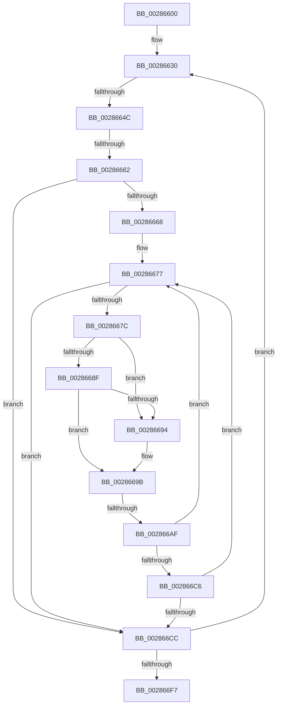

# sub_00286600

- RVA: `0x00286600`–`0x0028671A` (길이 `282` bytes)
- VA: `0x0000000140286600`
- 실행 섹션: `.text`
- PDB 이름 있음: `아니요`; PDB Function 태그: `아니요`
- unwind 정보 RVA: `0x00066BE4`
- 디코드: `68`개 명령, `282/282` bytes 표시
- 미해석 바이트: `0` (있으면 어셈블리에 `.byte`로 보존)

> 이 문서는 커널 이미지의 기계어와 PDB 기호를 분석해 생성했습니다. 4번과 5번은 함수 원형과 자료형을 바이너리 사용 방식에서 추정한 C 해석이며 원본 소스 복구 결과는 아닙니다.

## 1. Dependencies

- 직접 호출 지점: **2**; 고유 호출 대상: **2**
- 직접 호출자로 확인된 함수: **0**
- RIP 상대 이미지 참조: **1**

### Outgoing calls
- `0x002866BD` → [KiTryUnwaitThread](../35/KiTryUnwaitThread_function_003506D0.md) (function, `0x003506D0`)
- `0x002866E6` → [KiExitDispatcher](../25/KiExitDispatcher_function_00251CF0.md) (function, `0x00251CF0`)

### Direct callers
- 이 함수 시작 RVA로 연결되는 직접 call은 확인되지 않았습니다. 간접 호출은 완전히 역산할 수 없습니다.

### Static image references
- `0x0028663F` → RVA `0x00FC6D20` (`ALMOSTRO`; read)

## 2. Other-region calls and transfers

- 다른 실행 섹션으로 향하는 call: **0**
- call이 아닌 외부 분기/꼬리 이동: **3**
  - `0x00286646` → [sub_00286720](Unknown_function_00286720.md) (`tail-transfer`)
  - `0x0028665C` → [sub_00286720 + 0x30](Unknown_function_00286720.md) (`tail-transfer`)
  - `0x002866A9` → [sub_00286720 + 0x12](Unknown_function_00286720.md) (`tail-transfer`)

## 3. Assembly (complete function range)

```asm
00286600  48 89 58 10                     mov qword ptr [rax + 0x10], rbx
00286604  48 89 68 18                     mov qword ptr [rax + 0x18], rbp
00286608  48 89 70 F8                     mov qword ptr [rax - 8], rsi
0028660C  48 89 78 F0                     mov qword ptr [rax - 0x10], rdi
00286610  4C 89 60 E8                     mov qword ptr [rax - 0x18], r12
00286614  41 BC 02 00 00 00               mov r12d, 2
0028661A  4C 89 70 E0                     mov qword ptr [rax - 0x20], r14
0028661E  4C 89 78 D8                     mov qword ptr [rax - 0x28], r15
00286622  0F 1F 40 00                     nop dword ptr [rax]
00286626  66 66 0F 1F 84 00 00 00 00 00   nop word ptr [rax + rax]
00286630  48 8B 29                        mov rbp, qword ptr [rcx]
00286633  48 8D 59 10                     lea rbx, [rcx + 0x10]
00286637  45 0F 20 C7                     mov r15, cr8
0028663B  45 0F 22 C4                     mov cr8, r12
0028663F  83 3D DA 06 D4 00 00            cmp dword ptr [rip + 0xd406da], 0
00286646  0F 85 D4 00 00 00               jne 0x140286720
0028664C  65 4C 8B 34 25 20 00 00 00      mov r14, qword ptr gs:[0x20]
00286655  33 FF                           xor edi, edi
00286657  F0 0F BA 2B 07                  lock bts dword ptr [rbx], 7
0028665C  0F 82 EE 00 00 00               jb 0x140286750
00286662  83 7B 04 00                     cmp dword ptr [rbx + 4], 0
00286666  75 64                           jne 0x1402866cc
00286668  48 8B 7B 08                     mov rdi, qword ptr [rbx + 8]
0028666C  48 8D 73 08                     lea rsi, [rbx + 8]
00286670  C7 43 04 01 00 00 00            mov dword ptr [rbx + 4], 1
00286677  48 3B FE                        cmp rdi, rsi
0028667A  74 50                           je 0x1402866cc
0028667C  48 8B 17                        mov rdx, qword ptr [rdi]
0028667F  48 8B C7                        mov rax, rdi
00286682  48 8B FA                        mov rdi, rdx
00286685  48 8B 48 08                     mov rcx, qword ptr [rax + 8]
00286689  48 39 42 08                     cmp qword ptr [rdx + 8], rax
0028668D  75 05                           jne 0x140286694
0028668F  48 39 01                        cmp qword ptr [rcx], rax
00286692  74 07                           je 0x14028669b
00286694  B9 03 00 00 00                  mov ecx, 3
00286699  CD 29                           int 0x29
0028669B  48 89 11                        mov qword ptr [rcx], rdx
0028669E  48 89 4A 08                     mov qword ptr [rdx + 8], rcx
002866A2  0F B6 48 10                     movzx ecx, byte ptr [rax + 0x10]
002866A6  80 F9 01                        cmp cl, 1
002866A9  0F 85 83 00 00 00               jne 0x140286732
002866AF  44 0F B7 40 12                  movzx r8d, word ptr [rax + 0x12]
002866B4  45 33 C9                        xor r9d, r9d
002866B7  48 8B D0                        mov rdx, rax
002866BA  49 8B CE                        mov rcx, r14
002866BD  E8 0E A0 0C 00                  call 0x1403506d0
002866C2  84 C0                           test al, al
002866C4  74 B1                           je 0x140286677
002866C6  83 6B 04 01                     sub dword ptr [rbx + 4], 1
002866CA  75 AB                           jne 0x140286677
002866CC  F0 81 23 7F FF FF FF            lock and dword ptr [rbx], 0xffffff7f
002866D3  41 B9 01 00 00 00               mov r9d, 1
002866D9  44 88 7C 24 20                  mov byte ptr [rsp + 0x20], r15b
002866DE  45 8B C1                        mov r8d, r9d
002866E1  33 D2                           xor edx, edx
002866E3  49 8B CE                        mov rcx, r14
002866E6  E8 05 B6 FC FF                  call 0x140251cf0
002866EB  48 8B CD                        mov rcx, rbp
002866EE  48 85 ED                        test rbp, rbp
002866F1  0F 85 39 FF FF FF               jne 0x140286630
002866F7  4C 8B 74 24 38                  mov r14, qword ptr [rsp + 0x38]
002866FC  4C 8B 64 24 40                  mov r12, qword ptr [rsp + 0x40]
00286701  48 8B 7C 24 48                  mov rdi, qword ptr [rsp + 0x48]
00286706  48 8B 74 24 50                  mov rsi, qword ptr [rsp + 0x50]
0028670B  48 8B 6C 24 70                  mov rbp, qword ptr [rsp + 0x70]
00286710  48 8B 5C 24 68                  mov rbx, qword ptr [rsp + 0x68]
00286715  4C 8B 7C 24 30                  mov r15, qword ptr [rsp + 0x30]
```

## 4. C-style interpretation (structured pseudocode)

```c
__int64 __fastcall sub_00286600(__int64 a1, __int64 a2, __int64 a3, int a4, __int64 a5, __int64 a6, __int64 a7, __int64 a8, __int64 a9, __int64 a10, __int64 a11, __int64 a12, __int64 a13, __int64 a14)
{
    __int64 result;
    __int64 v_rdi;
    unsigned __int8 v_stack_p20;

    *(unsigned __int64 *)(result + 16) = v_rbx;
    *(unsigned __int64 *)(result + 24) = v_rbp;
    *(unsigned __int64 *)(result - 8) = v_rsi;
    *(unsigned __int64 *)(result - 16) = v_rdi;
    *(unsigned __int64 *)(result - 24) = v_r12;
    *(unsigned __int64 *)(result - 32) = v_r14;
    *(unsigned __int64 *)(result - 40) = v_r15;
loc_00286630:
    v_rdi = 0;
    if ((*(unsigned int *)(a1 + 16 + 4)) != 0) goto loc_002866CC;
    *(unsigned int *)(a1 + 16 + 4) = 1;
loc_00286677:
    if ((*(unsigned __int64 *)(a1 + 16 + 8)) == (a1 + 16 + 8)) goto loc_002866CC;
    if ((*(unsigned __int64 *)(*(unsigned __int64 *)(*(unsigned __int64 *)(a1 + 16 + 8)) + 8)) != (*(unsigned __int64 *)(a1 + 16 + 8))) goto loc_00286694;
    if ((*(unsigned __int64 *)(*(unsigned __int64 *)(*(unsigned __int64 *)(a1 + 16 + 8) + 8))) != (*(unsigned __int64 *)(a1 + 16 + 8))) {
        a1 = 3;
    }
    *(unsigned __int64 *)(a1) = *(unsigned __int64 *)(*(unsigned __int64 *)(a1 + 16 + 8));
    *(unsigned __int64 *)(*(unsigned __int64 *)(*(unsigned __int64 *)(a1 + 16 + 8)) + 8) = a1;
    a4 = 0;
    result = KiTryUnwaitThread(*(unsigned __int64 *)(gs_base + (0 + 32)), *(unsigned __int64 *)(a1 + 16 + 8), *(unsigned __int16 *)(*(unsigned __int64 *)(a1 + 16 + 8) + 18), a4);
    if ((unsigned __int8)(result) == 0) goto loc_00286677;
    if ((unsigned __int8)(result) != 0) goto loc_00286677;
loc_002866CC:
    v_stack_p20 = (unsigned __int8)(v_cr8);
    a2 = 0;
    result = KiExitDispatcher(*(unsigned __int64 *)(gs_base + (0 + 32)), a2, 1, 1);
    if (*(unsigned __int64 *)(a1) != 0) goto loc_00286630;
    return result;
}
```

## 5. (Beta) C Style

```c
int64_t sub_00286600(int64_t Arg1, int64_t Arg2, int64_t Arg3, int32_t Arg4, uint64_t Arg5, int64_t Arg6, int64_t Arg7, int64_t Arg8, int64_t Arg9, int64_t Arg10, uint64_t Arg11, uint64_t Arg12, int64_t Arg13, int64_t Arg14)
{
    int64_t result;
    int64_t local_rdi;
    uint8_t v_stack_p20;

    *(uint64_t *)(result + 0x10) = local_rbx;
    *(uint64_t *)(result + 0x18) = local_rbp;
    *(uint64_t *)(result - 0x8) = local_rsi;
    *(uint64_t *)(result - 0x10) = local_rdi;
    *(uint64_t *)(result - 0x18) = local_r12;
    *(uint64_t *)(result - 0x20) = local_r14;
    *(uint64_t *)(result - 0x28) = local_r15;
loc_00286630:
    local_rdi = 0;
    if ((*(uint32_t *)(Arg1 + 0x10 + 0x4)) != 0) goto loc_002866CC;
    *(uint32_t *)(Arg1 + 0x10 + 0x4) = 1;
loc_00286677:
    if ((*(uint64_t *)(Arg1 + 0x10 + 0x8)) == (Arg1 + 16 + 8)) goto loc_002866CC;
    if ((*(uint64_t *)(*(uint64_t *)(*(uint64_t *)(Arg1 + 0x10 + 0x8)) + 0x8)) != (*(uint64_t *)(Arg1 + 0x10 + 0x8))) goto loc_00286694;
    if ((*(uint64_t *)(*(uint64_t *)(*(uint64_t *)(Arg1 + 0x10 + 0x8) + 0x8))) != (*(uint64_t *)(Arg1 + 0x10 + 0x8))) {
        Arg1 = 3;
    }
    *(uint64_t *)(Arg1) = *(uint64_t *)(*(uint64_t *)(Arg1 + 0x10 + 0x8));
    *(uint64_t *)(*(uint64_t *)(*(uint64_t *)(Arg1 + 0x10 + 0x8)) + 0x8) = Arg1;
    Arg4 = 0;
    result = KiTryUnwaitThread(*(uint64_t *)(gs_base + (0 + 0x20)), *(uint64_t *)(Arg1 + 0x10 + 0x8), *(uint16_t *)(*(uint64_t *)(Arg1 + 0x10 + 0x8) + 0x12), Arg4);
    if ((uint8_t)(result) == 0) goto loc_00286677;
    if ((uint8_t)(result) != 0) goto loc_00286677;
loc_002866CC:
    v_stack_p20 = (uint8_t)(v_cr8);
    Arg2 = 0;
    result = KiExitDispatcher(*(uint64_t *)(gs_base + (0 + 0x20)), Arg2, 1, 1);
    if (*(uint64_t *)(Arg1) != 0) goto loc_00286630;
    return result;
}
```

## 6. Execution-region graph

[열기: 2D/3D 그래프와 함수 탐색 컨트롤 패널](../../../control-panel.html?section=text&rva=0x00286600&view=graph)

- 2D 그래프는 위에서 아래로 흐르고, 3D 그래프는 빈 공간을 드래그해 회전합니다. Shift+드래그는 이동, 휠은 확대·축소, 함수 노드 선택은 대상 보고서 이동입니다.

### Static fallback


