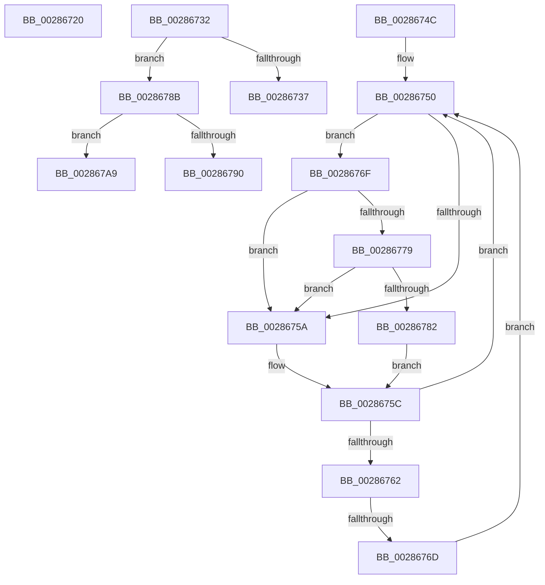

# sub_00286720

- RVA: `0x00286720`–`0x002867C8` (길이 `168` bytes)
- VA: `0x0000000140286720`
- 실행 섹션: `.text`
- PDB 이름 있음: `아니요`; PDB Function 태그: `아니요`
- unwind 정보 RVA: `0x00066C24`
- 디코드: `46`개 명령, `168/168` bytes 표시
- 미해석 바이트: `0` (있으면 어셈블리에 `.byte`로 보존)

> 이 문서는 커널 이미지의 기계어와 PDB 기호를 분석해 생성했습니다. 4번과 5번은 함수 원형과 자료형을 바이너리 사용 방식에서 추정한 C 해석이며 원본 소스 복구 결과는 아닙니다.

## 1. Dependencies

- 직접 호출 지점: **6**; 고유 호출 대상: **6**
- 직접 호출자로 확인된 함수: **0**
- RIP 상대 이미지 참조: **2**

### Outgoing calls
- `0x00286728` → [KiRaiseIrqlProcessIrqlFlags](../4F/KiRaiseIrqlProcessIrqlFlags_function_004F56FC.md) (function, `0x004F56FC`)
- `0x00286742` → [KiInsertQueueInternal](../21/KiInsertQueueInternal_function_00219B30.md) (function, `0x00219B30`)
- `0x00286779` → [KiCheckVpBackingLongSpinWaitHypercall](../30/KiCheckVpBackingLongSpinWaitHypercall_function_0030F490.md) (function, `0x0030F490`)
- `0x00286784` → [HvlNotifyLongSpinWait](../30/HvlNotifyLongSpinWait_function_0030F460.md) (function, `0x0030F460`)
- `0x0028679F` → [KiTryUnwaitThread](../35/KiTryUnwaitThread_function_003506D0.md) (function, `0x003506D0`)
- `0x002867BE` → [KeInsertQueueDpc](../20/KeInsertQueueDpc_function_00207C50.md) (function, `0x00207C50`)

### Direct callers
- 이 함수 시작 RVA로 연결되는 직접 call은 확인되지 않았습니다. 간접 호출은 완전히 역산할 수 없습니다.

### Static image references
- `0x00286752` → RVA `0x00FC52AC` (`ALMOSTRO`; reference)
- `0x0028676F` → RVA `0x00FC6AB8` (`ALMOSTRO`; read)

## 2. Other-region calls and transfers

- 다른 실행 섹션으로 향하는 call: **0**
- call이 아닌 외부 분기/꼬리 이동: **5**
  - `0x0028672D` → [sub_00286600 + 0x4C](Unknown_function_00286600.md) (`tail-transfer`)
  - `0x00286747` → [sub_00286600 + 0xC6](Unknown_function_00286600.md) (`tail-transfer`)
  - `0x00286767` → [sub_00286600 + 0x62](Unknown_function_00286600.md) (`tail-transfer`)
  - `0x002867A4` → [sub_00286600 + 0x77](Unknown_function_00286600.md) (`tail-transfer`)
  - `0x002867C3` → [sub_00286600 + 0x77](Unknown_function_00286600.md) (`tail-transfer`)

## 3. Assembly (complete function range)

```asm
00286720  41 0F B6 D4                     movzx edx, r12b
00286724  41 0F B6 CF                     movzx ecx, r15b
00286728  E8 CF EF 26 00                  call 0x1404f56fc
0028672D  E9 1A FF FF FF                  jmp 0x14028664c
00286732  41 3A CC                        cmp cl, r12b
00286735  75 54                           jne 0x14028678b
00286737  C6 40 11 05                     mov byte ptr [rax + 0x11], 5
0028673B  48 8B D0                        mov rdx, rax
0028673E  48 8B 48 18                     mov rcx, qword ptr [rax + 0x18]
00286742  E8 E9 33 F9 FF                  call 0x140219b30
00286747  E9 7A FF FF FF                  jmp 0x1402866c6
0028674C  0F 1F 40 00                     nop dword ptr [rax]
00286750  FF C7                           inc edi
00286752  85 3D 54 EB D3 00               test dword ptr [rip + 0xd3eb54], edi
00286758  74 15                           je 0x14028676f
0028675A  F3 90                           pause
0028675C  8B 03                           mov eax, dword ptr [rbx]
0028675E  84 C0                           test al, al
00286760  78 EE                           js 0x140286750
00286762  F0 0F BA 2B 07                  lock bts dword ptr [rbx], 7
00286767  0F 83 F5 FE FF FF               jae 0x140286662
0028676D  EB E1                           jmp 0x140286750
0028676F  8B 05 43 03 D4 00               mov eax, dword ptr [rip + 0xd40343]
00286775  A8 40                           test al, 0x40
00286777  74 E1                           je 0x14028675a
00286779  E8 12 8D 08 00                  call 0x14030f490
0028677E  84 C0                           test al, al
00286780  74 D8                           je 0x14028675a
00286782  8B CF                           mov ecx, edi
00286784  E8 D7 8C 08 00                  call 0x14030f460
00286789  EB D1                           jmp 0x14028675c
0028678B  80 F9 04                        cmp cl, 4
0028678E  74 19                           je 0x1402867a9
00286790  45 33 C9                        xor r9d, r9d
00286793  41 B8 00 01 00 00               mov r8d, 0x100
00286799  48 8B D0                        mov rdx, rax
0028679C  49 8B CE                        mov rcx, r14
0028679F  E8 2C 9F 0C 00                  call 0x1403506d0
002867A4  E9 CE FE FF FF                  jmp 0x140286677
002867A9  C6 40 11 05                     mov byte ptr [rax + 0x11], 5
002867AD  4C 8B C0                        mov r8, rax
002867B0  C7 43 04 00 00 00 00            mov dword ptr [rbx + 4], 0
002867B7  48 8B D3                        mov rdx, rbx
002867BA  48 8B 48 18                     mov rcx, qword ptr [rax + 0x18]
002867BE  E8 8D 14 F8 FF                  call 0x140207c50
002867C3  E9 AF FE FF FF                  jmp 0x140286677
```

## 4. C-style interpretation (structured pseudocode)

```c
__int64 __fastcall sub_00286720(__int64 a1, __int64 a2, __int64 a3, int a4)
{
    __int64 result;

    result = KiRaiseIrqlProcessIrqlFlags((unsigned __int8)(v_r15), (unsigned __int8)(v_r12), a3, a4);
}
```

## 5. (Beta) C Style

```c
int64_t sub_00286720(int64_t Arg1, int64_t Arg2, int64_t Arg3, int32_t Arg4)
{
    int64_t result;

    result = KiRaiseIrqlProcessIrqlFlags((uint8_t)(local_r15), (uint8_t)(local_r12), Arg3, Arg4);
}
```

## 6. Execution-region graph

[열기: 2D/3D 그래프와 함수 탐색 컨트롤 패널](../../../control-panel.html?section=text&rva=0x00286720&view=graph)

- 2D 그래프는 위에서 아래로 흐르고, 3D 그래프는 빈 공간을 드래그해 회전합니다. Shift+드래그는 이동, 휠은 확대·축소, 함수 노드 선택은 대상 보고서 이동입니다.

### Static fallback


