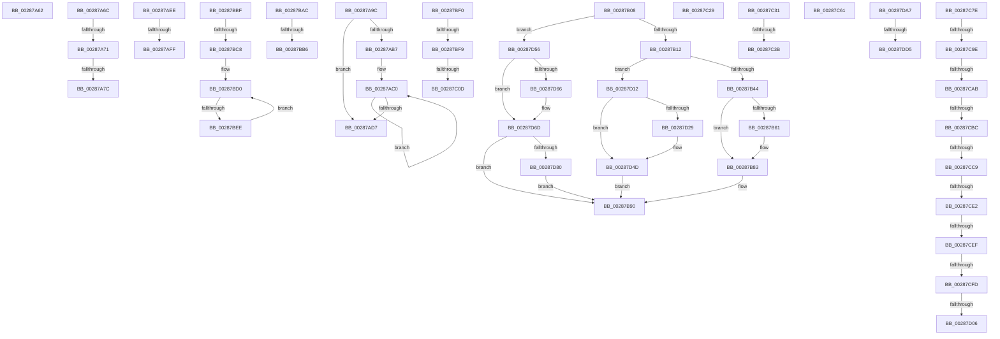

# sub_00287A62

- RVA: `0x00287A62`–`0x00287DEA` (길이 `904` bytes)
- VA: `0x0000000140287A62`
- 실행 섹션: `.text`
- PDB 이름 있음: `아니요`; PDB Function 태그: `아니요`
- unwind 정보 RVA: `0x00066D38`
- 디코드: `206`개 명령, `904/904` bytes 표시
- 미해석 바이트: `0` (있으면 어셈블리에 `.byte`로 보존)

> 이 문서는 커널 이미지의 기계어와 PDB 기호를 분석해 생성했습니다. 4번과 5번은 함수 원형과 자료형을 바이너리 사용 방식에서 추정한 C 해석이며 원본 소스 복구 결과는 아닙니다.

## 1. Dependencies

- 직접 호출 지점: **9**; 고유 호출 대상: **7**
- 직접 호출자로 확인된 함수: **0**
- RIP 상대 이미지 참조: **0**

### Outgoing calls
- `0x00287A95` → [MiUpdateLargePageCandidateValue](../33/MiUpdateLargePageCandidateValue_function_0033EF80.md) (function, `0x0033EF80`)
- `0x00287ADA` → [MiRemoveDecayClusterTimer](MiRemoveDecayClusterTimer_function_00288178.md) (function, `0x00288178`)
- `0x00287B54` → [MiDetermineModifiedPageListHead](../2B/MiDetermineModifiedPageListHead_function_002BAB00.md) (function, `0x002BAB00`)
- `0x00287B7A` → [MiAcquirePageListLock](../27/MiAcquirePageListLock_function_0027C450.md) (function, `0x0027C450`)
- `0x00287BFF` → [MiUnlinkSecondaryListStandbyPage](../33/MiUnlinkSecondaryListStandbyPage_function_0033B080.md) (function, `0x0033B080`)
- `0x00287C64` → [MiUnlinkProtectedStandbyPfn](../33/MiUnlinkProtectedStandbyPfn_function_0033C770.md) (function, `0x0033C770`)
- `0x00287D44` → [MiAcquirePageListLock](../27/MiAcquirePageListLock_function_0027C450.md) (function, `0x0027C450`)
- `0x00287D99` → [MiAcquirePageListLock](../27/MiAcquirePageListLock_function_0027C450.md) (function, `0x0027C450`)
- `0x00287DB7` → [MI_GET_SLAB_STANDBY_PAGE_SLAB_ENTRY](../2A/MI_GET_SLAB_STANDBY_PAGE_SLAB_ENTRY_function_002AF4B4.md) (function, `0x002AF4B4`)

### Direct callers
- 이 함수 시작 RVA로 연결되는 직접 call은 확인되지 않았습니다. 간접 호출은 완전히 역산할 수 없습니다.

### Static image references
- 디코드된 RIP-relative 메모리 참조가 없습니다.

## 2. Other-region calls and transfers

- 다른 실행 섹션으로 향하는 call: **0**
- call이 아닌 외부 분기/꼬리 이동: **30**
  - `0x00287A67` → [sub_00287607 + 0x64](Unknown_function_00287607.md) (`tail-transfer`)
  - `0x00287A6F` → [sub_00287607 + 0x419](Unknown_function_00287607.md) (`tail-transfer`)
  - `0x00287A7A` → [sub_00287607 + 0x41E](Unknown_function_00287607.md) (`tail-transfer`)
  - `0x00287A9A` → [sub_00287607 + 0x41E](Unknown_function_00287607.md) (`tail-transfer`)
  - `0x00287AE9` → [sub_00287607 + 0x377](Unknown_function_00287607.md) (`tail-transfer`)
  - `0x00287AF9` → [sub_00287607 + 0x2F4](Unknown_function_00287607.md) (`tail-transfer`)
  - `0x00287B03` → [sub_00287607 + 0x2F4](Unknown_function_00287607.md) (`tail-transfer`)
  - `0x00287BA7` → [sub_00287607 + 0x26D](Unknown_function_00287607.md) (`tail-transfer`)
  - `0x00287BB0` → [sub_00287607 + 0x31B](Unknown_function_00287607.md) (`tail-transfer`)
  - `0x00287BBA` → [sub_00287607 + 0x31B](Unknown_function_00287607.md) (`tail-transfer`)
  - `0x00287BC2` → [sub_00287607 + 0x2E3](Unknown_function_00287607.md) (`tail-transfer`)
  - `0x00287BE8` → [sub_00287607 + 0x2E3](Unknown_function_00287607.md) (`tail-transfer`)
  - `0x00287BF3` → [sub_00287607 + 0x336](Unknown_function_00287607.md) (`tail-transfer`)
  - `0x00287C07` → [sub_00287607 + 0x336](Unknown_function_00287607.md) (`tail-transfer`)
  - `0x00287C24` → [sub_00287607 + 0x336](Unknown_function_00287607.md) (`tail-transfer`)
  - `0x00287C2C` → [sub_00287607 + 0xDB](Unknown_function_00287607.md) (`tail-transfer`)
  - `0x00287C35` → [sub_00287E84 + 0x1CF](Unknown_function_00287E84.md) (`tail-transfer`)
  - `0x00287C5C` → [sub_00287607 + 0x42B](Unknown_function_00287607.md) (`tail-transfer`)
  - `0x00287C79` → [sub_00287607 + 0x258](Unknown_function_00287607.md) (`tail-transfer`)
  - `0x00287C98` → [sub_00287E84 + 0x144](Unknown_function_00287E84.md) (`tail-transfer`)
  - `0x00287CA5` → [sub_00287E84 + 0x144](Unknown_function_00287E84.md) (`tail-transfer`)
  - `0x00287CB6` → [sub_00287E84 + 0x72](Unknown_function_00287E84.md) (`tail-transfer`)
  - `0x00287CC3` → [sub_00287607 + 0x427](Unknown_function_00287607.md) (`tail-transfer`)
  - `0x00287CDC` → [sub_00287607 + 0x427](Unknown_function_00287607.md) (`tail-transfer`)
  - `0x00287CE9` → [sub_00287E84 + 0x160](Unknown_function_00287E84.md) (`tail-transfer`)
  - `0x00287CF7` → [sub_00287E84 + 0x151](Unknown_function_00287E84.md) (`tail-transfer`)
  - `0x00287D00` → [sub_00287607 + 0x427](Unknown_function_00287607.md) (`tail-transfer`)
  - `0x00287D0D` → [sub_00287607 + 0x42B](Unknown_function_00287607.md) (`tail-transfer`)
  - `0x00287DCF` → [sub_00287E84 + 0x110](Unknown_function_00287E84.md) (`tail-transfer`)
  - `0x00287DE5` → [sub_00287607 + 0x33F](Unknown_function_00287607.md) (`tail-transfer`)

## 3. Assembly (complete function range)

```asm
00287A62  BB A0 00 00 00                  mov ebx, 0xa0
00287A67  E9 FF FB FF FF                  jmp 0x14028766b
00287A6C  F6 C3 02                        test bl, 2
00287A6F  75 AF                           jne 0x140287a20
00287A71  4C 85 77 28                     test qword ptr [rdi + 0x28], r14
00287A75  48 8B 7C 24 40                  mov rdi, qword ptr [rsp + 0x40]
00287A7A  75 A9                           jne 0x140287a25
00287A7C  41 B9 02 00 00 00               mov r9d, 2
00287A82  48 C7 44 24 20 00 00 00 00      mov qword ptr [rsp + 0x20], 0
00287A8B  48 8B D6                        mov rdx, rsi
00287A8E  48 8B CF                        mov rcx, rdi
00287A91  45 8D 41 01                     lea r8d, [r9 + 1]
00287A95  E8 E6 74 0B 00                  call 0x14033ef80
00287A9A  EB 89                           jmp 0x140287a25
00287A9C  48 8B 57 18                     mov rdx, qword ptr [rdi + 0x18]
00287AA0  48 8B CA                        mov rcx, rdx
00287AA3  48 8B C2                        mov rax, rdx
00287AA6  49 23 CC                        and rcx, r12
00287AA9  F0 48 0F B1 4F 18               lock cmpxchg qword ptr [rdi + 0x18], rcx
00287AAF  4C 8B C0                        mov r8, rax
00287AB2  48 3B D0                        cmp rdx, rax
00287AB5  74 20                           je 0x140287ad7
00287AB7  66 0F 1F 84 00 00 00 00 00      nop word ptr [rax + rax]
00287AC0  49 8B C8                        mov rcx, r8
00287AC3  4D 23 C4                        and r8, r12
00287AC6  48 8B C1                        mov rax, rcx
00287AC9  F0 4C 0F B1 47 18               lock cmpxchg qword ptr [rdi + 0x18], r8
00287ACF  4C 8B C0                        mov r8, rax
00287AD2  48 3B C8                        cmp rcx, rax
00287AD5  75 E9                           jne 0x140287ac0
00287AD7  48 8B CF                        mov rcx, rdi
00287ADA  E8 99 06 00 00                  call 0x140288178
00287ADF  49 BE 00 00 00 00 00 00 20 00   movabs r14, 0x20000000000000
00287AE9  E9 90 FE FF FF                  jmp 0x14028797e
00287AEE  44 8B F3                        mov r14d, ebx
00287AF1  41 C1 EE 02                     shr r14d, 2
00287AF5  41 F6 C6 01                     test r14b, 1
00287AF9  0F 85 FC FD FF FF               jne 0x1402878fb
00287AFF  4D 89 5F 18                     mov qword ptr [r15 + 0x18], r11
00287B03  E9 F3 FD FF FF                  jmp 0x1402878fb
00287B08  41 83 F8 03                     cmp r8d, 3
00287B0C  0F 85 44 02 00 00               jne 0x140287d56
00287B12  F0 49 FF 0F                     lock dec qword ptr [r15]
00287B16  45 8D 70 7D                     lea r14d, [r8 + 0x7d]
00287B1A  48 8B 47 28                     mov rax, qword ptr [rdi + 0x28]
00287B1E  B9 40 1C 00 00                  mov ecx, 0x1c40
00287B23  48 C1 E8 3F                     shr rax, 0x3f
00287B27  BA C0 3F 00 00                  mov edx, 0x3fc0
00287B2C  84 C0                           test al, al
00287B2E  0F 44 CA                        cmove ecx, edx
00287B31  F0 4A FF 0C 11                  lock dec qword ptr [rcx + r10]
00287B36  8B 47 10                        mov eax, dword ptr [rdi + 0x10]
00287B39  48 0F BA E0 0A                  bt rax, 0xa
00287B3E  0F 82 CE 01 00 00               jb 0x140287d12
00287B44  41 3B DE                        cmp ebx, r14d
00287B47  49 8B D2                        mov rdx, r10
00287B4A  48 8B CF                        mov rcx, rdi
00287B4D  45 1B C0                        sbb r8d, r8d
00287B50  41 83 E0 02                     and r8d, 2
00287B54  E8 A7 2F 03 00                  call 0x1402bab00
00287B59  4C 8B F8                        mov r15, rax
00287B5C  41 3B DE                        cmp ebx, r14d
00287B5F  73 22                           jae 0x140287b83
00287B61  44 8B 44 24 34                  mov r8d, dword ptr [rsp + 0x34]
00287B66  48 8D 44 24 50                  lea rax, [rsp + 0x50]
00287B6B  45 8D 4E 81                     lea r9d, [r14 - 0x7f]
00287B6F  48 89 44 24 20                  mov qword ptr [rsp + 0x20], rax
00287B74  48 8B D7                        mov rdx, rdi
00287B77  49 8B CF                        mov rcx, r15
00287B7A  E8 D1 48 FF FF                  call 0x14027c450
00287B7F  0F BA EB 08                     bts ebx, 8
00287B83  48 8B 44 24 40                  mov rax, qword ptr [rsp + 0x40]
00287B88  F0 48 FF 88 A0 4C 00 00         lock dec qword ptr [rax + 0x4ca0]
00287B90  4C 8B 17                        mov r10, qword ptr [rdi]
00287B93  48 B8 FF FF FF FF FF 00 00 00   movabs rax, 0xffffffffff
00287B9D  4C 8B 5F 18                     mov r11, qword ptr [rdi + 0x18]
00287BA1  4C 23 D0                        and r10, rax
00287BA4  4C 23 D8                        and r11, rax
00287BA7  E9 C8 FC FF FF                  jmp 0x140287874
00287BAC  41 83 E6 01                     and r14d, 1
00287BB0  0F 85 6C FD FF FF               jne 0x140287922
00287BB6  4D 89 57 10                     mov qword ptr [r15 + 0x10], r10
00287BBA  E9 63 FD FF FF                  jmp 0x140287922
00287BBF  48 3B D0                        cmp rdx, rax
00287BC2  0F 84 22 FD FF FF               je 0x1402878ea
00287BC8  0F 1F 84 00 00 00 00 00         nop dword ptr [rax + rax]
00287BD0  49 8B C8                        mov rcx, r8
00287BD3  4D 23 C4                        and r8, r12
00287BD6  4D 0B C3                        or r8, r11
00287BD9  48 8B C1                        mov rax, rcx
00287BDC  F0 4D 0F B1 41 18               lock cmpxchg qword ptr [r9 + 0x18], r8
00287BE2  4C 8B C0                        mov r8, rax
00287BE5  48 3B C8                        cmp rcx, rax
00287BE8  0F 84 FC FC FF FF               je 0x1402878ea
00287BEE  EB E0                           jmp 0x140287bd0
00287BF0  F6 C3 0A                        test bl, 0xa
00287BF3  0F 85 44 FD FF FF               jne 0x14028793d
00287BF9  41 8B D5                        mov edx, r13d
00287BFC  48 8B CF                        mov rcx, rdi
00287BFF  E8 7C 34 0B 00                  call 0x14033b080
00287C04  45 85 F6                        test r14d, r14d
00287C07  0F 84 30 FD FF FF               je 0x14028793d
00287C0D  8B 47 20                        mov eax, dword ptr [rdi + 0x20]
00287C10  89 44 24 30                     mov dword ptr [rsp + 0x30], eax
00287C14  C1 E8 18                        shr eax, 0x18
00287C17  24 F7                           and al, 0xf7
00287C19  88 44 24 33                     mov byte ptr [rsp + 0x33], al
00287C1D  8B 44 24 30                     mov eax, dword ptr [rsp + 0x30]
00287C21  89 47 20                        mov dword ptr [rdi + 0x20], eax
00287C24  E9 14 FD FF FF                  jmp 0x14028793d
00287C29  83 CB 02                        or ebx, 2
00287C2C  E9 B1 FA FF FF                  jmp 0x1402876e2
00287C31  F6 47 23 10                     test byte ptr [rdi + 0x23], 0x10
00287C35  0F 85 18 04 00 00               jne 0x140288053
00287C3B  4C 89 27                        mov qword ptr [rdi], r12
00287C3E  49 BC 00 00 00 00 00 FF FF FF   movabs r12, 0xffffff0000000000
00287C48  48 8B 47 18                     mov rax, qword ptr [rdi + 0x18]
00287C4C  49 23 C4                        and rax, r12
00287C4F  48 89 47 18                     mov qword ptr [rdi + 0x18], rax
00287C53  33 C0                           xor eax, eax
00287C55  C7 47 24 00 00 00 00            mov dword ptr [rdi + 0x24], 0
00287C5C  E9 D1 FD FF FF                  jmp 0x140287a32
00287C61  48 8B CF                        mov rcx, rdi
00287C64  E8 07 4B 0B 00                  call 0x14033c770
00287C69  48 B8 FF FF FF FF 3F 00 00 00   movabs rax, 0x3fffffffff
00287C73  4C 8B D0                        mov r10, rax
00287C76  4C 8B D8                        mov r11, rax
00287C79  E9 E1 FB FF FF                  jmp 0x14028785f
00287C7E  48 C7 C6 FF FF FF FF            mov rsi, 0xffffffffffffffff
00287C85  F0 48 0F C1 B7 00 49 00 00      lock xadd qword ptr [rdi + 0x4900], rsi
00287C8E  48 FF CE                        dec rsi
00287C91  48 3B B7 00 41 00 00            cmp rsi, qword ptr [rdi + 0x4100]
00287C98  0F 84 2A 03 00 00               je 0x140287fc8
00287C9E  48 3B B7 08 41 00 00            cmp rsi, qword ptr [rdi + 0x4108]
00287CA5  0F 84 1D 03 00 00               je 0x140287fc8
00287CAB  48 8D 5E 01                     lea rbx, [rsi + 1]
00287CAF  48 81 FE 20 04 00 00            cmp rsi, 0x420
00287CB6  0F 86 3A 02 00 00               jbe 0x140287ef6
00287CBC  48 81 FE 9F 00 00 00            cmp rsi, 0x9f
00287CC3  0F 83 65 FD FF FF               jae 0x140287a2e
00287CC9  65 48 8B 14 25 88 01 00 00      mov rdx, qword ptr gs:[0x188]
00287CD2  8B 82 A4 05 00 00               mov eax, dword ptr [rdx + 0x5a4]
00287CD8  24 0C                           and al, 0xc
00287CDA  3C 08                           cmp al, 8
00287CDC  0F 84 4C FD FF FF               je 0x140287a2e
00287CE2  8B 4F 04                        mov ecx, dword ptr [rdi + 4]
00287CE5  48 83 FE 20                     cmp rsi, 0x20
00287CE9  0F 82 F5 02 00 00               jb 0x140287fe4
00287CEF  8B 82 A4 05 00 00               mov eax, dword ptr [rdx + 0x5a4]
00287CF5  A8 02                           test al, 2
00287CF7  0F 85 D8 02 00 00               jne 0x140287fd5
00287CFD  F6 C1 10                        test cl, 0x10
00287D00  0F 85 28 FD FF FF               jne 0x140287a2e
00287D06  8B 44 24 38                     mov eax, dword ptr [rsp + 0x38]
00287D0A  83 C8 02                        or eax, 2
00287D0D  E9 20 FD FF FF                  jmp 0x140287a32
00287D12  0F B6 47 24                     movzx eax, byte ptr [rdi + 0x24]
00287D16  83 E0 0F                        and eax, 0xf
00287D19  48 83 C0 40                     add rax, 0x40
00287D1D  4C 6B F8 58                     imul r15, rax, 0x58
00287D21  4D 03 FA                        add r15, r10
00287D24  41 3B DE                        cmp ebx, r14d
00287D27  73 24                           jae 0x140287d4d
00287D29  44 8B 44 24 34                  mov r8d, dword ptr [rsp + 0x34]
00287D2E  48 8D 44 24 50                  lea rax, [rsp + 0x50]
00287D33  41 B9 01 00 00 00               mov r9d, 1
00287D39  48 89 44 24 20                  mov qword ptr [rsp + 0x20], rax
00287D3E  48 8B D7                        mov rdx, rdi
00287D41  49 8B CF                        mov rcx, r15
00287D44  E8 07 47 FF FF                  call 0x14027c450
00287D49  0F BA EB 08                     bts ebx, 8
00287D4D  80 67 24 F0                     and byte ptr [rdi + 0x24], 0xf0
00287D51  E9 3A FE FF FF                  jmp 0x140287b90
00287D56  48 8B 47 28                     mov rax, qword ptr [rdi + 0x28]
00287D5A  48 85 C0                        test rax, rax
00287D5D  49 8D 82 40 1C 00 00            lea rax, [r10 + 0x1c40]
00287D64  78 07                           js 0x140287d6d
00287D66  49 8D 82 C0 3F 00 00            lea rax, [r10 + 0x3fc0]
00287D6D  F0 48 FF 08                     lock dec qword ptr [rax]
00287D71  41 BE 80 00 00 00               mov r14d, 0x80
00287D77  41 3B DE                        cmp ebx, r14d
00287D7A  0F 83 10 FE FF FF               jae 0x140287b90
00287D80  44 8B 44 24 34                  mov r8d, dword ptr [rsp + 0x34]
00287D85  48 8D 44 24 50                  lea rax, [rsp + 0x50]
00287D8A  45 8D 4E 81                     lea r9d, [r14 - 0x7f]
00287D8E  48 89 44 24 20                  mov qword ptr [rsp + 0x20], rax
00287D93  48 8B D7                        mov rdx, rdi
00287D96  49 8B CF                        mov rcx, r15
00287D99  E8 B2 46 FF FF                  call 0x14027c450
00287D9E  0F BA EB 08                     bts ebx, 8
00287DA2  E9 E9 FD FF FF                  jmp 0x140287b90
00287DA7  44 8B 4F 20                     mov r9d, dword ptr [rdi + 0x20]
00287DAB  48 8B CF                        mov rcx, rdi
00287DAE  44 89 4C 24 30                  mov dword ptr [rsp + 0x30], r9d
00287DB3  41 C1 E9 18                     shr r9d, 0x18
00287DB7  E8 F8 76 02 00                  call 0x1402af4b4
00287DBC  F0 FF 48 58                     lock dec dword ptr [rax + 0x58]
00287DC0  48 8B 48 38                     mov rcx, qword ptr [rax + 0x38]
00287DC4  83 B9 80 00 00 00 08            cmp dword ptr [rcx + 0x80], 8
00287DCB  48 8B 41 18                     mov rax, qword ptr [rcx + 0x18]
00287DCF  0F 84 BF 01 00 00               je 0x140287f94
00287DD5  41 80 E1 F7                     and r9b, 0xf7
00287DD9  44 88 4C 24 33                  mov byte ptr [rsp + 0x33], r9b
00287DDE  8B 44 24 30                     mov eax, dword ptr [rsp + 0x30]
00287DE2  89 47 20                        mov dword ptr [rdi + 0x20], eax
00287DE5  E9 5C FB FF FF                  jmp 0x140287946
```

## 4. C-style interpretation (structured pseudocode)

```c
__int64 __fastcall sub_00287A62(void)
{
    unsigned __int64 v_stack_p20;
    unsigned int v_stack_p30;
    unsigned __int8 v_stack_p33;
    unsigned int v_stack_p34;
    unsigned int v_stack_p38;
    unsigned __int64 v_stack_p40;
    unsigned __int64 v_stack_p50;
}
```

## 5. (Beta) C Style

```c
void sub_00287A62(void)
{
    uint64_t v_stack_p20;
    uint32_t v_stack_p30;
    uint8_t v_stack_p33;
    uint32_t v_stack_p34;
    uint32_t v_stack_p38;
    uint64_t v_stack_p40;
    uint64_t v_stack_p50;
}
```

## 6. Execution-region graph

[열기: 2D/3D 그래프와 함수 탐색 컨트롤 패널](../../../control-panel.html?section=text&rva=0x00287A62&view=graph)

- 2D 그래프는 위에서 아래로 흐르고, 3D 그래프는 빈 공간을 드래그해 회전합니다. Shift+드래그는 이동, 휠은 확대·축소, 함수 노드 선택은 대상 보고서 이동입니다.

### Static fallback


