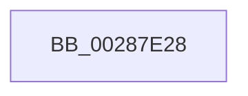

# sub_00287E28

- RVA: `0x00287E28`–`0x00287E6A` (길이 `66` bytes)
- VA: `0x0000000140287E28`
- 실행 섹션: `.text`
- PDB 이름 있음: `아니요`; PDB Function 태그: `아니요`
- unwind 정보 RVA: `0x00066D7C`
- 디코드: `14`개 명령, `66/66` bytes 표시
- 미해석 바이트: `0` (있으면 어셈블리에 `.byte`로 보존)

> 이 문서는 커널 이미지의 기계어와 PDB 기호를 분석해 생성했습니다. 4번과 5번은 함수 원형과 자료형을 바이너리 사용 방식에서 추정한 C 해석이며 원본 소스 복구 결과는 아닙니다.

## 1. Dependencies

- 직접 호출 지점: **1**; 고유 호출 대상: **1**
- 직접 호출자로 확인된 함수: **0**
- RIP 상대 이미지 참조: **1**

### Outgoing calls
- `0x00287E64` → [KeBugCheckEx](../4F/KeBugCheckEx_function_004FD660.md) (function, `0x004FD660`)

### Direct callers
- 이 함수 시작 RVA로 연결되는 직접 call은 확인되지 않았습니다. 간접 호출은 완전히 역산할 수 없습니다.

### Static image references
- `0x00287E3B` → RVA `0x00E3D548` (`.data`; read)

## 2. Other-region calls and transfers

- 다른 실행 섹션으로 향하는 call: **0**
- 별도 외부 분기/꼬리 이동을 확인하지 못했습니다.

## 3. Assembly (complete function range)

```asm
00287E28  8B 47 20                        mov eax, dword ptr [rdi + 0x20]
00287E2B  0F B7 C8                        movzx ecx, ax
00287E2E  49 BD 00 00 00 00 00 DE FF FF   movabs r13, 0xffffde0000000000
00287E38  49 8B C5                        mov rax, r13
00287E3B  4C 8B 0D 06 57 BB 00            mov r9, qword ptr [rip + 0xbb5706]
00287E42  48 2B F8                        sub rdi, rax
00287E45  48 C1 FF 04                     sar rdi, 4
00287E49  BA 02 00 00 00                  mov edx, 2
00287E4E  48 89 4C 24 20                  mov qword ptr [rsp + 0x20], rcx
00287E53  49 B8 AB AA AA AA AA AA AA AA   movabs r8, 0xaaaaaaaaaaaaaaab
00287E5D  4C 0F AF C7                     imul r8, rdi
00287E61  8D 4A 4C                        lea ecx, [rdx + 0x4c]
00287E64  E8 F7 57 27 00                  call 0x1404fd660
00287E69  CC                              int3
```

## 4. C-style interpretation (structured pseudocode)

```c
__int64 __fastcall sub_00287E28(void)
{
    __int64 result;
    __int64 v_rdi;
    unsigned __int64 v_stack_p20;

    v_rdi = (v_rdi) - (v_r13);
    v_rdi = (v_rdi) >> (4);
    v_stack_p20 = (unsigned __int16)((unsigned int)(*(unsigned int *)(v_rdi + 32)));
    a3 = (a3) * (v_rdi);
    result = KeBugCheckEx(2 + 76, 2, a3, *(unsigned __int64 *)(v_rip + 12277510));
    return result;
}
```

## 5. (Beta) C Style

```c
void sub_00287E28(void)
{
    int64_t result;
    int64_t local_rdi;
    uint64_t v_stack_p20;

    local_rdi = (local_rdi) - (local_r13);
    local_rdi = (local_rdi) >> (4);
    v_stack_p20 = (uint16_t)((uint32_t)(*(uint32_t *)(local_rdi + 0x20)));
    a3 = (a3) * (local_rdi);
    result = KeBugCheckEx(2 + 76, 2, a3, *(uint64_t *)(v_rip + 0xBB5706));
    return result;
}
```

## 6. Execution-region graph

[열기: 2D/3D 그래프와 함수 탐색 컨트롤 패널](../../../control-panel.html?section=text&rva=0x00287E28&view=graph)

- 2D 그래프는 위에서 아래로 흐르고, 3D 그래프는 빈 공간을 드래그해 회전합니다. Shift+드래그는 이동, 휠은 확대·축소, 함수 노드 선택은 대상 보고서 이동입니다.

### Static fallback


