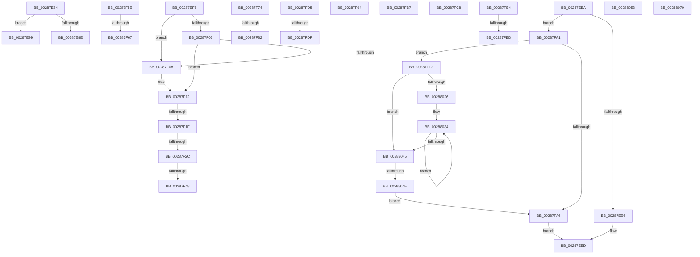

# sub_00287E84

- RVA: `0x00287E84`–`0x002880D0` (길이 `588` bytes)
- VA: `0x0000000140287E84`
- 실행 섹션: `.text`
- PDB 이름 있음: `아니요`; PDB Function 태그: `아니요`
- unwind 정보 RVA: `0x00066DA0`
- 디코드: `148`개 명령, `588/588` bytes 표시
- 미해석 바이트: `0` (있으면 어셈블리에 `.byte`로 보존)

> 이 문서는 커널 이미지의 기계어와 PDB 기호를 분석해 생성했습니다. 4번과 5번은 함수 원형과 자료형을 바이너리 사용 방식에서 추정한 C 해석이며 원본 소스 복구 결과는 아닙니다.

## 1. Dependencies

- 직접 호출 지점: **12**; 고유 호출 대상: **9**
- 직접 호출자로 확인된 함수: **0**
- RIP 상대 이미지 참조: **2**

### Outgoing calls
- `0x00287EA2` → [MiGetSlabAllocatorRepurposedStandbyList](../2A/MiGetSlabAllocatorRepurposedStandbyList_function_002AF428.md) (function, `0x002AF428`)
- `0x00287F0D` → [MiObtainFreePages](../3B/MiObtainFreePages_function_003BB724.md) (function, `0x003BB724`)
- `0x00287F34` → [MiSlabDemotionLowMemoryConditionUpdate](../3B/MiSlabDemotionLowMemoryConditionUpdate_function_003BB7E0.md) (function, `0x003BB7E0`)
- `0x00287F54` → [KeSetEvent](../33/KeSetEvent_function_0033F310.md) (function, `0x0033F310`)
- `0x00287F8A` → [ExpReleaseSpinLockSharedFromDpcLevelInstrumented](../2F/ExpReleaseSpinLockSharedFromDpcLevelInstrumented_function_002F0F48.md) (function, `0x002F0F48`)
- `0x00287FBC` → [MiUnlinkPageFromBadList](../3B/MiUnlinkPageFromBadList_function_003BD620.md) (function, `0x003BD620`)
- `0x00287FCB` → [MiUpdateAvailableEventsAtDpc](../3B/MiUpdateAvailableEventsAtDpc_function_003BC804.md) (function, `0x003BC804`)
- `0x00288066` → [MiUnlinkPageFromBadList](../3B/MiUnlinkPageFromBadList_function_003BD620.md) (function, `0x003BD620`)
- `0x00288073` → [MiGetPfnPriority](../32/MiGetPfnPriority_function_003226F0.md) (function, `0x003226F0`)
- `0x0028809A` → [KeBugCheckEx](../4F/KeBugCheckEx_function_004FD660.md) (function, `0x004FD660`)
- `0x002880A3` → [MiGetPfnPriority](../32/MiGetPfnPriority_function_003226F0.md) (function, `0x003226F0`)
- `0x002880CA` → [KeBugCheckEx](../4F/KeBugCheckEx_function_004FD660.md) (function, `0x004FD660`)

### Direct callers
- 이 함수 시작 RVA로 연결되는 직접 call은 확인되지 않았습니다. 간접 호출은 완전히 역산할 수 없습니다.

### Static image references
- `0x00287EBA` → RVA `0x00E301A8` (`.data`; read)
- `0x00287F74` → RVA `0x00F0DE58` (`.data`; read)

## 2. Other-region calls and transfers

- 다른 실행 섹션으로 향하는 call: **0**
- call이 아닌 외부 분기/꼬리 이동: **20**
  - `0x00287E94` → [sub_00287607 + 0x142](Unknown_function_00287607.md) (`tail-transfer`)
  - `0x00287EB5` → [sub_00287607 + 0x142](Unknown_function_00287607.md) (`tail-transfer`)
  - `0x00287EF1` → [sub_00287607 + 0x377](Unknown_function_00287607.md) (`tail-transfer`)
  - `0x00287F19` → [sub_00287A62 + 0x25A](Unknown_function_00287A62.md) (`tail-transfer`)
  - `0x00287F26` → [sub_00287A62 + 0x25A](Unknown_function_00287A62.md) (`tail-transfer`)
  - `0x00287F42` → [sub_00287A62 + 0x25A](Unknown_function_00287A62.md) (`tail-transfer`)
  - `0x00287F59` → [sub_00287A62 + 0x25A](Unknown_function_00287A62.md) (`tail-transfer`)
  - `0x00287F61` → [sub_00287607 + 0x26D](Unknown_function_00287607.md) (`tail-transfer`)
  - `0x00287F6F` → [sub_00287607 + 0x26D](Unknown_function_00287607.md) (`tail-transfer`)
  - `0x00287F7C` → [sub_00287607 + 0x409](Unknown_function_00287607.md) (`tail-transfer`)
  - `0x00287F8F` → [sub_00287607 + 0x413](Unknown_function_00287607.md) (`tail-transfer`)
  - `0x00287F9C` → [sub_00287A62 + 0x373](Unknown_function_00287A62.md) (`tail-transfer`)
  - `0x00287FC3` → [sub_00287607 + 0x42B](Unknown_function_00287607.md) (`tail-transfer`)
  - `0x00287FD0` → [sub_00287A62 + 0x249](Unknown_function_00287A62.md) (`tail-transfer`)
  - `0x00287FD9` → [sub_00287A62 + 0x29B](Unknown_function_00287A62.md) (`tail-transfer`)
  - `0x00287FDF` → [sub_00287607 + 0x427](Unknown_function_00287607.md) (`tail-transfer`)
  - `0x00287FE7` → [sub_00287A62 + 0x28D](Unknown_function_00287A62.md) (`tail-transfer`)
  - `0x00287FED` → [sub_00287A62 + 0x2A4](Unknown_function_00287A62.md) (`tail-transfer`)
  - `0x00288048` → [sub_00287607 + 0x377](Unknown_function_00287607.md) (`tail-transfer`)
  - `0x0028806B` → [sub_00287A62 + 0x1D9](Unknown_function_00287A62.md) (`tail-transfer`)

## 3. Assembly (complete function range)

```asm
00287E84  8B 47 20                        mov eax, dword ptr [rdi + 0x20]
00287E87  C1 E8 18                        shr eax, 0x18
00287E8A  A8 08                           test al, 8
00287E8C  75 0B                           jne 0x140287e99
00287E8E  83 E3 EF                        and ebx, 0xffffffef
00287E91  83 E3 FE                        and ebx, 0xfffffffe
00287E94  E9 B0 F8 FF FF                  jmp 0x140287749
00287E99  45 33 C0                        xor r8d, r8d
00287E9C  41 8B D6                        mov edx, r14d
00287E9F  48 8B CF                        mov rcx, rdi
00287EA2  E8 81 75 02 00                  call 0x1402af428
00287EA7  4C 8B 54 24 40                  mov r10, qword ptr [rsp + 0x40]
00287EAC  83 CB 08                        or ebx, 8
00287EAF  83 E3 FE                        and ebx, 0xfffffffe
00287EB2  4C 8B F8                        mov r15, rax
00287EB5  E9 8F F8 FF FF                  jmp 0x140287749
00287EBA  48 8B 05 E7 82 BA 00            mov rax, qword ptr [rip + 0xba82e7]
00287EC1  4C 8B C6                        mov r8, rsi
00287EC4  41 83 E0 1F                     and r8d, 0x1f
00287EC8  48 8B CE                        mov rcx, rsi
00287ECB  48 C1 E9 05                     shr rcx, 5
00287ECF  BA 01 00 00 00                  mov edx, 1
00287ED4  4C 8D 0C 88                     lea r9, [rax + rcx*4]
00287ED8  49 8D 40 01                     lea rax, [r8 + 1]
00287EDC  48 83 F8 20                     cmp rax, 0x20
00287EE0  0F 87 BB 00 00 00               ja 0x140287fa1
00287EE6  41 8B C8                        mov ecx, r8d
00287EE9  8B C2                           mov eax, edx
00287EEB  D3 E0                           shl eax, cl
00287EED  F0 41 09 01                     lock or dword ptr [r9], eax
00287EF1  E9 88 FA FF FF                  jmp 0x14028797e
00287EF6  48 8B 87 C0 44 00 00            mov rax, qword ptr [rdi + 0x44c0]
00287EFD  48 85 C0                        test rax, rax
00287F00  74 08                           je 0x140287f0a
00287F02  0F B6 40 34                     movzx eax, byte ptr [rax + 0x34]
00287F06  84 C0                           test al, al
00287F08  75 08                           jne 0x140287f12
00287F0A  48 8B CF                        mov rcx, rdi
00287F0D  E8 12 38 13 00                  call 0x1403bb724
00287F12  48 81 FE A0 00 00 00            cmp rsi, 0xa0
00287F19  0F 83 9D FD FF FF               jae 0x140287cbc
00287F1F  48 81 FB A0 00 00 00            cmp rbx, 0xa0
00287F26  0F 82 90 FD FF FF               jb 0x140287cbc
00287F2C  BA 01 00 00 00                  mov edx, 1
00287F31  48 8B CF                        mov rcx, rdi
00287F34  E8 A7 38 13 00                  call 0x1403bb7e0
00287F39  8B 87 B4 04 00 00               mov eax, dword ptr [rdi + 0x4b4]
00287F3F  83 F8 FF                        cmp eax, -1
00287F42  0F 84 74 FD FF FF               je 0x140287cbc
00287F48  48 8D 8F 20 04 00 00            lea rcx, [rdi + 0x420]
00287F4F  45 33 C0                        xor r8d, r8d
00287F52  33 D2                           xor edx, edx
00287F54  E8 B7 73 0B 00                  call 0x14033f310
00287F59  E9 5E FD FF FF                  jmp 0x140287cbc
00287F5E  F6 C3 08                        test bl, 8
00287F61  0F 85 0D F9 FF FF               jne 0x140287874
00287F67  C7 44 24 38 01 00 00 00         mov dword ptr [rsp + 0x38], 1
00287F6F  E9 00 F9 FF FF                  jmp 0x140287874
00287F74  8B 05 DE 5E C8 00               mov eax, dword ptr [rip + 0xc85ede]
00287F7A  85 C0                           test eax, eax
00287F7C  0F 85 8E FA FF FF               jne 0x140287a10
00287F82  48 8B 94 24 F8 00 00 00         mov rdx, qword ptr [rsp + 0xf8]
00287F8A  E8 B9 8F 06 00                  call 0x1402f0f48
00287F8F  E9 86 FA FF FF                  jmp 0x140287a1a
00287F94  F0 48 FF 88 80 47 00 00         lock dec qword ptr [rax + 0x4780]
00287F9C  E9 34 FE FF FF                  jmp 0x140287dd5
00287FA1  4D 85 C0                        test r8, r8
00287FA4  75 4C                           jne 0x140287ff2
00287FA6  48 8B CA                        mov rcx, rdx
00287FA9  B8 01 00 00 00                  mov eax, 1
00287FAE  D3 E0                           shl eax, cl
00287FB0  FF C8                           dec eax
00287FB2  E9 36 FF FF FF                  jmp 0x140287eed
00287FB7  33 D2                           xor edx, edx
00287FB9  48 8B CF                        mov rcx, rdi
00287FBC  E8 5F 56 13 00                  call 0x1403bd620
00287FC1  33 C0                           xor eax, eax
00287FC3  E9 6A FA FF FF                  jmp 0x140287a32
00287FC8  48 8B CF                        mov rcx, rdi
00287FCB  E8 34 48 13 00                  call 0x1403bc804
00287FD0  E9 D6 FC FF FF                  jmp 0x140287cab
00287FD5  48 83 FE 21                     cmp rsi, 0x21
00287FD9  0F 82 1E FD FF FF               jb 0x140287cfd
00287FDF  E9 4A FA FF FF                  jmp 0x140287a2e
00287FE4  F6 C1 04                        test cl, 4
00287FE7  0F 84 02 FD FF FF               je 0x140287cef
00287FED  E9 14 FD FF FF                  jmp 0x140287d06
00287FF2  8B C6                           mov eax, esi
00287FF4  BA 20 00 00 00                  mov edx, 0x20
00287FF9  83 E0 1F                        and eax, 0x1f
00287FFC  2B D0                           sub edx, eax
00287FFE  B8 01 00 00 00                  mov eax, 1
00288003  8B CA                           mov ecx, edx
00288005  D3 E0                           shl eax, cl
00288007  49 8B C8                        mov rcx, r8
0028800A  FF C8                           dec eax
0028800C  D3 E0                           shl eax, cl
0028800E  F0 41 09 01                     lock or dword ptr [r9], eax
00288012  8B C2                           mov eax, edx
00288014  49 83 C1 04                     add r9, 4
00288018  BA 01 00 00 00                  mov edx, 1
0028801D  48 2B D0                        sub rdx, rax
00288020  48 83 FA 20                     cmp rdx, 0x20
00288024  72 1F                           jb 0x140288045
00288026  48 8B CA                        mov rcx, rdx
00288029  48 C1 E9 05                     shr rcx, 5
0028802D  48 6B C1 E0                     imul rax, rcx, -0x20
00288031  48 03 D0                        add rdx, rax
00288034  41 C7 01 FF FF FF FF            mov dword ptr [r9], 0xffffffff
0028803B  49 83 C1 04                     add r9, 4
0028803F  48 83 E9 01                     sub rcx, 1
00288043  75 EF                           jne 0x140288034
00288045  48 85 D2                        test rdx, rdx
00288048  0F 84 30 F9 FF FF               je 0x14028797e
0028804E  E9 53 FF FF FF                  jmp 0x140287fa6
00288053  41 BE 80 00 00 00               mov r14d, 0x80
00288059  48 8B CF                        mov rcx, rdi
0028805C  41 3B DE                        cmp ebx, r14d
0028805F  45 0F 42 F4                     cmovb r14d, r12d
00288063  41 8B D6                        mov edx, r14d
00288066  E8 B5 55 13 00                  call 0x1403bd620
0028806B  E9 CB FB FF FF                  jmp 0x140287c3b
00288070  49 8B CE                        mov rcx, r14
00288073  E8 78 A6 09 00                  call 0x1403226f0
00288078  44 8B D0                        mov r10d, eax
0028807B  4D 8B CE                        mov r9, r14
0028807E  41 C1 E4 08                     shl r12d, 8
00288082  4C 8B C7                        mov r8, rdi
00288085  41 8B C4                        mov eax, r12d
00288088  BA 86 88 00 00                  mov edx, 0x8886
0028808D  4C 0B D0                        or r10, rax
00288090  B9 1A 00 00 00                  mov ecx, 0x1a
00288095  4C 89 54 24 20                  mov qword ptr [rsp + 0x20], r10
0028809A  E8 C1 55 27 00                  call 0x1404fd660
0028809F  CC                              int3
002880A0  49 8B CE                        mov rcx, r14
002880A3  E8 48 A6 09 00                  call 0x1403226f0
002880A8  44 8B D0                        mov r10d, eax
002880AB  4D 8B CE                        mov r9, r14
002880AE  41 C1 E4 08                     shl r12d, 8
002880B2  4C 8B C7                        mov r8, rdi
002880B5  41 8B C4                        mov eax, r12d
002880B8  BA 87 88 00 00                  mov edx, 0x8887
002880BD  4C 0B D0                        or r10, rax
002880C0  B9 1A 00 00 00                  mov ecx, 0x1a
002880C5  4C 89 54 24 20                  mov qword ptr [rsp + 0x20], r10
002880CA  E8 91 55 27 00                  call 0x1404fd660
002880CF  CC                              int3
```

## 4. C-style interpretation (structured pseudocode)

```c
__int64 __fastcall sub_00287E84(__int64 a1, __int64 a2, int a3, __int64 a4, __int64 a5, __int64 a6, __int64 a7, __int64 a8)
{
    __int64 result;
    __int64 v_rbx;
    unsigned __int64 v_stack_p20;
    unsigned int v_stack_p38;
    unsigned __int64 v_stack_pF8;

    result = (unsigned int)(((unsigned int)(*(unsigned int *)(v_rdi + 32))) >> (24));
    if ((((unsigned __int8)(result)) & (8)) != 0) goto loc_00287E99;
    v_rbx = (unsigned int)((v_rbx) & (0xFFFFFFEFULL));
    v_rbx = (unsigned int)((v_rbx) & (0xFFFFFFFEULL));
loc_00287E99:
    a3 = 0;
    result = MiGetSlabAllocatorRepurposedStandbyList(v_rdi, (unsigned int)((unsigned int)(v_r14)), a3, a4);
    v_rbx = (unsigned int)((v_rbx) | (8));
    v_rbx = (unsigned int)((v_rbx) & (0xFFFFFFFEULL));
}
```

## 5. (Beta) C Style

```c
int64_t sub_00287E84(int64_t Arg1, int64_t Arg2, int32_t Arg3, int64_t Arg4, uint64_t Arg5, uint64_t Arg6, uint64_t Arg7, int64_t Arg8)
{
    int64_t result;
    int64_t local_rbx;
    uint64_t v_stack_p20;
    uint32_t v_stack_p38;
    uint64_t v_stack_pF8;

    result = (uint32_t)(((uint32_t)(*(uint32_t *)(local_rdi + 0x20))) >> (24));
    if ((((uint8_t)(result)) & (8)) != 0) goto loc_00287E99;
    local_rbx = (uint32_t)((local_rbx) & (0xFFFFFFEFULL));
    local_rbx = (uint32_t)((local_rbx) & (0xFFFFFFFEULL));
loc_00287E99:
    Arg3 = 0;
    result = MiGetSlabAllocatorRepurposedStandbyList(local_rdi, (uint32_t)((uint32_t)(local_r14)), Arg3, Arg4);
    local_rbx = (uint32_t)((local_rbx) | (8));
    local_rbx = (uint32_t)((local_rbx) & (0xFFFFFFFEULL));
}
```

## 6. Execution-region graph

[열기: 2D/3D 그래프와 함수 탐색 컨트롤 패널](../../../control-panel.html?section=text&rva=0x00287E84&view=graph)

- 2D 그래프는 위에서 아래로 흐르고, 3D 그래프는 빈 공간을 드래그해 회전합니다. Shift+드래그는 이동, 휠은 확대·축소, 함수 노드 선택은 대상 보고서 이동입니다.

### Static fallback


