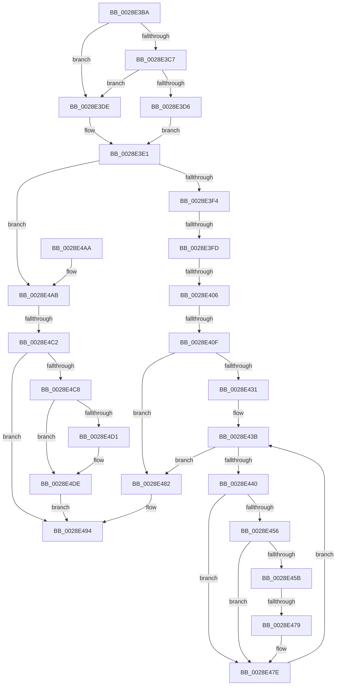

# sub_0028E3BA

- RVA: `0x0028E3BA`–`0x0028E4E4` (길이 `298` bytes)
- VA: `0x000000014028E3BA`
- 실행 섹션: `.text`
- PDB 이름 있음: `아니요`; PDB Function 태그: `아니요`
- unwind 정보 RVA: `0x00067090`
- 디코드: `79`개 명령, `298/298` bytes 표시
- 미해석 바이트: `0` (있으면 어셈블리에 `.byte`로 보존)

> 이 문서는 커널 이미지의 기계어와 PDB 기호를 분석해 생성했습니다. 4번과 5번은 함수 원형과 자료형을 바이너리 사용 방식에서 추정한 C 해석이며 원본 소스 복구 결과는 아닙니다.

## 1. Dependencies

- 직접 호출 지점: **3**; 고유 호출 대상: **3**
- 직접 호출자로 확인된 함수: **0**
- RIP 상대 이미지 참조: **4**

### Outgoing calls
- `0x0028E3E3` → [MiSystemVaTypeToVm](MiSystemVaTypeToVm_function_0028EB50.md) (function, `0x0028EB50`)
- `0x0028E48F` → [MiUnlockPage](../31/MiUnlockPage_function_0031A3E0.md) (function, `0x0031A3E0`)
- `0x0028E4D9` → [KiLowerIrqlProcessIrqlFlags](../4F/KiLowerIrqlProcessIrqlFlags_function_004F5698.md) (function, `0x004F5698`)

### Direct callers
- 이 함수 시작 RVA로 연결되는 직접 call은 확인되지 않았습니다. 간접 호출은 완전히 역산할 수 없습니다.

### Static image references
- `0x0028E413` → RVA `0x00E30088` (`.data`; read)
- `0x0028E45F` → RVA `0x00E3738C` (`.data`; read)
- `0x0028E482` → RVA `0x00EF517C` (`.data`; read/write)
- `0x0028E4C8` → RVA `0x00FC6D20` (`ALMOSTRO`; read)

## 2. Other-region calls and transfers

- 다른 실행 섹션으로 향하는 call: **0**
- call이 아닌 외부 분기/꼬리 이동: **5**
  - `0x0028E3F7` → [sub_0028E4EC + 0x1B2](Unknown_function_0028E4EC.md) (`tail-transfer`)
  - `0x0028E400` → [sub_0028E4EC + 0x20B](Unknown_function_0028E4EC.md) (`tail-transfer`)
  - `0x0028E409` → [sub_0028E4EC + 0x1F6](Unknown_function_0028E4EC.md) (`tail-transfer`)
  - `0x0028E473` → [sub_0028E4EC + 0x27](Unknown_function_0028E4EC.md) (`tail-transfer`)
  - `0x0028E4C0` → [sub_0028E4EC](Unknown_function_0028E4EC.md) (`tail-transfer`)

## 3. Assembly (complete function range)

```asm
0028E3BA  4C 89 64 24 78                  mov qword ptr [rsp + 0x78], r12
0028E3BF  48 8B C2                        mov rax, rdx
0028E3C2  48 3B F0                        cmp rsi, rax
0028E3C5  72 17                           jb 0x14028e3de
0028E3C7  48 B8 FF FF FF FF FF F6 FF FF   movabs rax, 0xfffff6ffffffffff
0028E3D1  48 3B F0                        cmp rsi, rax
0028E3D4  77 08                           ja 0x14028e3de
0028E3D6  41 BC 01 00 00 00               mov r12d, 1
0028E3DC  EB 03                           jmp 0x14028e3e1
0028E3DE  45 8B E6                        mov r12d, r14d
0028E3E1  8B CB                           mov ecx, ebx
0028E3E3  E8 68 07 00 00                  call 0x14028eb50
0028E3E8  4C 8B E8                        mov r13, rax
0028E3EB  83 FB 04                        cmp ebx, 4
0028E3EE  0F 84 B7 00 00 00               je 0x14028e4ab
0028E3F4  83 FB 05                        cmp ebx, 5
0028E3F7  0F 84 A1 02 00 00               je 0x14028e69e
0028E3FD  83 FB 0B                        cmp ebx, 0xb
0028E400  0F 84 F1 02 00 00               je 0x14028e6f7
0028E406  83 FB 11                        cmp ebx, 0x11
0028E409  0F 84 D3 02 00 00               je 0x14028e6e2
0028E40F  48 8B 47 28                     mov rax, qword ptr [rdi + 0x28]
0028E413  48 8B 0D 6E 1C BA 00            mov rcx, qword ptr [rip + 0xba1c6e]
0028E41A  48 C1 E8 2B                     shr rax, 0x2b
0028E41E  25 FF 03 00 00                  and eax, 0x3ff
0028E423  48 8B 0C C1                     mov rcx, qword ptr [rcx + rax*8]
0028E427  48 89 4C 24 70                  mov qword ptr [rsp + 0x70], rcx
0028E42C  83 FB 08                        cmp ebx, 8
0028E42F  75 51                           jne 0x14028e482
0028E431  44 8B 81 58 48 00 00            mov r8d, dword ptr [rcx + 0x4858]
0028E438  41 8B D6                        mov edx, r14d
0028E43B  41 3B D0                        cmp edx, r8d
0028E43E  73 42                           jae 0x14028e482
0028E440  8B C2                           mov eax, edx
0028E442  4C 8B 8C C1 60 48 00 00         mov r9, qword ptr [rcx + rax*8 + 0x4860]
0028E44A  49 8B 81 B8 00 00 00            mov rax, qword ptr [r9 + 0xb8]
0028E451  48 85 C0                        test rax, rax
0028E454  74 28                           je 0x14028e47e
0028E456  48 3B F0                        cmp rsi, rax
0028E459  72 23                           jb 0x14028e47e
0028E45B  41 8B 49 04                     mov ecx, dword ptr [r9 + 4]
0028E45F  8B 05 27 8F BA 00               mov eax, dword ptr [rip + 0xba8f27]
0028E465  48 0F AF C8                     imul rcx, rax
0028E469  49 03 89 B8 00 00 00            add rcx, qword ptr [r9 + 0xb8]
0028E470  48 3B F1                        cmp rsi, rcx
0028E473  0F 82 9A 00 00 00               jb 0x14028e513
0028E479  48 8B 4C 24 70                  mov rcx, qword ptr [rsp + 0x70]
0028E47E  FF C2                           inc edx
0028E480  EB B9                           jmp 0x14028e43b
0028E482  FF 05 F4 6C C6 00               inc dword ptr [rip + 0xc66cf4]
0028E488  40 0F B6 D5                     movzx edx, bpl
0028E48C  48 8B CF                        mov rcx, rdi
0028E48F  E8 4C BF 08 00                  call 0x14031a3e0
0028E494  33 C0                           xor eax, eax
0028E496  4C 8B 64 24 78                  mov r12, qword ptr [rsp + 0x78]
0028E49B  48 83 C4 30                     add rsp, 0x30
0028E49F  41 5F                           pop r15
0028E4A1  41 5E                           pop r14
0028E4A3  41 5D                           pop r13
0028E4A5  5F                              pop rdi
0028E4A6  5E                              pop rsi
0028E4A7  5D                              pop rbp
0028E4A8  5B                              pop rbx
0028E4A9  C3                              ret
0028E4AA  CC                              int3
0028E4AB  0F B6 47 23                     movzx eax, byte ptr [rdi + 0x23]
0028E4AF  48 B9 FF FF FF FF FF FF FF 7F   movabs rcx, 0x7fffffffffffffff
0028E4B9  F0 48 21 4F 18                  lock and qword ptr [rdi + 0x18], rcx
0028E4BE  A8 10                           test al, 0x10
0028E4C0  74 2A                           je 0x14028e4ec
0028E4C2  40 80 FD 02                     cmp bpl, 2
0028E4C6  73 CC                           jae 0x14028e494
0028E4C8  44 39 35 51 88 D3 00            cmp dword ptr [rip + 0xd38851], r14d
0028E4CF  74 0D                           je 0x14028e4de
0028E4D1  44 0F 20 C1                     mov rcx, cr8
0028E4D5  40 0F B6 D5                     movzx edx, bpl
0028E4D9  E8 BA 71 26 00                  call 0x1404f5698
0028E4DE  44 0F 22 C5                     mov cr8, rbp
0028E4E2  EB B0                           jmp 0x14028e494
```

## 4. C-style interpretation (structured pseudocode)

```c
__int64 __fastcall sub_0028E3BA(__int64 a1, __int64 a2, __int64 a3, __int64 a4, __int64 a5, __int64 a6, __int64 a7, __int64 a8, __int64 a9, __int64 a10, __int64 a11, __int64 a12, __int64 a13, __int64 a14, __int64 a15)
{
    __int64 result;
    __int64 v_rsp;
    unsigned __int64 v_stack_p70;
    unsigned __int64 v_stack_p78;

    v_stack_p78 = v_r12;
    if (v_rsi < a2) goto loc_0028E3DE;
    if (v_rsi > a2) goto loc_0028E3DE;
    goto loc_0028E3E1;
loc_0028E3DE:
loc_0028E3E1:
    result = MiSystemVaTypeToVm((unsigned int)((unsigned int)(v_rbx)), a2, a3, a4);
    if (((unsigned int)(v_rbx)) == 4) goto loc_0028E4AB;
    result = (*(unsigned __int64 *)(v_rdi + 40)) >> (43);
    result = (unsigned int)((result) & (0x3FFULL));
    v_stack_p70 = *(unsigned __int64 *)(*(unsigned __int64 *)(v_rip + 12196974) + result * 8);
    if (((unsigned int)(v_rbx)) != 8) goto loc_0028E482;
loc_0028E43B:
    if (((unsigned int)((unsigned int)((unsigned int)(v_r14)))) >= ((unsigned int)((unsigned int)(*(unsigned int *)(*(unsigned __int64 *)(*(unsigned __int64 *)(v_rip + 12196974) + result * 8) + 18520))))) goto loc_0028E482;
    if (*(unsigned __int64 *)(*(unsigned __int64 *)(*(unsigned __int64 *)(*(unsigned __int64 *)(v_rip + 12196974) + result * 8) + (unsigned int)((unsigned int)((unsigned int)((unsigned int)(v_r14)))) * 8 + 18528) + 184) == 0) goto loc_0028E47E;
    if (v_rsi < (*(unsigned __int64 *)(*(unsigned __int64 *)(*(unsigned __int64 *)(*(unsigned __int64 *)(v_rip + 12196974) + result * 8) + (unsigned int)((unsigned int)((unsigned int)((unsigned int)(v_r14)))) * 8 + 18528) + 184))) goto loc_0028E47E;
    a1 = ((unsigned int)(*(unsigned int *)(*(unsigned __int64 *)(*(unsigned __int64 *)(*(unsigned __int64 *)(v_rip + 12196974) + result * 8) + (unsigned int)((unsigned int)((unsigned int)((unsigned int)(v_r14)))) * 8 + 18528) + 4))) * ((unsigned int)(*(unsigned int *)(v_rip + 12226343)));
    a1 = (a1) + (*(unsigned __int64 *)(*(unsigned __int64 *)(*(unsigned __int64 *)(*(unsigned __int64 *)(v_rip + 12196974) + result * 8) + (unsigned int)((unsigned int)((unsigned int)((unsigned int)(v_r14)))) * 8 + 18528) + 184));
loc_0028E47E:
    a2 = (unsigned int)(((unsigned int)((unsigned int)(v_r14))) + 1);
    goto loc_0028E43B;
loc_0028E482:
    result = MiUnlockPage(v_rdi, (unsigned __int8)(v_rbp), (unsigned int)(*(unsigned int *)(*(unsigned __int64 *)(*(unsigned __int64 *)(v_rip + 12196974) + result * 8) + 18520)), *(unsigned __int64 *)(*(unsigned __int64 *)(*(unsigned __int64 *)(v_rip + 12196974) + result * 8) + (unsigned int)((unsigned int)((unsigned int)((unsigned int)(v_r14)))) * 8 + 18528));
loc_0028E494:
    result = 0;
    v_rsp = (v_rsp) + (48);
    return result;
loc_0028E4AB:
    if (((unsigned __int8)(v_rbp)) >= 2) goto loc_0028E494;
    result = *(unsigned __int8 *)(v_rdi + 35);
    if ((*(unsigned int *)(v_rip + 13862993)) != ((unsigned int)(v_r14))) {
        a1 = v_cr8;
        a2 = (unsigned __int8)(v_rbp);
        result = KiLowerIrqlProcessIrqlFlags(a1, a2, (unsigned int)(*(unsigned int *)(*(unsigned __int64 *)(*(unsigned __int64 *)(v_rip + 12196974) + result * 8) + 18520)), *(unsigned __int64 *)(*(unsigned __int64 *)(*(unsigned __int64 *)(v_rip + 12196974) + result * 8) + (unsigned int)((unsigned int)((unsigned int)((unsigned int)(v_r14)))) * 8 + 18528));
    }
    goto loc_0028E494;
}
```

## 5. (Beta) C Style

```c
int64_t sub_0028E3BA(int64_t Arg1, int64_t Arg2, int64_t Arg3, int64_t Arg4, uint64_t Arg5, uint64_t Arg6, uint64_t Arg7, uint64_t Arg8, uint64_t Arg9, uint64_t Arg10, uint64_t Arg11, uint64_t Arg12, uint64_t Arg13, int64_t Arg14, int64_t Arg15)
{
    int64_t result;
    int64_t local_rsp;
    uint64_t v_stack_p70;
    uint64_t v_stack_p78;

    v_stack_p78 = local_r12;
    if (local_rsi < Arg2) goto loc_0028E3DE;
    if (local_rsi > Arg2) goto loc_0028E3DE;
    goto loc_0028E3E1;
loc_0028E3DE:
loc_0028E3E1:
    result = MiSystemVaTypeToVm((uint32_t)((uint32_t)(local_rbx)), Arg2, Arg3, Arg4);
    if (((uint32_t)(local_rbx)) == 4) goto loc_0028E4AB;
    result = (*(uint64_t *)(local_rdi + 0x28)) >> (43);
    result = (uint32_t)((result) & (0x3FFULL));
    v_stack_p70 = *(uint64_t *)(*(uint64_t *)(v_rip + 0xBA1C6E) + result * 8);
    if (((uint32_t)(local_rbx)) != 8) goto loc_0028E482;
loc_0028E43B:
    if (((uint32_t)((uint32_t)((uint32_t)(local_r14)))) >= ((uint32_t)((uint32_t)(*(uint32_t *)(*(uint64_t *)(*(uint64_t *)(v_rip + 0xBA1C6E) + result * 8) + 0x4858))))) goto loc_0028E482;
    if (*(uint64_t *)(*(uint64_t *)(*(uint64_t *)(*(uint64_t *)(v_rip + 0xBA1C6E) + result * 8) + (uint32_t)((uint32_t)((uint32_t)((uint32_t)(local_r14)))) * 8 + 0x4860) + 0xB8) == 0) goto loc_0028E47E;
    if (local_rsi < (*(uint64_t *)(*(uint64_t *)(*(uint64_t *)(*(uint64_t *)(v_rip + 0xBA1C6E) + result * 8) + (uint32_t)((uint32_t)((uint32_t)((uint32_t)(local_r14)))) * 8 + 0x4860) + 0xB8))) goto loc_0028E47E;
    Arg1 = ((uint32_t)(*(uint32_t *)(*(uint64_t *)(*(uint64_t *)(*(uint64_t *)(v_rip + 0xBA1C6E) + result * 8) + (uint32_t)((uint32_t)((uint32_t)((uint32_t)(local_r14)))) * 8 + 0x4860) + 0x4))) * ((uint32_t)(*(uint32_t *)(v_rip + 0xBA8F27)));
    Arg1 = (Arg1) + (*(uint64_t *)(*(uint64_t *)(*(uint64_t *)(*(uint64_t *)(v_rip + 0xBA1C6E) + result * 8) + (uint32_t)((uint32_t)((uint32_t)((uint32_t)(local_r14)))) * 8 + 0x4860) + 0xB8));
loc_0028E47E:
    Arg2 = (uint32_t)(((uint32_t)((uint32_t)(local_r14))) + 1);
    goto loc_0028E43B;
loc_0028E482:
    result = MiUnlockPage(local_rdi, (uint8_t)(local_rbp), (uint32_t)(*(uint32_t *)(*(uint64_t *)(*(uint64_t *)(v_rip + 0xBA1C6E) + result * 8) + 0x4858)), *(uint64_t *)(*(uint64_t *)(*(uint64_t *)(v_rip + 0xBA1C6E) + result * 8) + (uint32_t)((uint32_t)((uint32_t)((uint32_t)(local_r14)))) * 8 + 0x4860));
loc_0028E494:
    result = 0;
    local_rsp = (local_rsp) + (48);
    return result;
loc_0028E4AB:
    if (((uint8_t)(local_rbp)) >= 2) goto loc_0028E494;
    result = *(uint8_t *)(local_rdi + 0x23);
    if ((*(uint32_t *)(v_rip + 0xD38851)) != ((uint32_t)(local_r14))) {
        Arg1 = v_cr8;
        Arg2 = (uint8_t)(local_rbp);
        result = KiLowerIrqlProcessIrqlFlags(Arg1, Arg2, (uint32_t)(*(uint32_t *)(*(uint64_t *)(*(uint64_t *)(v_rip + 0xBA1C6E) + result * 8) + 0x4858)), *(uint64_t *)(*(uint64_t *)(*(uint64_t *)(v_rip + 0xBA1C6E) + result * 8) + (uint32_t)((uint32_t)((uint32_t)((uint32_t)(local_r14)))) * 8 + 0x4860));
    }
    goto loc_0028E494;
}
```

## 6. Execution-region graph

[열기: 2D/3D 그래프와 함수 탐색 컨트롤 패널](../../../control-panel.html?section=text&rva=0x0028E3BA&view=graph)

- 2D 그래프는 위에서 아래로 흐르고, 3D 그래프는 빈 공간을 드래그해 회전합니다. Shift+드래그는 이동, 휠은 확대·축소, 함수 노드 선택은 대상 보고서 이동입니다.

### Static fallback


