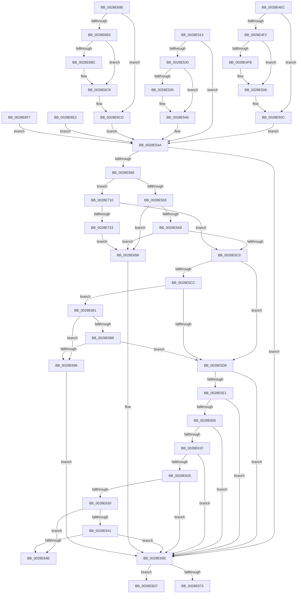

# sub_0028E4EC

- RVA: `0x0028E4EC`–`0x0028E728` (길이 `572` bytes)
- VA: `0x000000014028E4EC`
- 실행 섹션: `.text`
- PDB 이름 있음: `아니요`; PDB Function 태그: `아니요`
- unwind 정보 RVA: `0x000670B8`
- 디코드: `133`개 명령, `572/572` bytes 표시
- 미해석 바이트: `0` (있으면 어셈블리에 `.byte`로 보존)

> 이 문서는 커널 이미지의 기계어와 PDB 기호를 분석해 생성했습니다. 4번과 5번은 함수 원형과 자료형을 바이너리 사용 방식에서 추정한 C 해석이며 원본 소스 복구 결과는 아닙니다.

## 1. Dependencies

- 직접 호출 지점: **9**; 고유 호출 대상: **6**
- 직접 호출자로 확인된 함수: **0**
- RIP 상대 이미지 참조: **6**

### Outgoing calls
- `0x0028E503` → [KiLowerIrqlProcessIrqlFlags](../4F/KiLowerIrqlProcessIrqlFlags_function_004F5698.md) (function, `0x004F5698`)
- `0x0028E541` → [KiLowerIrqlProcessIrqlFlags](../4F/KiLowerIrqlProcessIrqlFlags_function_004F5698.md) (function, `0x004F5698`)
- `0x0028E55B` → [MiSynchronizeSystemVa](MiSynchronizeSystemVa_function_0028ECB8.md) (function, `0x0028ECB8`)
- `0x0028E644` → [MiGetPfnSlabType](MiGetPfnSlabType_function_0028E2D0.md) (function, `0x0028E2D0`)
- `0x0028E661` → [MiUnlockStealVm](MiUnlockStealVm_function_0028EF40.md) (function, `0x0028EF40`)
- `0x0028E6C4` → [KiLowerIrqlProcessIrqlFlags](../4F/KiLowerIrqlProcessIrqlFlags_function_004F5698.md) (function, `0x004F5698`)
- `0x0028E6E9` → [MiUnlockPage](../31/MiUnlockPage_function_0031A3E0.md) (function, `0x0031A3E0`)
- `0x0028E6FE` → [MiUnlockPage](../31/MiUnlockPage_function_0031A3E0.md) (function, `0x0031A3E0`)
- `0x0028E716` → [MiSmallVaStillMapsFrame](../47/MiSmallVaStillMapsFrame_function_00471090.md) (function, `0x00471090`)

### Direct callers
- 이 함수 시작 RVA로 연결되는 직접 call은 확인되지 않았습니다. 간접 호출은 완전히 역산할 수 없습니다.

### Static image references
- `0x0028E4F2` → RVA `0x00FC6D20` (`ALMOSTRO`; read)
- `0x0028E5D8` → RVA `0x00E2DCE0` (`.data`; read)
- `0x0028E604` → RVA `0x00E30088` (`.data`; read)
- `0x0028E673` → RVA `0x00EF517C` (`.data`; read/write)
- `0x0028E696` → RVA `0x00EF5188` (`.data`; read/write)
- `0x0028E6D7` → RVA `0x00EF520C` (`.data`; read/write)

## 2. Other-region calls and transfers

- 다른 실행 섹션으로 향하는 call: **0**
- call이 아닌 외부 분기/꼬리 이동: **3**
  - `0x0028E653` → [sub_0028E3BA + 0xDC](Unknown_function_0028E3BA.md) (`tail-transfer`)
  - `0x0028E67C` → [sub_0028E3BA + 0xDC](Unknown_function_0028E3BA.md) (`tail-transfer`)
  - `0x0028E6DD` → [sub_0028E3BA + 0xDA](Unknown_function_0028E3BA.md) (`tail-transfer`)

## 3. Assembly (complete function range)

```asm
0028E4EC  40 80 FD 02                     cmp bpl, 2
0028E4F0  73 1A                           jae 0x14028e50c
0028E4F2  44 39 35 27 88 D3 00            cmp dword ptr [rip + 0xd38827], r14d
0028E4F9  74 0D                           je 0x14028e508
0028E4FB  44 0F 20 C1                     mov rcx, cr8
0028E4FF  40 0F B6 D5                     movzx edx, bpl
0028E503  E8 90 71 26 00                  call 0x1404f5698
0028E508  44 0F 22 C5                     mov cr8, rbp
0028E50C  41 83 4F 08 20                  or dword ptr [r15 + 8], 0x20
0028E511  EB 37                           jmp 0x14028e54a
0028E513  41 C7 47 30 02 00 00 00         mov dword ptr [r15 + 0x30], 2
0028E51B  48 B9 FF FF FF FF FF FF FF 7F   movabs rcx, 0x7fffffffffffffff
0028E525  F0 48 21 4F 18                  lock and qword ptr [rdi + 0x18], rcx
0028E52A  40 80 FD 02                     cmp bpl, 2
0028E52E  73 1A                           jae 0x14028e54a
0028E530  44 39 35 E9 87 D3 00            cmp dword ptr [rip + 0xd387e9], r14d
0028E537  74 0D                           je 0x14028e546
0028E539  44 0F 20 C1                     mov rcx, cr8
0028E53D  40 0F B6 D5                     movzx edx, bpl
0028E541  E8 52 71 26 00                  call 0x1404f5698
0028E546  44 0F 22 C5                     mov cr8, rbp
0028E54A  45 8B CC                        mov r9d, r12d
0028E54D  4C 89 7C 24 20                  mov qword ptr [rsp + 0x20], r15
0028E552  44 8B C3                        mov r8d, ebx
0028E555  48 8B D6                        mov rdx, rsi
0028E558  49 8B CD                        mov rcx, r13
0028E55B  E8 58 07 00 00                  call 0x14028ecb8
0028E560  85 C0                           test eax, eax
0028E562  0F 84 F6 00 00 00               je 0x14028e65e
0028E568  48 B8 00 00 00 00 00 DE FF FF   movabs rax, 0xffffde0000000000
0028E572  48 8B DF                        mov rbx, rdi
0028E575  48 2B D8                        sub rbx, rax
0028E578  48 B8 AB AA AA AA AA AA AA AA   movabs rax, 0xaaaaaaaaaaaaaaab
0028E582  48 C1 FB 04                     sar rbx, 4
0028E586  48 0F AF D8                     imul rbx, rax
0028E58A  45 85 E4                        test r12d, r12d
0028E58D  0F 85 7D 01 00 00               jne 0x14028e710
0028E593  48 8B 84 24 80 00 00 00         mov rax, qword ptr [rsp + 0x80]
0028E59B  48 8B 00                        mov rax, qword ptr [rax]
0028E59E  A8 01                           test al, 1
0028E5A0  0F 84 B2 00 00 00               je 0x14028e658
0028E5A6  48 C1 E8 0C                     shr rax, 0xc
0028E5AA  48 B9 FF FF FF FF FF 00 00 00   movabs rcx, 0xffffffffff
0028E5B4  48 23 C1                        and rax, rcx
0028E5B7  48 3B C3                        cmp rax, rbx
0028E5BA  0F 85 98 00 00 00               jne 0x14028e658
0028E5C0  41 8B 47 30                     mov eax, dword ptr [r15 + 0x30]
0028E5C4  83 E8 02                        sub eax, 2
0028E5C7  83 F8 01                        cmp eax, 1
0028E5CA  76 0C                           jbe 0x14028e5d8
0028E5CC  41 8B 47 08                     mov eax, dword ptr [r15 + 8]
0028E5D0  A8 20                           test al, 0x20
0028E5D2  0F 84 A9 00 00 00               je 0x14028e681
0028E5D8  48 3B 1D 01 F7 B9 00            cmp rbx, qword ptr [rip + 0xb9f701]
0028E5DF  77 7D                           ja 0x14028e65e
0028E5E1  48 8D 04 5B                     lea rax, [rbx + rbx*2]
0028E5E5  48 03 C0                        add rax, rax
0028E5E8  48 B9 28 00 00 00 00 DE FF FF   movabs rcx, 0xffffde0000000028
0028E5F2  48 8B 04 C1                     mov rax, qword ptr [rcx + rax*8]
0028E5F6  48 C1 E8 36                     shr rax, 0x36
0028E5FA  0F BA E0 00                     bt eax, 0
0028E5FE  73 5E                           jae 0x14028e65e
0028E600  48 8B 47 28                     mov rax, qword ptr [rdi + 0x28]
0028E604  48 8B 0D 7D 1A BA 00            mov rcx, qword ptr [rip + 0xba1a7d]
0028E60B  48 8B 54 24 70                  mov rdx, qword ptr [rsp + 0x70]
0028E610  48 C1 E8 2B                     shr rax, 0x2b
0028E614  25 FF 03 00 00                  and eax, 0x3ff
0028E619  48 39 14 C1                     cmp qword ptr [rcx + rax*8], rdx
0028E61D  75 3F                           jne 0x14028e65e
0028E61F  48 8B 47 28                     mov rax, qword ptr [rdi + 0x28]
0028E623  48 85 C0                        test rax, rax
0028E626  78 36                           js 0x14028e65e
0028E628  48 0F BA 67 28 35               bt qword ptr [rdi + 0x28], 0x35
0028E62E  72 2E                           jb 0x14028e65e
0028E630  41 8B 0F                        mov ecx, dword ptr [r15]
0028E633  81 E1 00 00 41 00               and ecx, 0x410000
0028E639  81 F9 00 00 41 00               cmp ecx, 0x410000
0028E63F  74 0D                           je 0x14028e64e
0028E641  48 8B CF                        mov rcx, rdi
0028E644  E8 87 FC FF FF                  call 0x14028e2d0
0028E649  83 F8 09                        cmp eax, 9
0028E64C  75 10                           jne 0x14028e65e
0028E64E  B8 01 00 00 00                  mov eax, 1
0028E653  E9 3E FE FF FF                  jmp 0x14028e496
0028E658  41 BE 02 00 00 00               mov r14d, 2
0028E65E  49 8B CF                        mov rcx, r15
0028E661  E8 DA 08 00 00                  call 0x14028ef40
0028E666  41 8B 85 B8 00 00 00            mov eax, dword ptr [r13 + 0xb8]
0028E66D  24 0F                           and al, 0xf
0028E66F  3C 02                           cmp al, 2
0028E671  74 64                           je 0x14028e6d7
0028E673  FF 05 03 6B C6 00               inc dword ptr [rip + 0xc66b03]
0028E679  41 8B C6                        mov eax, r14d
0028E67C  E9 15 FE FF FF                  jmp 0x14028e496
0028E681  48 8B 07                        mov rax, qword ptr [rdi]
0028E684  A8 01                           test al, 1
0028E686  74 0E                           je 0x14028e696
0028E688  8B 47 20                        mov eax, dword ptr [rdi + 0x20]
0028E68B  C1 E8 18                        shr eax, 0x18
0028E68E  A8 08                           test al, 8
0028E690  0F 84 42 FF FF FF               je 0x14028e5d8
0028E696  FF 05 EC 6A C6 00               inc dword ptr [rip + 0xc66aec]
0028E69C  EB C0                           jmp 0x14028e65e
0028E69E  48 B9 FF FF FF FF FF FF FF 7F   movabs rcx, 0x7fffffffffffffff
0028E6A8  F0 48 21 4F 18                  lock and qword ptr [rdi + 0x18], rcx
0028E6AD  40 80 FD 02                     cmp bpl, 2
0028E6B1  73 1A                           jae 0x14028e6cd
0028E6B3  44 39 35 66 86 D3 00            cmp dword ptr [rip + 0xd38666], r14d
0028E6BA  74 0D                           je 0x14028e6c9
0028E6BC  44 0F 20 C1                     mov rcx, cr8
0028E6C0  40 0F B6 D5                     movzx edx, bpl
0028E6C4  E8 CF 6F 26 00                  call 0x1404f5698
0028E6C9  44 0F 22 C5                     mov cr8, rbp
0028E6CD  41 83 4F 08 10                  or dword ptr [r15 + 8], 0x10
0028E6D2  E9 73 FE FF FF                  jmp 0x14028e54a
0028E6D7  FF 05 2F 6B C6 00               inc dword ptr [rip + 0xc66b2f]
0028E6DD  E9 B2 FD FF FF                  jmp 0x14028e494
0028E6E2  40 0F B6 D5                     movzx edx, bpl
0028E6E6  48 8B CF                        mov rcx, rdi
0028E6E9  E8 F2 BC 08 00                  call 0x14031a3e0
0028E6EE  45 89 77 30                     mov dword ptr [r15 + 0x30], r14d
0028E6F2  E9 53 FE FF FF                  jmp 0x14028e54a
0028E6F7  40 0F B6 D5                     movzx edx, bpl
0028E6FB  48 8B CF                        mov rcx, rdi
0028E6FE  E8 DD BC 08 00                  call 0x14031a3e0
0028E703  41 C7 47 30 01 00 00 00         mov dword ptr [r15 + 0x30], 1
0028E70B  E9 3A FE FF FF                  jmp 0x14028e54a
0028E710  48 8B D3                        mov rdx, rbx
0028E713  48 8B CE                        mov rcx, rsi
0028E716  E8 75 29 1E 00                  call 0x140471090
0028E71B  85 C0                           test eax, eax
0028E71D  0F 85 9D FE FF FF               jne 0x14028e5c0
0028E723  E9 30 FF FF FF                  jmp 0x14028e658
```

## 4. C-style interpretation (structured pseudocode)

```c
__int64 __fastcall sub_0028E4EC(__int64 a1, __int64 a2, __int64 a3, __int64 a4, __int64 a5, __int64 a6, __int64 a7, __int64 a8, __int64 a9, __int64 a10, __int64 a11, __int64 a12, __int64 a13, __int64 a14, __int64 a15, __int64 a16)
{
    __int64 result;
    __int64 v_rbx;
    unsigned __int64 v_stack_p20;

    if (((unsigned __int8)(v_rbp)) >= 2) goto loc_0028E50C;
    if ((*(unsigned int *)(v_rip + 13862951)) != ((unsigned int)(v_r14))) {
        a1 = v_cr8;
        a2 = (unsigned __int8)(v_rbp);
        result = KiLowerIrqlProcessIrqlFlags(a1, a2, a3, a4);
    }
loc_0028E50C:
    goto loc_0028E54A;
loc_0028E54A:
    v_stack_p20 = v_r15;
    result = MiSynchronizeSystemVa(v_r13, v_rsi, (unsigned int)((unsigned int)(v_rbx)), (unsigned int)((unsigned int)(v_r12)));
    if ((unsigned int)(result) == 0) goto loc_0028E65E;
    v_rbx = (v_rdi) - (result);
    v_rbx = (v_rbx) >> (4);
    v_rbx = (v_rbx) * (result);
    if ((unsigned int)(v_r12) != 0) goto loc_0028E710;
    if ((((unsigned __int8)(*(unsigned __int64 *)(a16))) & (1)) == 0) goto loc_0028E658;
    result = (*(unsigned __int64 *)(a16)) >> (12);
    result = (result) & (v_r13);
    if (result != v_rbx) goto loc_0028E658;
loc_0028E5C0:
    result = (unsigned int)(((unsigned int)(*(unsigned int *)(v_r15 + 48))) - (2));
    if (((unsigned int)(result)) <= 1) goto loc_0028E5D8;
    if ((((unsigned __int8)((unsigned int)(*(unsigned int *)(v_r15 + 8)))) & (32)) == 0) goto loc_0028E681;
loc_0028E5D8:
    if (v_rbx > (*(unsigned __int64 *)(v_rip + 12187393))) goto loc_0028E65E;
    result = (v_rbx + v_rbx * 2) + (v_rbx + v_rbx * 2);
    result = (*(unsigned __int64 *)(v_r13 + result * 8)) >> (54);
    if (condition_is_above_or_equal) goto loc_0028E65E;
    result = (*(unsigned __int64 *)(v_rdi + 40)) >> (43);
    result = (unsigned int)((result) & (0x3FFULL));
    if ((*(unsigned __int64 *)(*(unsigned __int64 *)(v_rip + 12196477) + result * 8)) != a14) goto loc_0028E65E;
    if (sign_flag) goto loc_0028E65E;
    if (condition_is_below) goto loc_0028E65E;
    a1 = (unsigned int)(((unsigned int)(*(unsigned int *)(v_r15))) & (0x410000ULL));
    if (((unsigned int)(a1)) == 0x410000ULL) goto loc_0028E64E;
    result = MiGetPfnSlabType(v_rdi, a14, (unsigned int)((unsigned int)(v_rbx)), (unsigned int)((unsigned int)(v_r12)));
    if (((unsigned int)(result)) != 9) goto loc_0028E65E;
loc_0028E64E:
loc_0028E658:
loc_0028E65E:
    result = MiUnlockStealVm(v_r15, a14, (unsigned int)((unsigned int)(v_rbx)), (unsigned int)((unsigned int)(v_r12)));
    result = (unsigned __int8)(((unsigned int)(*(unsigned int *)(v_r13 + 184))) & (15));
    if (((unsigned __int8)(result)) == 2) goto loc_0028E6D7;
loc_0028E681:
    if ((((unsigned __int8)(*(unsigned __int64 *)(v_rdi))) & (1)) == 0) goto loc_0028E696;
    result = (unsigned int)(((unsigned int)(*(unsigned int *)(v_rdi + 32))) >> (24));
    if ((((unsigned __int8)(result)) & (8)) == 0) goto loc_0028E5D8;
loc_0028E696:
    goto loc_0028E65E;
loc_0028E6D7:
loc_0028E710:
    result = MiSmallVaStillMapsFrame(v_rsi, v_rbx, (unsigned int)((unsigned int)(v_rbx)), (unsigned int)((unsigned int)(v_r12)));
    if ((unsigned int)(result) != 0) goto loc_0028E5C0;
    goto loc_0028E658;
}
```

## 5. (Beta) C Style

```c
int64_t sub_0028E4EC(int64_t Arg1, int64_t Arg2, int64_t Arg3, int64_t Arg4, uint64_t Arg5, uint64_t Arg6, uint64_t Arg7, uint64_t Arg8, uint64_t Arg9, uint64_t Arg10, uint64_t Arg11, uint64_t Arg12, uint64_t Arg13, int64_t Arg14, uint64_t Arg15, void *Arg16)
{
    uint8_t *arg16 = (uint8_t *)Arg16;

    int64_t result;
    int64_t local_rbx;
    uint64_t v_stack_p20;

    if (((uint8_t)(local_rbp)) >= 2) goto loc_0028E50C;
    if ((*(uint32_t *)(v_rip + 0xD38827)) != ((uint32_t)(local_r14))) {
        Arg1 = v_cr8;
        Arg2 = (uint8_t)(local_rbp);
        result = KiLowerIrqlProcessIrqlFlags(Arg1, Arg2, Arg3, Arg4);
    }
loc_0028E50C:
    goto loc_0028E54A;
loc_0028E54A:
    v_stack_p20 = local_r15;
    result = MiSynchronizeSystemVa(local_r13, local_rsi, (uint32_t)((uint32_t)(local_rbx)), (uint32_t)((uint32_t)(local_r12)));
    if ((uint32_t)(result) == 0) goto loc_0028E65E;
    local_rbx = (local_rdi) - (result);
    local_rbx = (local_rbx) >> (4);
    local_rbx = (local_rbx) * (result);
    if ((uint32_t)(local_r12) != 0) goto loc_0028E710;
    if ((((uint8_t)(*(uint64_t *)(arg16))) & (1)) == 0) goto loc_0028E658;
    result = (*(uint64_t *)(arg16)) >> (12);
    result = (result) & (local_r13);
    if (result != local_rbx) goto loc_0028E658;
loc_0028E5C0:
    result = (uint32_t)(((uint32_t)(*(uint32_t *)(local_r15 + 0x30))) - (2));
    if (((uint32_t)(result)) <= 1) goto loc_0028E5D8;
    if ((((uint8_t)((uint32_t)(*(uint32_t *)(local_r15 + 0x8)))) & (32)) == 0) goto loc_0028E681;
loc_0028E5D8:
    if (local_rbx > (*(uint64_t *)(v_rip + 0xB9F701))) goto loc_0028E65E;
    result = (local_rbx + local_rbx * 2) + (local_rbx + local_rbx * 2);
    result = (*(uint64_t *)(local_r13 + result * 8)) >> (54);
    if (condition_is_above_or_equal) goto loc_0028E65E;
    result = (*(uint64_t *)(local_rdi + 0x28)) >> (43);
    result = (uint32_t)((result) & (0x3FFULL));
    if ((*(uint64_t *)(*(uint64_t *)(v_rip + 0xBA1A7D) + result * 8)) != Arg14) goto loc_0028E65E;
    if (sign_flag) goto loc_0028E65E;
    if (condition_is_below) goto loc_0028E65E;
    Arg1 = (uint32_t)(((uint32_t)(*(uint32_t *)(local_r15))) & (0x410000ULL));
    if (((uint32_t)(Arg1)) == 0x410000ULL) goto loc_0028E64E;
    result = MiGetPfnSlabType(local_rdi, Arg14, (uint32_t)((uint32_t)(local_rbx)), (uint32_t)((uint32_t)(local_r12)));
    if (((uint32_t)(result)) != 9) goto loc_0028E65E;
loc_0028E64E:
loc_0028E658:
loc_0028E65E:
    result = MiUnlockStealVm(local_r15, Arg14, (uint32_t)((uint32_t)(local_rbx)), (uint32_t)((uint32_t)(local_r12)));
    result = (uint8_t)(((uint32_t)(*(uint32_t *)(local_r13 + 0xB8))) & (15));
    if (((uint8_t)(result)) == 2) goto loc_0028E6D7;
loc_0028E681:
    if ((((uint8_t)(*(uint64_t *)(local_rdi))) & (1)) == 0) goto loc_0028E696;
    result = (uint32_t)(((uint32_t)(*(uint32_t *)(local_rdi + 0x20))) >> (24));
    if ((((uint8_t)(result)) & (8)) == 0) goto loc_0028E5D8;
loc_0028E696:
    goto loc_0028E65E;
loc_0028E6D7:
loc_0028E710:
    result = MiSmallVaStillMapsFrame(local_rsi, local_rbx, (uint32_t)((uint32_t)(local_rbx)), (uint32_t)((uint32_t)(local_r12)));
    if ((uint32_t)(result) != 0) goto loc_0028E5C0;
    goto loc_0028E658;
}
```

### 관측된 메모리 오프셋

구조체 형식이 확인되지 않은 접근은 인자 기준의 오프셋으로만 기록했습니다.

| 기준 인자 | 오프셋 표현 | 폭 (bit) | 접근 |
|---|---:|---:|---|
| `Arg16` | `+ 0x0` | `64` | `R` |

## 6. Execution-region graph

[열기: 2D/3D 그래프와 함수 탐색 컨트롤 패널](../../../control-panel.html?section=text&rva=0x0028E4EC&view=graph)

- 2D 그래프는 위에서 아래로 흐르고, 3D 그래프는 빈 공간을 드래그해 회전합니다. Shift+드래그는 이동, 휠은 확대·축소, 함수 노드 선택은 대상 보고서 이동입니다.

### Static fallback


