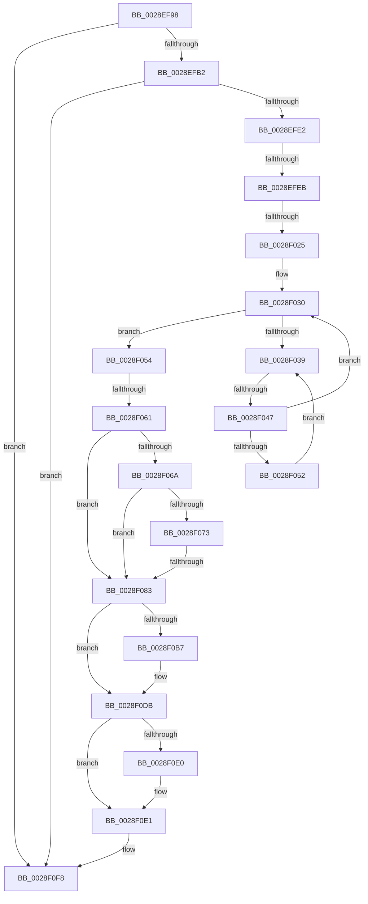

# sub_0028EF98

- RVA: `0x0028EF98`–`0x0028F111` (길이 `377` bytes)
- VA: `0x000000014028EF98`
- 실행 섹션: `.text`
- PDB 이름 있음: `아니요`; PDB Function 태그: `아니요`
- unwind 정보 RVA: `0x00067148`
- 디코드: `80`개 명령, `377/377` bytes 표시
- 미해석 바이트: `0` (있으면 어셈블리에 `.byte`로 보존)

> 이 문서는 커널 이미지의 기계어와 PDB 기호를 분석해 생성했습니다. 4번과 5번은 함수 원형과 자료형을 바이너리 사용 방식에서 추정한 C 해석이며 원본 소스 복구 결과는 아닙니다.

## 1. Dependencies

- 직접 호출 지점: **4**; 고유 호출 대상: **4**
- 직접 호출자로 확인된 함수: **0**
- RIP 상대 이미지 참조: **2**

### Outgoing calls
- `0x0028F088` → [KeBugCheck](../4F/KeBugCheck_function_004FD640.md) (function, `0x004FD640`)
- `0x0028F097` → [HalpDisableInterrupts](../25/HalpDisableInterrupts_function_002521A0.md) (function, `0x002521A0`)
- `0x0028F0F3` → [HalpInterruptSendIpi](../25/HalpInterruptSendIpi_function_00252310.md) (function, `0x00252310`)
- `0x0028F0FC` → [MiAttachThreadDone](MiAttachThreadDone_function_0028F3E0.md) (function, `0x0028F3E0`)

### Direct callers
- 이 함수 시작 RVA로 연결되는 직접 call은 확인되지 않았습니다. 간접 호출은 완전히 역산할 수 없습니다.

### Static image references
- `0x0028F018` → RVA `0x00FC6D20` (`ALMOSTRO`; read)
- `0x0028F03B` → RVA `0x00FC52AC` (`ALMOSTRO`; reference)

## 2. Other-region calls and transfers

- 다른 실행 섹션으로 향하는 call: **0**
- call이 아닌 외부 분기/꼬리 이동: **5**
  - `0x0028EFE5` → [sub_0028F375](Unknown_function_0028F375.md) (`tail-transfer`)
  - `0x0028F01F` → [sub_0028F316](Unknown_function_0028F316.md) (`tail-transfer`)
  - `0x0028F041` → [sub_0028F316 + 0x11](Unknown_function_0028F316.md) (`tail-transfer`)
  - `0x0028F05B` → [sub_0028F390](Unknown_function_0028F390.md) (`tail-transfer`)
  - `0x0028F07D` → [sub_0028F12C](Unknown_function_0028F12C.md) (`tail-transfer`)

## 3. Assembly (complete function range)

```asm
0028EF98  48 89 AC 24 B8 00 00 00         mov qword ptr [rsp + 0xb8], rbp
0028EFA0  4C 89 AC 24 C0 00 00 00         mov qword ptr [rsp + 0xc0], r13
0028EFA8  44 38 76 40                     cmp byte ptr [rsi + 0x40], r14b
0028EFAC  0F 84 46 01 00 00               je 0x14028f0f8
0028EFB2  48 8D 46 48                     lea rax, [rsi + 0x48]
0028EFB6  0F 57 C0                        xorps xmm0, xmm0
0028EFB9  48 85 C0                        test rax, rax
0028EFBC  48 8D 4C 24 40                  lea rcx, [rsp + 0x40]
0028EFC1  0F 11 44 24 40                  movups xmmword ptr [rsp + 0x40], xmm0
0028EFC6  48 0F 45 C8                     cmovne rcx, rax
0028EFCA  0F 11 44 24 50                  movups xmmword ptr [rsp + 0x50], xmm0
0028EFCF  0F 11 44 24 60                  movups xmmword ptr [rsp + 0x60], xmm0
0028EFD4  48 8B 41 20                     mov rax, qword ptr [rcx + 0x20]
0028EFD8  48 83 F8 01                     cmp rax, 1
0028EFDC  0F 84 16 01 00 00               je 0x14028f0f8
0028EFE2  48 85 C0                        test rax, rax
0028EFE5  0F 85 8A 03 00 00               jne 0x14028f375
0028EFEB  65 48 8B 04 25 88 01 00 00      mov rax, qword ptr gs:[0x188]
0028EFF4  65 48 8B 1C 25 88 01 00 00      mov rbx, qword ptr gs:[0x188]
0028EFFD  48 8D A8 58 02 00 00            lea rbp, [rax + 0x258]
0028F004  4C 8B AB B8 00 00 00            mov r13, qword ptr [rbx + 0xb8]
0028F00B  44 0F 20 C7                     mov rdi, cr8
0028F00F  B8 02 00 00 00                  mov eax, 2
0028F014  44 0F 22 C0                     mov cr8, rax
0028F018  44 39 35 01 7D D3 00            cmp dword ptr [rip + 0xd37d01], r14d
0028F01F  0F 85 F1 02 00 00               jne 0x14028f316
0028F025  40 88 7C 24 20                  mov byte ptr [rsp + 0x20], dil
0028F02A  41 8B FE                        mov edi, r14d
0028F02D  0F 1F 00                        nop dword ptr [rax]
0028F030  F0 48 0F BA 6B 40 00            lock bts qword ptr [rbx + 0x40], 0
0028F037  73 1B                           jae 0x14028f054
0028F039  FF C7                           inc edi
0028F03B  85 3D 6B 62 D3 00               test dword ptr [rip + 0xd3626b], edi
0028F041  0F 84 E0 02 00 00               je 0x14028f327
0028F047  F3 90                           pause
0028F049  48 8B 43 40                     mov rax, qword ptr [rbx + 0x40]
0028F04D  48 85 C0                        test rax, rax
0028F050  74 DE                           je 0x14028f030
0028F052  EB E5                           jmp 0x14028f039
0028F054  44 38 B3 C1 00 00 00            cmp byte ptr [rbx + 0xc1], r14b
0028F05B  0F 85 2F 03 00 00               jne 0x14028f390
0028F061  44 38 B3 4A 02 00 00            cmp byte ptr [rbx + 0x24a], r14b
0028F068  74 19                           je 0x14028f083
0028F06A  F6 83 C0 00 00 00 01            test byte ptr [rbx + 0xc0], 1
0028F071  75 10                           jne 0x14028f083
0028F073  48 8D BB 98 00 00 00            lea rdi, [rbx + 0x98]
0028F07A  48 39 3F                        cmp qword ptr [rdi], rdi
0028F07D  0F 84 A9 00 00 00               je 0x14028f12c
0028F083  B9 06 00 00 00                  mov ecx, 6
0028F088  E8 B3 E5 26 00                  call 0x1404fd640
0028F08D  CC                              int3
0028F08E  65 4C 8B 04 25 20 00 00 00      mov r8, qword ptr gs:[0x20]
0028F097  E8 04 31 FC FF                  call 0x1402521a0
0028F09C  41 8B 90 A8 00 00 00            mov edx, dword ptr [r8 + 0xa8]
0028F0A3  44 0F B6 C8                     movzx r9d, al
0028F0A7  8B CA                           mov ecx, edx
0028F0A9  83 C9 02                        or ecx, 2
0028F0AC  41 89 88 A8 00 00 00            mov dword ptr [r8 + 0xa8], ecx
0028F0B3  85 D2                           test edx, edx
0028F0B5  75 24                           jne 0x14028f0db
0028F0B7  B9 15 00 01 C0                  mov ecx, 0xc0010015
0028F0BC  0F 32                           rdmsr
0028F0BE  48 C1 E2 20                     shl rdx, 0x20
0028F0C2  48 0B C2                        or rax, rdx
0028F0C5  48 BA 00 00 00 00 01 00 00 00   movabs rdx, 0x100000000
0028F0CF  48 0B C2                        or rax, rdx
0028F0D2  48 8B D0                        mov rdx, rax
0028F0D5  48 C1 EA 20                     shr rdx, 0x20
0028F0D9  0F 30                           wrmsr
0028F0DB  45 84 C9                        test r9b, r9b
0028F0DE  74 01                           je 0x14028f0e1
0028F0E0  FB                              sti
0028F0E1  BA 1F 00 00 00                  mov edx, 0x1f
0028F0E6  C7 44 24 28 05 00 00 00         mov dword ptr [rsp + 0x28], 5
0028F0EE  48 8D 4C 24 28                  lea rcx, [rsp + 0x28]
0028F0F3  E8 18 32 FC FF                  call 0x140252310
0028F0F8  48 8B 4E 38                     mov rcx, qword ptr [rsi + 0x38]
0028F0FC  E8 DF 02 00 00                  call 0x14028f3e0
0028F101  48 8B AC 24 B8 00 00 00         mov rbp, qword ptr [rsp + 0xb8]
0028F109  4C 8B AC 24 C0 00 00 00         mov r13, qword ptr [rsp + 0xc0]
```

## 4. C-style interpretation (structured pseudocode)

```c
__int64 __fastcall sub_0028EF98(__int64 a1, __int64 a2, __int64 a3, __int64 a4, __int64 a5, __int64 a6, __int64 a7, __int64 a8, __int64 a9, __int64 a10, __int64 a11, __int64 a12, __int64 a13, __int64 a14, __int64 a15, __int64 a16, __int64 a17, __int64 a18, __int64 a19, __int64 a20, __int64 a21, __int64 a22, __int64 a23, __int64 a24)
{
    __int64 result;
    __int64 v_rdi;
    unsigned __int8 v_stack_p20;
    unsigned int v_stack_p28;
    unsigned __int64 v_stack_pB8;
    unsigned __int64 v_stack_pC0;

    v_stack_pB8 = v_rbp;
    v_stack_pC0 = v_r13;
    if ((*(unsigned __int8 *)(v_rsi + 64)) == ((unsigned __int8)(v_r14))) goto loc_0028F0F8;
    a8 = v_xmm0;
    if (v_rsi + 72 != 0) { a8 = v_rsi + 72; }
    a10 = v_xmm0;
    a12 = v_xmm0;
    if ((*(unsigned __int64 *)(a8 + 32)) == 1) goto loc_0028F0F8;
    v_stack_p20 = (unsigned __int8)(v_cr8);
loc_0028F030:
    if ((*(unsigned int *)(v_rip + 13860097)) >= ((unsigned int)(v_r14))) goto loc_0028F054;
loc_0028F039:
    v_rdi = (unsigned int)(((unsigned int)((unsigned int)(v_r14))) + 1);
    if (*(unsigned __int64 *)(*(unsigned __int64 *)(gs_base + (0 + 392)) + 64) == 0) goto loc_0028F030;
    goto loc_0028F039;
loc_0028F054:
    if ((*(unsigned __int8 *)(*(unsigned __int64 *)(gs_base + (0 + 392)) + 586)) == ((unsigned __int8)(v_r14))) goto loc_0028F083;
    if (((*(unsigned __int8 *)(*(unsigned __int64 *)(gs_base + (0 + 392)) + 192)) & (1)) != 0) goto loc_0028F083;
loc_0028F083:
    result = KeBugCheck(6, a2, a3, a4);
    result = HalpDisableInterrupts(6, a2, *(unsigned __int64 *)(gs_base + (0 + 32)), a4);
    a1 = (unsigned int)(((unsigned int)((unsigned int)((unsigned int)(*(unsigned int *)(*(unsigned __int64 *)(gs_base + (0 + 32)) + 168))))) | (2));
    *(unsigned int *)(*(unsigned __int64 *)(gs_base + (0 + 32)) + 168) = (unsigned int)(a1);
    if ((unsigned int)((unsigned int)(*(unsigned int *)(*(unsigned __int64 *)(gs_base + (0 + 32)) + 168))) == 0) {
        a1 = 0xC0010015ULL;
        a2 = ((unsigned int)(*(unsigned int *)(*(unsigned __int64 *)(gs_base + (0 + 32)) + 168))) << (32);
        result = (result) | (a2);
        result = (result) | (a2);
        a2 = result;
        a2 = (a2) >> (32);
    }
    if ((unsigned __int8)((unsigned __int8)(result)) != 0) {
    }
    v_stack_p28 = 5;
    result = HalpInterruptSendIpi(a5, 31, *(unsigned __int64 *)(gs_base + (0 + 32)), (unsigned __int8)(result));
loc_0028F0F8:
    result = MiAttachThreadDone(*(unsigned __int64 *)(v_rsi + 56), 31, *(unsigned __int64 *)(gs_base + (0 + 32)), (unsigned __int8)(result));
    return result;
}
```

## 5. (Beta) C Style

```c
int64_t sub_0028EF98(int64_t Arg1, int64_t Arg2, int64_t Arg3, int64_t Arg4, int64_t Arg5, uint64_t Arg6, uint64_t Arg7, int64_t Arg8, uint64_t Arg9, int64_t Arg10, uint64_t Arg11, int64_t Arg12, uint64_t Arg13, uint64_t Arg14, uint64_t Arg15, uint64_t Arg16, uint64_t Arg17, uint64_t Arg18, uint64_t Arg19, uint64_t Arg20, uint64_t Arg21, uint64_t Arg22, int64_t Arg23, int64_t Arg24)
{
    int64_t result;
    int64_t local_rdi;
    uint8_t v_stack_p20;
    uint32_t v_stack_p28;
    uint64_t v_stack_pB8;
    uint64_t v_stack_pC0;

    v_stack_pB8 = local_rbp;
    v_stack_pC0 = local_r13;
    if ((*(uint8_t *)(local_rsi + 0x40)) == ((uint8_t)(local_r14))) goto loc_0028F0F8;
    Arg8 = v_xmm0;
    if (local_rsi + 72 != 0) { Arg8 = local_rsi + 72; }
    Arg10 = v_xmm0;
    Arg12 = v_xmm0;
    if ((*(uint64_t *)(Arg8 + 0x20)) == 1) goto loc_0028F0F8;
    v_stack_p20 = (uint8_t)(v_cr8);
loc_0028F030:
    if ((*(uint32_t *)(v_rip + 0xD37D01)) >= ((uint32_t)(local_r14))) goto loc_0028F054;
loc_0028F039:
    local_rdi = (uint32_t)(((uint32_t)((uint32_t)(local_r14))) + 1);
    if (*(uint64_t *)(*(uint64_t *)(gs_base + (0 + 0x188)) + 0x40) == 0) goto loc_0028F030;
    goto loc_0028F039;
loc_0028F054:
    if ((*(uint8_t *)(*(uint64_t *)(gs_base + (0 + 0x188)) + 0x24A)) == ((uint8_t)(local_r14))) goto loc_0028F083;
    if (((*(uint8_t *)(*(uint64_t *)(gs_base + (0 + 0x188)) + 0xC0)) & (1)) != 0) goto loc_0028F083;
loc_0028F083:
    result = KeBugCheck(6, Arg2, Arg3, Arg4);
    result = HalpDisableInterrupts(6, Arg2, *(uint64_t *)(gs_base + (0 + 0x20)), Arg4);
    Arg1 = (uint32_t)(((uint32_t)((uint32_t)((uint32_t)(*(uint32_t *)(*(uint64_t *)(gs_base + (0 + 0x20)) + 0xA8))))) | (2));
    *(uint32_t *)(*(uint64_t *)(gs_base + (0 + 0x20)) + 0xA8) = (uint32_t)(Arg1);
    if ((uint32_t)((uint32_t)(*(uint32_t *)(*(uint64_t *)(gs_base + (0 + 0x20)) + 0xA8))) == 0) {
        Arg1 = 0xC0010015ULL;
        Arg2 = ((uint32_t)(*(uint32_t *)(*(uint64_t *)(gs_base + (0 + 0x20)) + 0xA8))) << (32);
        result = (result) | (Arg2);
        result = (result) | (Arg2);
        Arg2 = result;
        Arg2 = (Arg2) >> (32);
    }
    if ((uint8_t)((uint8_t)(result)) != 0) {
    }
    v_stack_p28 = 5;
    result = HalpInterruptSendIpi(Arg5, 31, *(uint64_t *)(gs_base + (0 + 0x20)), (uint8_t)(result));
loc_0028F0F8:
    result = MiAttachThreadDone(*(uint64_t *)(local_rsi + 0x38), 31, *(uint64_t *)(gs_base + (0 + 0x20)), (uint8_t)(result));
    return result;
}
```

## 6. Execution-region graph

[열기: 2D/3D 그래프와 함수 탐색 컨트롤 패널](../../../control-panel.html?section=text&rva=0x0028EF98&view=graph)

- 2D 그래프는 위에서 아래로 흐르고, 3D 그래프는 빈 공간을 드래그해 회전합니다. Shift+드래그는 이동, 휠은 확대·축소, 함수 노드 선택은 대상 보고서 이동입니다.

### Static fallback


