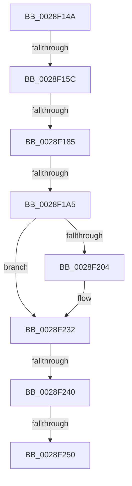

# sub_0028F14A

- RVA: `0x0028F14A`–`0x0028F27B` (길이 `305` bytes)
- VA: `0x000000014028F14A`
- 실행 섹션: `.text`
- PDB 이름 있음: `아니요`; PDB Function 태그: `아니요`
- unwind 정보 RVA: `0x0006718C`
- 디코드: `60`개 명령, `305/305` bytes 표시
- 미해석 바이트: `0` (있으면 어셈블리에 `.byte`로 보존)

> 이 문서는 커널 이미지의 기계어와 PDB 기호를 분석해 생성했습니다. 4번과 5번은 함수 원형과 자료형을 바이너리 사용 방식에서 추정한 C 해석이며 원본 소스 복구 결과는 아닙니다.

## 1. Dependencies

- 직접 호출 지점: **1**; 고유 호출 대상: **1**
- 직접 호출자로 확인된 함수: **0**
- RIP 상대 이미지 참조: **3**

### Outgoing calls
- `0x0028F22D` → [KiSetAddressPolicy](../21/KiSetAddressPolicy_function_002178A0.md) (function, `0x002178A0`)

### Direct callers
- 이 함수 시작 RVA로 연결되는 직접 call은 확인되지 않았습니다. 간접 호출은 완전히 역산할 수 없습니다.

### Static image references
- `0x0028F1F7` → RVA `0x01201840` (`CFGRO`; read)
- `0x0028F232` → RVA `0x00FC6AB8` (`ALMOSTRO`; read)
- `0x0028F265` → RVA `0x00FC6D20` (`ALMOSTRO`; read)

## 2. Other-region calls and transfers

- 다른 실행 섹션으로 향하는 call: **0**
- call이 아닌 외부 분기/꼬리 이동: **6**
  - `0x0028F156` → [sub_0028F34E](Unknown_function_0028F34E.md) (`tail-transfer`)
  - `0x0028F17F` → [sub_0028F2B8](Unknown_function_0028F2B8.md) (`tail-transfer`)
  - `0x0028F19F` → [sub_0028F2B8 + 0x17](Unknown_function_0028F2B8.md) (`tail-transfer`)
  - `0x0028F23A` → [sub_0028F368](Unknown_function_0028F368.md) (`tail-transfer`)
  - `0x0028F24A` → [sub_0028F2B8 + 0x2E](Unknown_function_0028F2B8.md) (`tail-transfer`)
  - `0x0028F279` → [sub_0028F27B + 0xD](Unknown_function_0028F27B.md) (`tail-transfer`)

## 3. Assembly (complete function range)

```asm
0028F14A  4C 89 BC 24 80 00 00 00         mov qword ptr [rsp + 0x80], r15
0028F152  90                              nop
0028F153  48 3B E9                        cmp rbp, rcx
0028F156  0F 85 F2 01 00 00               jne 0x14028f34e
0028F15C  48 8B 41 20                     mov rax, qword ptr [rcx + 0x20]
0028F160  48 89 47 20                     mov qword ptr [rdi + 0x20], rax
0028F164  0F B6 41 28                     movzx eax, byte ptr [rcx + 0x28]
0028F168  88 47 28                        mov byte ptr [rdi + 0x28], al
0028F16B  0F B6 41 29                     movzx eax, byte ptr [rcx + 0x29]
0028F16F  88 47 29                        mov byte ptr [rdi + 0x29], al
0028F172  0F B6 41 2A                     movzx eax, byte ptr [rcx + 0x2a]
0028F176  88 47 2A                        mov byte ptr [rdi + 0x2a], al
0028F179  48 8B 11                        mov rdx, qword ptr [rcx]
0028F17C  48 3B D1                        cmp rdx, rcx
0028F17F  0F 85 33 01 00 00               jne 0x14028f2b8
0028F185  48 89 7F 08                     mov qword ptr [rdi + 8], rdi
0028F189  48 89 3F                        mov qword ptr [rdi], rdi
0028F18C  44 88 77 29                     mov byte ptr [rdi + 0x29], r14b
0028F190  48 8B 51 10                     mov rdx, qword ptr [rcx + 0x10]
0028F194  48 8D 41 10                     lea rax, [rcx + 0x10]
0028F198  48 3B D0                        cmp rdx, rax
0028F19B  48 8D 47 10                     lea rax, [rdi + 0x10]
0028F19F  0F 85 2A 01 00 00               jne 0x14028f2cf
0028F1A5  48 89 40 08                     mov qword ptr [rax + 8], rax
0028F1A9  48 89 00                        mov qword ptr [rax], rax
0028F1AC  44 88 77 2A                     mov byte ptr [rdi + 0x2a], r14b
0028F1B0  4C 89 B3 78 02 00 00            mov qword ptr [rbx + 0x278], r14
0028F1B7  44 88 B3 4A 02 00 00            mov byte ptr [rbx + 0x24a], r14b
0028F1BE  4C 89 73 40                     mov qword ptr [rbx + 0x40], r14
0028F1C2  65 48 8B 04 25 20 00 00 00      mov rax, qword ptr gs:[0x20]
0028F1CB  4C 8B 83 B8 00 00 00            mov r8, qword ptr [rbx + 0xb8]
0028F1D2  44 0F B6 B8 D1 00 00 00         movzx r15d, byte ptr [rax + 0xd1]
0028F1DA  0F B6 80 D0 00 00 00            movzx eax, byte ptr [rax + 0xd0]
0028F1E1  4C 8D 34 C5 00 00 00 00         lea r14, [rax*8]
0028F1E9  49 8B 80 80 00 00 00            mov rax, qword ptr [r8 + 0x80]
0028F1F0  F0 4E 0F AB 7C 30 08            lock bts qword ptr [rax + r14 + 8], r15
0028F1F7  80 3D 42 26 F7 00 00            cmp byte ptr [rip + 0xf72642], 0
0028F1FE  49 8B 68 28                     mov rbp, qword ptr [r8 + 0x28]
0028F202  74 2E                           je 0x14028f232
0028F204  48 B9 00 00 00 00 00 00 00 80   movabs rcx, 0x8000000000000000
0028F20E  48 8B C5                        mov rax, rbp
0028F211  48 0B C1                        or rax, rcx
0028F214  40 F6 C5 02                     test bpl, 2
0028F218  48 0F 44 C5                     cmove rax, rbp
0028F21C  65 48 89 04 25 00 B0 00 00      mov qword ptr gs:[0xb000], rax
0028F225  41 0F B6 88 60 01 00 00         movzx ecx, byte ptr [r8 + 0x160]
0028F22D  E8 6E 86 F8 FF                  call 0x1402178a0
0028F232  8B 05 80 78 D3 00               mov eax, dword ptr [rip + 0xd37880]
0028F238  A8 01                           test al, 1
0028F23A  0F 85 28 01 00 00               jne 0x14028f368
0028F240  0F 22 DD                        mov cr3, rbp
0028F243  80 3D F6 25 F7 00 00            cmp byte ptr [rip + 0xf725f6], 0
0028F24A  0F 85 96 00 00 00               jne 0x14028f2e6
0028F250  49 8B 85 80 00 00 00            mov rax, qword ptr [r13 + 0x80]
0028F257  F0 4E 0F B3 7C 30 08            lock btr qword ptr [rax + r14 + 8], r15
0028F25E  81 63 74 FF F7 FF FF            and dword ptr [rbx + 0x74], 0xfffff7ff
0028F265  83 3D B4 7A D3 00 00            cmp dword ptr [rip + 0xd37ab4], 0
0028F26C  0F B6 6C 24 20                  movzx ebp, byte ptr [rsp + 0x20]
0028F271  4C 8B BC 24 80 00 00 00         mov r15, qword ptr [rsp + 0x80]
0028F279  74 0D                           je 0x14028f288
```

## 4. C-style interpretation (structured pseudocode)

```c
__int64 __fastcall sub_0028F14A(__int64 a1, __int64 a2, __int64 a3, __int64 a4, __int64 a5, __int64 a6, __int64 a7, __int64 a8, __int64 a9, __int64 a10, __int64 a11, __int64 a12, __int64 a13, __int64 a14, __int64 a15, __int64 a16)
{
    __int64 result;
    unsigned __int8 v_stack_p20;
    unsigned __int64 v_stack_p80;

    v_stack_p80 = v_r15;
    *(unsigned __int64 *)(v_rdi + 32) = *(unsigned __int64 *)(a1 + 32);
    *(unsigned __int8 *)(v_rdi + 40) = (unsigned __int8)(*(unsigned __int8 *)(a1 + 40));
    *(unsigned __int8 *)(v_rdi + 41) = (unsigned __int8)(*(unsigned __int8 *)(a1 + 41));
    *(unsigned __int8 *)(v_rdi + 42) = (unsigned __int8)(*(unsigned __int8 *)(a1 + 42));
    *(unsigned __int64 *)(v_rdi + 8) = v_rdi;
    *(unsigned __int64 *)(v_rdi) = v_rdi;
    *(unsigned __int8 *)(v_rdi + 41) = (unsigned __int8)(v_r14);
    *(unsigned __int64 *)(v_rdi + 16 + 8) = v_rdi + 16;
    *(unsigned __int64 *)(v_rdi + 16) = v_rdi + 16;
    *(unsigned __int8 *)(v_rdi + 42) = (unsigned __int8)(v_r14);
    *(unsigned __int64 *)(v_rbx + 632) = v_r14;
    *(unsigned __int8 *)(v_rbx + 586) = (unsigned __int8)(v_r14);
    *(unsigned __int64 *)(v_rbx + 64) = v_r14;
    result = *(unsigned __int64 *)(*(unsigned __int64 *)(v_rbx + 184) + 128);
    if ((*(unsigned __int8 *)(v_rip + 16197186)) != 0) {
        result = *(unsigned __int64 *)(*(unsigned __int64 *)(v_rbx + 184) + 40);
        result = (result) | (a1);
        if ((((unsigned __int8)(*(unsigned __int64 *)(*(unsigned __int64 *)(v_rbx + 184) + 40))) & (2)) == 0) { result = *(unsigned __int64 *)(*(unsigned __int64 *)(v_rbx + 184) + 40); }
        *(unsigned __int64 *)(gs_base + (0 + 45056)) = result;
        a1 = *(unsigned __int8 *)(*(unsigned __int64 *)(v_rbx + 184) + 352);
        result = KiSetAddressPolicy(a1, *(unsigned __int64 *)(a1 + 16), *(unsigned __int64 *)(v_rbx + 184), a4);
    }
}
```

## 5. (Beta) C Style

```c
int64_t sub_0028F14A(void *Arg1, int64_t Arg2, int64_t Arg3, int64_t Arg4, uint64_t Arg5, uint64_t Arg6, uint64_t Arg7, uint64_t Arg8, uint64_t Arg9, uint64_t Arg10, uint64_t Arg11, uint64_t Arg12, uint64_t Arg13, uint64_t Arg14, uint64_t Arg15, int64_t Arg16)
{
    uint8_t *arg1 = (uint8_t *)Arg1;

    int64_t result;
    uint8_t v_stack_p20;
    uint64_t v_stack_p80;

    v_stack_p80 = local_r15;
    *(uint64_t *)(local_rdi + 0x20) = *(uint64_t *)(arg1 + 0x20);
    *(uint8_t *)(local_rdi + 0x28) = (uint8_t)(*(uint8_t *)(arg1 + 0x28));
    *(uint8_t *)(local_rdi + 0x29) = (uint8_t)(*(uint8_t *)(arg1 + 0x29));
    *(uint8_t *)(local_rdi + 0x2A) = (uint8_t)(*(uint8_t *)(arg1 + 0x2A));
    *(uint64_t *)(local_rdi + 0x8) = local_rdi;
    *(uint64_t *)(local_rdi) = local_rdi;
    *(uint8_t *)(local_rdi + 0x29) = (uint8_t)(local_r14);
    *(uint64_t *)(local_rdi + 0x10 + 0x8) = local_rdi + 16;
    *(uint64_t *)(local_rdi + 0x10) = local_rdi + 16;
    *(uint8_t *)(local_rdi + 0x2A) = (uint8_t)(local_r14);
    *(uint64_t *)(local_rbx + 0x278) = local_r14;
    *(uint8_t *)(local_rbx + 0x24A) = (uint8_t)(local_r14);
    *(uint64_t *)(local_rbx + 0x40) = local_r14;
    result = *(uint64_t *)(*(uint64_t *)(local_rbx + 0xB8) + 0x80);
    if ((*(uint8_t *)(v_rip + 0xF72642)) != 0) {
        result = *(uint64_t *)(*(uint64_t *)(local_rbx + 0xB8) + 0x28);
        result = (result) | (Arg1);
        if ((((uint8_t)(*(uint64_t *)(*(uint64_t *)(local_rbx + 0xB8) + 0x28))) & (2)) == 0) { result = *(uint64_t *)(*(uint64_t *)(local_rbx + 0xB8) + 0x28); }
        *(uint64_t *)(gs_base + (0 + 0xB000)) = result;
        Arg1 = *(uint8_t *)(*(uint64_t *)(local_rbx + 0xB8) + 0x160);
        result = KiSetAddressPolicy(Arg1, *(uint64_t *)(arg1 + 0x10), *(uint64_t *)(local_rbx + 0xB8), Arg4);
    }
}
```

### 관측된 메모리 오프셋

구조체 형식이 확인되지 않은 접근은 인자 기준의 오프셋으로만 기록했습니다.

| 기준 인자 | 오프셋 표현 | 폭 (bit) | 접근 |
|---|---:|---:|---|
| `Arg1` | `+ 0x0` | `64` | `R` |
| `Arg1` | `+ 0x10` | `64` | `R` |
| `Arg1` | `+ 0x20` | `64` | `R` |
| `Arg1` | `+ 0x28` | `8` | `R` |
| `Arg1` | `+ 0x29` | `8` | `R` |
| `Arg1` | `+ 0x2A` | `8` | `R` |

## 6. Execution-region graph

[열기: 2D/3D 그래프와 함수 탐색 컨트롤 패널](../../../control-panel.html?section=text&rva=0x0028F14A&view=graph)

- 2D 그래프는 위에서 아래로 흐르고, 3D 그래프는 빈 공간을 드래그해 회전합니다. Shift+드래그는 이동, 휠은 확대·축소, 함수 노드 선택은 대상 보고서 이동입니다.

### Static fallback


