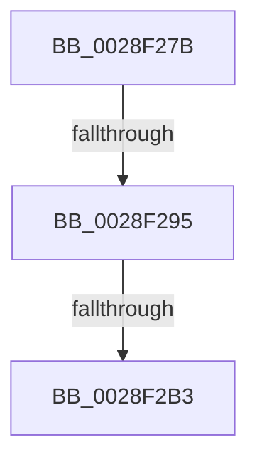

# sub_0028F27B

- RVA: `0x0028F27B`–`0x0028F2B8` (길이 `61` bytes)
- VA: `0x000000014028F27B`
- 실행 섹션: `.text`
- PDB 이름 있음: `아니요`; PDB Function 태그: `아니요`
- unwind 정보 RVA: `0x000671A0`
- 디코드: `13`개 명령, `61/61` bytes 표시
- 미해석 바이트: `0` (있으면 어셈블리에 `.byte`로 보존)

> 이 문서는 커널 이미지의 기계어와 PDB 기호를 분석해 생성했습니다. 4번과 5번은 함수 원형과 자료형을 바이너리 사용 방식에서 추정한 C 해석이며 원본 소스 복구 결과는 아닙니다.

## 1. Dependencies

- 직접 호출 지점: **1**; 고유 호출 대상: **1**
- 직접 호출자로 확인된 함수: **0**
- RIP 상대 이미지 참조: **1**

### Outgoing calls
- `0x0028F283` → [KiLowerIrqlProcessIrqlFlags](../4F/KiLowerIrqlProcessIrqlFlags_function_004F5698.md) (function, `0x004F5698`)

### Direct callers
- 이 함수 시작 RVA로 연결되는 직접 call은 확인되지 않았습니다. 간접 호출은 완전히 역산할 수 없습니다.

### Static image references
- `0x0028F29E` → RVA `0x00FC6BC5` (`ALMOSTRO`; read)

## 2. Other-region calls and transfers

- 다른 실행 섹션으로 향하는 call: **0**
- call이 아닌 외부 분기/꼬리 이동: **3**
  - `0x0028F28F` → [sub_0028EF98 + 0x160](Unknown_function_0028EF98.md) (`tail-transfer`)
  - `0x0028F2AD` → [sub_0028EF98 + 0x149](Unknown_function_0028EF98.md) (`tail-transfer`)
  - `0x0028F2B3` → [sub_0028EF98 + 0xF6](Unknown_function_0028EF98.md) (`tail-transfer`)

## 3. Assembly (complete function range)

```asm
0028F27B  44 0F 20 C1                     mov rcx, cr8
0028F27F  40 0F B6 D5                     movzx edx, bpl
0028F283  E8 10 64 26 00                  call 0x1404f5698
0028F288  44 0F 22 C5                     mov cr8, rbp
0028F28C  48 39 3F                        cmp qword ptr [rdi], rdi
0028F28F  0F 84 63 FE FF FF               je 0x14028f0f8
0028F295  33 C0                           xor eax, eax
0028F297  C6 83 C1 00 00 00 01            mov byte ptr [rbx + 0xc1], 1
0028F29E  38 05 21 79 D3 00               cmp byte ptr [rip + 0xd37921], al
0028F2A4  0F 57 C0                        xorps xmm0, xmm0
0028F2A7  F3 0F 7F 44 24 2C               movdqu xmmword ptr [rsp + 0x2c], xmm0
0028F2AD  0F 84 2E FE FF FF               je 0x14028f0e1
0028F2B3  E9 D6 FD FF FF                  jmp 0x14028f08e
```

## 4. C-style interpretation (structured pseudocode)

```c
__int64 __fastcall sub_0028F27B(void)
{
    __int64 result;
    unsigned __int64 v_stack_p2C;

    result = KiLowerIrqlProcessIrqlFlags(v_cr8, (unsigned __int8)(v_rbp), a3, a4);
    result = 0;
    *(unsigned __int8 *)(v_rbx + 193) = 1;
    v_stack_p2C = v_xmm0;
}
```

## 5. (Beta) C Style

```c
void sub_0028F27B(void)
{
    int64_t result;
    uint64_t v_stack_p2C;

    result = KiLowerIrqlProcessIrqlFlags(v_cr8, (uint8_t)(local_rbp), a3, a4);
    result = 0;
    *(uint8_t *)(local_rbx + 0xC1) = 1;
    v_stack_p2C = v_xmm0;
}
```

## 6. Execution-region graph

[열기: 2D/3D 그래프와 함수 탐색 컨트롤 패널](../../../control-panel.html?section=text&rva=0x0028F27B&view=graph)

- 2D 그래프는 위에서 아래로 흐르고, 3D 그래프는 빈 공간을 드래그해 회전합니다. Shift+드래그는 이동, 휠은 확대·축소, 함수 노드 선택은 대상 보고서 이동입니다.

### Static fallback


