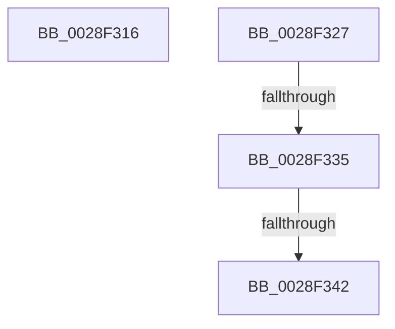

# sub_0028F316

- RVA: `0x0028F316`–`0x0028F34E` (길이 `56` bytes)
- VA: `0x000000014028F316`
- 실행 섹션: `.text`
- PDB 이름 있음: `아니요`; PDB Function 태그: `아니요`
- unwind 정보 RVA: `0x000671C4`
- 디코드: `13`개 명령, `56/56` bytes 표시
- 미해석 바이트: `0` (있으면 어셈블리에 `.byte`로 보존)

> 이 문서는 커널 이미지의 기계어와 PDB 기호를 분석해 생성했습니다. 4번과 5번은 함수 원형과 자료형을 바이너리 사용 방식에서 추정한 C 해석이며 원본 소스 복구 결과는 아닙니다.

## 1. Dependencies

- 직접 호출 지점: **3**; 고유 호출 대상: **3**
- 직접 호출자로 확인된 함수: **0**
- RIP 상대 이미지 참조: **1**

### Outgoing calls
- `0x0028F31D` → [KiRaiseIrqlProcessIrqlFlags](../4F/KiRaiseIrqlProcessIrqlFlags_function_004F56FC.md) (function, `0x004F56FC`)
- `0x0028F335` → [KiCheckVpBackingLongSpinWaitHypercall](../30/KiCheckVpBackingLongSpinWaitHypercall_function_0030F490.md) (function, `0x0030F490`)
- `0x0028F344` → [HvlNotifyLongSpinWait](../30/HvlNotifyLongSpinWait_function_0030F460.md) (function, `0x0030F460`)

### Direct callers
- 이 함수 시작 RVA로 연결되는 직접 call은 확인되지 않았습니다. 간접 호출은 완전히 역산할 수 없습니다.

### Static image references
- `0x0028F327` → RVA `0x00FC6AB8` (`ALMOSTRO`; read)

## 2. Other-region calls and transfers

- 다른 실행 섹션으로 향하는 call: **0**
- call이 아닌 외부 분기/꼬리 이동: **4**
  - `0x0028F322` → [sub_0028EF98 + 0x8D](Unknown_function_0028EF98.md) (`tail-transfer`)
  - `0x0028F32F` → [sub_0028EF98 + 0xAF](Unknown_function_0028EF98.md) (`tail-transfer`)
  - `0x0028F33C` → [sub_0028EF98 + 0xAF](Unknown_function_0028EF98.md) (`tail-transfer`)
  - `0x0028F349` → [sub_0028EF98 + 0xB1](Unknown_function_0028EF98.md) (`tail-transfer`)

## 3. Assembly (complete function range)

```asm
0028F316  0F B6 D0                        movzx edx, al
0028F319  40 0F B6 CF                     movzx ecx, dil
0028F31D  E8 DA 63 26 00                  call 0x1404f56fc
0028F322  E9 FE FC FF FF                  jmp 0x14028f025
0028F327  8B 05 8B 77 D3 00               mov eax, dword ptr [rip + 0xd3778b]
0028F32D  A8 40                           test al, 0x40
0028F32F  0F 84 12 FD FF FF               je 0x14028f047
0028F335  E8 56 01 08 00                  call 0x14030f490
0028F33A  84 C0                           test al, al
0028F33C  0F 84 05 FD FF FF               je 0x14028f047
0028F342  8B CF                           mov ecx, edi
0028F344  E8 17 01 08 00                  call 0x14030f460
0028F349  E9 FB FC FF FF                  jmp 0x14028f049
```

## 4. C-style interpretation (structured pseudocode)

```c
__int64 __fastcall sub_0028F316(void)
{
    __int64 result;

    result = KiRaiseIrqlProcessIrqlFlags((unsigned __int8)(v_rdi), (unsigned __int8)(result), a3, a4);
}
```

## 5. (Beta) C Style

```c
void sub_0028F316(void)
{
    int64_t result;

    result = KiRaiseIrqlProcessIrqlFlags((uint8_t)(local_rdi), (uint8_t)(result), a3, a4);
}
```

## 6. Execution-region graph

[열기: 2D/3D 그래프와 함수 탐색 컨트롤 패널](../../../control-panel.html?section=text&rva=0x0028F316&view=graph)

- 2D 그래프는 위에서 아래로 흐르고, 3D 그래프는 빈 공간을 드래그해 회전합니다. Shift+드래그는 이동, 휠은 확대·축소, 함수 노드 선택은 대상 보고서 이동입니다.

### Static fallback


