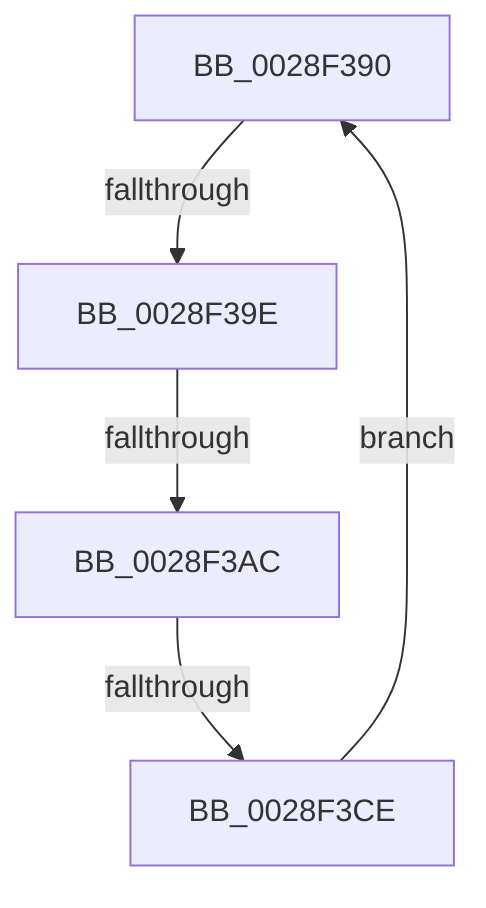

# sub_0028F390

- RVA: `0x0028F390`–`0x0028F3D0` (길이 `64` bytes)
- VA: `0x000000014028F390`
- 실행 섹션: `.text`
- PDB 이름 있음: `아니요`; PDB Function 태그: `아니요`
- unwind 정보 RVA: `0x00067248`
- 디코드: `13`개 명령, `64/64` bytes 표시
- 미해석 바이트: `0` (있으면 어셈블리에 `.byte`로 보존)

> 이 문서는 커널 이미지의 기계어와 PDB 기호를 분석해 생성했습니다. 4번과 5번은 함수 원형과 자료형을 바이너리 사용 방식에서 추정한 C 해석이며 원본 소스 복구 결과는 아닙니다.

## 1. Dependencies

- 직접 호출 지점: **2**; 고유 호출 대상: **2**
- 직접 호출자로 확인된 함수: **0**
- RIP 상대 이미지 참조: **0**

### Outgoing calls
- `0x0028F3AF` → [KiReleaseThreadLockLowerIrql](../3C/KiReleaseThreadLockLowerIrql_function_003C65D0.md) (function, `0x003C65D0`)
- `0x0028F3BC` → [KiAcquireThreadLockRaiseToDpc](../39/KiAcquireThreadLockRaiseToDpc_function_00396280.md) (function, `0x00396280`)

### Direct callers
- 이 함수 시작 RVA로 연결되는 직접 call은 확인되지 않았습니다. 간접 호출은 완전히 역산할 수 없습니다.

### Static image references
- 디코드된 RIP-relative 메모리 참조가 없습니다.

## 2. Other-region calls and transfers

- 다른 실행 섹션으로 향하는 call: **0**
- call이 아닌 외부 분기/꼬리 이동: **3**
  - `0x0028F398` → [sub_0028EF98 + 0xC9](Unknown_function_0028EF98.md) (`tail-transfer`)
  - `0x0028F3A6` → [sub_0028EF98 + 0xC9](Unknown_function_0028EF98.md) (`tail-transfer`)
  - `0x0028F3C8` → [sub_0028EF98 + 0xC9](Unknown_function_0028EF98.md) (`tail-transfer`)

## 3. Assembly (complete function range)

```asm
0028F390  66 44 39 B3 E6 01 00 00         cmp word ptr [rbx + 0x1e6], r14w
0028F398  0F 85 C3 FC FF FF               jne 0x14028f061
0028F39E  0F B6 54 24 20                  movzx edx, byte ptr [rsp + 0x20]
0028F3A3  80 FA 01                        cmp dl, 1
0028F3A6  0F 83 B5 FC FF FF               jae 0x14028f061
0028F3AC  48 8B CB                        mov rcx, rbx
0028F3AF  E8 1C 72 13 00                  call 0x1403c65d0
0028F3B4  48 8D 54 24 20                  lea rdx, [rsp + 0x20]
0028F3B9  48 8B CB                        mov rcx, rbx
0028F3BC  E8 BF 6E 10 00                  call 0x140396280
0028F3C1  44 38 B3 C1 00 00 00            cmp byte ptr [rbx + 0xc1], r14b
0028F3C8  0F 84 93 FC FF FF               je 0x14028f061
0028F3CE  EB C0                           jmp 0x14028f390
```

## 4. C-style interpretation (structured pseudocode)

```c
__int64 __fastcall sub_0028F390(void)
{
    __int64 result;
    unsigned __int8 v_stack_p20;

    result = KiReleaseThreadLockLowerIrql(v_rbx, v_stack_p20, a3, a4);
    result = KiAcquireThreadLockRaiseToDpc(v_rbx, v_stack_p20, a3, a4);
    goto loc_0028F390;
}
```

## 5. (Beta) C Style

```c
void sub_0028F390(void)
{
    int64_t result;
    uint8_t v_stack_p20;

    result = KiReleaseThreadLockLowerIrql(local_rbx, v_stack_p20, a3, a4);
    result = KiAcquireThreadLockRaiseToDpc(local_rbx, v_stack_p20, a3, a4);
    goto loc_0028F390;
}
```

## 6. Execution-region graph

[열기: 2D/3D 그래프와 함수 탐색 컨트롤 패널](../../../control-panel.html?section=text&rva=0x0028F390&view=graph)

- 2D 그래프는 위에서 아래로 흐르고, 3D 그래프는 빈 공간을 드래그해 회전합니다. Shift+드래그는 이동, 휠은 확대·축소, 함수 노드 선택은 대상 보고서 이동입니다.

### Static fallback


