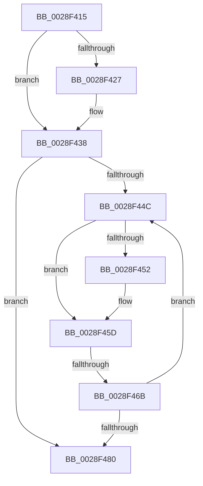

# sub_0028F415

- RVA: `0x0028F415`–`0x0028F485` (길이 `112` bytes)
- VA: `0x000000014028F415`
- 실행 섹션: `.text`
- PDB 이름 있음: `아니요`; PDB Function 태그: `아니요`
- unwind 정보 RVA: `0x0006727C`
- 디코드: `26`개 명령, `112/112` bytes 표시
- 미해석 바이트: `0` (있으면 어셈블리에 `.byte`로 보존)

> 이 문서는 커널 이미지의 기계어와 PDB 기호를 분석해 생성했습니다. 4번과 5번은 함수 원형과 자료형을 바이너리 사용 방식에서 추정한 C 해석이며 원본 소스 복구 결과는 아닙니다.

## 1. Dependencies

- 직접 호출 지점: **1**; 고유 호출 대상: **1**
- 직접 호출자로 확인된 함수: **0**
- RIP 상대 이미지 참조: **3**

### Outgoing calls
- `0x0028F431` → [ExpWaitForSpinLockExclusiveAndAcquire](../32/ExpWaitForSpinLockExclusiveAndAcquire_function_003239A0.md) (function, `0x003239A0`)

### Direct callers
- 이 함수 시작 RVA로 연결되는 직접 call은 확인되지 않았습니다. 간접 호출은 완전히 역산할 수 없습니다.

### Static image references
- `0x0028F41C` → RVA `0x00E374C0` (`.data`; read/write)
- `0x0028F42A` → RVA `0x00E374C0` (`.data`; read)
- `0x0028F45F` → RVA `0x00FC52AC` (`ALMOSTRO`; reference)

## 2. Other-region calls and transfers

- 다른 실행 섹션으로 향하는 call: **0**
- call이 아닌 외부 분기/꼬리 이동: **1**
  - `0x0028F465` → [sub_0028F553](Unknown_function_0028F553.md) (`tail-transfer`)

## 3. Assembly (complete function range)

```asm
0028F415  48 89 7C 24 48                  mov qword ptr [rsp + 0x48], rdi
0028F41A  33 FF                           xor edi, edi
0028F41C  F0 0F BA 2D 9B 80 BA 00 1F      lock bts dword ptr [rip + 0xba809b], 0x1f
0028F425  73 11                           jae 0x14028f438
0028F427  0F B6 D3                        movzx edx, bl
0028F42A  48 8D 0D 8F 80 BA 00            lea rcx, [rip + 0xba808f]
0028F431  E8 6A 45 09 00                  call 0x1403239a0
0028F436  8B F8                           mov edi, eax
0028F438  8B 15 82 80 BA 00               mov edx, dword ptr [rip + 0xba8082]
0028F43E  8B CA                           mov ecx, edx
0028F440  0F BA F1 1E                     btr ecx, 0x1e
0028F444  81 F9 00 00 00 80               cmp ecx, 0x80000000
0028F44A  74 34                           je 0x14028f480
0028F44C  0F BA E2 1E                     bt edx, 0x1e
0028F450  72 0B                           jb 0x14028f45d
0028F452  F0 81 0D 63 80 BA 00 00 00 00 40  lock or dword ptr [rip + 0xba8063], 0x40000000
0028F45D  FF C7                           inc edi
0028F45F  85 3D 47 5E D3 00               test dword ptr [rip + 0xd35e47], edi
0028F465  0F 84 E8 00 00 00               je 0x14028f553
0028F46B  F3 90                           pause
0028F46D  8B 15 4D 80 BA 00               mov edx, dword ptr [rip + 0xba804d]
0028F473  8B C2                           mov eax, edx
0028F475  0F BA F0 1E                     btr eax, 0x1e
0028F479  3D 00 00 00 80                  cmp eax, 0x80000000
0028F47E  75 CC                           jne 0x14028f44c
0028F480  48 8B 7C 24 48                  mov rdi, qword ptr [rsp + 0x48]
```

## 4. C-style interpretation (structured pseudocode)

```c
__int64 __fastcall sub_0028F415(__int64 a1, __int64 a2, __int64 a3, __int64 a4, __int64 a5, __int64 a6, __int64 a7, __int64 a8, __int64 a9)
{
    __int64 result;
    __int64 v_rdi;
    unsigned __int64 v_stack_p48;

    v_stack_p48 = v_rdi;
    v_rdi = 0;
    if (!(condition_is_above_or_equal)) {
        a2 = (unsigned __int8)(v_rbx);
        a1 = v_rip + 12222607;
        result = ExpWaitForSpinLockExclusiveAndAcquire(a1, a2, a3, a4);
        v_rdi = (unsigned int)(result);
    }
    if (((unsigned int)((unsigned int)((unsigned int)((unsigned int)(*(unsigned int *)(v_rip + 12222594)))))) == 0x80000000ULL) goto loc_0028F480;
loc_0028F44C:
    if (((unsigned int)((unsigned int)((unsigned int)((unsigned int)(*(unsigned int *)(v_rip + 12222594)))))) >= 0x80000000ULL) {
    }
    v_rdi = (unsigned int)((v_rdi) + 1);
    if (((unsigned int)((unsigned int)((unsigned int)((unsigned int)(*(unsigned int *)(v_rip + 12222541)))))) != 0x80000000ULL) goto loc_0028F44C;
loc_0028F480:
    return (unsigned int)((unsigned int)((unsigned int)(*(unsigned int *)(v_rip + 12222541))));
}
```

## 5. (Beta) C Style

```c
int64_t sub_0028F415(int64_t Arg1, int64_t Arg2, int64_t Arg3, int64_t Arg4, uint64_t Arg5, uint64_t Arg6, uint64_t Arg7, uint64_t Arg8, int64_t Arg9)
{
    int64_t result;
    int64_t local_rdi;
    uint64_t v_stack_p48;

    v_stack_p48 = local_rdi;
    local_rdi = 0;
    if (!(condition_is_above_or_equal)) {
        Arg2 = (uint8_t)(local_rbx);
        Arg1 = v_rip + 12222607;
        result = ExpWaitForSpinLockExclusiveAndAcquire(Arg1, Arg2, Arg3, Arg4);
        local_rdi = (uint32_t)(result);
    }
    if (((uint32_t)((uint32_t)((uint32_t)((uint32_t)(*(uint32_t *)(v_rip + 0xBA8082)))))) == 0x80000000ULL) goto loc_0028F480;
loc_0028F44C:
    if (((uint32_t)((uint32_t)((uint32_t)((uint32_t)(*(uint32_t *)(v_rip + 0xBA8082)))))) >= 0x80000000ULL) {
    }
    local_rdi = (uint32_t)((local_rdi) + 1);
    if (((uint32_t)((uint32_t)((uint32_t)((uint32_t)(*(uint32_t *)(v_rip + 0xBA804D)))))) != 0x80000000ULL) goto loc_0028F44C;
loc_0028F480:
    return (uint32_t)((uint32_t)((uint32_t)(*(uint32_t *)(v_rip + 0xBA804D))));
}
```

## 6. Execution-region graph

[열기: 2D/3D 그래프와 함수 탐색 컨트롤 패널](../../../control-panel.html?section=text&rva=0x0028F415&view=graph)

- 2D 그래프는 위에서 아래로 흐르고, 3D 그래프는 빈 공간을 드래그해 회전합니다. Shift+드래그는 이동, 휠은 확대·축소, 함수 노드 선택은 대상 보고서 이동입니다.

### Static fallback


