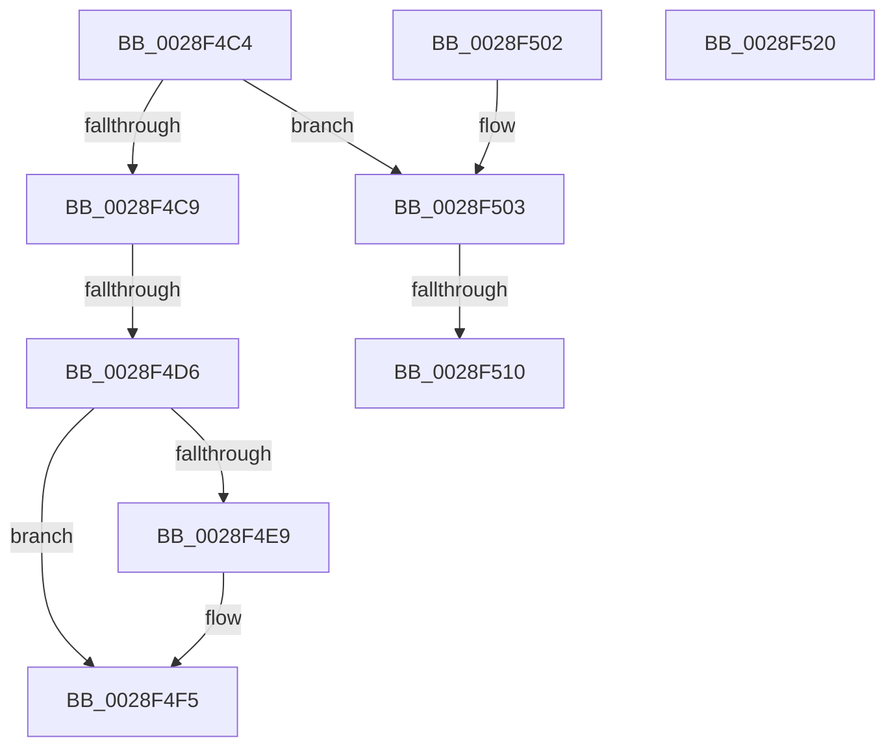

# sub_0028F4C4

- RVA: `0x0028F4C4`–`0x0028F521` (길이 `93` bytes)
- VA: `0x000000014028F4C4`
- 실행 섹션: `.text`
- PDB 이름 있음: `아니요`; PDB Function 태그: `아니요`
- unwind 정보 RVA: `0x000672A0`
- 디코드: `23`개 명령, `93/93` bytes 표시
- 미해석 바이트: `0` (있으면 어셈블리에 `.byte`로 보존)

> 이 문서는 커널 이미지의 기계어와 PDB 기호를 분석해 생성했습니다. 4번과 5번은 함수 원형과 자료형을 바이너리 사용 방식에서 추정한 C 해석이며 원본 소스 복구 결과는 아닙니다.

## 1. Dependencies

- 직접 호출 지점: **1**; 고유 호출 대상: **1**
- 직접 호출자로 확인된 함수: **0**
- RIP 상대 이미지 참조: **3**

### Outgoing calls
- `0x0028F4F0` → [KiLowerIrqlProcessIrqlFlags](../4F/KiLowerIrqlProcessIrqlFlags_function_004F5698.md) (function, `0x004F5698`)

### Direct callers
- 이 함수 시작 RVA로 연결되는 직접 call은 확인되지 않았습니다. 간접 호출은 완전히 역산할 수 없습니다.

### Static image references
- `0x0028F4C9` → RVA `0x00FC6B06` (`ALMOSTRO`; read)
- `0x0028F4D6` → RVA `0x00E374C0` (`.data`; write)
- `0x0028F4E0` → RVA `0x00FC6D20` (`ALMOSTRO`; read)

## 2. Other-region calls and transfers

- 다른 실행 섹션으로 향하는 call: **0**
- call이 아닌 외부 분기/꼬리 이동: **2**
  - `0x0028F4D0` → [sub_0028F57A](Unknown_function_0028F57A.md) (`tail-transfer`)
  - `0x0028F50A` → [sub_0028F57A + 0x24](Unknown_function_0028F57A.md) (`tail-transfer`)

## 3. Assembly (complete function range)

```asm
0028F4C4  80 FB 11                        cmp bl, 0x11
0028F4C7  74 3A                           je 0x14028f503
0028F4C9  F6 05 36 76 D3 00 01            test byte ptr [rip + 0xd37636], 1
0028F4D0  0F 85 A4 00 00 00               jne 0x14028f57a
0028F4D6  C7 05 E0 7F BA 00 00 00 00 00   mov dword ptr [rip + 0xba7fe0], 0
0028F4E0  83 3D 39 78 D3 00 00            cmp dword ptr [rip + 0xd37839], 0
0028F4E7  74 0C                           je 0x14028f4f5
0028F4E9  44 0F 20 C1                     mov rcx, cr8
0028F4ED  0F B6 D3                        movzx edx, bl
0028F4F0  E8 A3 61 26 00                  call 0x1404f5698
0028F4F5  0F B6 C3                        movzx eax, bl
0028F4F8  44 0F 22 C0                     mov cr8, rax
0028F4FC  48 83 C4 20                     add rsp, 0x20
0028F500  5B                              pop rbx
0028F501  C3                              ret
0028F502  CC                              int3
0028F503  F6 05 FC 75 D3 00 01            test byte ptr [rip + 0xd375fc], 1
0028F50A  0F 85 8E 00 00 00               jne 0x14028f59e
0028F510  C7 05 A6 7F BA 00 00 00 00 00   mov dword ptr [rip + 0xba7fa6], 0
0028F51A  48 83 C4 20                     add rsp, 0x20
0028F51E  5B                              pop rbx
0028F51F  C3                              ret
0028F520  CC                              int3
```

## 4. C-style interpretation (structured pseudocode)

```c
__int64 __fastcall sub_0028F4C4(void)
{
    __int64 result;
    __int64 v_rsp;

    if (((unsigned __int8)(v_rbx)) == 17) goto loc_0028F503;
    *(unsigned int *)(v_rip + 12222432) = 0;
    if ((*(unsigned int *)(v_rip + 13858873)) != 0) {
        a1 = v_cr8;
        a2 = (unsigned __int8)(v_rbx);
        result = KiLowerIrqlProcessIrqlFlags(a1, a2, a3, a4);
    }
    v_rsp = (v_rsp) + (32);
    return (unsigned __int8)(v_rbx);
loc_0028F503:
    *(unsigned int *)(v_rip + 12222374) = 0;
    v_rsp = (v_rsp) + (32);
    return (unsigned __int8)(v_rbx);
}
```

## 5. (Beta) C Style

```c
void sub_0028F4C4(void)
{
    int64_t result;
    int64_t local_rsp;

    if (((uint8_t)(local_rbx)) == 17) goto loc_0028F503;
    *(uint32_t *)(v_rip + 0xBA7FE0) = 0;
    if ((*(uint32_t *)(v_rip + 0xD37839)) != 0) {
        a1 = v_cr8;
        a2 = (uint8_t)(local_rbx);
        result = KiLowerIrqlProcessIrqlFlags(a1, a2, a3, a4);
    }
    local_rsp = (local_rsp) + (32);
    return (uint8_t)(local_rbx);
loc_0028F503:
    *(uint32_t *)(v_rip + 0xBA7FA6) = 0;
    local_rsp = (local_rsp) + (32);
    return (uint8_t)(local_rbx);
}
```

## 6. Execution-region graph

[열기: 2D/3D 그래프와 함수 탐색 컨트롤 패널](../../../control-panel.html?section=text&rva=0x0028F4C4&view=graph)

- 2D 그래프는 위에서 아래로 흐르고, 3D 그래프는 빈 공간을 드래그해 회전합니다. Shift+드래그는 이동, 휠은 확대·축소, 함수 노드 선택은 대상 보고서 이동입니다.

### Static fallback


