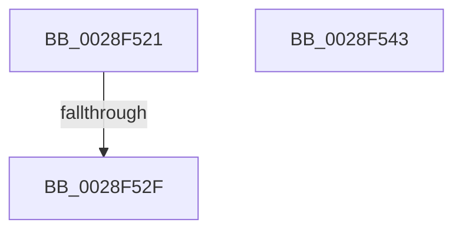

# sub_0028F521

- RVA: `0x0028F521`–`0x0028F553` (길이 `50` bytes)
- VA: `0x000000014028F521`
- 실행 섹션: `.text`
- PDB 이름 있음: `아니요`; PDB Function 태그: `아니요`
- unwind 정보 RVA: `0x000672B8`
- 디코드: `11`개 명령, `50/50` bytes 표시
- 미해석 바이트: `0` (있으면 어셈블리에 `.byte`로 보존)

> 이 문서는 커널 이미지의 기계어와 PDB 기호를 분석해 생성했습니다. 4번과 5번은 함수 원형과 자료형을 바이너리 사용 방식에서 추정한 C 해석이며 원본 소스 복구 결과는 아닙니다.

## 1. Dependencies

- 직접 호출 지점: **2**; 고유 호출 대상: **2**
- 직접 호출자로 확인된 함수: **0**
- RIP 상대 이미지 참조: **2**

### Outgoing calls
- `0x0028F539` → [ExpAcquireSpinLockExclusiveAtDpcLevelInstrumented](../32/ExpAcquireSpinLockExclusiveAtDpcLevelInstrumented_function_00323A70.md) (function, `0x00323A70`)
- `0x0028F549` → [KiRaiseIrqlProcessIrqlFlags](../4F/KiRaiseIrqlProcessIrqlFlags_function_004F56FC.md) (function, `0x004F56FC`)

### Direct callers
- 이 함수 시작 RVA로 연결되는 직접 call은 확인되지 않았습니다. 간접 호출은 완전히 역산할 수 없습니다.

### Static image references
- `0x0028F521` → RVA `0x00F0DE58` (`.data`; read)
- `0x0028F532` → RVA `0x00E374C0` (`.data`; read)

## 2. Other-region calls and transfers

- 다른 실행 섹션으로 향하는 call: **0**
- call이 아닌 외부 분기/꼬리 이동: **3**
  - `0x0028F529` → [sub_0028F415](Unknown_function_0028F415.md) (`tail-transfer`)
  - `0x0028F53E` → [sub_0028F485](Unknown_function_0028F485.md) (`tail-transfer`)
  - `0x0028F54E` → [sub_0028F3E6 + 0x22](Unknown_function_0028F3E6.md) (`tail-transfer`)

## 3. Assembly (complete function range)

```asm
0028F521  8B 05 31 E9 C7 00               mov eax, dword ptr [rip + 0xc7e931]
0028F527  85 C0                           test eax, eax
0028F529  0F 85 E6 FE FF FF               jne 0x14028f415
0028F52F  0F B6 D3                        movzx edx, bl
0028F532  48 8D 0D 87 7F BA 00            lea rcx, [rip + 0xba7f87]
0028F539  E8 32 45 09 00                  call 0x140323a70
0028F53E  E9 42 FF FF FF                  jmp 0x14028f485
0028F543  0F B6 D0                        movzx edx, al
0028F546  0F B6 CB                        movzx ecx, bl
0028F549  E8 AE 61 26 00                  call 0x1404f56fc
0028F54E  E9 B5 FE FF FF                  jmp 0x14028f408
```

## 4. C-style interpretation (structured pseudocode)

```c
__int64 __fastcall sub_0028F521(void)
{
    __int64 result;

    result = ExpAcquireSpinLockExclusiveAtDpcLevelInstrumented(v_rip + 12222343, (unsigned __int8)(v_rbx), a3, a4);
}
```

## 5. (Beta) C Style

```c
void sub_0028F521(void)
{
    int64_t result;

    result = ExpAcquireSpinLockExclusiveAtDpcLevelInstrumented(v_rip + 12222343, (uint8_t)(local_rbx), a3, a4);
}
```

## 6. Execution-region graph

[열기: 2D/3D 그래프와 함수 탐색 컨트롤 패널](../../../control-panel.html?section=text&rva=0x0028F521&view=graph)

- 2D 그래프는 위에서 아래로 흐르고, 3D 그래프는 빈 공간을 드래그해 회전합니다. Shift+드래그는 이동, 휠은 확대·축소, 함수 노드 선택은 대상 보고서 이동입니다.

### Static fallback


