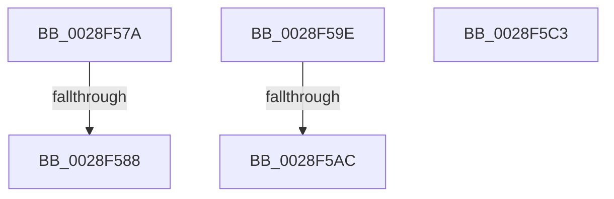

# sub_0028F57A

- RVA: `0x0028F57A`–`0x0028F5D3` (길이 `89` bytes)
- VA: `0x000000014028F57A`
- 실행 섹션: `.text`
- PDB 이름 있음: `아니요`; PDB Function 태그: `아니요`
- unwind 정보 RVA: `0x000672E4`
- 디코드: `20`개 명령, `89/89` bytes 표시
- 미해석 바이트: `0` (있으면 어셈블리에 `.byte`로 보존)

> 이 문서는 커널 이미지의 기계어와 PDB 기호를 분석해 생성했습니다. 4번과 5번은 함수 원형과 자료형을 바이너리 사용 방식에서 추정한 C 해석이며 원본 소스 복구 결과는 아닙니다.

## 1. Dependencies

- 직접 호출 지점: **3**; 고유 호출 대상: **2**
- 직접 호출자로 확인된 함수: **0**
- RIP 상대 이미지 참조: **2**

### Outgoing calls
- `0x0028F594` → [ExpReleaseSpinLockExclusiveFromDpcLevelInstrumented](../2C/ExpReleaseSpinLockExclusiveFromDpcLevelInstrumented_function_002C0F44.md) (function, `0x002C0F44`)
- `0x0028F5B8` → [ExpReleaseSpinLockExclusiveFromDpcLevelInstrumented](../2C/ExpReleaseSpinLockExclusiveFromDpcLevelInstrumented_function_002C0F44.md) (function, `0x002C0F44`)
- `0x0028F5C9` → [KeSignalGate](../2C/KeSignalGate_function_002C748C.md) (function, `0x002C748C`)

### Direct callers
- 이 함수 시작 RVA로 연결되는 직접 call은 확인되지 않았습니다. 간접 호출은 완전히 역산할 수 없습니다.

### Static image references
- `0x0028F57A` → RVA `0x00F0DE58` (`.data`; read)
- `0x0028F58D` → RVA `0x00E374C0` (`.data`; read)

## 2. Other-region calls and transfers

- 다른 실행 섹션으로 향하는 call: **0**
- call이 아닌 외부 분기/꼬리 이동: **4**
  - `0x0028F582` → [sub_0028F4C4 + 0x12](Unknown_function_0028F4C4.md) (`tail-transfer`)
  - `0x0028F599` → [sub_0028F4C4 + 0x1C](Unknown_function_0028F4C4.md) (`tail-transfer`)
  - `0x0028F5A6` → [sub_0028F4C4 + 0x4C](Unknown_function_0028F4C4.md) (`tail-transfer`)
  - `0x0028F5CE` → [sub_0028F4C4](Unknown_function_0028F4C4.md) (`tail-transfer`)

## 3. Assembly (complete function range)

```asm
0028F57A  8B 05 D8 E8 C7 00               mov eax, dword ptr [rip + 0xc7e8d8]
0028F580  85 C0                           test eax, eax
0028F582  0F 85 4E FF FF FF               jne 0x14028f4d6
0028F588  48 8B 54 24 28                  mov rdx, qword ptr [rsp + 0x28]
0028F58D  48 8D 0D 2C 7F BA 00            lea rcx, [rip + 0xba7f2c]
0028F594  E8 AB 19 03 00                  call 0x1402c0f44
0028F599  E9 42 FF FF FF                  jmp 0x14028f4e0
0028F59E  8B 05 B4 E8 C7 00               mov eax, dword ptr [rip + 0xc7e8b4]
0028F5A4  85 C0                           test eax, eax
0028F5A6  0F 85 64 FF FF FF               jne 0x14028f510
0028F5AC  48 8B 54 24 28                  mov rdx, qword ptr [rsp + 0x28]
0028F5B1  48 8D 0D 08 7F BA 00            lea rcx, [rip + 0xba7f08]
0028F5B8  E8 87 19 03 00                  call 0x1402c0f44
0028F5BD  48 83 C4 20                     add rsp, 0x20
0028F5C1  5B                              pop rbx
0028F5C2  C3                              ret
0028F5C3  CC                              int3
0028F5C4  BA 01 00 00 00                  mov edx, 1
0028F5C9  E8 BE 7E 03 00                  call 0x1402c748c
0028F5CE  E9 F1 FE FF FF                  jmp 0x14028f4c4
```

## 4. C-style interpretation (structured pseudocode)

```c
__int64 __fastcall sub_0028F57A(__int64 a1, __int64 a2, __int64 a3, __int64 a4, __int64 a5)
{
    __int64 result;
    unsigned __int64 v_stack_p28;

    result = ExpReleaseSpinLockExclusiveFromDpcLevelInstrumented(v_rip + 12222252, a5, a3, a4);
}
```

## 5. (Beta) C Style

```c
int64_t sub_0028F57A(int64_t Arg1, int64_t Arg2, int64_t Arg3, int64_t Arg4, int64_t Arg5)
{
    int64_t result;
    uint64_t v_stack_p28;

    result = ExpReleaseSpinLockExclusiveFromDpcLevelInstrumented(v_rip + 12222252, Arg5, Arg3, Arg4);
}
```

## 6. Execution-region graph

[열기: 2D/3D 그래프와 함수 탐색 컨트롤 패널](../../../control-panel.html?section=text&rva=0x0028F57A&view=graph)

- 2D 그래프는 위에서 아래로 흐르고, 3D 그래프는 빈 공간을 드래그해 회전합니다. Shift+드래그는 이동, 휠은 확대·축소, 함수 노드 선택은 대상 보고서 이동입니다.

### Static fallback


