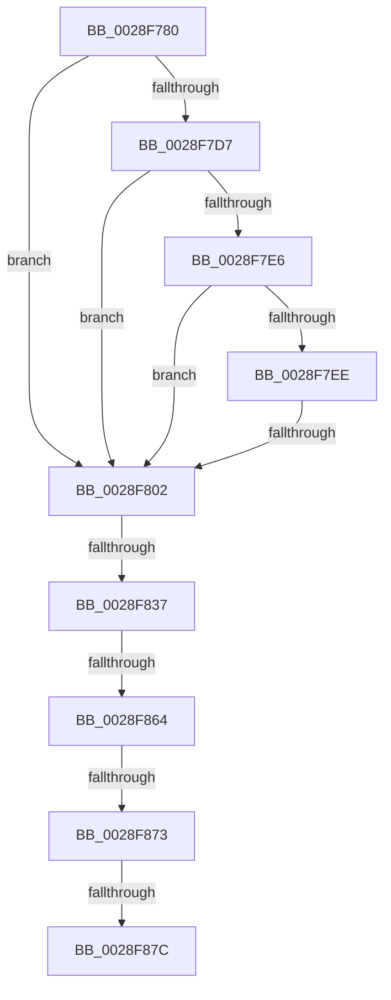

# sub_0028F780

- RVA: `0x0028F780`–`0x0028F8C9` (길이 `329` bytes)
- VA: `0x000000014028F780`
- 실행 섹션: `.text`
- PDB 이름 있음: `아니요`; PDB Function 태그: `아니요`
- unwind 정보 RVA: `0x00067320`
- 디코드: `79`개 명령, `329/329` bytes 표시
- 미해석 바이트: `0` (있으면 어셈블리에 `.byte`로 보존)

> 이 문서는 커널 이미지의 기계어와 PDB 기호를 분석해 생성했습니다. 4번과 5번은 함수 원형과 자료형을 바이너리 사용 방식에서 추정한 C 해석이며 원본 소스 복구 결과는 아닙니다.

## 1. Dependencies

- 직접 호출 지점: **1**; 고유 호출 대상: **1**
- 직접 호출자로 확인된 함수: **0**
- RIP 상대 이미지 참조: **0**

### Outgoing calls
- `0x0028F8A3` → [MiAgePteWorker](MiAgePteWorker_function_0028FB20.md) (function, `0x0028FB20`)

### Direct callers
- 이 함수 시작 RVA로 연결되는 직접 call은 확인되지 않았습니다. 간접 호출은 완전히 역산할 수 없습니다.

### Static image references
- 디코드된 RIP-relative 메모리 참조가 없습니다.

## 2. Other-region calls and transfers

- 다른 실행 섹션으로 향하는 call: **0**
- call이 아닌 외부 분기/꼬리 이동: **5**
  - `0x0028F7FC` → [sub_0028F8D8](Unknown_function_0028F8D8.md) (`tail-transfer`)
  - `0x0028F831` → [sub_0028FA52 + 0x33](Unknown_function_0028FA52.md) (`tail-transfer`)
  - `0x0028F85E` → [sub_0028FA52](Unknown_function_0028FA52.md) (`tail-transfer`)
  - `0x0028F86D` → [sub_0028F8D8 + 0xE9](Unknown_function_0028F8D8.md) (`tail-transfer`)
  - `0x0028F876` → [sub_0028F8D8 + 0x6B](Unknown_function_0028F8D8.md) (`tail-transfer`)

## 3. Assembly (complete function range)

```asm
0028F780  48 89 5C 24 68                  mov qword ptr [rsp + 0x68], rbx
0028F785  48 89 6C 24 70                  mov qword ptr [rsp + 0x70], rbp
0028F78A  48 89 74 24 78                  mov qword ptr [rsp + 0x78], rsi
0028F78F  49 BB 00 00 00 00 80 F6 FF FF   movabs r11, 0xfffff68000000000
0028F799  4D 8B C3                        mov r8, r11
0028F79C  49 C1 E6 19                     shl r14, 0x19
0028F7A0  48 B8 F8 FF FF FF 7F 00 00 00   movabs rax, 0x7ffffffff8
0028F7AA  49 C1 E0 19                     shl r8, 0x19
0028F7AE  4D 2B F0                        sub r14, r8
0028F7B1  49 C1 FE 10                     sar r14, 0x10
0028F7B5  49 8B F6                        mov rsi, r14
0028F7B8  48 C1 EE 09                     shr rsi, 9
0028F7BC  48 23 F0                        and rsi, rax
0028F7BF  49 8B C3                        mov rax, r11
0028F7C2  48 03 F0                        add rsi, rax
0028F7C5  48 8B 1E                        mov rbx, qword ptr [rsi]
0028F7C8  48 B8 00 D0 BE 7D FB F6 FF FF   movabs rax, 0xfffff6fb7dbed000
0028F7D2  48 3B F0                        cmp rsi, rax
0028F7D5  72 2B                           jb 0x14028f802
0028F7D7  48 B8 F8 D7 BE 7D FB F6 FF FF   movabs rax, 0xfffff6fb7dbed7f8
0028F7E1  48 3B F0                        cmp rsi, rax
0028F7E4  77 1C                           ja 0x14028f802
0028F7E6  48 8B C3                        mov rax, rbx
0028F7E9  F6 C3 01                        test bl, 1
0028F7EC  74 14                           je 0x14028f802
0028F7EE  F6 C3 42                        test bl, 0x42
0028F7F1  0F 95 C2                        setne dl
0028F7F4  F6 C3 20                        test bl, 0x20
0028F7F7  0F 95 C1                        setne cl
0028F7FA  84 D1                           test cl, dl
0028F7FC  0F 84 D6 00 00 00               je 0x14028f8d8
0028F802  48 8B C3                        mov rax, rbx
0028F805  48 B9 FF FF FF FF FF 00 00 00   movabs rcx, 0xffffffffff
0028F80F  48 C1 E8 0C                     shr rax, 0xc
0028F813  48 23 C1                        and rax, rcx
0028F816  48 8D 2C 40                     lea rbp, [rax + rax*2]
0028F81A  48 B8 00 00 00 00 00 DE FF FF   movabs rax, 0xffffde0000000000
0028F824  48 C1 E5 04                     shl rbp, 4
0028F828  48 8B C0                        mov rax, rax
0028F82B  48 03 E8                        add rbp, rax
0028F82E  45 85 E4                        test r12d, r12d
0028F831  0F 85 4E 02 00 00               jne 0x14028fa85
0028F837  48 8D 4E 08                     lea rcx, [rsi + 8]
0028F83B  8B 07                           mov eax, dword ptr [rdi]
0028F83D  BA 08 00 00 00                  mov edx, 8
0028F842  A8 02                           test al, 2
0028F844  B8 10 00 00 00                  mov eax, 0x10
0028F849  0F 44 C2                        cmove eax, edx
0028F84C  4A 89 0C 10                     mov qword ptr [rax + r10], rcx
0028F850  48 FF 47 28                     inc qword ptr [rdi + 0x28]
0028F854  41 8B 85 B8 00 00 00            mov eax, dword ptr [r13 + 0xb8]
0028F85B  45 85 E4                        test r12d, r12d
0028F85E  0F 85 EE 01 00 00               jne 0x14028fa52
0028F864  48 8B 45 28                     mov rax, qword ptr [rbp + 0x28]
0028F868  48 0F BA E0 28                  bt rax, 0x28
0028F86D  0F 83 4E 01 00 00               jae 0x14028f9c1
0028F873  F6 C3 20                        test bl, 0x20
0028F876  0F 85 C7 00 00 00               jne 0x14028f943
0028F87C  48 C1 EB 05                     shr rbx, 5
0028F880  4C 8B CD                        mov r9, rbp
0028F883  83 E3 01                        and ebx, 1
0028F886  4D 8B C6                        mov r8, r14
0028F889  8B CB                           mov ecx, ebx
0028F88B  48 8B D6                        mov rdx, rsi
0028F88E  83 C9 02                        or ecx, 2
0028F891  F6 07 03                        test byte ptr [rdi], 3
0028F894  0F 44 CB                        cmove ecx, ebx
0028F897  89 4C 24 28                     mov dword ptr [rsp + 0x28], ecx
0028F89B  49 8B CF                        mov rcx, r15
0028F89E  48 89 7C 24 20                  mov qword ptr [rsp + 0x20], rdi
0028F8A3  E8 78 02 00 00                  call 0x14028fb20
0028F8A8  48 8B 4F 30                     mov rcx, qword ptr [rdi + 0x30]
0028F8AC  33 C0                           xor eax, eax
0028F8AE  48 39 4F 28                     cmp qword ptr [rdi + 0x28], rcx
0028F8B2  BA 04 00 00 00                  mov edx, 4
0028F8B7  48 8B 74 24 78                  mov rsi, qword ptr [rsp + 0x78]
0028F8BC  48 8B 6C 24 70                  mov rbp, qword ptr [rsp + 0x70]
0028F8C1  0F 43 C2                        cmovae eax, edx
0028F8C4  48 8B 5C 24 68                  mov rbx, qword ptr [rsp + 0x68]
```

## 4. C-style interpretation (structured pseudocode)

```c
__int64 __fastcall sub_0028F780(__int64 a1, __int64 a2, __int64 a3, __int64 a4, __int64 a5, __int64 a6, __int64 a7, __int64 a8, __int64 a9, __int64 a10, __int64 a11, __int64 a12, __int64 a13, __int64 a14, __int64 a15)
{
    __int64 result;
    __int64 v_r14;
    __int64 v_rbp;
    __int64 v_rbx;
    __int64 v_rsi;
    unsigned __int64 v_stack_p20;
    unsigned int v_stack_p28;
    unsigned __int64 v_stack_p68;
    unsigned __int64 v_stack_p70;
    unsigned __int64 v_stack_p78;

    v_stack_p68 = v_rbx;
    v_stack_p70 = v_rbp;
    v_stack_p78 = v_rsi;
    v_r14 = (v_r14) << (25);
    a3 = (v_r11) << (25);
    v_r14 = (v_r14) - (a3);
    v_r14 = (v_r14) >> (16);
    v_rsi = (v_r14) >> (9);
    v_rsi = (v_rsi) & (result);
    v_rsi = (v_rsi) + (v_r11);
    if (v_rsi < v_r11) goto loc_0028F802;
    if (v_rsi > v_r11) goto loc_0028F802;
    if ((((unsigned __int8)(*(unsigned __int64 *)(v_rsi))) & (1)) == 0) goto loc_0028F802;
    a2 = ((((unsigned __int8)(*(unsigned __int64 *)(v_rsi))) & (66)) != 0) ? 1 : 0;
    a1 = ((((unsigned __int8)(*(unsigned __int64 *)(v_rsi))) & (32)) != 0) ? 1 : 0;
loc_0028F802:
    result = (*(unsigned __int64 *)(v_rsi)) >> (12);
    result = (result) & (a1);
    v_rbp = (result + result * 2) << (4);
    v_rbp = (v_rbp) + (result);
    result = 16;
    if ((((unsigned __int8)((unsigned int)(*(unsigned int *)(v_rdi)))) & (2)) == 0) { result = 8; }
    *(unsigned __int64 *)(result + v_r10 * 1) = v_rsi + 8;
    v_rbx = (*(unsigned __int64 *)(v_rsi)) >> (5);
    v_rbx = (unsigned int)((v_rbx) & (1));
    a1 = (unsigned int)(((unsigned int)((unsigned int)(v_rbx))) | (2));
    if (((*(unsigned __int8 *)(v_rdi)) & (3)) == 0) { a1 = (unsigned int)(v_rbx); }
    v_stack_p28 = (unsigned int)(a1);
    v_stack_p20 = v_rdi;
    result = MiAgePteWorker(v_r15, v_rsi, v_r14, v_rbp);
    result = 0;
    if ((*(unsigned __int64 *)(v_rdi + 40)) >= (*(unsigned __int64 *)(v_rdi + 48))) { result = 4; }
    return result;
}
```

## 5. (Beta) C Style

```c
int64_t sub_0028F780(int64_t Arg1, int64_t Arg2, int64_t Arg3, int64_t Arg4, uint64_t Arg5, uint64_t Arg6, uint64_t Arg7, uint64_t Arg8, uint64_t Arg9, uint64_t Arg10, uint64_t Arg11, uint64_t Arg12, int64_t Arg13, int64_t Arg14, int64_t Arg15)
{
    int64_t result;
    int64_t local_r14;
    int64_t local_rbp;
    int64_t local_rbx;
    int64_t local_rsi;
    uint64_t v_stack_p20;
    uint32_t v_stack_p28;
    uint64_t v_stack_p68;
    uint64_t v_stack_p70;
    uint64_t v_stack_p78;

    v_stack_p68 = local_rbx;
    v_stack_p70 = local_rbp;
    v_stack_p78 = local_rsi;
    local_r14 = (local_r14) << (25);
    Arg3 = (local_r11) << (25);
    local_r14 = (local_r14) - (Arg3);
    local_r14 = (local_r14) >> (16);
    local_rsi = (local_r14) >> (9);
    local_rsi = (local_rsi) & (result);
    local_rsi = (local_rsi) + (local_r11);
    if (local_rsi < local_r11) goto loc_0028F802;
    if (local_rsi > local_r11) goto loc_0028F802;
    if ((((uint8_t)(*(uint64_t *)(local_rsi))) & (1)) == 0) goto loc_0028F802;
    Arg2 = ((((uint8_t)(*(uint64_t *)(local_rsi))) & (66)) != 0) ? 1 : 0;
    Arg1 = ((((uint8_t)(*(uint64_t *)(local_rsi))) & (32)) != 0) ? 1 : 0;
loc_0028F802:
    result = (*(uint64_t *)(local_rsi)) >> (12);
    result = (result) & (Arg1);
    local_rbp = (result + result * 2) << (4);
    local_rbp = (local_rbp) + (result);
    result = 16;
    if ((((uint8_t)((uint32_t)(*(uint32_t *)(local_rdi)))) & (2)) == 0) { result = 8; }
    *(uint64_t *)(result + local_r10 * 1) = local_rsi + 8;
    local_rbx = (*(uint64_t *)(local_rsi)) >> (5);
    local_rbx = (uint32_t)((local_rbx) & (1));
    Arg1 = (uint32_t)(((uint32_t)((uint32_t)(local_rbx))) | (2));
    if (((*(uint8_t *)(local_rdi)) & (3)) == 0) { Arg1 = (uint32_t)(local_rbx); }
    v_stack_p28 = (uint32_t)(Arg1);
    v_stack_p20 = local_rdi;
    result = MiAgePteWorker(local_r15, local_rsi, local_r14, local_rbp);
    result = 0;
    if ((*(uint64_t *)(local_rdi + 0x28)) >= (*(uint64_t *)(local_rdi + 0x30))) { result = 4; }
    return result;
}
```

## 6. Execution-region graph

[열기: 2D/3D 그래프와 함수 탐색 컨트롤 패널](../../../control-panel.html?section=text&rva=0x0028F780&view=graph)

- 2D 그래프는 위에서 아래로 흐르고, 3D 그래프는 빈 공간을 드래그해 회전합니다. Shift+드래그는 이동, 휠은 확대·축소, 함수 노드 선택은 대상 보고서 이동입니다.

### Static fallback


