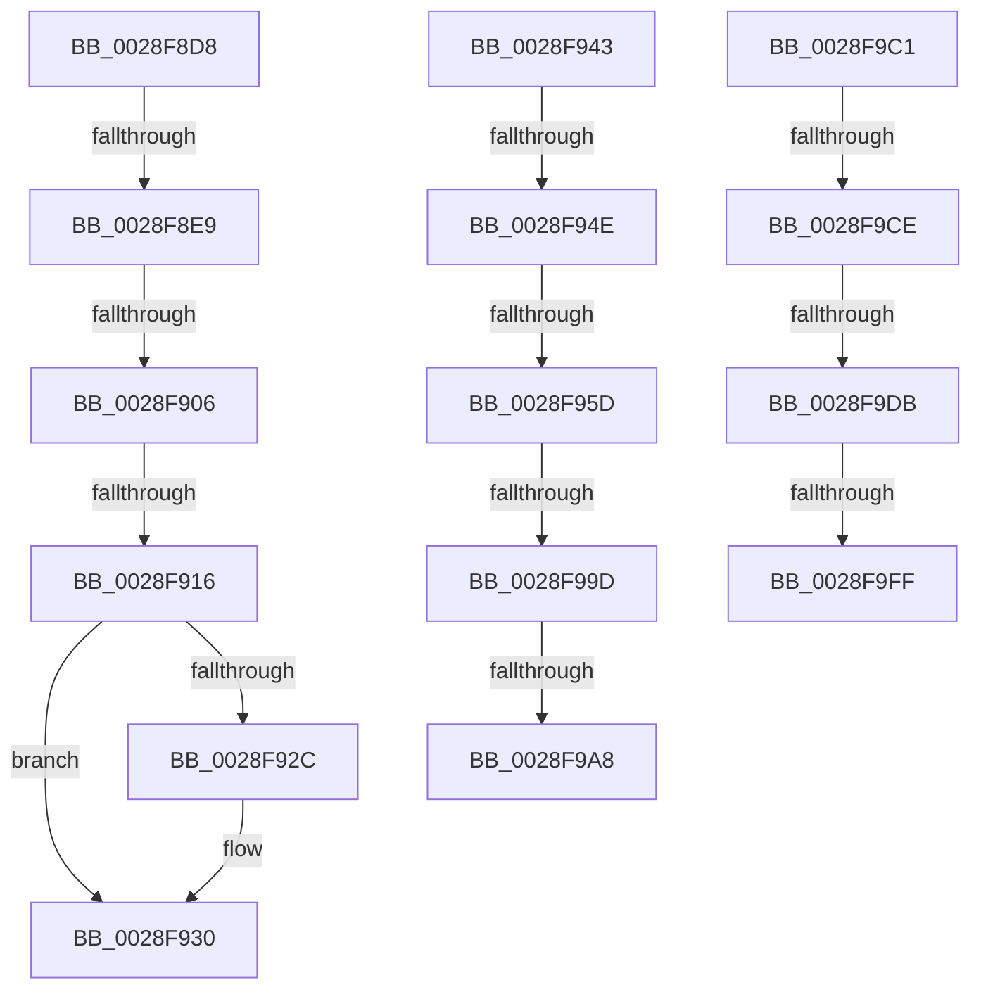

# sub_0028F8D8

- RVA: `0x0028F8D8`–`0x0028FA07` (길이 `303` bytes)
- VA: `0x000000014028F8D8`
- 실행 섹션: `.text`
- PDB 이름 있음: `아니요`; PDB Function 태그: `아니요`
- unwind 정보 RVA: `0x00067350`
- 디코드: `64`개 명령, `303/303` bytes 표시
- 미해석 바이트: `0` (있으면 어셈블리에 `.byte`로 보존)

> 이 문서는 커널 이미지의 기계어와 PDB 기호를 분석해 생성했습니다. 4번과 5번은 함수 원형과 자료형을 바이너리 사용 방식에서 추정한 C 해석이며 원본 소스 복구 결과는 아닙니다.

## 1. Dependencies

- 직접 호출 지점: **2**; 고유 호출 대상: **2**
- 직접 호출자로 확인된 함수: **0**
- RIP 상대 이미지 참조: **1**

### Outgoing calls
- `0x0028F990` → [MiGetPagePrivilege](MiGetPagePrivilege_function_00285420.md) (function, `0x00285420`)
- `0x0028F9F2` → [MiDemoteCombinedPte](../22/MiDemoteCombinedPte_function_0022ABAC.md) (function, `0x0022ABAC`)

### Direct callers
- 이 함수 시작 RVA로 연결되는 직접 call은 확인되지 않았습니다. 간접 호출은 완전히 역산할 수 없습니다.

### Static image references
- `0x0028F8D8` → RVA `0x00FC6A88` (`ALMOSTRO`; read)

## 2. Other-region calls and transfers

- 다른 실행 섹션으로 향하는 call: **0**
- call이 아닌 외부 분기/꼬리 이동: **13**
  - `0x0028F8E3` → [sub_0028F780 + 0x82](Unknown_function_0028F780.md) (`tail-transfer`)
  - `0x0028F900` → [sub_0028F780 + 0x82](Unknown_function_0028F780.md) (`tail-transfer`)
  - `0x0028F910` → [sub_0028F780 + 0x82](Unknown_function_0028F780.md) (`tail-transfer`)
  - `0x0028F93E` → [sub_0028F780 + 0x82](Unknown_function_0028F780.md) (`tail-transfer`)
  - `0x0028F948` → [sub_0028F780 + 0xFC](Unknown_function_0028F780.md) (`tail-transfer`)
  - `0x0028F957` → [sub_0028FA52 + 0xA5](Unknown_function_0028FA52.md) (`tail-transfer`)
  - `0x0028F997` → [sub_0028F780 + 0xFC](Unknown_function_0028F780.md) (`tail-transfer`)
  - `0x0028F9A2` → [sub_0028FA52 + 0x94](Unknown_function_0028FA52.md) (`tail-transfer`)
  - `0x0028F9BC` → [sub_0028F780 + 0x128](Unknown_function_0028F780.md) (`tail-transfer`)
  - `0x0028F9C8` → [sub_0028F780 + 0xF3](Unknown_function_0028F780.md) (`tail-transfer`)
  - `0x0028F9D5` → [sub_0028F780 + 0xF3](Unknown_function_0028F780.md) (`tail-transfer`)
  - `0x0028F9F9` → [sub_0028F780 + 0xF3](Unknown_function_0028F780.md) (`tail-transfer`)
  - `0x0028FA02` → [sub_0028F780 + 0xF3](Unknown_function_0028F780.md) (`tail-transfer`)

## 3. Assembly (complete function range)

```asm
0028F8D8  48 F7 05 A5 71 D3 00 00 00 60 00  test qword ptr [rip + 0xd371a5], 0x600000
0028F8E3  0F 84 19 FF FF FF               je 0x14028f802
0028F8E9  65 48 8B 0C 25 88 01 00 00      mov rcx, qword ptr gs:[0x188]
0028F8F2  48 8B 91 B8 00 00 00            mov rdx, qword ptr [rcx + 0xb8]
0028F8F9  80 BA 60 01 00 00 01            cmp byte ptr [rdx + 0x160], 1
0028F900  0F 84 FC FE FF FF               je 0x14028f802
0028F906  4C 8B 8A 08 05 00 00            mov r9, qword ptr [rdx + 0x508]
0028F90D  4D 85 C9                        test r9, r9
0028F910  0F 84 EC FE FF FF               je 0x14028f802
0028F916  48 8B CE                        mov rcx, rsi
0028F919  48 C1 E9 03                     shr rcx, 3
0028F91D  81 E1 FF 01 00 00               and ecx, 0x1ff
0028F923  49 8B 0C C9                     mov rcx, qword ptr [r9 + rcx*8]
0028F927  F6 C1 20                        test cl, 0x20
0028F92A  74 04                           je 0x14028f930
0028F92C  48 83 C8 20                     or rax, 0x20
0028F930  48 8B D8                        mov rbx, rax
0028F933  48 83 CB 42                     or rbx, 0x42
0028F937  F6 C1 42                        test cl, 0x42
0028F93A  48 0F 44 D8                     cmove rbx, rax
0028F93E  E9 BF FE FF FF                  jmp 0x14028f802
0028F943  48 83 7F 48 00                  cmp qword ptr [rdi + 0x48], 0
0028F948  0F 84 2E FF FF FF               je 0x14028f87c
0028F94E  41 8B 85 B8 00 00 00            mov eax, dword ptr [r13 + 0xb8]
0028F955  A8 0F                           test al, 0xf
0028F957  0F 84 9A 01 00 00               je 0x14028faf7
0028F95D  48 B9 FF FF FF FF FF 00 00 00   movabs rcx, 0xffffffffff
0028F967  48 8B C3                        mov rax, rbx
0028F96A  48 C1 E8 0C                     shr rax, 0xc
0028F96E  48 23 C1                        and rax, rcx
0028F971  48 8D 0C 40                     lea rcx, [rax + rax*2]
0028F975  48 B8 00 00 00 00 00 DE FF FF   movabs rax, 0xffffde0000000000
0028F97F  48 C1 E1 04                     shl rcx, 4
0028F983  48 8B C0                        mov rax, rax
0028F986  45 33 C0                        xor r8d, r8d
0028F989  48 03 C8                        add rcx, rax
0028F98C  41 8D 50 02                     lea edx, [r8 + 2]
0028F990  E8 8B 5A FF FF                  call 0x140285420
0028F995  A8 41                           test al, 0x41
0028F997  0F 84 DF FE FF FF               je 0x14028f87c
0028F99D  48 83 7F 48 01                  cmp qword ptr [rdi + 0x48], 1
0028F9A2  0F 84 3E 01 00 00               je 0x14028fae6
0028F9A8  48 8B 4F 48                     mov rcx, qword ptr [rdi + 0x48]
0028F9AC  49 81 E6 00 F0 FF FF            and r14, 0xfffffffffffff000
0028F9B3  8B 01                           mov eax, dword ptr [rcx]
0028F9B5  4C 89 74 C1 08                  mov qword ptr [rcx + rax*8 + 8], r14
0028F9BA  FF 01                           inc dword ptr [rcx]
0028F9BC  E9 E7 FE FF FF                  jmp 0x14028f8a8
0028F9C1  48 8B 45 08                     mov rax, qword ptr [rbp + 8]
0028F9C5  48 85 C0                        test rax, rax
0028F9C8  0F 88 A5 FE FF FF               js 0x14028f873
0028F9CE  48 8B 45 08                     mov rax, qword ptr [rbp + 8]
0028F9D2  48 85 C0                        test rax, rax
0028F9D5  0F 84 98 FE FF FF               je 0x14028f873
0028F9DB  4C 8B 45 08                     mov r8, qword ptr [rbp + 8]
0028F9DF  48 B8 00 00 00 00 00 00 00 80   movabs rax, 0x8000000000000000
0028F9E9  4C 0B C0                        or r8, rax
0028F9EC  48 8B D6                        mov rdx, rsi
0028F9EF  49 8B CD                        mov rcx, r13
0028F9F2  E8 B5 B1 F9 FF                  call 0x14022abac
0028F9F7  85 C0                           test eax, eax
0028F9F9  0F 84 74 FE FF FF               je 0x14028f873
0028F9FF  48 8B 1E                        mov rbx, qword ptr [rsi]
0028FA02  E9 6C FE FF FF                  jmp 0x14028f873
```

## 4. C-style interpretation (structured pseudocode)

```c
__int64 __fastcall sub_0028F8D8(__int64 a1, __int64 a2, int a3)
{
    __int64 result;
    __int64 v_rbx;

    a1 = (v_rsi) >> (3);
    a1 = (unsigned int)((a1) & (511));
    if ((((unsigned __int8)(*(unsigned __int64 *)(*(unsigned __int64 *)(*(unsigned __int64 *)(*(unsigned __int64 *)(gs_base + (0 + 392)) + 184) + 1288) + a1 * 8))) & (32)) != 0) {
        result = (result) | (32);
    }
    v_rbx = (result) | (66);
    if ((((unsigned __int8)(*(unsigned __int64 *)(*(unsigned __int64 *)(*(unsigned __int64 *)(*(unsigned __int64 *)(gs_base + (0 + 392)) + 184) + 1288) + a1 * 8))) & (66)) == 0) { v_rbx = result; }
}
```

## 5. (Beta) C Style

```c
int64_t sub_0028F8D8(int64_t Arg1, int64_t Arg2, int32_t Arg3)
{
    int64_t result;
    int64_t local_rbx;

    Arg1 = (local_rsi) >> (3);
    Arg1 = (uint32_t)((Arg1) & (511));
    if ((((uint8_t)(*(uint64_t *)(*(uint64_t *)(*(uint64_t *)(*(uint64_t *)(gs_base + (0 + 0x188)) + 0xB8) + 0x508) + Arg1 * 8))) & (32)) != 0) {
        result = (result) | (32);
    }
    local_rbx = (result) | (66);
    if ((((uint8_t)(*(uint64_t *)(*(uint64_t *)(*(uint64_t *)(*(uint64_t *)(gs_base + (0 + 0x188)) + 0xB8) + 0x508) + Arg1 * 8))) & (66)) == 0) { local_rbx = result; }
}
```

## 6. Execution-region graph

[열기: 2D/3D 그래프와 함수 탐색 컨트롤 패널](../../../control-panel.html?section=text&rva=0x0028F8D8&view=graph)

- 2D 그래프는 위에서 아래로 흐르고, 3D 그래프는 빈 공간을 드래그해 회전합니다. Shift+드래그는 이동, 휠은 확대·축소, 함수 노드 선택은 대상 보고서 이동입니다.

### Static fallback


