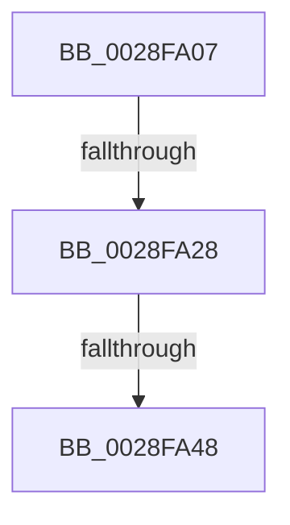

# sub_0028FA07

- RVA: `0x0028FA07`–`0x0028FA52` (길이 `75` bytes)
- VA: `0x000000014028FA07`
- 실행 섹션: `.text`
- PDB 이름 있음: `아니요`; PDB Function 태그: `아니요`
- unwind 정보 RVA: `0x0006736C`
- 디코드: `17`개 명령, `75/75` bytes 표시
- 미해석 바이트: `0` (있으면 어셈블리에 `.byte`로 보존)

> 이 문서는 커널 이미지의 기계어와 PDB 기호를 분석해 생성했습니다. 4번과 5번은 함수 원형과 자료형을 바이너리 사용 방식에서 추정한 C 해석이며 원본 소스 복구 결과는 아닙니다.

## 1. Dependencies

- 직접 호출 지점: **1**; 고유 호출 대상: **1**
- 직접 호출자로 확인된 함수: **0**
- RIP 상대 이미지 참조: **0**

### Outgoing calls
- `0x0028FA35` → [MiComputeAgingAmount](../2C/MiComputeAgingAmount_function_002C2520.md) (function, `0x002C2520`)

### Direct callers
- 이 함수 시작 RVA로 연결되는 직접 call은 확인되지 않았습니다. 간접 호출은 완전히 역산할 수 없습니다.

### Static image references
- 디코드된 RIP-relative 메모리 참조가 없습니다.

## 2. Other-region calls and transfers

- 다른 실행 섹션으로 향하는 call: **0**
- call이 아닌 외부 분기/꼬리 이동: **3**
  - `0x0028FA22` → [sub_0028FB0F](Unknown_function_0028FB0F.md) (`tail-transfer`)
  - `0x0028FA42` → [sub_0028FB0F](Unknown_function_0028FB0F.md) (`tail-transfer`)
  - `0x0028FA4D` → [sub_0028F780](Unknown_function_0028F780.md) (`tail-transfer`)

## 3. Assembly (complete function range)

```asm
0028FA07  C6 47 06 00                     mov byte ptr [rdi + 6], 0
0028FA0B  49 8B 45 10                     mov rax, qword ptr [r13 + 0x10]
0028FA0F  48 89 44 24 60                  mov qword ptr [rsp + 0x60], rax
0028FA14  48 8B 48 20                     mov rcx, qword ptr [rax + 0x20]
0028FA18  49 8B 95 90 00 00 00            mov rdx, qword ptr [r13 + 0x90]
0028FA1F  48 3B D1                        cmp rdx, rcx
0028FA22  0F 86 E7 00 00 00               jbe 0x14028fb0f
0028FA28  44 8B 4F 0C                     mov r9d, dword ptr [rdi + 0xc]
0028FA2C  48 2B D1                        sub rdx, rcx
0028FA2F  44 8B 07                        mov r8d, dword ptr [rdi]
0028FA32  49 8B CD                        mov rcx, r13
0028FA35  E8 E6 2A 03 00                  call 0x1402c2520
0028FA3A  48 89 47 30                     mov qword ptr [rdi + 0x30], rax
0028FA3E  48 39 47 28                     cmp qword ptr [rdi + 0x28], rax
0028FA42  0F 83 C7 00 00 00               jae 0x14028fb0f
0028FA48  4C 8B 54 24 60                  mov r10, qword ptr [rsp + 0x60]
0028FA4D  E9 2E FD FF FF                  jmp 0x14028f780
```

## 4. C-style interpretation (structured pseudocode)

```c
__int64 __fastcall sub_0028FA07(__int64 a1, __int64 a2, __int64 a3, __int64 a4, __int64 a5, __int64 a6, __int64 a7, __int64 a8, __int64 a9, __int64 a10, __int64 a11, __int64 a12)
{
    __int64 result;
    unsigned __int64 v_stack_p60;

    *(unsigned __int8 *)(v_rdi + 6) = 0;
    v_stack_p60 = *(unsigned __int64 *)(v_r13 + 16);
    a2 = (*(unsigned __int64 *)(v_r13 + 144)) - (*(unsigned __int64 *)(*(unsigned __int64 *)(v_r13 + 16) + 32));
    result = MiComputeAgingAmount(v_r13, a2, (unsigned int)(*(unsigned int *)(v_rdi)), (unsigned int)(*(unsigned int *)(v_rdi + 12)));
    *(unsigned __int64 *)(v_rdi + 48) = result;
}
```

## 5. (Beta) C Style

```c
int64_t sub_0028FA07(int64_t Arg1, int64_t Arg2, int64_t Arg3, int64_t Arg4, uint64_t Arg5, uint64_t Arg6, uint64_t Arg7, uint64_t Arg8, uint64_t Arg9, uint64_t Arg10, uint64_t Arg11, int64_t Arg12)
{
    int64_t result;
    uint64_t v_stack_p60;

    *(uint8_t *)(local_rdi + 0x6) = 0;
    v_stack_p60 = *(uint64_t *)(local_r13 + 0x10);
    Arg2 = (*(uint64_t *)(local_r13 + 0x90)) - (*(uint64_t *)(*(uint64_t *)(local_r13 + 0x10) + 0x20));
    result = MiComputeAgingAmount(local_r13, Arg2, (uint32_t)(*(uint32_t *)(local_rdi)), (uint32_t)(*(uint32_t *)(local_rdi + 0xC)));
    *(uint64_t *)(local_rdi + 0x30) = result;
}
```

## 6. Execution-region graph

[열기: 2D/3D 그래프와 함수 탐색 컨트롤 패널](../../../control-panel.html?section=text&rva=0x0028FA07&view=graph)

- 2D 그래프는 위에서 아래로 흐르고, 3D 그래프는 빈 공간을 드래그해 회전합니다. Shift+드래그는 이동, 휠은 확대·축소, 함수 노드 선택은 대상 보고서 이동입니다.

### Static fallback


