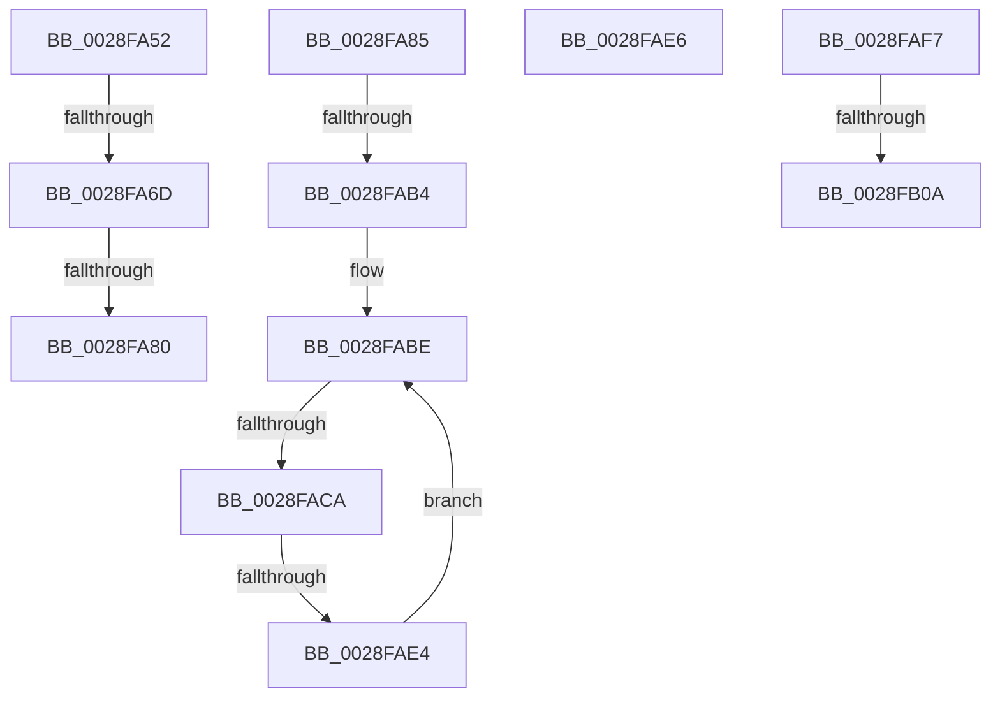

# sub_0028FA52

- RVA: `0x0028FA52`–`0x0028FB0F` (길이 `189` bytes)
- VA: `0x000000014028FA52`
- 실행 섹션: `.text`
- PDB 이름 있음: `아니요`; PDB Function 태그: `아니요`
- unwind 정보 RVA: `0x0006737C`
- 디코드: `43`개 명령, `189/189` bytes 표시
- 미해석 바이트: `0` (있으면 어셈블리에 `.byte`로 보존)

> 이 문서는 커널 이미지의 기계어와 PDB 기호를 분석해 생성했습니다. 4번과 5번은 함수 원형과 자료형을 바이너리 사용 방식에서 추정한 C 해석이며 원본 소스 복구 결과는 아닙니다.

## 1. Dependencies

- 직접 호출 지점: **2**; 고유 호출 대상: **2**
- 직접 호출자로 확인된 함수: **0**
- RIP 상대 이미지 참조: **0**

### Outgoing calls
- `0x0028FA73` → [MiIsPageTableLocked](../22/MiIsPageTableLocked_function_0022A5B0.md) (function, `0x0022A5B0`)
- `0x0028FAED` → [MiAcquirePrcbAgeTrimLists](../29/MiAcquirePrcbAgeTrimLists_function_002918B0.md) (function, `0x002918B0`)

### Direct callers
- 이 함수 시작 RVA로 연결되는 직접 call은 확인되지 않았습니다. 간접 호출은 완전히 역산할 수 없습니다.

### Static image references
- 디코드된 RIP-relative 메모리 참조가 없습니다.

## 2. Other-region calls and transfers

- 다른 실행 섹션으로 향하는 call: **0**
- call이 아닌 외부 분기/꼬리 이동: **9**
  - `0x0028FA67` → [sub_0028F780 + 0x128](Unknown_function_0028F780.md) (`tail-transfer`)
  - `0x0028FA7A` → [sub_0028F780 + 0xE4](Unknown_function_0028F780.md) (`tail-transfer`)
  - `0x0028FA80` → [sub_0028F780 + 0x128](Unknown_function_0028F780.md) (`tail-transfer`)
  - `0x0028FAAE` → [sub_0028F780 + 0xBB](Unknown_function_0028F780.md) (`tail-transfer`)
  - `0x0028FAC4` → [sub_0028F780 + 0xBB](Unknown_function_0028F780.md) (`tail-transfer`)
  - `0x0028FADE` → [sub_0028F780 + 0xBB](Unknown_function_0028F780.md) (`tail-transfer`)
  - `0x0028FAF2` → [sub_0028F8D8 + 0xD0](Unknown_function_0028F8D8.md) (`tail-transfer`)
  - `0x0028FB04` → [sub_0028F8D8 + 0xC5](Unknown_function_0028F8D8.md) (`tail-transfer`)
  - `0x0028FB0A` → [sub_0028F780 + 0xFC](Unknown_function_0028F780.md) (`tail-transfer`)

## 3. Assembly (complete function range)

```asm
0028FA52  48 8B 45 18                     mov rax, qword ptr [rbp + 0x18]
0028FA56  48 B9 FF FF FF FF FF FF FF 3F   movabs rcx, 0x3fffffffffffffff
0028FA60  48 23 C1                        and rax, rcx
0028FA63  48 83 F8 01                     cmp rax, 1
0028FA67  0F 85 3B FE FF FF               jne 0x14028f8a8
0028FA6D  48 8B D6                        mov rdx, rsi
0028FA70  49 8B CD                        mov rcx, r13
0028FA73  E8 38 AB F9 FF                  call 0x14022a5b0
0028FA78  85 C0                           test eax, eax
0028FA7A  0F 84 E4 FD FF FF               je 0x14028f864
0028FA80  E9 23 FE FF FF                  jmp 0x14028f8a8
0028FA85  48 8B CE                        mov rcx, rsi
0028FA88  48 C1 E1 19                     shl rcx, 0x19
0028FA8C  49 2B C8                        sub rcx, r8
0028FA8F  48 81 C1 00 00 00 10            add rcx, 0x10000000
0028FA96  48 C1 F9 10                     sar rcx, 0x10
0028FA9A  48 8B D1                        mov rdx, rcx
0028FA9D  48 C1 E2 19                     shl rdx, 0x19
0028FAA1  49 2B D0                        sub rdx, r8
0028FAA4  48 C1 FA 10                     sar rdx, 0x10
0028FAA8  49 8B C3                        mov rax, r11
0028FAAB  48 3B D0                        cmp rdx, rax
0028FAAE  0F 82 87 FD FF FF               jb 0x14028f83b
0028FAB4  49 B9 FF FF FF FF FF F6 FF FF   movabs r9, 0xfffff6ffffffffff
0028FABE  49 8B C1                        mov rax, r9
0028FAC1  48 3B D0                        cmp rdx, rax
0028FAC4  0F 87 71 FD FF FF               ja 0x14028f83b
0028FACA  48 8B CA                        mov rcx, rdx
0028FACD  48 C1 E2 19                     shl rdx, 0x19
0028FAD1  49 2B D0                        sub rdx, r8
0028FAD4  48 C1 FA 10                     sar rdx, 0x10
0028FAD8  49 8B C3                        mov rax, r11
0028FADB  48 3B D0                        cmp rdx, rax
0028FADE  0F 82 57 FD FF FF               jb 0x14028f83b
0028FAE4  EB D8                           jmp 0x14028fabe
0028FAE6  48 8D 57 38                     lea rdx, [rdi + 0x38]
0028FAEA  49 8B CD                        mov rcx, r13
0028FAED  E8 BE 1D 00 00                  call 0x1402918b0
0028FAF2  E9 B1 FE FF FF                  jmp 0x14028f9a8
0028FAF7  48 B8 FF FF FE FF FF 7F 00 00   movabs rax, 0x7ffffffeffff
0028FB01  4C 3B F0                        cmp r14, rax
0028FB04  0F 86 93 FE FF FF               jbe 0x14028f99d
0028FB0A  E9 6D FD FF FF                  jmp 0x14028f87c
```

## 4. C-style interpretation (structured pseudocode)

```c
__int64 __fastcall sub_0028FA52(__int64 a1, __int64 a2, __int64 a3)
{
    __int64 result;

    result = (*(unsigned __int64 *)(v_rbp + 24)) & (a1);
    result = MiIsPageTableLocked(v_r13, v_rsi, a3, a4);
}
```

## 5. (Beta) C Style

```c
int64_t sub_0028FA52(int64_t Arg1, int64_t Arg2, int64_t Arg3)
{
    int64_t result;

    result = (*(uint64_t *)(local_rbp + 0x18)) & (Arg1);
    result = MiIsPageTableLocked(local_r13, local_rsi, Arg3, a4);
}
```

## 6. Execution-region graph

[열기: 2D/3D 그래프와 함수 탐색 컨트롤 패널](../../../control-panel.html?section=text&rva=0x0028FA52&view=graph)

- 2D 그래프는 위에서 아래로 흐르고, 3D 그래프는 빈 공간을 드래그해 회전합니다. Shift+드래그는 이동, 휠은 확대·축소, 함수 노드 선택은 대상 보고서 이동입니다.

### Static fallback


