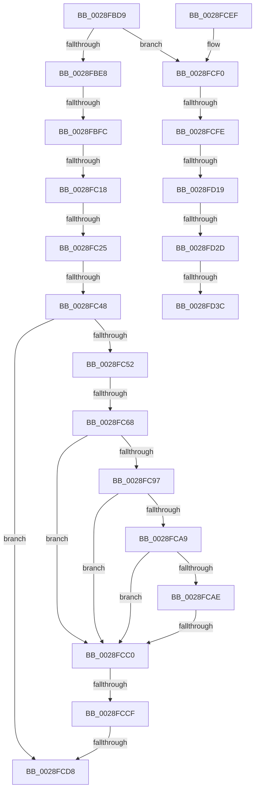

# sub_0028FBD9

- RVA: `0x0028FBD9`–`0x0028FD74` (길이 `411` bytes)
- VA: `0x000000014028FBD9`
- 실행 섹션: `.text`
- PDB 이름 있음: `아니요`; PDB Function 태그: `아니요`
- unwind 정보 RVA: `0x000673BC`
- 디코드: `100`개 명령, `411/411` bytes 표시
- 미해석 바이트: `0` (있으면 어셈블리에 `.byte`로 보존)

> 이 문서는 커널 이미지의 기계어와 PDB 기호를 분석해 생성했습니다. 4번과 5번은 함수 원형과 자료형을 바이너리 사용 방식에서 추정한 C 해석이며 원본 소스 복구 결과는 아닙니다.

## 1. Dependencies

- 직접 호출 지점: **0**; 고유 호출 대상: **0**
- 직접 호출자로 확인된 함수: **0**
- RIP 상대 이미지 참조: **0**

### Outgoing calls
- 직접 디코드된 call 명령이 없습니다.

### Direct callers
- 이 함수 시작 RVA로 연결되는 직접 call은 확인되지 않았습니다. 간접 호출은 완전히 역산할 수 없습니다.

### Static image references
- 디코드된 RIP-relative 메모리 참조가 없습니다.

## 2. Other-region calls and transfers

- 다른 실행 섹션으로 향하는 call: **0**
- call이 아닌 외부 분기/꼬리 이동: **13**
  - `0x0028FBF6` → [sub_0028FDDD + 0xC1](Unknown_function_0028FDDD.md) (`tail-transfer`)
  - `0x0028FC12` → [sub_0028FDDD + 0x9](Unknown_function_0028FDDD.md) (`tail-transfer`)
  - `0x0028FC1F` → [sub_0028FDDD](Unknown_function_0028FDDD.md) (`tail-transfer`)
  - `0x0028FC42` → [sub_002901B8](../29/Unknown_function_002901B8.md) (`tail-transfer`)
  - `0x0028FC62` → [sub_002901B8 + 0x117](../29/Unknown_function_002901B8.md) (`tail-transfer`)
  - `0x0028FCBA` → [sub_0028FDDD + 0x58](Unknown_function_0028FDDD.md) (`tail-transfer`)
  - `0x0028FCC9` → [sub_002901B8 + 0x3A](../29/Unknown_function_002901B8.md) (`tail-transfer`)
  - `0x0028FCD2` → [sub_002901B8 + 0x3A](../29/Unknown_function_002901B8.md) (`tail-transfer`)
  - `0x0028FCF8` → [sub_0028FDDD + 0x3A](Unknown_function_0028FDDD.md) (`tail-transfer`)
  - `0x0028FD13` → [sub_002901B8 + 0x190](../29/Unknown_function_002901B8.md) (`tail-transfer`)
  - `0x0028FD27` → [sub_0028FDDD + 0xDD](Unknown_function_0028FDDD.md) (`tail-transfer`)
  - `0x0028FD36` → [sub_002901B8 + 0xF8](../29/Unknown_function_002901B8.md) (`tail-transfer`)
  - `0x0028FD6F` → [sub_0028FDDD + 0xDD](Unknown_function_0028FDDD.md) (`tail-transfer`)

## 3. Assembly (complete function range)

```asm
0028FBD9  4C 89 64 24 70                  mov qword ptr [rsp + 0x70], r12
0028FBDE  41 F6 C7 01                     test r15b, 1
0028FBE2  0F 85 08 01 00 00               jne 0x14028fcf0
0028FBE8  41 8B 5E 20                     mov ebx, dword ptr [r14 + 0x20]
0028FBEC  41 8B 4E 20                     mov ecx, dword ptr [r14 + 0x20]
0028FBF0  C1 E9 18                        shr ecx, 0x18
0028FBF3  F6 C1 08                        test cl, 8
0028FBF6  0F 85 A2 02 00 00               jne 0x14028fe9e
0028FBFC  C1 EB 18                        shr ebx, 0x18
0028FBFF  83 E3 07                        and ebx, 7
0028FC02  48 8B BC 24 80 00 00 00         mov rdi, qword ptr [rsp + 0x80]
0028FC0A  41 BC 01 00 00 00               mov r12d, 1
0028FC10  3C 06                           cmp al, 6
0028FC12  0F 82 CE 01 00 00               jb 0x14028fde6
0028FC18  49 8B 46 28                     mov rax, qword ptr [r14 + 0x28]
0028FC1C  48 85 C0                        test rax, rax
0028FC1F  0F 89 B8 01 00 00               jns 0x14028fddd
0028FC25  0F B6 47 05                     movzx eax, byte ptr [rdi + 5]
0028FC29  84 C0                           test al, al
0028FC2B  44 0F B6 F8                     movzx r15d, al
0028FC2F  8B 86 B8 00 00 00               mov eax, dword ptr [rsi + 0xb8]
0028FC35  B9 07 00 00 00                  mov ecx, 7
0028FC3A  44 0F 44 F9                     cmove r15d, ecx
0028FC3E  24 0F                           and al, 0xf
0028FC40  3C 02                           cmp al, 2
0028FC42  0F 84 70 05 00 00               je 0x1402901b8
0028FC48  8B 07                           mov eax, dword ptr [rdi]
0028FC4A  A8 03                           test al, 3
0028FC4C  0F 84 86 00 00 00               je 0x14028fcd8
0028FC52  48 BA 00 00 00 00 80 F6 FF FF   movabs rdx, 0xfffff68000000000
0028FC5C  48 8B C2                        mov rax, rdx
0028FC5F  4C 3B E8                        cmp r13, rax
0028FC62  0F 83 67 06 00 00               jae 0x1402902cf
0028FC68  4D 8B C5                        mov r8, r13
0028FC6B  48 B8 F8 FF FF FF 7F 00 00 00   movabs rax, 0x7ffffffff8
0028FC75  49 C1 E8 09                     shr r8, 9
0028FC79  4C 23 C0                        and r8, rax
0028FC7C  48 8B C2                        mov rax, rdx
0028FC7F  4C 03 C0                        add r8, rax
0028FC82  48 B9 00 D0 BE 7D FB F6 FF FF   movabs rcx, 0xfffff6fb7dbed000
0028FC8C  49 8B 00                        mov rax, qword ptr [r8]
0028FC8F  48 8B C9                        mov rcx, rcx
0028FC92  4C 3B C1                        cmp r8, rcx
0028FC95  72 29                           jb 0x14028fcc0
0028FC97  48 B9 F8 D7 BE 7D FB F6 FF FF   movabs rcx, 0xfffff6fb7dbed7f8
0028FCA1  48 8B C9                        mov rcx, rcx
0028FCA4  4C 3B C1                        cmp r8, rcx
0028FCA7  77 17                           ja 0x14028fcc0
0028FCA9  41 84 C4                        test r12b, al
0028FCAC  74 12                           je 0x14028fcc0
0028FCAE  A8 42                           test al, 0x42
0028FCB0  0F 95 C2                        setne dl
0028FCB3  A8 20                           test al, 0x20
0028FCB5  0F 95 C1                        setne cl
0028FCB8  84 D1                           test cl, dl
0028FCBA  0F 84 75 01 00 00               je 0x14028fe35
0028FCC0  48 C1 E8 38                     shr rax, 0x38
0028FCC4  24 0F                           and al, 0xf
0028FCC6  41 3A C7                        cmp al, r15b
0028FCC9  0F 83 23 05 00 00               jae 0x1402901f2
0028FCCF  3B 5F 08                        cmp ebx, dword ptr [rdi + 8]
0028FCD2  0F 82 1A 05 00 00               jb 0x1402901f2
0028FCD8  4C 8B 64 24 70                  mov r12, qword ptr [rsp + 0x70]
0028FCDD  48 8B 5C 24 78                  mov rbx, qword ptr [rsp + 0x78]
0028FCE2  48 83 C4 30                     add rsp, 0x30
0028FCE6  41 5F                           pop r15
0028FCE8  41 5E                           pop r14
0028FCEA  41 5D                           pop r13
0028FCEC  5F                              pop rdi
0028FCED  5E                              pop rsi
0028FCEE  C3                              ret
0028FCEF  CC                              int3
0028FCF0  33 DB                           xor ebx, ebx
0028FCF2  44 8D 63 01                     lea r12d, [rbx + 1]
0028FCF6  84 C0                           test al, al
0028FCF8  0F 85 19 01 00 00               jne 0x14028fe17
0028FCFE  41 8B 46 20                     mov eax, dword ptr [r14 + 0x20]
0028FD02  41 8B 4E 20                     mov ecx, dword ptr [r14 + 0x20]
0028FD06  C1 E9 18                        shr ecx, 0x18
0028FD09  89 84 24 88 00 00 00            mov dword ptr [rsp + 0x88], eax
0028FD10  F6 C1 08                        test cl, 8
0028FD13  0F 85 2F 06 00 00               jne 0x140290348
0028FD19  0F B6 84 24 8B 00 00 00         movzx eax, byte ptr [rsp + 0x8b]
0028FD21  83 E0 07                        and eax, 7
0028FD24  83 F8 05                        cmp eax, 5
0028FD27  0F 83 8D 01 00 00               jae 0x14028feba
0028FD2D  8B FB                           mov edi, ebx
0028FD2F  F0 49 0F BA 6E 18 3F            lock bts qword ptr [r14 + 0x18], 0x3f
0028FD36  0F 82 74 05 00 00               jb 0x1402902b0
0028FD3C  41 8B 46 20                     mov eax, dword ptr [r14 + 0x20]
0028FD40  89 84 24 88 00 00 00            mov dword ptr [rsp + 0x88], eax
0028FD47  C1 E8 18                        shr eax, 0x18
0028FD4A  24 FD                           and al, 0xfd
0028FD4C  0C 05                           or al, 5
0028FD4E  88 84 24 8B 00 00 00            mov byte ptr [rsp + 0x8b], al
0028FD55  8B 84 24 88 00 00 00            mov eax, dword ptr [rsp + 0x88]
0028FD5C  41 89 46 20                     mov dword ptr [r14 + 0x20], eax
0028FD60  48 B8 FF FF FF FF FF FF FF 7F   movabs rax, 0x7fffffffffffffff
0028FD6A  F0 49 21 46 18                  lock and qword ptr [r14 + 0x18], rax
0028FD6F  E9 46 01 00 00                  jmp 0x14028feba
```

## 4. C-style interpretation (structured pseudocode)

```c
__int64 __fastcall sub_0028FBD9(__int64 a1, __int64 a2, __int64 a3, __int64 a4, __int64 a5, __int64 a6, __int64 a7, __int64 a8, __int64 a9, __int64 a10, __int64 a11, __int64 a12, __int64 a13, __int64 a14, __int64 a15, __int64 a16, unsigned int a17)
{
    __int64 result;
    __int64 v_r15;
    __int64 v_rbx;
    __int64 v_rsp;
    unsigned __int64 v_stack_p70;
    unsigned int v_stack_pE0;
    unsigned __int8 v_stack_pE3;

    v_stack_p70 = v_r12;
    if ((((unsigned __int8)(v_r15)) & (1)) != 0) goto loc_0028FCF0;
    a1 = (unsigned int)(((unsigned int)(*(unsigned int *)(v_r14 + 32))) >> (24));
    v_rbx = (unsigned int)(((unsigned int)(*(unsigned int *)(v_r14 + 32))) >> (24));
    v_rbx = (unsigned int)((v_rbx) & (7));
    v_r15 = (unsigned __int8)(*(unsigned __int8 *)(a16 + 5));
    if ((unsigned __int8)(*(unsigned __int8 *)(a16 + 5)) == 0) { v_r15 = 7; }
    result = (unsigned __int8)(((unsigned int)(*(unsigned int *)(v_rsi + 184))) & (15));
    if ((((unsigned __int8)((unsigned int)(*(unsigned int *)(a16)))) & (3)) == 0) goto loc_0028FCD8;
    a3 = (v_r13) >> (9);
    a3 = (a3) & (a2);
    a3 = (a3) + (a2);
    if (a3 < 7) goto loc_0028FCC0;
    if (a3 > 7) goto loc_0028FCC0;
    if (((1) & ((unsigned __int8)(*(unsigned __int64 *)(a3)))) == 0) goto loc_0028FCC0;
    a2 = ((((unsigned __int8)(*(unsigned __int64 *)(a3))) & (66)) != 0) ? 1 : 0;
    a1 = ((((unsigned __int8)(*(unsigned __int64 *)(a3))) & (32)) != 0) ? 1 : 0;
loc_0028FCC0:
    result = (*(unsigned __int64 *)(a3)) >> (56);
    result = (unsigned __int8)((result) & (15));
loc_0028FCD8:
    v_rsp = (v_rsp) + (48);
    return result;
loc_0028FCF0:
    v_rbx = 0;
    a1 = (unsigned int)(((unsigned int)(*(unsigned int *)(v_r14 + 32))) >> (24));
    v_stack_pE0 = (unsigned int)((unsigned int)(*(unsigned int *)(v_r14 + 32)));
    result = (unsigned int)((v_stack_pE3) & (7));
    v_stack_pE0 = (unsigned int)((unsigned int)(*(unsigned int *)(v_r14 + 32)));
    result = (unsigned int)(((unsigned int)(*(unsigned int *)(v_r14 + 32))) >> (24));
    result = (unsigned __int8)((result) & (253));
    result = (unsigned __int8)((result) | (5));
    v_stack_pE3 = (unsigned __int8)(result);
    *(unsigned int *)(v_r14 + 32) = (unsigned int)((unsigned int)(a17));
}
```

## 5. (Beta) C Style

```c
int64_t sub_0028FBD9(int64_t Arg1, int64_t Arg2, int64_t Arg3, int64_t Arg4, uint64_t Arg5, uint64_t Arg6, uint64_t Arg7, uint64_t Arg8, uint64_t Arg9, uint64_t Arg10, uint64_t Arg11, uint64_t Arg12, uint64_t Arg13, int64_t Arg14, int64_t Arg15, void *Arg16, uint32_t Arg17)
{
    uint8_t *arg16 = (uint8_t *)Arg16;

    int64_t result;
    int64_t local_r15;
    int64_t local_rbx;
    int64_t local_rsp;
    uint64_t v_stack_p70;
    uint32_t v_stack_pE0;
    uint8_t v_stack_pE3;

    v_stack_p70 = local_r12;
    if ((((uint8_t)(local_r15)) & (1)) != 0) goto loc_0028FCF0;
    Arg1 = (uint32_t)(((uint32_t)(*(uint32_t *)(local_r14 + 0x20))) >> (24));
    local_rbx = (uint32_t)(((uint32_t)(*(uint32_t *)(local_r14 + 0x20))) >> (24));
    local_rbx = (uint32_t)((local_rbx) & (7));
    local_r15 = (uint8_t)(*(uint8_t *)(arg16 + 0x5));
    if ((uint8_t)(*(uint8_t *)(arg16 + 0x5)) == 0) { local_r15 = 7; }
    result = (uint8_t)(((uint32_t)(*(uint32_t *)(local_rsi + 0xB8))) & (15));
    if ((((uint8_t)((uint32_t)(*(uint32_t *)(arg16)))) & (3)) == 0) goto loc_0028FCD8;
    Arg3 = (local_r13) >> (9);
    Arg3 = (Arg3) & (Arg2);
    Arg3 = (Arg3) + (Arg2);
    if (Arg3 < 7) goto loc_0028FCC0;
    if (Arg3 > 7) goto loc_0028FCC0;
    if (((1) & ((uint8_t)(*(uint64_t *)(Arg3)))) == 0) goto loc_0028FCC0;
    Arg2 = ((((uint8_t)(*(uint64_t *)(Arg3))) & (66)) != 0) ? 1 : 0;
    Arg1 = ((((uint8_t)(*(uint64_t *)(Arg3))) & (32)) != 0) ? 1 : 0;
loc_0028FCC0:
    result = (*(uint64_t *)(Arg3)) >> (56);
    result = (uint8_t)((result) & (15));
loc_0028FCD8:
    local_rsp = (local_rsp) + (48);
    return result;
loc_0028FCF0:
    local_rbx = 0;
    Arg1 = (uint32_t)(((uint32_t)(*(uint32_t *)(local_r14 + 0x20))) >> (24));
    v_stack_pE0 = (uint32_t)((uint32_t)(*(uint32_t *)(local_r14 + 0x20)));
    result = (uint32_t)((v_stack_pE3) & (7));
    v_stack_pE0 = (uint32_t)((uint32_t)(*(uint32_t *)(local_r14 + 0x20)));
    result = (uint32_t)(((uint32_t)(*(uint32_t *)(local_r14 + 0x20))) >> (24));
    result = (uint8_t)((result) & (253));
    result = (uint8_t)((result) | (5));
    v_stack_pE3 = (uint8_t)(result);
    *(uint32_t *)(local_r14 + 0x20) = (uint32_t)((uint32_t)(Arg17));
}
```

### 관측된 메모리 오프셋

구조체 형식이 확인되지 않은 접근은 인자 기준의 오프셋으로만 기록했습니다.

| 기준 인자 | 오프셋 표현 | 폭 (bit) | 접근 |
|---|---:|---:|---|
| `Arg16` | `+ 0x0` | `32` | `R` |
| `Arg16` | `+ 0x5` | `8` | `R` |
| `Arg16` | `+ 0x8` | `32` | `R` |

## 6. Execution-region graph

[열기: 2D/3D 그래프와 함수 탐색 컨트롤 패널](../../../control-panel.html?section=text&rva=0x0028FBD9&view=graph)

- 2D 그래프는 위에서 아래로 흐르고, 3D 그래프는 빈 공간을 드래그해 회전합니다. Shift+드래그는 이동, 휠은 확대·축소, 함수 노드 선택은 대상 보고서 이동입니다.

### Static fallback


