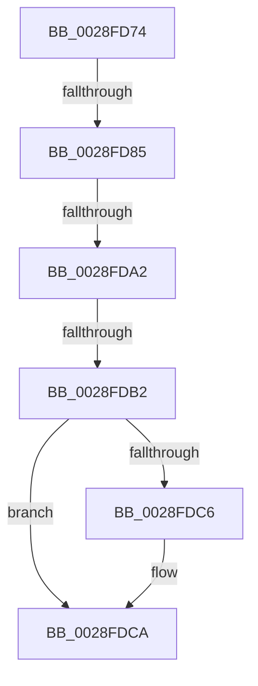

# sub_0028FD74

- RVA: `0x0028FD74`–`0x0028FDDD` (길이 `105` bytes)
- VA: `0x000000014028FD74`
- 실행 섹션: `.text`
- PDB 이름 있음: `아니요`; PDB Function 태그: `아니요`
- unwind 정보 RVA: `0x000673D4`
- 디코드: `20`개 명령, `105/105` bytes 표시
- 미해석 바이트: `0` (있으면 어셈블리에 `.byte`로 보존)

> 이 문서는 커널 이미지의 기계어와 PDB 기호를 분석해 생성했습니다. 4번과 5번은 함수 원형과 자료형을 바이너리 사용 방식에서 추정한 C 해석이며 원본 소스 복구 결과는 아닙니다.

## 1. Dependencies

- 직접 호출 지점: **0**; 고유 호출 대상: **0**
- 직접 호출자로 확인된 함수: **0**
- RIP 상대 이미지 참조: **1**

### Outgoing calls
- 직접 디코드된 call 명령이 없습니다.

### Direct callers
- 이 함수 시작 RVA로 연결되는 직접 call은 확인되지 않았습니다. 간접 호출은 완전히 역산할 수 없습니다.

### Static image references
- `0x0028FD74` → RVA `0x00FC6A88` (`ALMOSTRO`; read)

## 2. Other-region calls and transfers

- 다른 실행 섹션으로 향하는 call: **0**
- call이 아닌 외부 분기/꼬리 이동: **4**
  - `0x0028FD7F` → [MiAgePteWorker + 0xAB](MiAgePteWorker_function_0028FB20.md) (`tail-transfer`)
  - `0x0028FD9C` → [MiAgePteWorker + 0xAB](MiAgePteWorker_function_0028FB20.md) (`tail-transfer`)
  - `0x0028FDAC` → [MiAgePteWorker + 0xAB](MiAgePteWorker_function_0028FB20.md) (`tail-transfer`)
  - `0x0028FDD8` → [MiAgePteWorker + 0xAB](MiAgePteWorker_function_0028FB20.md) (`tail-transfer`)

## 3. Assembly (complete function range)

```asm
0028FD74  48 F7 05 09 6D D3 00 00 00 60 00  test qword ptr [rip + 0xd36d09], 0x600000
0028FD7F  0F 84 46 FE FF FF               je 0x14028fbcb
0028FD85  65 48 8B 0C 25 88 01 00 00      mov rcx, qword ptr gs:[0x188]
0028FD8E  48 8B 91 B8 00 00 00            mov rdx, qword ptr [rcx + 0xb8]
0028FD95  80 BA 60 01 00 00 01            cmp byte ptr [rdx + 0x160], 1
0028FD9C  0F 84 29 FE FF FF               je 0x14028fbcb
0028FDA2  48 8B 8A 08 05 00 00            mov rcx, qword ptr [rdx + 0x508]
0028FDA9  48 85 C9                        test rcx, rcx
0028FDAC  0F 84 19 FE FF FF               je 0x14028fbcb
0028FDB2  49 C1 E8 03                     shr r8, 3
0028FDB6  41 81 E0 FF 01 00 00            and r8d, 0x1ff
0028FDBD  4A 8B 0C C1                     mov rcx, qword ptr [rcx + r8*8]
0028FDC1  F6 C1 20                        test cl, 0x20
0028FDC4  74 04                           je 0x14028fdca
0028FDC6  48 83 C8 20                     or rax, 0x20
0028FDCA  48 8B D0                        mov rdx, rax
0028FDCD  48 83 C8 42                     or rax, 0x42
0028FDD1  F6 C1 42                        test cl, 0x42
0028FDD4  48 0F 44 C2                     cmove rax, rdx
0028FDD8  E9 EE FD FF FF                  jmp 0x14028fbcb
```

## 4. C-style interpretation (structured pseudocode)

```c
__int64 __fastcall sub_0028FD74(__int64 a1, __int64 a2, __int64 a3)
{
    __int64 result;

    a3 = (a3) >> (3);
    a3 = (unsigned int)((a3) & (511));
    if ((((unsigned __int8)(*(unsigned __int64 *)(*(unsigned __int64 *)(*(unsigned __int64 *)(*(unsigned __int64 *)(gs_base + (0 + 392)) + 184) + 1288) + a3 * 8))) & (32)) != 0) {
        result = (result) | (32);
    }
    result = (result) | (66);
    if ((((unsigned __int8)(*(unsigned __int64 *)(*(unsigned __int64 *)(*(unsigned __int64 *)(*(unsigned __int64 *)(gs_base + (0 + 392)) + 184) + 1288) + a3 * 8))) & (66)) == 0) { result = result; }
}
```

## 5. (Beta) C Style

```c
int64_t sub_0028FD74(int64_t Arg1, int64_t Arg2, int64_t Arg3)
{
    int64_t result;

    Arg3 = (Arg3) >> (3);
    Arg3 = (uint32_t)((Arg3) & (511));
    if ((((uint8_t)(*(uint64_t *)(*(uint64_t *)(*(uint64_t *)(*(uint64_t *)(gs_base + (0 + 0x188)) + 0xB8) + 0x508) + Arg3 * 8))) & (32)) != 0) {
        result = (result) | (32);
    }
    result = (result) | (66);
    if ((((uint8_t)(*(uint64_t *)(*(uint64_t *)(*(uint64_t *)(*(uint64_t *)(gs_base + (0 + 0x188)) + 0xB8) + 0x508) + Arg3 * 8))) & (66)) == 0) { result = result; }
}
```

## 6. Execution-region graph

[열기: 2D/3D 그래프와 함수 탐색 컨트롤 패널](../../../control-panel.html?section=text&rva=0x0028FD74&view=graph)

- 2D 그래프는 위에서 아래로 흐르고, 3D 그래프는 빈 공간을 드래그해 회전합니다. Shift+드래그는 이동, 휠은 확대·축소, 함수 노드 선택은 대상 보고서 이동입니다.

### Static fallback


