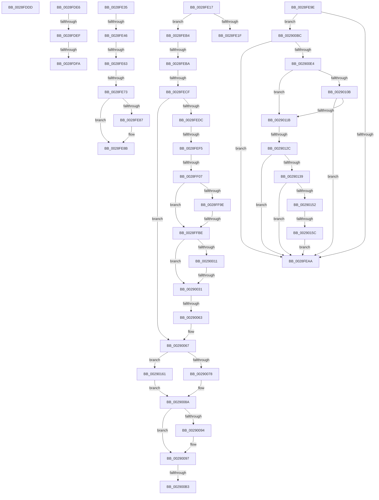

# sub_0028FDDD

- RVA: `0x0028FDDD`–`0x0029016D` (길이 `912` bytes)
- VA: `0x000000014028FDDD`
- 실행 섹션: `.text`
- PDB 이름 있음: `아니요`; PDB Function 태그: `아니요`
- unwind 정보 RVA: `0x000673E4`
- 디코드: `196`개 명령, `912/912` bytes 표시
- 미해석 바이트: `0` (있으면 어셈블리에 `.byte`로 보존)

> 이 문서는 커널 이미지의 기계어와 PDB 기호를 분석해 생성했습니다. 4번과 5번은 함수 원형과 자료형을 바이너리 사용 방식에서 추정한 C 해석이며 원본 소스 복구 결과는 아닙니다.

## 1. Dependencies

- 직접 호출 지점: **3**; 고유 호출 대상: **2**
- 직접 호출자로 확인된 함수: **0**
- RIP 상대 이미지 참조: **7**

### Outgoing calls
- `0x0028FE09` → [MiSetVaAgeList](../29/MiSetVaAgeList_function_00290A20.md) (function, `0x00290A20`)
- `0x0028FE2B` → [MiSetVaAgeList](../29/MiSetVaAgeList_function_00290A20.md) (function, `0x00290A20`)
- `0x002900A6` → [MiClearPteAccessed](../29/MiClearPteAccessed_function_00290630.md) (function, `0x00290630`)

### Direct callers
- 이 함수 시작 RVA로 연결되는 직접 call은 확인되지 않았습니다. 간접 호출은 완전히 역산할 수 없습니다.

### Static image references
- `0x0028FE35` → RVA `0x00FC6A88` (`ALMOSTRO`; read)
- `0x0029007F` → RVA `0x00E30088` (`.data`; read)
- `0x002900BC` → RVA `0x00E2DCE0` (`.data`; read)
- `0x002900FF` → RVA `0x00E35C00` (`.data`; read)
- `0x0029012C` → RVA `0x00E3CBE6` (`.data`; read)
- `0x00290139` → RVA `0x00E3D240` (`.data`; read)
- `0x00290161` → RVA `0x00E38D00` (`.data`; read)

## 2. Other-region calls and transfers

- 다른 실행 섹션으로 향하는 call: **0**
- call이 아닌 외부 분기/꼬리 이동: **21**
  - `0x0028FDE1` → [sub_0028FBD9 + 0x50](Unknown_function_0028FBD9.md) (`tail-transfer`)
  - `0x0028FDE9` → [sub_002901B8 + 0x2DE](../29/Unknown_function_002901B8.md) (`tail-transfer`)
  - `0x0028FDF4` → [sub_0028FBD9 + 0x3F](Unknown_function_0028FBD9.md) (`tail-transfer`)
  - `0x0028FE12` → [sub_0028FBD9 + 0x3F](Unknown_function_0028FBD9.md) (`tail-transfer`)
  - `0x0028FE30` → [sub_0028FBD9 + 0x125](Unknown_function_0028FBD9.md) (`tail-transfer`)
  - `0x0028FE40` → [sub_0028FBD9 + 0xE7](Unknown_function_0028FBD9.md) (`tail-transfer`)
  - `0x0028FE5D` → [sub_0028FBD9 + 0xE7](Unknown_function_0028FBD9.md) (`tail-transfer`)
  - `0x0028FE6D` → [sub_0028FBD9 + 0xE7](Unknown_function_0028FBD9.md) (`tail-transfer`)
  - `0x0028FE99` → [sub_0028FBD9 + 0xE7](Unknown_function_0028FBD9.md) (`tail-transfer`)
  - `0x0028FEAF` → [sub_0028FBD9 + 0x29](Unknown_function_0028FBD9.md) (`tail-transfer`)
  - `0x0028FEB4` → [sub_0028FBD9 + 0x125](Unknown_function_0028FBD9.md) (`tail-transfer`)
  - `0x0028FEC9` → [sub_002901B8 + 0x21E](../29/Unknown_function_002901B8.md) (`tail-transfer`)
  - `0x0028FEEF` → [sub_002901B8 + 0x413](../29/Unknown_function_002901B8.md) (`tail-transfer`)
  - `0x0028FF01` → [sub_002901B8 + 0x430](../29/Unknown_function_002901B8.md) (`tail-transfer`)
  - `0x0028FFB8` → [sub_002901B8 + 0x320](../29/Unknown_function_002901B8.md) (`tail-transfer`)
  - `0x0029002B` → [sub_002901B8 + 0x32C](../29/Unknown_function_002901B8.md) (`tail-transfer`)
  - `0x0029005D` → [sub_002901B8 + 0x180](../29/Unknown_function_002901B8.md) (`tail-transfer`)
  - `0x002900AD` → [sub_0028FBD9 + 0xFF](Unknown_function_0028FBD9.md) (`tail-transfer`)
  - `0x002900B7` → [sub_0028FBD9 + 0xFF](Unknown_function_0028FBD9.md) (`tail-transfer`)
  - `0x00290126` → [sub_0028FBD9 + 0x23](Unknown_function_0028FBD9.md) (`tail-transfer`)
  - `0x00290156` → [sub_0028FBD9 + 0x23](Unknown_function_0028FBD9.md) (`tail-transfer`)

## 3. Assembly (complete function range)

```asm
0028FDDD  0F B6 47 04                     movzx eax, byte ptr [rdi + 4]
0028FDE1  E9 43 FE FF FF                  jmp 0x14028fc29
0028FDE6  83 FB 05                        cmp ebx, 5
0028FDE9  0F 82 A7 06 00 00               jb 0x140290496
0028FDEF  8B 0F                           mov ecx, dword ptr [rdi]
0028FDF1  41 84 CC                        test r12b, cl
0028FDF4  0F 84 1E FE FF FF               je 0x14028fc18
0028FDFA  FE C0                           inc al
0028FDFC  44 0F B6 C8                     movzx r9d, al
0028FE00  45 8B C4                        mov r8d, r12d
0028FE03  49 8B D5                        mov rdx, r13
0028FE06  48 8B CE                        mov rcx, rsi
0028FE09  E8 12 0C 00 00                  call 0x140290a20
0028FE0E  48 FF 47 10                     inc qword ptr [rdi + 0x10]
0028FE12  E9 01 FE FF FF                  jmp 0x14028fc18
0028FE17  3C 07                           cmp al, 7
0028FE19  0F 83 95 00 00 00               jae 0x14028feb4
0028FE1F  45 33 C9                        xor r9d, r9d
0028FE22  45 8B C4                        mov r8d, r12d
0028FE25  49 8B D5                        mov rdx, r13
0028FE28  48 8B CE                        mov rcx, rsi
0028FE2B  E8 F0 0B 00 00                  call 0x140290a20
0028FE30  E9 C9 FE FF FF                  jmp 0x14028fcfe
0028FE35  48 F7 05 48 6C D3 00 00 00 60 00  test qword ptr [rip + 0xd36c48], 0x600000
0028FE40  0F 84 7A FE FF FF               je 0x14028fcc0
0028FE46  65 48 8B 0C 25 88 01 00 00      mov rcx, qword ptr gs:[0x188]
0028FE4F  48 8B 91 B8 00 00 00            mov rdx, qword ptr [rcx + 0xb8]
0028FE56  44 38 A2 60 01 00 00            cmp byte ptr [rdx + 0x160], r12b
0028FE5D  0F 84 5D FE FF FF               je 0x14028fcc0
0028FE63  48 8B 8A 08 05 00 00            mov rcx, qword ptr [rdx + 0x508]
0028FE6A  48 85 C9                        test rcx, rcx
0028FE6D  0F 84 4D FE FF FF               je 0x14028fcc0
0028FE73  49 C1 E8 03                     shr r8, 3
0028FE77  41 81 E0 FF 01 00 00            and r8d, 0x1ff
0028FE7E  4A 8B 0C C1                     mov rcx, qword ptr [rcx + r8*8]
0028FE82  F6 C1 20                        test cl, 0x20
0028FE85  74 04                           je 0x14028fe8b
0028FE87  48 83 C8 20                     or rax, 0x20
0028FE8B  48 8B D0                        mov rdx, rax
0028FE8E  48 83 C8 42                     or rax, 0x42
0028FE92  F6 C1 42                        test cl, 0x42
0028FE95  48 0F 44 C2                     cmove rax, rdx
0028FE99  E9 22 FE FF FF                  jmp 0x14028fcc0
0028FE9E  48 8B CF                        mov rcx, rdi
0028FEA1  4C 3B F1                        cmp r14, rcx
0028FEA4  0F 83 12 02 00 00               jae 0x1402900bc
0028FEAA  BB 05 00 00 00                  mov ebx, 5
0028FEAF  E9 4E FD FF FF                  jmp 0x14028fc02
0028FEB4  0F 85 44 FE FF FF               jne 0x14028fcfe
0028FEBA  48 8B BC 24 80 00 00 00         mov rdi, qword ptr [rsp + 0x80]
0028FEC2  4C 8B CB                        mov r9, rbx
0028FEC5  41 F6 C7 02                     test r15b, 2
0028FEC9  0F 84 07 05 00 00               je 0x1402903d6
0028FECF  4C 8B 4F 38                     mov r9, qword ptr [rdi + 0x38]
0028FED3  4D 85 C9                        test r9, r9
0028FED6  0F 85 8B 01 00 00               jne 0x140290067
0028FEDC  65 4C 8B 04 25 20 00 00 00      mov r8, qword ptr gs:[0x20]
0028FEE5  49 8B 90 38 88 00 00            mov rdx, qword ptr [r8 + 0x8838]
0028FEEC  48 85 D2                        test rdx, rdx
0028FEEF  0F 84 D6 06 00 00               je 0x1402905cb
0028FEF5  8B 82 5C 01 00 00               mov eax, dword ptr [rdx + 0x15c]
0028FEFB  3B 82 60 01 00 00               cmp eax, dword ptr [rdx + 0x160]
0028FF01  0F 84 E1 06 00 00               je 0x1402905e8
0028FF07  48 69 C8 78 50 00 00            imul rcx, rax, 0x5078
0028FF0E  0F 57 C0                        xorps xmm0, xmm0
0028FF11  65 48 8B 04 25 88 01 00 00      mov rax, qword ptr gs:[0x188]
0028FF1A  41 BA 02 00 00 00               mov r10d, 2
0028FF20  48 03 CA                        add rcx, rdx
0028FF23  48 89 81 F0 51 00 00            mov qword ptr [rcx + 0x51f0], rax
0028FF2A  4C 8D 81 80 01 00 00            lea r8, [rcx + 0x180]
0028FF31  FF 82 5C 01 00 00               inc dword ptr [rdx + 0x15c]
0028FF37  33 C0                           xor eax, eax
0028FF39  49 8D 90 28 10 00 00            lea rdx, [r8 + 0x1028]
0028FF40  48 89 99 88 01 00 00            mov qword ptr [rcx + 0x188], rbx
0028FF47  48 89 99 90 01 00 00            mov qword ptr [rcx + 0x190], rbx
0028FF4E  48 89 99 98 01 00 00            mov qword ptr [rcx + 0x198], rbx
0028FF55  48 89 99 A0 01 00 00            mov qword ptr [rcx + 0x1a0], rbx
0028FF5C  41 C7 40 0C 00 02 00 00         mov dword ptr [r8 + 0xc], 0x200
0028FF64  0F 11 02                        movups xmmword ptr [rdx], xmm0
0028FF67  0F 11 42 10                     movups xmmword ptr [rdx + 0x10], xmm0
0028FF6B  48 89 42 20                     mov qword ptr [rdx + 0x20], rax
0028FF6F  C7 42 0C 00 02 00 00            mov dword ptr [rdx + 0xc], 0x200
0028FF76  41 89 58 10                     mov dword ptr [r8 + 0x10], ebx
0028FF7A  45 89 50 14                     mov dword ptr [r8 + 0x14], r10d
0028FF7E  49 89 30                        mov qword ptr [r8], rsi
0028FF81  8B 86 B8 00 00 00               mov eax, dword ptr [rsi + 0xb8]
0028FF87  C1 E8 08                        shr eax, 8
0028FF8A  C0 E8 03                        shr al, 3
0028FF8D  41 22 C4                        and al, r12b
0028FF90  41 88 40 18                     mov byte ptr [r8 + 0x18], al
0028FF94  8B 86 B8 00 00 00               mov eax, dword ptr [rsi + 0xb8]
0028FF9A  A8 0F                           test al, 0xf
0028FF9C  75 20                           jne 0x14028ffbe
0028FF9E  65 48 8B 04 25 88 01 00 00      mov rax, qword ptr gs:[0x188]
0028FFA7  48 8B 88 B8 00 00 00            mov rcx, qword ptr [rax + 0xb8]
0028FFAE  48 81 C1 00 04 00 00            add rcx, 0x400
0028FFB5  48 3B F1                        cmp rsi, rcx
0028FFB8  0F 85 1A 05 00 00               jne 0x1402904d8
0028FFBE  8B 86 B8 00 00 00               mov eax, dword ptr [rsi + 0xb8]
0028FFC4  8B CB                           mov ecx, ebx
0028FFC6  A8 0F                           test al, 0xf
0028FFC8  41 0F 44 CC                     cmove ecx, r12d
0028FFCC  41 83 60 10 DB                  and dword ptr [r8 + 0x10], 0xffffffdb
0028FFD1  41 89 48 08                     mov dword ptr [r8 + 8], ecx
0028FFD5  66 41 89 58 19                  mov word ptr [r8 + 0x19], bx
0028FFDA  41 89 58 1C                     mov dword ptr [r8 + 0x1c], ebx
0028FFDE  49 89 58 20                     mov qword ptr [r8 + 0x20], rbx
0028FFE2  49 89 58 28                     mov qword ptr [r8 + 0x28], rbx
0028FFE6  4C 89 47 38                     mov qword ptr [rdi + 0x38], r8
0028FFEA  44 89 52 10                     mov dword ptr [rdx + 0x10], r10d
0028FFEE  44 89 62 14                     mov dword ptr [rdx + 0x14], r12d
0028FFF2  48 89 32                        mov qword ptr [rdx], rsi
0028FFF5  8B 86 B8 00 00 00               mov eax, dword ptr [rsi + 0xb8]
0028FFFB  C1 E8 08                        shr eax, 8
0028FFFE  C0 E8 03                        shr al, 3
00290001  41 22 C4                        and al, r12b
00290004  88 42 18                        mov byte ptr [rdx + 0x18], al
00290007  8B 86 B8 00 00 00               mov eax, dword ptr [rsi + 0xb8]
0029000D  A8 0F                           test al, 0xf
0029000F  75 20                           jne 0x140290031
00290011  65 48 8B 04 25 88 01 00 00      mov rax, qword ptr gs:[0x188]
0029001A  48 8B 88 B8 00 00 00            mov rcx, qword ptr [rax + 0xb8]
00290021  48 81 C1 00 04 00 00            add rcx, 0x400
00290028  48 3B F1                        cmp rsi, rcx
0029002B  0F 85 B3 04 00 00               jne 0x1402904e4
00290031  8B 86 B8 00 00 00               mov eax, dword ptr [rsi + 0xb8]
00290037  8B CB                           mov ecx, ebx
00290039  A8 0F                           test al, 0xf
0029003B  41 0F 44 CC                     cmove ecx, r12d
0029003F  83 62 10 DB                     and dword ptr [rdx + 0x10], 0xffffffdb
00290043  89 4A 08                        mov dword ptr [rdx + 8], ecx
00290046  66 89 5A 19                     mov word ptr [rdx + 0x19], bx
0029004A  89 5A 1C                        mov dword ptr [rdx + 0x1c], ebx
0029004D  48 89 5A 20                     mov qword ptr [rdx + 0x20], rbx
00290051  48 89 5A 28                     mov qword ptr [rdx + 0x28], rbx
00290055  48 89 57 40                     mov qword ptr [rdi + 0x40], rdx
00290059  4C 39 67 48                     cmp qword ptr [rdi + 0x48], r12
0029005D  0F 84 D5 02 00 00               je 0x140290338
00290063  4C 8B 4F 38                     mov r9, qword ptr [rdi + 0x38]
00290067  8B 86 B8 00 00 00               mov eax, dword ptr [rsi + 0xb8]
0029006D  24 0F                           and al, 0xf
0029006F  41 3A C4                        cmp al, r12b
00290072  0F 84 E9 00 00 00               je 0x140290161
00290078  0F B7 8E AE 00 00 00            movzx ecx, word ptr [rsi + 0xae]
0029007F  48 8B 05 02 00 BA 00            mov rax, qword ptr [rip + 0xba0002]
00290086  48 8B 04 C8                     mov rax, qword ptr [rax + rcx*8]
0029008A  8B 80 2C 44 00 00               mov eax, dword ptr [rax + 0x442c]
00290090  85 C0                           test eax, eax
00290092  74 03                           je 0x140290097
00290094  41 0B DC                        or ebx, r12d
00290097  4C 8B 44 24 68                  mov r8, qword ptr [rsp + 0x68]
0029009C  49 8B D6                        mov rdx, r14
0029009F  48 8B CE                        mov rcx, rsi
002900A2  89 5C 24 20                     mov dword ptr [rsp + 0x20], ebx
002900A6  E8 85 05 00 00                  call 0x140290630
002900AB  85 C0                           test eax, eax
002900AD  0F 84 25 FC FF FF               je 0x14028fcd8
002900B3  48 FF 47 18                     inc qword ptr [rdi + 0x18]
002900B7  E9 1C FC FF FF                  jmp 0x14028fcd8
002900BC  48 8B 0D 1D DC B9 00            mov rcx, qword ptr [rip + 0xb9dc1d]
002900C3  48 8D 14 49                     lea rdx, [rcx + rcx*2]
002900C7  48 B9 30 00 00 00 00 DE FF FF   movabs rcx, 0xffffde0000000030
002900D1  48 C1 E2 04                     shl rdx, 4
002900D5  48 8B C9                        mov rcx, rcx
002900D8  48 03 D1                        add rdx, rcx
002900DB  4C 3B F2                        cmp r14, rdx
002900DE  0F 83 C6 FD FF FF               jae 0x14028feaa
002900E4  48 8B CF                        mov rcx, rdi
002900E7  49 8B D6                        mov rdx, r14
002900EA  48 2B D1                        sub rdx, rcx
002900ED  48 B9 AB AA AA AA AA AA AA AA   movabs rcx, 0xaaaaaaaaaaaaaaab
002900F7  48 C1 FA 04                     sar rdx, 4
002900FB  48 0F AF D1                     imul rdx, rcx
002900FF  48 8B 0D FA 5A BA 00            mov rcx, qword ptr [rip + 0xba5afa]
00290106  48 3B D1                        cmp rdx, rcx
00290109  72 10                           jb 0x14029011b
0029010B  48 81 C1 00 08 00 00            add rcx, 0x800
00290112  48 3B D1                        cmp rdx, rcx
00290115  0F 82 8F FD FF FF               jb 0x14028feaa
0029011B  8B CB                           mov ecx, ebx
0029011D  C1 E9 10                        shr ecx, 0x10
00290120  80 E1 07                        and cl, 7
00290123  80 F9 06                        cmp cl, 6
00290126  0F 84 D0 FA FF FF               je 0x14028fbfc
0029012C  80 3D B3 CA BA 00 00            cmp byte ptr [rip + 0xbacab3], 0
00290133  0F 84 71 FD FF FF               je 0x14028feaa
00290139  48 8B 0D 00 D1 BA 00            mov rcx, qword ptr [rip + 0xbad100]
00290140  48 C1 EA 09                     shr rdx, 9
00290144  44 0F B6 04 51                  movzx r8d, byte ptr [rcx + rdx*2]
00290149  45 84 C0                        test r8b, r8b
0029014C  0F 84 58 FD FF FF               je 0x14028feaa
00290152  41 80 F8 0A                     cmp r8b, 0xa
00290156  0F 85 A0 FA FF FF               jne 0x14028fbfc
0029015C  E9 49 FD FF FF                  jmp 0x14028feaa
00290161  48 8D 05 98 8B BA 00            lea rax, [rip + 0xba8b98]
00290168  E9 1D FF FF FF                  jmp 0x14029008a
```

## 4. C-style interpretation (structured pseudocode)

```c
__int64 __fastcall sub_0028FDDD(void)
{
    unsigned int v_stack_p20;
    unsigned __int64 v_stack_p68;
    unsigned __int64 v_stack_p80;
}
```

## 5. (Beta) C Style

```c
void sub_0028FDDD(void)
{
    uint32_t v_stack_p20;
    uint64_t v_stack_p68;
    uint64_t v_stack_p80;
}
```

## 6. Execution-region graph

[열기: 2D/3D 그래프와 함수 탐색 컨트롤 패널](../../../control-panel.html?section=text&rva=0x0028FDDD&view=graph)

- 2D 그래프는 위에서 아래로 흐르고, 3D 그래프는 빈 공간을 드래그해 회전합니다. Shift+드래그는 이동, 휠은 확대·축소, 함수 노드 선택은 대상 보고서 이동입니다.

### Static fallback


