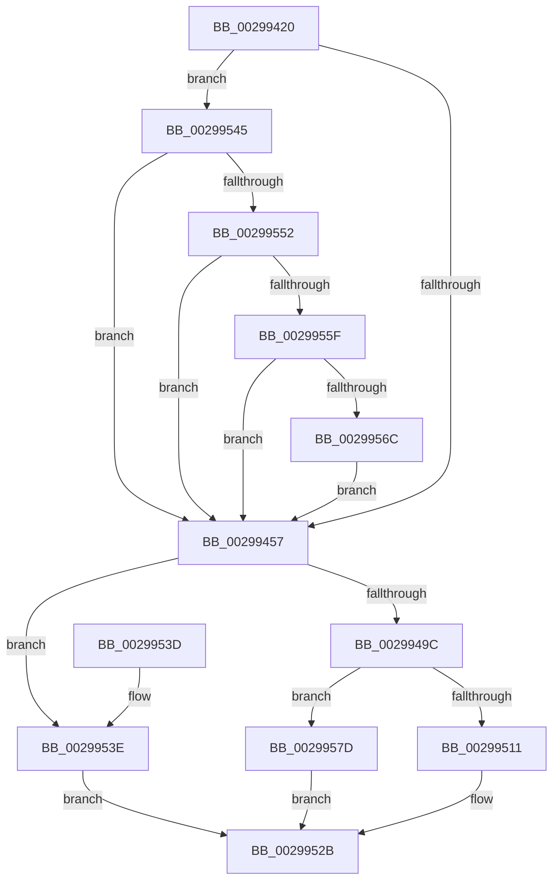

# CcSetValidData

- RVA: `0x00299420`–`0x00299587` (길이 `359` bytes)
- VA: `0x0000000140299420`
- 실행 섹션: `.text`
- PDB 이름 있음: `예`; PDB Function 태그: `아니요`
- unwind 정보 RVA: `0x00067C08`
- 디코드: `84`개 명령, `359/359` bytes 표시
- 미해석 바이트: `0` (있으면 어셈블리에 `.byte`로 보존)

> 이 문서는 커널 이미지의 기계어와 PDB 기호를 분석해 생성했습니다. 4번과 5번은 함수 원형과 자료형을 바이너리 사용 방식에서 추정한 C 해석이며 원본 소스 복구 결과는 아닙니다.

## 1. Dependencies

- 직접 호출 지점: **5**; 고유 호출 대상: **5**
- 직접 호출자로 확인된 함수: **1**
- RIP 상대 이미지 참조: **6**

### Outgoing calls
- `0x0029947E` → [IoGetRelatedDeviceObject](IoGetRelatedDeviceObject_function_0029B120.md) (function, `0x0029B120`)
- `0x0029948B` → [IoAllocateIrp](../20/IoAllocateIrp_function_002065D0.md) (function, `0x002065D0`)
- `0x00299503` → [IofCallDriver](IofCallDriver_function_0029B4B0.md) (function, `0x0029B4B0`)
- `0x00299523` → [KeWaitForSingleObject](../20/KeWaitForSingleObject_function_0020E6B0.md) (function, `0x0020E6B0`)
- `0x00299573` → [CcSetTelemetryPeriodicTimer](../../page/AD/CcSetTelemetryPeriodicTimer_function_00ADB788.md) (function, `0x00ADB788`)

### Direct callers
- [CcWriteBehindPostProcess](../35/CcWriteBehindPostProcess_function_00357BB4.md) at `0x00357DF5`

### Static image references
- `0x00299432` → RVA `0x00F8F2D8` (`.data`; read/write)
- `0x0029943C` → RVA `0x00F8F3C4` (`.data`; read)
- `0x00299545` → RVA `0x00F8F2A1` (`.data`; read)
- `0x00299552` → RVA `0x00F8F260` (`.data`; read)
- `0x0029955F` → RVA `0x00F8F3C0` (`.data`; read)
- `0x0029956C` → RVA `0x00F8F280` (`.data`; read)

## 2. Other-region calls and transfers

- 다른 실행 섹션으로 향하는 call: **1**
  - `0x00299573` → [CcSetTelemetryPeriodicTimer](../../page/AD/CcSetTelemetryPeriodicTimer_function_00ADB788.md) (`.text` → `PAGE`)
- 별도 외부 분기/꼬리 이동을 확인하지 못했습니다.

## 3. Assembly (complete function range)

```asm
00299420  48 89 5C 24 08                  mov qword ptr [rsp + 8], rbx
00299425  48 89 7C 24 18                  mov qword ptr [rsp + 0x18], rdi
0029942A  55                              push rbp
0029942B  48 8B EC                        mov rbp, rsp
0029942E  48 83 EC 60                     sub rsp, 0x60
00299432  48 FF 05 9F 5E CF 00            inc qword ptr [rip + 0xcf5e9f]
00299439  0F 57 C0                        xorps xmm0, xmm0
0029943C  83 3D 81 5F CF 00 00            cmp dword ptr [rip + 0xcf5f81], 0
00299443  48 8B FA                        mov rdi, rdx
00299446  48 8B D9                        mov rbx, rcx
00299449  C6 45 E3 00                     mov byte ptr [rbp - 0x1d], 0
0029944D  0F 11 45 D0                     movups xmmword ptr [rbp - 0x30], xmm0
00299451  0F 84 EE 00 00 00               je 0x140299545
00299457  48 8B 07                        mov rax, qword ptr [rdi]
0029945A  48 8B CB                        mov rcx, rbx
0029945D  66 83 65 E0 00                  and word ptr [rbp - 0x20], 0
00299462  83 65 E4 00                     and dword ptr [rbp - 0x1c], 0
00299466  48 89 45 18                     mov qword ptr [rbp + 0x18], rax
0029946A  48 8D 45 E8                     lea rax, [rbp - 0x18]
0029946E  48 89 45 F0                     mov qword ptr [rbp - 0x10], rax
00299472  48 8D 45 E8                     lea rax, [rbp - 0x18]
00299476  48 89 45 E8                     mov qword ptr [rbp - 0x18], rax
0029947A  C6 45 E2 06                     mov byte ptr [rbp - 0x1e], 6
0029947E  E8 9D 1C 00 00                  call 0x14029b120
00299483  33 D2                           xor edx, edx
00299485  48 8B F8                        mov rdi, rax
00299488  8A 48 4C                        mov cl, byte ptr [rax + 0x4c]
0029948B  E8 40 D1 F6 FF                  call 0x1402065d0
00299490  48 8B D0                        mov rdx, rax
00299493  48 85 C0                        test rax, rax
00299496  0F 84 A2 00 00 00               je 0x14029953e
0029949C  48 8B 88 B8 00 00 00            mov rcx, qword ptr [rax + 0xb8]
002994A3  C7 40 10 42 00 00 00            mov dword ptr [rax + 0x10], 0x42
002994AA  C6 40 40 00                     mov byte ptr [rax + 0x40], 0
002994AE  48 8D 45 D0                     lea rax, [rbp - 0x30]
002994B2  48 89 42 48                     mov qword ptr [rdx + 0x48], rax
002994B6  48 8D 45 E0                     lea rax, [rbp - 0x20]
002994BA  48 89 42 50                     mov qword ptr [rdx + 0x50], rax
002994BE  48 89 9A C0 00 00 00            mov qword ptr [rdx + 0xc0], rbx
002994C5  65 48 8B 04 25 88 01 00 00      mov rax, qword ptr gs:[0x188]
002994CE  48 89 82 98 00 00 00            mov qword ptr [rdx + 0x98], rax
002994D5  48 8D 45 18                     lea rax, [rbp + 0x18]
002994D9  48 89 42 18                     mov qword ptr [rdx + 0x18], rax
002994DD  48 83 61 D0 00                  and qword ptr [rcx - 0x30], 0
002994E2  C6 41 B8 06                     mov byte ptr [rcx - 0x48], 6
002994E6  48 89 59 E8                     mov qword ptr [rcx - 0x18], rbx
002994EA  48 89 79 E0                     mov qword ptr [rcx - 0x20], rdi
002994EE  C7 41 C0 08 00 00 00            mov dword ptr [rcx - 0x40], 8
002994F5  C7 41 C8 14 00 00 00            mov dword ptr [rcx - 0x38], 0x14
002994FC  C6 41 D9 01                     mov byte ptr [rcx - 0x27], 1
00299500  48 8B CF                        mov rcx, rdi
00299503  E8 A8 1F 00 00                  call 0x14029b4b0
00299508  8B C8                           mov ecx, eax
0029950A  3D 03 01 00 00                  cmp eax, 0x103
0029950F  75 6C                           jne 0x14029957d
00299511  48 83 64 24 20 00               and qword ptr [rsp + 0x20], 0
00299517  48 8D 4D E0                     lea rcx, [rbp - 0x20]
0029951B  45 33 C9                        xor r9d, r9d
0029951E  45 33 C0                        xor r8d, r8d
00299521  33 D2                           xor edx, edx
00299523  E8 88 51 F7 FF                  call 0x14020e6b0
00299528  8B 45 D0                        mov eax, dword ptr [rbp - 0x30]
0029952B  4C 8D 5C 24 60                  lea r11, [rsp + 0x60]
00299530  49 8B 5B 10                     mov rbx, qword ptr [r11 + 0x10]
00299534  49 8B 7B 20                     mov rdi, qword ptr [r11 + 0x20]
00299538  49 8B E3                        mov rsp, r11
0029953B  5D                              pop rbp
0029953C  C3                              ret
0029953D  CC                              int3
0029953E  B8 9A 00 00 C0                  mov eax, 0xc000009a
00299543  EB E6                           jmp 0x14029952b
00299545  80 3D 55 5D CF 00 00            cmp byte ptr [rip + 0xcf5d55], 0
0029954C  0F 85 05 FF FF FF               jne 0x140299457
00299552  80 3D 07 5D CF 00 00            cmp byte ptr [rip + 0xcf5d07], 0
00299559  0F 84 F8 FE FF FF               je 0x140299457
0029955F  83 3D 5A 5E CF 00 00            cmp dword ptr [rip + 0xcf5e5a], 0
00299566  0F 85 EB FE FF FF               jne 0x140299457
0029956C  48 8B 0D 0D 5D CF 00            mov rcx, qword ptr [rip + 0xcf5d0d]
00299573  E8 10 22 84 00                  call 0x140adb788
00299578  E9 DA FE FF FF                  jmp 0x140299457
0029957D  8B 45 D0                        mov eax, dword ptr [rbp - 0x30]
00299580  85 C9                           test ecx, ecx
00299582  0F 48 C1                        cmovs eax, ecx
00299585  EB A4                           jmp 0x14029952b
```

## 4. C-style interpretation (structured pseudocode)

```c
__int64 __fastcall CcSetValidData(__int64 a1, __int64 a2, int a3, int a4)
{
    __int64 result;
    __int64 v_rsp;
    unsigned __int64 v_stack_m18;
    unsigned __int64 v_stack_m20;
    unsigned int v_stack_m24;
    unsigned __int8 v_stack_m25;
    unsigned __int8 v_stack_m26;
    unsigned __int16 v_stack_m28;
    unsigned __int64 v_stack_m38;
    unsigned __int64 v_stack_m48;
    unsigned __int64 v_stack_m8;
    unsigned __int64 v_stack_p10;
    unsigned __int64 v_stack_p18;
    unsigned __int64 v_stack_p8;

    v_stack_p8 = v_rbx;
    v_stack_p18 = v_rdi;
    v_rsp = (v_rsp) - (96);
    v_stack_m25 = 0;
    v_stack_m38 = v_xmm0;
    if ((*(unsigned int *)(v_rip + 13590401)) == 0) goto loc_00299545;
loc_00299457:
    v_stack_p10 = *(unsigned __int64 *)(a2);
    v_stack_m18 = v_stack_m20;
    v_stack_m20 = v_stack_m20;
    v_stack_m26 = 6;
    result = IoGetRelatedDeviceObject(a1, a2, a3, a4);
    a2 = 0;
    result = IoAllocateIrp(*(unsigned __int8 *)(result + 76), a2, a3, a4);
    if (result == 0) goto loc_0029953E;
    *(unsigned int *)(result + 16) = 66;
    *(unsigned __int8 *)(result + 64) = 0;
    *(unsigned __int64 *)(result + 72) = v_stack_m38;
    *(unsigned __int64 *)(result + 80) = v_stack_m28;
    *(unsigned __int64 *)(result + 192) = a1;
    *(unsigned __int64 *)(result + 152) = *(unsigned __int64 *)(gs_base + (0 + 392));
    *(unsigned __int64 *)(result + 24) = v_stack_p10;
    *(unsigned __int8 *)(*(unsigned __int64 *)(result + 184) - 72) = 6;
    *(unsigned __int64 *)(*(unsigned __int64 *)(result + 184) - 24) = a1;
    *(unsigned __int64 *)(*(unsigned __int64 *)(result + 184) - 32) = result;
    *(unsigned int *)(*(unsigned __int64 *)(result + 184) - 64) = 8;
    *(unsigned int *)(*(unsigned __int64 *)(result + 184) - 56) = 20;
    *(unsigned __int8 *)(*(unsigned __int64 *)(result + 184) - 39) = 1;
    result = IofCallDriver(result, result, a3, a4);
    if (((unsigned int)(result)) != 259) goto loc_0029957D;
    a4 = 0;
    a3 = 0;
    a2 = 0;
    result = KeWaitForSingleObject(v_stack_m28, a2, a3, a4);
loc_0029952B:
    return (unsigned int)(v_stack_m38);
loc_0029953E:
    goto loc_0029952B;
loc_00299545:
    if ((*(unsigned __int8 *)(v_rip + 13589845)) != 0) goto loc_00299457;
    if ((*(unsigned __int8 *)(v_rip + 13589767)) == 0) goto loc_00299457;
    if ((*(unsigned int *)(v_rip + 13590106)) != 0) goto loc_00299457;
    result = CcSetTelemetryPeriodicTimer(*(unsigned __int64 *)(v_rip + 13589773), a2, a3, a4);
    goto loc_00299457;
loc_0029957D:
    result = (unsigned int)(v_stack_m38);
    if (sign_flag) { result = (unsigned int)(*(unsigned __int64 *)(v_rip + 13589773)); }
    goto loc_0029952B;
}
```

## 5. (Beta) C Style

```c
int64_t CcSetValidData(int64_t Arg1, void *Arg2, int32_t Arg3, int32_t Arg4)
{
    uint8_t *arg2 = (uint8_t *)Arg2;

    int64_t result;
    int64_t local_rsp;
    uint64_t v_stack_m18;
    uint64_t v_stack_m20;
    uint32_t v_stack_m24;
    uint8_t v_stack_m25;
    uint8_t v_stack_m26;
    uint16_t v_stack_m28;
    uint64_t v_stack_m38;
    uint64_t v_stack_m48;
    uint64_t v_stack_m8;
    uint64_t v_stack_p10;
    uint64_t v_stack_p18;
    uint64_t v_stack_p8;

    v_stack_p8 = local_rbx;
    v_stack_p18 = local_rdi;
    local_rsp = (local_rsp) - (96);
    v_stack_m25 = 0;
    v_stack_m38 = v_xmm0;
    if ((*(uint32_t *)(v_rip + 0xCF5F81)) == 0) goto loc_00299545;
loc_00299457:
    v_stack_p10 = *(uint64_t *)(arg2);
    v_stack_m18 = v_stack_m20;
    v_stack_m20 = v_stack_m20;
    v_stack_m26 = 6;
    result = IoGetRelatedDeviceObject(Arg1, Arg2, Arg3, Arg4);
    Arg2 = 0;
    result = IoAllocateIrp(*(uint8_t *)(result + 0x4C), Arg2, Arg3, Arg4);
    if (result == 0) goto loc_0029953E;
    *(uint32_t *)(result + 0x10) = 66;
    *(uint8_t *)(result + 0x40) = 0;
    *(uint64_t *)(result + 0x48) = v_stack_m38;
    *(uint64_t *)(result + 0x50) = v_stack_m28;
    *(uint64_t *)(result + 0xC0) = Arg1;
    *(uint64_t *)(result + 0x98) = *(uint64_t *)(gs_base + (0 + 0x188));
    *(uint64_t *)(result + 0x18) = v_stack_p10;
    *(uint8_t *)(*(uint64_t *)(result + 0xB8) - 0x48) = 6;
    *(uint64_t *)(*(uint64_t *)(result + 0xB8) - 0x18) = Arg1;
    *(uint64_t *)(*(uint64_t *)(result + 0xB8) - 0x20) = result;
    *(uint32_t *)(*(uint64_t *)(result + 0xB8) - 0x40) = 8;
    *(uint32_t *)(*(uint64_t *)(result + 0xB8) - 0x38) = 20;
    *(uint8_t *)(*(uint64_t *)(result + 0xB8) - 0x27) = 1;
    result = IofCallDriver(result, result, Arg3, Arg4);
    if (((uint32_t)(result)) != 259) goto loc_0029957D;
    Arg4 = 0;
    Arg3 = 0;
    Arg2 = 0;
    result = KeWaitForSingleObject(v_stack_m28, Arg2, Arg3, Arg4);
loc_0029952B:
    return (uint32_t)(v_stack_m38);
loc_0029953E:
    goto loc_0029952B;
loc_00299545:
    if ((*(uint8_t *)(v_rip + 0xCF5D55)) != 0) goto loc_00299457;
    if ((*(uint8_t *)(v_rip + 0xCF5D07)) == 0) goto loc_00299457;
    if ((*(uint32_t *)(v_rip + 0xCF5E5A)) != 0) goto loc_00299457;
    result = CcSetTelemetryPeriodicTimer(*(uint64_t *)(v_rip + 0xCF5D0D), Arg2, Arg3, Arg4);
    goto loc_00299457;
loc_0029957D:
    result = (uint32_t)(v_stack_m38);
    if (sign_flag) { result = (uint32_t)(*(uint64_t *)(v_rip + 0xCF5D0D)); }
    goto loc_0029952B;
}
```

### 관측된 메모리 오프셋

구조체 형식이 확인되지 않은 접근은 인자 기준의 오프셋으로만 기록했습니다.

| 기준 인자 | 오프셋 표현 | 폭 (bit) | 접근 |
|---|---:|---:|---|
| `Arg2` | `+ 0x0` | `64` | `R` |

## 6. Execution-region graph

[열기: 2D/3D 그래프와 함수 탐색 컨트롤 패널](../../../control-panel.html?section=text&rva=0x00299420&view=graph)

- 2D 그래프는 위에서 아래로 흐르고, 3D 그래프는 빈 공간을 드래그해 회전합니다. Shift+드래그는 이동, 휠은 확대·축소, 함수 노드 선택은 대상 보고서 이동입니다.

### Static fallback


