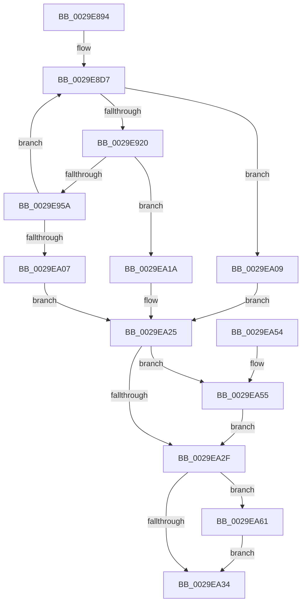

# CcZeroDataInCache

- RVA: `0x0029E894`–`0x0029EA6B` (길이 `471` bytes)
- VA: `0x000000014029E894`
- 실행 섹션: `.text`
- PDB 이름 있음: `예`; PDB Function 태그: `아니요`
- unwind 정보 RVA: `0x000681CC`
- 디코드: `113`개 명령, `471/471` bytes 표시
- 미해석 바이트: `0` (있으면 어셈블리에 `.byte`로 보존)

> 이 문서는 커널 이미지의 기계어와 PDB 기호를 분석해 생성했습니다. 4번과 5번은 함수 원형과 자료형을 바이너리 사용 방식에서 추정한 C 해석이며 원본 소스 복구 결과는 아닙니다.

## 1. Dependencies

- 직접 호출 지점: **11**; 고유 호출 대상: **9**
- 직접 호출자로 확인된 함수: **1**
- RIP 상대 이미지 참조: **0**

### Outgoing calls
- `0x0029E913` → [CcPinFileData](../33/CcPinFileData_function_0033FB40.md) (function, `0x0033FB40`)
- `0x0029E947` → [IoAllocateMdl](IoAllocateMdl_function_0029EBF0.md) (function, `0x0029EBF0`)
- `0x0029E98B` → [MmProbeAndLockPages](../23/MmProbeAndLockPages_function_0023B990.md) (function, `0x0023B990`)
- `0x0029E9BA` → [MmSetAddressRangeModifiedEx](../23/MmSetAddressRangeModifiedEx_function_00236F20.md) (function, `0x00236F20`)
- `0x0029E9C6` → [CcSetDirtyPinnedData](../35/CcSetDirtyPinnedData_function_0035A120.md) (function, `0x0035A120`)
- `0x0029E9D5` → [CcUnpinFileDataEx](../35/CcUnpinFileDataEx_function_00359DEC.md) (function, `0x00359DEC`)
- `0x0029E9E5` → [MmUnlockPages](MmUnlockPages_function_0029EEE0.md) (function, `0x0029EEE0`)
- `0x0029E9EF` → [IoFreeMdl](IoFreeMdl_function_0029EA80.md) (function, `0x0029EA80`)
- `0x0029EA1F` → [RtlRaiseStatus](../2F/RtlRaiseStatus_function_002F6A50.md) (function, `0x002F6A50`)
- `0x0029EA5A` → [CcUnpinFileDataEx](../35/CcUnpinFileDataEx_function_00359DEC.md) (function, `0x00359DEC`)
- `0x0029EA64` → [IoFreeMdl](IoFreeMdl_function_0029EA80.md) (function, `0x0029EA80`)

### Direct callers
- [CcZeroData](../38/CcZeroData_function_00387F00.md) at `0x00388013`
- [CcZeroData](../38/CcZeroData_function_00387F00.md) at `0x0038809F`

### Static image references
- 디코드된 RIP-relative 메모리 참조가 없습니다.

## 2. Other-region calls and transfers

- 다른 실행 섹션으로 향하는 call: **0**
- 별도 외부 분기/꼬리 이동을 확인하지 못했습니다.

## 3. Assembly (complete function range)

```asm
0029E894  4C 8B DC                        mov r11, rsp
0029E897  49 89 5B 08                     mov qword ptr [r11 + 8], rbx
0029E89B  49 89 73 18                     mov qword ptr [r11 + 0x18], rsi
0029E89F  57                              push rdi
0029E8A0  41 56                           push r14
0029E8A2  41 57                           push r15
0029E8A4  48 81 EC 90 00 00 00            sub rsp, 0x90
0029E8AB  45 0F B6 F1                     movzx r14d, r9b
0029E8AF  41 8B F0                        mov esi, r8d
0029E8B2  4C 8B F9                        mov r15, rcx
0029E8B5  33 FF                           xor edi, edi
0029E8B7  49 21 7B C8                     and qword ptr [r11 - 0x38], rdi
0029E8BB  48 8B 02                        mov rax, qword ptr [rdx]
0029E8BE  49 89 43 D0                     mov qword ptr [r11 - 0x30], rax
0029E8C2  49 21 7B C0                     and qword ptr [r11 - 0x40], rdi
0029E8C6  49 21 7B D8                     and qword ptr [r11 - 0x28], rdi
0029E8CA  49 21 7B B8                     and qword ptr [r11 - 0x48], rdi
0029E8CE  41 C6 43 10 01                  mov byte ptr [r11 + 0x10], 1
0029E8D3  21 7C 24 50                     and dword ptr [rsp + 0x50], edi
0029E8D7  44 8B C6                        mov r8d, esi
0029E8DA  44 2B C7                        sub r8d, edi
0029E8DD  48 8D 4C 24 70                  lea rcx, [rsp + 0x70]
0029E8E2  48 89 4C 24 40                  mov qword ptr [rsp + 0x40], rcx
0029E8E7  48 8D 8C 24 80 00 00 00         lea rcx, [rsp + 0x80]
0029E8EF  48 89 4C 24 38                  mov qword ptr [rsp + 0x38], rcx
0029E8F4  48 8D 4C 24 68                  lea rcx, [rsp + 0x68]
0029E8F9  48 89 4C 24 30                  mov qword ptr [rsp + 0x30], rcx
0029E8FE  44 89 74 24 28                  mov dword ptr [rsp + 0x28], r14d
0029E903  C6 44 24 20 01                  mov byte ptr [rsp + 0x20], 1
0029E908  45 33 C9                        xor r9d, r9d
0029E90B  48 8D 54 24 78                  lea rdx, [rsp + 0x78]
0029E910  49 8B CF                        mov rcx, r15
0029E913  E8 28 12 0A 00                  call 0x14033fb40
0029E918  84 C0                           test al, al
0029E91A  0F 84 E9 00 00 00               je 0x14029ea09
0029E920  48 8B 54 24 70                  mov rdx, qword ptr [rsp + 0x70]
0029E925  2B 54 24 78                     sub edx, dword ptr [rsp + 0x78]
0029E929  89 54 24 54                     mov dword ptr [rsp + 0x54], edx
0029E92D  03 FA                           add edi, edx
0029E92F  89 7C 24 58                     mov dword ptr [rsp + 0x58], edi
0029E933  48 83 64 24 20 00               and qword ptr [rsp + 0x20], 0
0029E939  45 33 C9                        xor r9d, r9d
0029E93C  45 33 C0                        xor r8d, r8d
0029E93F  48 8B 8C 24 80 00 00 00         mov rcx, qword ptr [rsp + 0x80]
0029E947  E8 A4 02 00 00                  call 0x14029ebf0
0029E94C  48 89 44 24 60                  mov qword ptr [rsp + 0x60], rax
0029E951  48 85 C0                        test rax, rax
0029E954  0F 84 C0 00 00 00               je 0x14029ea1a
0029E95A  65 48 8B 04 25 88 01 00 00      mov rax, qword ptr gs:[0x188]
0029E963  0F B6 98 AD 05 00 00            movzx ebx, byte ptr [rax + 0x5ad]
0029E96A  8D 43 02                        lea eax, [rbx + 2]
0029E96D  89 44 24 50                     mov dword ptr [rsp + 0x50], eax
0029E971  65 48 8B 04 25 88 01 00 00      mov rax, qword ptr gs:[0x188]
0029E97A  C6 80 AD 05 00 00 01            mov byte ptr [rax + 0x5ad], 1
0029E981  45 33 C0                        xor r8d, r8d
0029E984  33 D2                           xor edx, edx
0029E986  48 8B 4C 24 60                  mov rcx, qword ptr [rsp + 0x60]
0029E98B  E8 00 D0 F9 FF                  call 0x14023b990
0029E990  65 48 8B 04 25 88 01 00 00      mov rax, qword ptr gs:[0x188]
0029E999  88 98 AD 05 00 00               mov byte ptr [rax + 0x5ad], bl
0029E99F  83 64 24 50 00                  and dword ptr [rsp + 0x50], 0
0029E9A4  48 8B 44 24 70                  mov rax, qword ptr [rsp + 0x70]
0029E9A9  48 89 44 24 78                  mov qword ptr [rsp + 0x78], rax
0029E9AE  8B 54 24 54                     mov edx, dword ptr [rsp + 0x54]
0029E9B2  48 8B 8C 24 80 00 00 00         mov rcx, qword ptr [rsp + 0x80]
0029E9BA  E8 61 85 F9 FF                  call 0x140236f20
0029E9BF  33 D2                           xor edx, edx
0029E9C1  48 8B 4C 24 68                  mov rcx, qword ptr [rsp + 0x68]
0029E9C6  E8 55 B7 0B 00                  call 0x14035a120
0029E9CB  45 33 C0                        xor r8d, r8d
0029E9CE  33 D2                           xor edx, edx
0029E9D0  48 8B 4C 24 68                  mov rcx, qword ptr [rsp + 0x68]
0029E9D5  E8 12 B4 0B 00                  call 0x140359dec
0029E9DA  48 83 64 24 68 00               and qword ptr [rsp + 0x68], 0
0029E9E0  48 8B 4C 24 60                  mov rcx, qword ptr [rsp + 0x60]
0029E9E5  E8 F6 04 00 00                  call 0x14029eee0
0029E9EA  48 8B 4C 24 60                  mov rcx, qword ptr [rsp + 0x60]
0029E9EF  E8 8C 00 00 00                  call 0x14029ea80
0029E9F4  33 DB                           xor ebx, ebx
0029E9F6  48 89 5C 24 60                  mov qword ptr [rsp + 0x60], rbx
0029E9FB  8B 7C 24 58                     mov edi, dword ptr [rsp + 0x58]
0029E9FF  3B F7                           cmp esi, edi
0029EA01  0F 87 D0 FE FF FF               ja 0x14029e8d7
0029EA07  EB 1C                           jmp 0x14029ea25
0029EA09  C6 84 24 B8 00 00 00 00         mov byte ptr [rsp + 0xb8], 0
0029EA11  33 DB                           xor ebx, ebx
0029EA13  48 89 5C 24 60                  mov qword ptr [rsp + 0x60], rbx
0029EA18  EB 0B                           jmp 0x14029ea25
0029EA1A  B9 9A 00 00 C0                  mov ecx, 0xc000009a
0029EA1F  E8 2C 80 05 00                  call 0x1402f6a50
0029EA24  90                              nop
0029EA25  48 8B 4C 24 68                  mov rcx, qword ptr [rsp + 0x68]
0029EA2A  48 85 C9                        test rcx, rcx
0029EA2D  75 26                           jne 0x14029ea55
0029EA2F  48 85 DB                        test rbx, rbx
0029EA32  75 2D                           jne 0x14029ea61
0029EA34  8A 84 24 B8 00 00 00            mov al, byte ptr [rsp + 0xb8]
0029EA3B  4C 8D 9C 24 90 00 00 00         lea r11, [rsp + 0x90]
0029EA43  49 8B 5B 20                     mov rbx, qword ptr [r11 + 0x20]
0029EA47  49 8B 73 30                     mov rsi, qword ptr [r11 + 0x30]
0029EA4B  49 8B E3                        mov rsp, r11
0029EA4E  41 5F                           pop r15
0029EA50  41 5E                           pop r14
0029EA52  5F                              pop rdi
0029EA53  C3                              ret
0029EA54  CC                              int3
0029EA55  45 33 C0                        xor r8d, r8d
0029EA58  33 D2                           xor edx, edx
0029EA5A  E8 8D B3 0B 00                  call 0x140359dec
0029EA5F  EB CE                           jmp 0x14029ea2f
0029EA61  48 8B CB                        mov rcx, rbx
0029EA64  E8 17 00 00 00                  call 0x14029ea80
0029EA69  EB C9                           jmp 0x14029ea34
```

## 4. C-style interpretation (structured pseudocode)

```c
__int64 __fastcall CcZeroDataInCache(__int64 a1, __int64 a2, int a3, int a4)
{
    __int64 result;
    __int64 v_rbx;
    __int64 v_rdi;
    __int64 v_rsp;
    unsigned __int64 v_stack_m18;
    unsigned __int64 v_stack_m28;
    unsigned __int64 v_stack_m30;
    unsigned __int64 v_stack_m38;
    unsigned __int64 v_stack_m40;
    unsigned __int64 v_stack_m48;
    unsigned int v_stack_m50;
    unsigned int v_stack_m54;
    unsigned int v_stack_m58;
    unsigned __int64 v_stack_m68;
    unsigned __int64 v_stack_m70;
    unsigned __int64 v_stack_m78;
    unsigned int v_stack_m80;
    unsigned __int8 v_stack_m88;
    unsigned __int8 v_stack_p10;

    *(unsigned __int64 *)(v_rsp + 8) = v_rbx;
    *(unsigned __int64 *)(v_rsp + 24) = v_rsi;
    v_rsp = (v_rsp) - (144);
    v_rdi = 0;
    *(unsigned __int64 *)(v_rsp - 48) = *(unsigned __int64 *)(a2);
    *(unsigned __int8 *)(v_rsp + 16) = 1;
loc_0029E8D7:
    a3 = (unsigned int)(((unsigned int)((unsigned int)((unsigned int)(a3)))) - (0));
    v_stack_m68 = v_stack_m38;
    v_stack_m70 = v_stack_m28;
    v_stack_m78 = v_stack_m40;
    v_stack_m80 = (unsigned int)((unsigned __int8)(a4));
    v_stack_m88 = 1;
    a4 = 0;
    result = CcPinFileData(a1, v_stack_m30, a3, a4);
    if ((unsigned __int8)(result) == 0) goto loc_0029EA09;
    a2 = (unsigned int)((v_stack_m38) - (v_stack_m30));
    v_stack_m54 = (unsigned int)(a2);
    v_rdi = (unsigned int)((v_rdi) + ((unsigned int)(a2)));
    v_stack_m50 = (unsigned int)(v_rdi);
    a4 = 0;
    a3 = 0;
    result = IoAllocateMdl(v_stack_m28, a2, a3, a4);
    v_stack_m48 = result;
    if (result == 0) goto loc_0029EA1A;
    v_stack_m58 = (unsigned int)(*(unsigned __int8 *)(*(unsigned __int64 *)(gs_base + (0 + 392)) + 1453) + 2);
    *(unsigned __int8 *)(*(unsigned __int64 *)(gs_base + (0 + 392)) + 1453) = 1;
    a3 = 0;
    a2 = 0;
    result = MmProbeAndLockPages(v_stack_m48, a2, a3, a4);
    *(unsigned __int8 *)(*(unsigned __int64 *)(gs_base + (0 + 392)) + 1453) = (unsigned __int8)(*(unsigned __int8 *)(*(unsigned __int64 *)(gs_base + (0 + 392)) + 1453));
    v_stack_m30 = v_stack_m38;
    result = MmSetAddressRangeModifiedEx(v_stack_m28, (unsigned int)(v_stack_m54), a3, a4);
    a2 = 0;
    result = CcSetDirtyPinnedData(v_stack_m40, a2, a3, a4);
    a3 = 0;
    a2 = 0;
    result = CcUnpinFileDataEx(v_stack_m40, a2, a3, a4);
    result = MmUnlockPages(v_stack_m48, a2, a3, a4);
    result = IoFreeMdl(v_stack_m48, a2, a3, a4);
    v_rbx = 0;
    v_stack_m48 = 0;
    if (((unsigned int)((unsigned int)(a3))) > ((unsigned int)((unsigned int)(v_stack_m50)))) goto loc_0029E8D7;
    goto loc_0029EA25;
loc_0029EA09:
    v_stack_p10 = 0;
    v_rbx = 0;
    v_stack_m48 = 0;
    goto loc_0029EA25;
loc_0029EA1A:
    result = RtlRaiseStatus((unsigned int)(0xC000009AULL), a2, a3, a4);
loc_0029EA25:
    if (v_stack_m40 != 0) goto loc_0029EA55;
loc_0029EA2F:
    if (0 != 0) goto loc_0029EA61;
loc_0029EA34:
    return v_stack_p10;
loc_0029EA55:
    a3 = 0;
    a2 = 0;
    result = CcUnpinFileDataEx(v_stack_m40, a2, a3, a4);
    goto loc_0029EA2F;
loc_0029EA61:
    result = IoFreeMdl(*(unsigned __int64 *)(v_stack_m18 + 32), a2, a3, a4);
    goto loc_0029EA34;
}
```

## 5. (Beta) C Style

```c
int64_t CcZeroDataInCache(int64_t Arg1, void *Arg2, int32_t Arg3, int32_t Arg4)
{
    uint8_t *arg2 = (uint8_t *)Arg2;

    int64_t result;
    int64_t local_rbx;
    int64_t local_rdi;
    int64_t local_rsp;
    uint64_t v_stack_m18;
    uint64_t v_stack_m28;
    uint64_t v_stack_m30;
    uint64_t v_stack_m38;
    uint64_t v_stack_m40;
    uint64_t v_stack_m48;
    uint32_t v_stack_m50;
    uint32_t v_stack_m54;
    uint32_t v_stack_m58;
    uint64_t v_stack_m68;
    uint64_t v_stack_m70;
    uint64_t v_stack_m78;
    uint32_t v_stack_m80;
    uint8_t v_stack_m88;
    uint8_t v_stack_p10;

    *(uint64_t *)(local_rsp + 0x8) = local_rbx;
    *(uint64_t *)(local_rsp + 0x18) = local_rsi;
    local_rsp = (local_rsp) - (144);
    local_rdi = 0;
    *(uint64_t *)(local_rsp - 0x30) = *(uint64_t *)(arg2);
    *(uint8_t *)(local_rsp + 0x10) = 1;
loc_0029E8D7:
    Arg3 = (uint32_t)(((uint32_t)((uint32_t)((uint32_t)(Arg3)))) - (0));
    v_stack_m68 = v_stack_m38;
    v_stack_m70 = v_stack_m28;
    v_stack_m78 = v_stack_m40;
    v_stack_m80 = (uint32_t)((uint8_t)(Arg4));
    v_stack_m88 = 1;
    Arg4 = 0;
    result = CcPinFileData(Arg1, v_stack_m30, Arg3, Arg4);
    if ((uint8_t)(result) == 0) goto loc_0029EA09;
    Arg2 = (uint32_t)((v_stack_m38) - (v_stack_m30));
    v_stack_m54 = (uint32_t)(Arg2);
    local_rdi = (uint32_t)((local_rdi) + ((uint32_t)(Arg2)));
    v_stack_m50 = (uint32_t)(local_rdi);
    Arg4 = 0;
    Arg3 = 0;
    result = IoAllocateMdl(v_stack_m28, Arg2, Arg3, Arg4);
    v_stack_m48 = result;
    if (result == 0) goto loc_0029EA1A;
    v_stack_m58 = (uint32_t)(*(uint8_t *)(*(uint64_t *)(gs_base + (0 + 0x188)) + 0x5AD) + 2);
    *(uint8_t *)(*(uint64_t *)(gs_base + (0 + 0x188)) + 0x5AD) = 1;
    Arg3 = 0;
    Arg2 = 0;
    result = MmProbeAndLockPages(v_stack_m48, Arg2, Arg3, Arg4);
    *(uint8_t *)(*(uint64_t *)(gs_base + (0 + 0x188)) + 0x5AD) = (uint8_t)(*(uint8_t *)(*(uint64_t *)(gs_base + (0 + 0x188)) + 0x5AD));
    v_stack_m30 = v_stack_m38;
    result = MmSetAddressRangeModifiedEx(v_stack_m28, (uint32_t)(v_stack_m54), Arg3, Arg4);
    Arg2 = 0;
    result = CcSetDirtyPinnedData(v_stack_m40, Arg2, Arg3, Arg4);
    Arg3 = 0;
    Arg2 = 0;
    result = CcUnpinFileDataEx(v_stack_m40, Arg2, Arg3, Arg4);
    result = MmUnlockPages(v_stack_m48, Arg2, Arg3, Arg4);
    result = IoFreeMdl(v_stack_m48, Arg2, Arg3, Arg4);
    local_rbx = 0;
    v_stack_m48 = 0;
    if (((uint32_t)((uint32_t)(Arg3))) > ((uint32_t)((uint32_t)(v_stack_m50)))) goto loc_0029E8D7;
    goto loc_0029EA25;
loc_0029EA09:
    v_stack_p10 = 0;
    local_rbx = 0;
    v_stack_m48 = 0;
    goto loc_0029EA25;
loc_0029EA1A:
    result = RtlRaiseStatus((uint32_t)(0xC000009AULL), Arg2, Arg3, Arg4);
loc_0029EA25:
    if (v_stack_m40 != 0) goto loc_0029EA55;
loc_0029EA2F:
    if (0 != 0) goto loc_0029EA61;
loc_0029EA34:
    return v_stack_p10;
loc_0029EA55:
    Arg3 = 0;
    Arg2 = 0;
    result = CcUnpinFileDataEx(v_stack_m40, Arg2, Arg3, Arg4);
    goto loc_0029EA2F;
loc_0029EA61:
    result = IoFreeMdl(*(uint64_t *)(v_stack_m18 + 0x20), Arg2, Arg3, Arg4);
    goto loc_0029EA34;
}
```

### 관측된 메모리 오프셋

구조체 형식이 확인되지 않은 접근은 인자 기준의 오프셋으로만 기록했습니다.

| 기준 인자 | 오프셋 표현 | 폭 (bit) | 접근 |
|---|---:|---:|---|
| `Arg2` | `+ 0x0` | `64` | `R` |

## 6. Execution-region graph

[열기: 2D/3D 그래프와 함수 탐색 컨트롤 패널](../../../control-panel.html?section=text&rva=0x0029E894&view=graph)

- 2D 그래프는 위에서 아래로 흐르고, 3D 그래프는 빈 공간을 드래그해 회전합니다. Shift+드래그는 이동, 휠은 확대·축소, 함수 노드 선택은 대상 보고서 이동입니다.

### Static fallback


