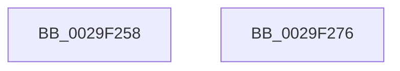

# ExUnlockUserBuffer

- RVA: `0x0029F258`–`0x0029F277` (길이 `31` bytes)
- VA: `0x000000014029F258`
- 실행 섹션: `.text`
- PDB 이름 있음: `예`; PDB Function 태그: `아니요`
- unwind 정보 RVA: `0x0005CF00`
- 디코드: `11`개 명령, `31/31` bytes 표시
- 미해석 바이트: `0` (있으면 어셈블리에 `.byte`로 보존)

> 이 문서는 커널 이미지의 기계어와 PDB 기호를 분석해 생성했습니다. 4번과 5번은 함수 원형과 자료형을 바이너리 사용 방식에서 추정한 C 해석이며 원본 소스 복구 결과는 아닙니다.

## 1. Dependencies

- 직접 호출 지점: **2**; 고유 호출 대상: **2**
- 직접 호출자로 확인된 함수: **19**
- RIP 상대 이미지 참조: **0**

### Outgoing calls
- `0x0029F261` → [MmUnlockPages](MmUnlockPages_function_0029EEE0.md) (function, `0x0029EEE0`)
- `0x0029F26B` → [ExFreePoolWithTag](../../poolcode/B8/ExFreePoolWithTag_function_00B82870.md) (function, `0x00B82870`)

### Direct callers
- [ExpGetLookasideInformation](../4E/ExpGetLookasideInformation_function_004E2468.md) at `0x004E2698`
- [KdSystemDebugControl](../../page/74/KdSystemDebugControl_function_00744700.md) at `0x00744EBC`
- [ExpGetLockInformation](../../page/7C/ExpGetLockInformation_function_007C3AE0.md) at `0x007C3B56`
- [ExpGetObjectInformation](../../page/7C/ExpGetObjectInformation_function_007C3B74.md) at `0x007C3BF3`
- [ExpSetFirmwareEnvironmentVariable](../../page/7C/ExpSetFirmwareEnvironmentVariable_function_007CC9A8.md) at `0x007CCA4E`
- [NtEnumerateDriverEntries](../../page/7C/NtEnumerateDriverEntries_function_007CD5D0.md) at `0x007CD9F4`
- [NtEnumerateSystemEnvironmentValuesEx](../../page/7C/NtEnumerateSystemEnvironmentValuesEx_function_007CDA30.md) at `0x007CDB81`
- [NtQueryDriverEntryOrder](../../page/7C/NtQueryDriverEntryOrder_function_007CDCE0.md) at `0x007CDEC2`
- [MiCopyLargeVad](../../page/81/MiCopyLargeVad_function_008118A4.md) at `0x00811AA5`
- [MiCopyLargeVad](../../page/81/MiCopyLargeVad_function_008118A4.md) at `0x00811AD5`
- [MiCopyLargeVad](../../page/81/MiCopyLargeVad_function_008118A4.md) at `0x00811AE9`
- [NtQuerySystemEnvironmentValueEx](../../page/95/NtQuerySystemEnvironmentValueEx_function_00952180.md) at `0x009523FF`
- [ExpGetFirmwareEnvironmentVariable](../../page/95/ExpGetFirmwareEnvironmentVariable_function_009524DC.md) at `0x00952587`
- [ExLockUserBuffer](../../page/95/ExLockUserBuffer_function_009533B8.md) at `0x009534EC`
- [NtQueryInformationProcess](../../page/9A/NtQueryInformationProcess_function_009AA250.md) at `0x009AC5F4`
- [NtQueryInformationProcess](../../page/9A/NtQueryInformationProcess_function_009AA250.md) at `0x009ADFC8`
- [NtEnumerateBootEntries](../../page/A2/NtEnumerateBootEntries_function_00A25040.md) at `0x00A2567B`
- [ExpGetHandleInformation](../../page/A8/ExpGetHandleInformation_function_00A8FB40.md) at `0x00A8FBC7`
- [NtQueryBootEntryOrder](../../page/A9/NtQueryBootEntryOrder_function_00A91720.md) at `0x00A91914`
- [ExpGetHandleInformationEx](../../page/A9/ExpGetHandleInformationEx_function_00A999B8.md) at `0x00A99A3F`
- [EtwQueryPerformanceTraceInformation](../../page/AF/EtwQueryPerformanceTraceInformation_function_00AF28A4.md) at `0x00AF2D4F`
- [sub_00B3F842](../../page/B3/Unknown_function_00B3F842.md) at `0x00B3FCA6`

### Static image references
- 디코드된 RIP-relative 메모리 참조가 없습니다.

## 2. Other-region calls and transfers

- 다른 실행 섹션으로 향하는 call: **1**
  - `0x0029F26B` → [ExFreePoolWithTag](../../poolcode/B8/ExFreePoolWithTag_function_00B82870.md) (`.text` → `POOLCODE`)
- 별도 외부 분기/꼬리 이동을 확인하지 못했습니다.

## 3. Assembly (complete function range)

```asm
0029F258  40 53                           push rbx
0029F25A  48 83 EC 20                     sub rsp, 0x20
0029F25E  48 8B D9                        mov rbx, rcx
0029F261  E8 7A FC FF FF                  call 0x14029eee0
0029F266  33 D2                           xor edx, edx
0029F268  48 8B CB                        mov rcx, rbx
0029F26B  E8 00 36 8E 00                  call 0x140b82870
0029F270  48 83 C4 20                     add rsp, 0x20
0029F274  5B                              pop rbx
0029F275  C3                              ret
0029F276  CC                              int3
```

## 4. C-style interpretation (structured pseudocode)

```c
__int64 __fastcall ExUnlockUserBuffer(__int64 a1, int a2)
{
    __int64 result;
    __int64 v_rsp;

    v_rsp = (v_rsp) - (32);
    result = MmUnlockPages(a1, a2, a3, a4);
    a2 = 0;
    result = ExFreePoolWithTag(a1, a2, a3, a4);
    v_rsp = (v_rsp) + (32);
    return result;
}
```

## 5. (Beta) C Style

```c
int64_t ExUnlockUserBuffer(int64_t Arg1, int32_t Arg2)
{
    int64_t result;
    int64_t local_rsp;

    local_rsp = (local_rsp) - (32);
    result = MmUnlockPages(Arg1, Arg2, a3, a4);
    Arg2 = 0;
    result = ExFreePoolWithTag(Arg1, Arg2, a3, a4);
    local_rsp = (local_rsp) + (32);
    return result;
}
```

## 6. Execution-region graph

[열기: 2D/3D 그래프와 함수 탐색 컨트롤 패널](../../../control-panel.html?section=text&rva=0x0029F258&view=graph)

- 2D 그래프는 위에서 아래로 흐르고, 3D 그래프는 빈 공간을 드래그해 회전합니다. Shift+드래그는 이동, 휠은 확대·축소, 함수 노드 선택은 대상 보고서 이동입니다.

### Static fallback


