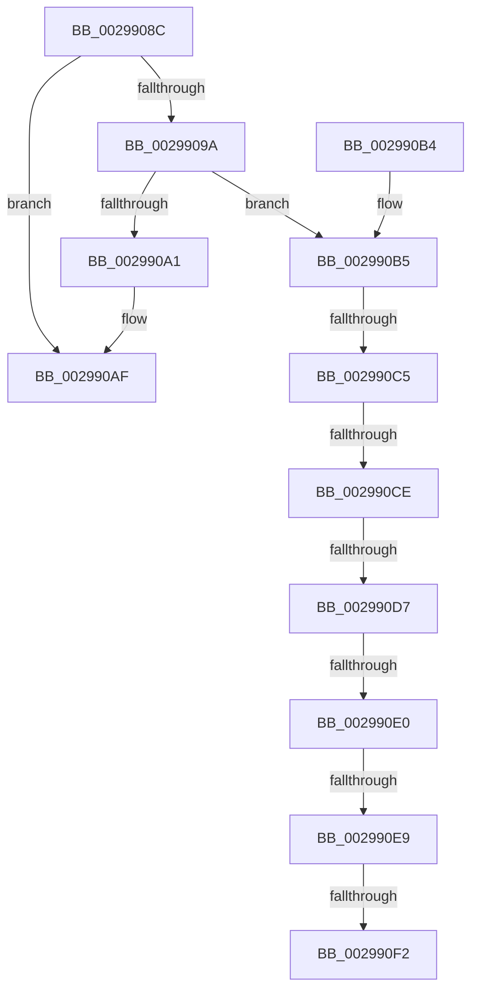

# FsFilterCtrlFree

- RVA: `0x0029908C`–`0x002990F7` (길이 `107` bytes)
- VA: `0x000000014029908C`
- 실행 섹션: `.text`
- PDB 이름 있음: `예`; PDB Function 태그: `예`
- unwind 정보 RVA: `0x00067BB4`
- 디코드: `28`개 명령, `107/107` bytes 표시
- 미해석 바이트: `0` (있으면 어셈블리에 `.byte`로 보존)

> 이 문서는 커널 이미지의 기계어와 PDB 기호를 분석해 생성했습니다. 4번과 5번은 함수 원형과 자료형을 바이너리 사용 방식에서 추정한 C 해석이며 원본 소스 복구 결과는 아닙니다.

## 1. Dependencies

- 직접 호출 지점: **1**; 고유 호출 대상: **1**
- 직접 호출자로 확인된 함수: **7**
- RIP 상대 이미지 참조: **0**

### Outgoing calls
- `0x002990AA` → [ExFreePoolWithTag](../../poolcode/B8/ExFreePoolWithTag_function_00B82870.md) (function, `0x00B82870`)

### Direct callers
- [FsRtlReleaseFileForModWrite](FsRtlReleaseFileForModWrite_function_00299100.md) at `0x00299309`
- [FsRtlAcquireFileForModWriteEx](FsRtlAcquireFileForModWriteEx_function_00299E5C.md) at `0x0029A09C`
- [FsRtlReleaseFile](../../page/98/FsRtlReleaseFile_function_00985B70.md) at `0x00985CDF`
- [FsRtlAcquireFileForCcFlushEx](../../page/9D/FsRtlAcquireFileForCcFlushEx_function_009D72F0.md) at `0x009D74A6`
- [FsRtlReleaseFileForCcFlush](../../page/9D/FsRtlReleaseFileForCcFlush_function_009D75A0.md) at `0x009D773B`
- [FsRtlQueryOpen](../../page/9D/FsRtlQueryOpen_function_009D85A4.md) at `0x009D8683`
- [FsRtlAcquireFileExclusiveCommon](../../page/9D/FsRtlAcquireFileExclusiveCommon_function_009D8E50.md) at `0x009D8FC4`

### Static image references
- 디코드된 RIP-relative 메모리 참조가 없습니다.

## 2. Other-region calls and transfers

- 다른 실행 섹션으로 향하는 call: **1**
  - `0x002990AA` → [ExFreePoolWithTag](../../poolcode/B8/ExFreePoolWithTag_function_00B82870.md) (`.text` → `POOLCODE`)
- call이 아닌 외부 분기/꼬리 이동: **7**
  - `0x002990BF` → [sub_006DA746 + 0x9](../6D/Unknown_function_006DA746.md) (`tail-transfer`)
  - `0x002990C8` → [sub_006DA746](../6D/Unknown_function_006DA746.md) (`tail-transfer`)
  - `0x002990D1` → [sub_006DA746 + 0x9](../6D/Unknown_function_006DA746.md) (`tail-transfer`)
  - `0x002990DA` → [sub_006DA746](../6D/Unknown_function_006DA746.md) (`tail-transfer`)
  - `0x002990E3` → [sub_006DA746 + 0x9](../6D/Unknown_function_006DA746.md) (`tail-transfer`)
  - `0x002990EC` → [sub_006DA746](../6D/Unknown_function_006DA746.md) (`tail-transfer`)
  - `0x002990F2` → [sub_006DA746 + 0x10](../6D/Unknown_function_006DA746.md) (`tail-transfer`)

## 3. Assembly (complete function range)

```asm
0029908C  48 83 EC 28                     sub rsp, 0x28
00299090  8B 41 40                        mov eax, dword ptr [rcx + 0x40]
00299093  4C 8B C1                        mov r8, rcx
00299096  A8 01                           test al, 1
00299098  74 15                           je 0x1402990af
0029909A  45 33 C9                        xor r9d, r9d
0029909D  A8 02                           test al, 2
0029909F  75 14                           jne 0x1402990b5
002990A1  48 8B 49 50                     mov rcx, qword ptr [rcx + 0x50]
002990A5  BA 46 53 6D 67                  mov edx, 0x676d5346
002990AA  E8 C1 97 8E 00                  call 0x140b82870
002990AF  48 83 C4 28                     add rsp, 0x28
002990B3  C3                              ret
002990B4  CC                              int3
002990B5  0F B6 49 04                     movzx ecx, byte ptr [rcx + 4]
002990B9  81 E9 FA 00 00 00               sub ecx, 0xfa
002990BF  0F 84 8A 16 44 00               je 0x1406da74f
002990C5  83 E9 01                        sub ecx, 1
002990C8  0F 84 78 16 44 00               je 0x1406da746
002990CE  83 E9 01                        sub ecx, 1
002990D1  0F 84 78 16 44 00               je 0x1406da74f
002990D7  83 E9 01                        sub ecx, 1
002990DA  0F 84 66 16 44 00               je 0x1406da746
002990E0  83 E9 01                        sub ecx, 1
002990E3  0F 84 66 16 44 00               je 0x1406da74f
002990E9  83 F9 01                        cmp ecx, 1
002990EC  0F 84 54 16 44 00               je 0x1406da746
002990F2  E9 5F 16 44 00                  jmp 0x1406da756
```

## 4. C-style interpretation (structured pseudocode)

```c
__int64 __fastcall FsFilterCtrlFree(__int64 a1, __int64 a2, __int64 a3, int a4)
{
    __int64 result;
    __int64 v_rsp;

    v_rsp = (v_rsp) - (40);
    if ((((unsigned __int8)((unsigned int)(*(unsigned int *)(a1 + 64)))) & (1)) == 0) goto loc_002990AF;
    a4 = 0;
    if ((((unsigned __int8)((unsigned int)(*(unsigned int *)(a1 + 64)))) & (2)) != 0) goto loc_002990B5;
    result = ExFreePoolWithTag(*(unsigned __int64 *)(a1 + 80), (unsigned int)(0x676D5346ULL), a1, a4);
loc_002990AF:
    v_rsp = (v_rsp) + (40);
    return result;
loc_002990B5:
    a1 = (unsigned int)((*(unsigned __int8 *)(*(unsigned __int64 *)(a1 + 80) + 4)) - (250));
    a1 = (unsigned int)((a1) - (1));
    a1 = (unsigned int)((a1) - (1));
    a1 = (unsigned int)((a1) - (1));
    a1 = (unsigned int)((a1) - (1));
}
```

## 5. (Beta) C Style

```c
int64_t FsFilterCtrlFree(void *Arg1, int64_t Arg2, int64_t Arg3, int32_t Arg4)
{
    uint8_t *arg1 = (uint8_t *)Arg1;

    int64_t result;
    int64_t local_rsp;

    local_rsp = (local_rsp) - (40);
    if ((((uint8_t)((uint32_t)(*(uint32_t *)(arg1 + 0x40)))) & (1)) == 0) goto loc_002990AF;
    Arg4 = 0;
    if ((((uint8_t)((uint32_t)(*(uint32_t *)(arg1 + 0x40)))) & (2)) != 0) goto loc_002990B5;
    result = ExFreePoolWithTag(*(uint64_t *)(arg1 + 0x50), (uint32_t)(0x676D5346ULL), Arg1, Arg4);
loc_002990AF:
    local_rsp = (local_rsp) + (40);
    return result;
loc_002990B5:
    Arg1 = (uint32_t)((*(uint8_t *)(*(uint64_t *)(arg1 + 0x50) + 0x4)) - (250));
    Arg1 = (uint32_t)((Arg1) - (1));
    Arg1 = (uint32_t)((Arg1) - (1));
    Arg1 = (uint32_t)((Arg1) - (1));
    Arg1 = (uint32_t)((Arg1) - (1));
}
```

### 관측된 메모리 오프셋

구조체 형식이 확인되지 않은 접근은 인자 기준의 오프셋으로만 기록했습니다.

| 기준 인자 | 오프셋 표현 | 폭 (bit) | 접근 |
|---|---:|---:|---|
| `Arg1` | `+ 0x4` | `8` | `R` |
| `Arg1` | `+ 0x40` | `32` | `R` |
| `Arg1` | `+ 0x50` | `64` | `R` |

## 6. Execution-region graph

[열기: 2D/3D 그래프와 함수 탐색 컨트롤 패널](../../../control-panel.html?section=text&rva=0x0029908C&view=graph)

- 2D 그래프는 위에서 아래로 흐르고, 3D 그래프는 빈 공간을 드래그해 회전합니다. Shift+드래그는 이동, 휠은 확대·축소, 함수 노드 선택은 대상 보고서 이동입니다.

### Static fallback


