# FsRtlReleaseFileForModWrite

- RVA: `0x00299100`–`0x00299417` (길이 `791` bytes)
- VA: `0x0000000140299100`
- 실행 섹션: `.text`
- PDB 이름 있음: `예`; PDB Function 태그: `예`
- unwind 정보 RVA: `0x00067BD0`
- 디코드: `207`개 명령, `791/791` bytes 표시
- 미해석 바이트: `0` (있으면 어셈블리에 `.byte`로 보존)

> 이 문서는 커널 이미지의 기계어와 PDB 기호를 분석해 생성했습니다. 4번과 5번은 함수 원형과 자료형을 바이너리 사용 방식에서 추정한 C 해석이며 원본 소스 복구 결과는 아닙니다.

## 1. Dependencies

- 직접 호출 지점: **13**; 고유 호출 대상: **12**
- 직접 호출자로 확인된 함수: **2**
- RIP 상대 이미지 참조: **1**

### Outgoing calls
- `0x00299145` → [memset](../6C/memset_function_006C6C40.md) (function, `0x006C6C40`)
- `0x00299162` → [IoGetRelatedDeviceObject](IoGetRelatedDeviceObject_function_0029B120.md) (function, `0x0029B120`)
- `0x0029916D` → [IoGetBaseFileSystemDeviceObject](IoGetBaseFileSystemDeviceObject_function_0029A2A0.md) (function, `0x0029A2A0`)
- `0x00299212` → [memset](../6C/memset_function_006C6C40.md) (function, `0x006C6C40`)
- `0x00299234` → [FsFilterPerformCallbacks](FsFilterPerformCallbacks_function_00299590.md) (function, `0x00299590`)
- `0x00299264` → [IoGetDeviceAttachmentBaseRefWithTag](../27/IoGetDeviceAttachmentBaseRefWithTag_function_00272788.md) (function, `0x00272788`)
- `0x002992CD` → [guard_dispatch_icall](../6B/guard_dispatch_icall_function_006BAAD0.md) (function, `0x006BAAD0`)
- `0x002992FF` → [FsFilterPerformCompletionCallbacks](FsFilterPerformCompletionCallbacks_function_00299000.md) (function, `0x00299000`)
- `0x00299309` → [FsFilterCtrlFree](FsFilterCtrlFree_function_0029908C.md) (function, `0x0029908C`)
- `0x00299318` → [_security_check_cookie](../6A/_security_check_cookie_function_006AC640.md) (function, `0x006AC640`)
- `0x00299343` → [ExReleaseResourceLite](../25/ExReleaseResourceLite_function_0025FA10.md) (function, `0x0025FA10`)
- `0x00299364` → [ExAllocatePool2](../../poolcode/B8/ExAllocatePool2_function_00B820F0.md) (function, `0x00B820F0`)
- `0x0029940C` → [ObfDereferenceObjectWithTag](../2F/ObfDereferenceObjectWithTag_function_002F78E0.md) (function, `0x002F78E0`)

### Direct callers
- [MiGatherMappedPages](../40/MiGatherMappedPages_function_00404E80.md) at `0x00405105`
- [sub_006EC582](../6E/Unknown_function_006EC582.md) at `0x006EC59F`

### Static image references
- `0x0029911F` → RVA `0x00E0A740` (`.data`; read)

## 2. Other-region calls and transfers

- 다른 실행 섹션으로 향하는 call: **1**
  - `0x00299364` → [ExAllocatePool2](../../poolcode/B8/ExAllocatePool2_function_00B820F0.md) (`.text` → `POOLCODE`)
- call이 아닌 외부 분기/꼬리 이동: **9**
  - `0x002993BD` → [sub_006DA772 + 0x10](../6D/Unknown_function_006DA772.md) (`tail-transfer`)
  - `0x002993C6` → [sub_006DA772](../6D/Unknown_function_006DA772.md) (`tail-transfer`)
  - `0x002993CF` → [sub_006DA772 + 0x10](../6D/Unknown_function_006DA772.md) (`tail-transfer`)
  - `0x002993D8` → [sub_006DA772](../6D/Unknown_function_006DA772.md) (`tail-transfer`)
  - `0x002993E1` → [sub_006DA772 + 0x10](../6D/Unknown_function_006DA772.md) (`tail-transfer`)
  - `0x002993EA` → [sub_006DA772](../6D/Unknown_function_006DA772.md) (`tail-transfer`)
  - `0x002993F0` → [sub_006DA772 + 0x1E](../6D/Unknown_function_006DA772.md) (`tail-transfer`)
  - `0x002993FF` → [sub_006DA772 + 0x5C](../6D/Unknown_function_006DA772.md) (`tail-transfer`)
  - `0x00299412` → [sub_006DA772 + 0x5C](../6D/Unknown_function_006DA772.md) (`tail-transfer`)

## 3. Assembly (complete function range)

```asm
00299100  48 89 5C 24 18                  mov qword ptr [rsp + 0x18], rbx
00299105  55                              push rbp
00299106  56                              push rsi
00299107  57                              push rdi
00299108  41 54                           push r12
0029910A  41 55                           push r13
0029910C  41 56                           push r14
0029910E  41 57                           push r15
00299110  48 8D AC 24 60 FE FF FF         lea rbp, [rsp - 0x1a0]
00299118  48 81 EC A0 02 00 00            sub rsp, 0x2a0
0029911F  48 8B 05 1A 16 B7 00            mov rax, qword ptr [rip + 0xb7161a]
00299126  48 33 C4                        xor rax, rsp
00299129  48 89 85 90 01 00 00            mov qword ptr [rbp + 0x190], rax
00299130  48 89 54 24 38                  mov qword ptr [rsp + 0x38], rdx
00299135  4C 8B F1                        mov r14, rcx
00299138  33 D2                           xor edx, edx
0029913A  48 8D 4C 24 50                  lea rcx, [rsp + 0x50]
0029913F  41 B8 38 02 00 00               mov r8d, 0x238
00299145  E8 F6 DA 42 00                  call 0x1406c6c40
0029914A  33 D2                           xor edx, edx
0029914C  48 8D 44 24 50                  lea rax, [rsp + 0x50]
00299151  49 8B CE                        mov rcx, r14
00299154  48 89 44 24 40                  mov qword ptr [rsp + 0x40], rax
00299159  8B DA                           mov ebx, edx
0029915B  89 54 24 34                     mov dword ptr [rsp + 0x34], edx
0029915F  44 8A E2                        mov r12b, dl
00299162  E8 B9 1F 00 00                  call 0x14029b120
00299167  49 8B CE                        mov rcx, r14
0029916A  48 8B F0                        mov rsi, rax
0029916D  E8 2E 11 00 00                  call 0x14029a2a0
00299172  4C 8B E8                        mov r13, rax
00299175  33 C9                           xor ecx, ecx
00299177  48 8B 40 08                     mov rax, qword ptr [rax + 8]
0029917B  4C 8B 78 50                     mov r15, qword ptr [rax + 0x50]
0029917F  48 8B 40 30                     mov rax, qword ptr [rax + 0x30]
00299183  48 8B 78 30                     mov rdi, qword ptr [rax + 0x30]
00299187  48 85 FF                        test rdi, rdi
0029918A  74 20                           je 0x1402991ac
0029918C  8B 07                           mov eax, dword ptr [rdi]
0029918E  83 F8 60                        cmp eax, 0x60
00299191  72 0A                           jb 0x14029919d
00299193  48 39 4F 58                     cmp qword ptr [rdi + 0x58], rcx
00299197  0F 85 F2 01 00 00               jne 0x14029938f
0029919D  83 F8 68                        cmp eax, 0x68
002991A0  72 0A                           jb 0x1402991ac
002991A2  48 39 4F 60                     cmp qword ptr [rdi + 0x60], rcx
002991A6  0F 85 E3 01 00 00               jne 0x14029938f
002991AC  49 3B F5                        cmp rsi, r13
002991AF  0F 84 E2 01 00 00               je 0x140299397
002991B5  33 C0                           xor eax, eax
002991B7  89 4D 90                        mov dword ptr [rbp - 0x70], ecx
002991BA  41 B9 40 00 00 00               mov r9d, 0x40
002991C0  C6 44 24 54 FC                  mov byte ptr [rsp + 0x54], 0xfc
002991C5  0F 57 C0                        xorps xmm0, xmm0
002991C8  44 89 4C 24 50                  mov dword ptr [rsp + 0x50], r9d
002991CD  48 89 74 24 58                  mov qword ptr [rsp + 0x58], rsi
002991D2  4C 89 74 24 60                  mov qword ptr [rsp + 0x60], r14
002991D7  0F 11 44 24 68                  movups xmmword ptr [rsp + 0x68], xmm0
002991DC  48 89 45 88                     mov qword ptr [rbp - 0x78], rax
002991E0  41 8D 59 CF                     lea ebx, [r9 - 0x31]
002991E4  0F 11 44 24 78                  movups xmmword ptr [rsp + 0x78], xmm0
002991E9  0F BE 46 4C                     movsx eax, byte ptr [rsi + 0x4c]
002991ED  66 89 45 98                     mov word ptr [rbp - 0x68], ax
002991F1  66 89 4D 9A                     mov word ptr [rbp - 0x66], cx
002991F5  66 3B C3                        cmp ax, bx
002991F8  0F 87 50 01 00 00               ja 0x14029934e
002991FE  48 8D 45 A8                     lea rax, [rbp - 0x58]
00299202  33 D2                           xor edx, edx
00299204  41 B8 E0 01 00 00               mov r8d, 0x1e0
0029920A  48 89 45 A0                     mov qword ptr [rbp - 0x60], rax
0029920E  48 8D 4D A8                     lea rcx, [rbp - 0x58]
00299212  E8 29 DA 42 00                  call 0x1406c6c40
00299217  66 89 5D 98                     mov word ptr [rbp - 0x68], bx
0029921B  48 8B 74 24 38                  mov rsi, qword ptr [rsp + 0x38]
00299220  4C 8D 4C 24 34                  lea r9, [rsp + 0x34]
00299225  41 B0 01                        mov r8b, 1
00299228  48 89 74 24 68                  mov qword ptr [rsp + 0x68], rsi
0029922D  33 D2                           xor edx, edx
0029922F  48 8D 4C 24 50                  lea rcx, [rsp + 0x50]
00299234  E8 57 03 00 00                  call 0x140299590
00299239  33 C9                           xor ecx, ecx
0029923B  8B D8                           mov ebx, eax
0029923D  85 C0                           test eax, eax
0029923F  0F 88 F4 00 00 00               js 0x140299339
00299245  0F 85 AA 01 00 00               jne 0x1402993f5
0029924B  F6 45 90 04                     test byte ptr [rbp - 0x70], 4
0029924F  4C 8B 74 24 60                  mov r14, qword ptr [rsp + 0x60]
00299254  0F 84 50 01 00 00               je 0x1402993aa
0029925A  48 8B 4C 24 58                  mov rcx, qword ptr [rsp + 0x58]
0029925F  BA 44 66 6C 74                  mov edx, 0x746c6644
00299264  E8 1F 95 FD FF                  call 0x140272788
00299269  4C 8B E8                        mov r13, rax
0029926C  41 B4 01                        mov r12b, 1
0029926F  33 C9                           xor ecx, ecx
00299271  48 8B 40 08                     mov rax, qword ptr [rax + 8]
00299275  4C 8B 78 50                     mov r15, qword ptr [rax + 0x50]
00299279  48 8B 40 30                     mov rax, qword ptr [rax + 0x30]
0029927D  48 8B 78 30                     mov rdi, qword ptr [rax + 0x30]
00299281  48 85 FF                        test rdi, rdi
00299284  74 18                           je 0x14029929e
00299286  8B 07                           mov eax, dword ptr [rdi]
00299288  83 F8 60                        cmp eax, 0x60
0029928B  72 06                           jb 0x140299293
0029928D  48 39 4F 58                     cmp qword ptr [rdi + 0x58], rcx
00299291  75 48                           jne 0x1402992db
00299293  83 F8 68                        cmp eax, 0x68
00299296  72 06                           jb 0x14029929e
00299298  48 39 4F 60                     cmp qword ptr [rdi + 0x60], rcx
0029929C  75 3D                           jne 0x1402992db
0029929E  4D 85 FF                        test r15, r15
002992A1  0F 84 DE 00 00 00               je 0x140299385
002992A7  41 81 3F D0 00 00 00            cmp dword ptr [r15], 0xd0
002992AE  0F 82 D1 00 00 00               jb 0x140299385
002992B4  49 8B 87 C8 00 00 00            mov rax, qword ptr [r15 + 0xc8]
002992BB  48 85 C0                        test rax, rax
002992BE  0F 84 C1 00 00 00               je 0x140299385
002992C4  4D 8B C5                        mov r8, r13
002992C7  48 8B D6                        mov rdx, rsi
002992CA  49 8B CE                        mov rcx, r14
002992CD  E8 FE 17 42 00                  call 0x1406baad0
002992D2  8B D8                           mov ebx, eax
002992D4  33 C9                           xor ecx, ecx
002992D6  83 4C 24 34 01                  or dword ptr [rsp + 0x34], 1
002992DB  45 84 E4                        test r12b, r12b
002992DE  0F 85 20 01 00 00               jne 0x140299404
002992E4  85 DB                           test ebx, ebx
002992E6  78 51                           js 0x140299339
002992E8  48 8B 44 24 40                  mov rax, qword ptr [rsp + 0x40]
002992ED  48 85 C0                        test rax, rax
002992F0  74 1C                           je 0x14029930e
002992F2  66 39 48 4A                     cmp word ptr [rax + 0x4a], cx
002992F6  76 0C                           jbe 0x140299304
002992F8  8B D3                           mov edx, ebx
002992FA  48 8D 4C 24 50                  lea rcx, [rsp + 0x50]
002992FF  E8 FC FC FF FF                  call 0x140299000
00299304  48 8D 4C 24 50                  lea rcx, [rsp + 0x50]
00299309  E8 7E FD FF FF                  call 0x14029908c
0029930E  48 8B 8D 90 01 00 00            mov rcx, qword ptr [rbp + 0x190]
00299315  48 33 CC                        xor rcx, rsp
00299318  E8 23 33 41 00                  call 0x1406ac640
0029931D  48 8B 9C 24 F0 02 00 00         mov rbx, qword ptr [rsp + 0x2f0]
00299325  48 81 C4 A0 02 00 00            add rsp, 0x2a0
0029932C  41 5F                           pop r15
0029932E  41 5E                           pop r14
00299330  41 5D                           pop r13
00299332  41 5C                           pop r12
00299334  5F                              pop rdi
00299335  5E                              pop rsi
00299336  5D                              pop rbp
00299337  C3                              ret
00299338  CC                              int3
00299339  F6 44 24 34 01                  test byte ptr [rsp + 0x34], 1
0029933E  74 A8                           je 0x1402992e8
00299340  48 8B CE                        mov rcx, rsi
00299343  E8 C8 66 FC FF                  call 0x14025fa10
00299348  33 C9                           xor ecx, ecx
0029934A  8B D9                           mov ebx, ecx
0029934C  EB 9A                           jmp 0x1402992e8
0029934E  0F B7 D0                        movzx edx, ax
00299351  48 8B F1                        mov rsi, rcx
00299354  4C 8B F1                        mov r14, rcx
00299357  48 C1 E2 05                     shl rdx, 5
0029935B  41 B8 46 53 6D 67               mov r8d, 0x676d5346
00299361  49 8B C9                        mov rcx, r9
00299364  E8 87 8D 8E 00                  call 0x140b820f0
00299369  33 D2                           xor edx, edx
0029936B  48 8B D8                        mov rbx, rax
0029936E  48 85 C0                        test rax, rax
00299371  74 3F                           je 0x1402993b2
00299373  8B 45 90                        mov eax, dword ptr [rbp - 0x70]
00299376  83 C8 01                        or eax, 1
00299379  48 89 5D A0                     mov qword ptr [rbp - 0x60], rbx
0029937D  89 45 90                        mov dword ptr [rbp - 0x70], eax
00299380  E9 96 FE FF FF                  jmp 0x14029921b
00299385  BB 10 00 00 C0                  mov ebx, 0xc0000010
0029938A  E9 47 FF FF FF                  jmp 0x1402992d6
0029938F  41 B4 01                        mov r12b, 1
00299392  E9 15 FE FF FF                  jmp 0x1402991ac
00299397  45 84 E4                        test r12b, r12b
0029939A  0F 85 15 FE FF FF               jne 0x1402991b5
002993A0  48 8B 74 24 38                  mov rsi, qword ptr [rsp + 0x38]
002993A5  48 89 4C 24 40                  mov qword ptr [rsp + 0x40], rcx
002993AA  44 8A E1                        mov r12b, cl
002993AD  E9 CF FE FF FF                  jmp 0x140299281
002993B2  0F B6 4C 24 54                  movzx ecx, byte ptr [rsp + 0x54]
002993B7  81 E9 FA 00 00 00               sub ecx, 0xfa
002993BD  0F 84 BF 13 44 00               je 0x1406da782
002993C3  83 E9 01                        sub ecx, 1
002993C6  0F 84 A6 13 44 00               je 0x1406da772
002993CC  83 E9 01                        sub ecx, 1
002993CF  0F 84 AD 13 44 00               je 0x1406da782
002993D5  83 E9 01                        sub ecx, 1
002993D8  0F 84 94 13 44 00               je 0x1406da772
002993DE  83 E9 01                        sub ecx, 1
002993E1  0F 84 9B 13 44 00               je 0x1406da782
002993E7  83 F9 01                        cmp ecx, 1
002993EA  0F 84 82 13 44 00               je 0x1406da772
002993F0  E9 9B 13 44 00                  jmp 0x1406da790
002993F5  3D 26 01 00 00                  cmp eax, 0x126
002993FA  0F 45 C8                        cmovne ecx, eax
002993FD  8B D9                           mov ebx, ecx
002993FF  E9 CA 13 44 00                  jmp 0x1406da7ce
00299404  BA 44 66 6C 74                  mov edx, 0x746c6644
00299409  49 8B CD                        mov rcx, r13
0029940C  E8 CF E4 05 00                  call 0x1402f78e0
00299411  90                              nop
00299412  E9 B7 13 44 00                  jmp 0x1406da7ce
```

## 4. C-style interpretation (structured pseudocode)

```c
__int64 __fastcall FsRtlReleaseFileForModWrite(__int64 a1, __int64 a2)
{
    __int64 result;
    __int64 v_rsp;
    unsigned __int64 v_stack_m1D8;
    unsigned __int64 v_stack_m230;
    unsigned __int64 v_stack_m238;
    unsigned __int16 v_stack_m23E;
    unsigned __int16 v_stack_m240;
    unsigned int v_stack_m248;
    unsigned __int64 v_stack_m250;
    unsigned __int64 v_stack_m260;
    unsigned __int64 v_stack_m270;
    unsigned __int64 v_stack_m278;
    unsigned __int64 v_stack_m280;
    unsigned __int8 v_stack_m284;
    unsigned __int64 v_stack_m288;
    unsigned __int64 v_stack_m298;
    unsigned __int64 v_stack_m2A0;
    unsigned int v_stack_m2A4;
    unsigned __int64 v_stack_m48;
    unsigned __int64 v_stack_p18;
    unsigned __int8 v_stack_p34;
    unsigned __int64 v_stack_p38;
    unsigned __int64 v_stack_p40;
    unsigned __int8 v_stack_p54;

    v_stack_p18 = v_rbx;
    v_rsp = (v_rsp) - (672);
    result = (*(unsigned __int64 *)(v_rip + 11998746)) ^ (v_rsp);
    v_stack_m48 = result;
    v_stack_m2A0 = a2;
    a2 = 0;
    result = memset(v_stack_m288, a2, 568, a4);
    a2 = 0;
    v_stack_m298 = v_stack_m288;
    v_stack_m2A4 = 0;
    result = IoGetRelatedDeviceObject(a1, a2, 568, a4);
    result = IoGetBaseFileSystemDeviceObject(a1, a2, 568, a4);
    a1 = 0;
    if (*(unsigned __int64 *)(*(unsigned __int64 *)(*(unsigned __int64 *)(result + 8) + 48) + 48) == 0) goto loc_002991AC;
    if (((unsigned int)((unsigned int)(*(unsigned int *)(*(unsigned __int64 *)(*(unsigned __int64 *)(*(unsigned __int64 *)(result + 8) + 48) + 48))))) < 96) goto loc_0029919D;
    if ((*(unsigned __int64 *)(*(unsigned __int64 *)(*(unsigned __int64 *)(*(unsigned __int64 *)(result + 8) + 48) + 48) + 88)) != 0) goto loc_0029938F;
loc_0029919D:
    if (((unsigned int)((unsigned int)(*(unsigned int *)(*(unsigned __int64 *)(*(unsigned __int64 *)(*(unsigned __int64 *)(result + 8) + 48) + 48))))) < 104) goto loc_002991AC;
    if ((*(unsigned __int64 *)(*(unsigned __int64 *)(*(unsigned __int64 *)(*(unsigned __int64 *)(result + 8) + 48) + 48) + 96)) != 0) goto loc_0029938F;
loc_002991AC:
    if (result == result) goto loc_00299397;
loc_002991B5:
    result = 0;
    v_stack_m248 = 0;
    v_stack_m284 = 252;
    v_stack_m288 = 64;
    v_stack_m280 = 0;
    v_stack_m278 = 0;
    v_stack_m270 = v_xmm0;
    v_stack_m250 = 0;
    v_stack_m260 = v_xmm0;
    v_stack_m240 = (unsigned __int16)((__int8)(*(unsigned __int8 *)(result + 76)));
    v_stack_m23E = 0;
    if (((unsigned __int16)((__int8)(*(unsigned __int8 *)(result + 76)))) > ((unsigned __int16)(64 - 49))) goto loc_0029934E;
    a2 = 0;
    v_stack_m238 = v_stack_m230;
    result = memset(v_stack_m230, a2, 480, 64);
    v_stack_m240 = (unsigned __int16)(64 - 49);
loc_0029921B:
    v_stack_m270 = v_stack_m2A0;
    a2 = 0;
    result = FsFilterPerformCallbacks(v_stack_m288, a2, 1, v_stack_m2A4);
    a1 = 0;
    if (sign_flag) goto loc_00299339;
    if ((unsigned int)(result) != 0) goto loc_002993F5;
    if (((v_stack_m248) & (4)) == 0) goto loc_002993AA;
    result = IoGetDeviceAttachmentBaseRefWithTag(v_stack_m280, (unsigned int)(0x746C6644ULL), 1, v_stack_m2A4);
    a1 = 0;
loc_00299281:
    if (*(unsigned __int64 *)(*(unsigned __int64 *)(*(unsigned __int64 *)(result + 8) + 48) + 48) == 0) goto loc_0029929E;
    if (((unsigned int)((unsigned int)(*(unsigned int *)(*(unsigned __int64 *)(*(unsigned __int64 *)(*(unsigned __int64 *)(result + 8) + 48) + 48))))) < 96) goto loc_00299293;
    if ((*(unsigned __int64 *)(*(unsigned __int64 *)(*(unsigned __int64 *)(*(unsigned __int64 *)(result + 8) + 48) + 48) + 88)) != 0) goto loc_002992DB;
loc_00299293:
    if (((unsigned int)((unsigned int)(*(unsigned int *)(*(unsigned __int64 *)(*(unsigned __int64 *)(*(unsigned __int64 *)(result + 8) + 48) + 48))))) < 104) goto loc_0029929E;
    if ((*(unsigned __int64 *)(*(unsigned __int64 *)(*(unsigned __int64 *)(*(unsigned __int64 *)(result + 8) + 48) + 48) + 96)) != 0) goto loc_002992DB;
loc_0029929E:
    if (*(unsigned __int64 *)(*(unsigned __int64 *)(result + 8) + 80) == 0) goto loc_00299385;
    if ((*(unsigned int *)(*(unsigned __int64 *)(*(unsigned __int64 *)(result + 8) + 80))) < 208) goto loc_00299385;
    if (*(unsigned __int64 *)(*(unsigned __int64 *)(*(unsigned __int64 *)(result + 8) + 80) + 200) == 0) goto loc_00299385;
    result = guard_dispatch_icall(v_stack_m278, v_stack_m2A0, result, v_stack_m2A4);
    a1 = 0;
loc_002992D6:
loc_002992DB:
    if (1 != 0) goto loc_00299404;
    if (sign_flag) goto loc_00299339;
loc_002992E8:
    if (v_stack_m298 == 0) goto loc_0029930E;
    result = v_stack_m298;
    if ((*(unsigned __int16 *)(v_stack_m298 + 74)) >= = 0) {
        a2 = (unsigned int)((unsigned int)((unsigned int)(result)));
        a1 = v_stack_m288;
        result = FsFilterPerformCompletionCallbacks(a1, a2, result, v_stack_m2A4);
    }
    result = FsFilterCtrlFree(v_stack_m288, a2, result, v_stack_m2A4);
loc_0029930E:
    a1 = (v_stack_m48) ^ (v_rsp);
    result = _security_check_cookie(a1, a2, result, v_stack_m2A4);
    v_rsp = (v_rsp) + (672);
    return result;
loc_00299339:
    if (((v_stack_p34) & (1)) == 0) goto loc_002992E8;
    result = ExReleaseResourceLite(v_stack_m2A0, a2, result, v_stack_m2A4);
    a1 = 0;
    goto loc_002992E8;
loc_0029934E:
    a2 = ((unsigned __int16)(result)) << (5);
    result = ExAllocatePool2(v_stack_m2A4, a2, (unsigned int)(0x676D5346ULL), v_stack_m2A4);
    a2 = 0;
    if (result == 0) goto loc_002993B2;
    result = (unsigned int)(((unsigned int)(v_stack_m248)) | (1));
    v_stack_m238 = result;
    v_stack_m248 = (unsigned int)(result);
    goto loc_0029921B;
loc_00299385:
    goto loc_002992D6;
loc_0029938F:
    goto loc_002991AC;
loc_00299397:
    if (1 != 0) goto loc_002991B5;
    v_stack_p40 = v_stack_m2A4;
loc_002993AA:
    goto loc_00299281;
loc_002993B2:
    a1 = (unsigned int)((v_stack_p54) - (250));
    a1 = (unsigned int)((a1) - (1));
    a1 = (unsigned int)((a1) - (1));
    a1 = (unsigned int)((a1) - (1));
    a1 = (unsigned int)((a1) - (1));
loc_002993F5:
    if (((unsigned int)(result)) != 294) { a1 = (unsigned int)(result); }
loc_00299404:
    result = ObfDereferenceObjectWithTag(result, (unsigned int)(0x746C6644ULL), (unsigned int)(0x676D5346ULL), v_stack_m2A4);
}
```

## 5. (Beta) C Style

```c
int64_t FsRtlReleaseFileForModWrite(int64_t Arg1, int64_t Arg2)
{
    int64_t result;
    int64_t local_rsp;
    uint64_t v_stack_m1D8;
    uint64_t v_stack_m230;
    uint64_t v_stack_m238;
    uint16_t v_stack_m23E;
    uint16_t v_stack_m240;
    uint32_t v_stack_m248;
    uint64_t v_stack_m250;
    uint64_t v_stack_m260;
    uint64_t v_stack_m270;
    uint64_t v_stack_m278;
    uint64_t v_stack_m280;
    uint8_t v_stack_m284;
    uint64_t v_stack_m288;
    uint64_t v_stack_m298;
    uint64_t v_stack_m2A0;
    uint32_t v_stack_m2A4;
    uint64_t v_stack_m48;
    uint64_t v_stack_p18;
    uint8_t v_stack_p34;
    uint64_t v_stack_p38;
    uint64_t v_stack_p40;
    uint8_t v_stack_p54;

    v_stack_p18 = local_rbx;
    local_rsp = (local_rsp) - (672);
    result = (*(uint64_t *)(v_rip + 0xB7161A)) ^ (local_rsp);
    v_stack_m48 = result;
    v_stack_m2A0 = Arg2;
    Arg2 = 0;
    result = memset(v_stack_m288, Arg2, 568, a4);
    Arg2 = 0;
    v_stack_m298 = v_stack_m288;
    v_stack_m2A4 = 0;
    result = IoGetRelatedDeviceObject(Arg1, Arg2, 568, a4);
    result = IoGetBaseFileSystemDeviceObject(Arg1, Arg2, 568, a4);
    Arg1 = 0;
    if (*(uint64_t *)(*(uint64_t *)(*(uint64_t *)(result + 0x8) + 0x30) + 0x30) == 0) goto loc_002991AC;
    if (((uint32_t)((uint32_t)(*(uint32_t *)(*(uint64_t *)(*(uint64_t *)(*(uint64_t *)(result + 0x8) + 0x30) + 0x30))))) < 96) goto loc_0029919D;
    if ((*(uint64_t *)(*(uint64_t *)(*(uint64_t *)(*(uint64_t *)(result + 0x8) + 0x30) + 0x30) + 0x58)) != 0) goto loc_0029938F;
loc_0029919D:
    if (((uint32_t)((uint32_t)(*(uint32_t *)(*(uint64_t *)(*(uint64_t *)(*(uint64_t *)(result + 0x8) + 0x30) + 0x30))))) < 104) goto loc_002991AC;
    if ((*(uint64_t *)(*(uint64_t *)(*(uint64_t *)(*(uint64_t *)(result + 0x8) + 0x30) + 0x30) + 0x60)) != 0) goto loc_0029938F;
loc_002991AC:
    if (result == result) goto loc_00299397;
loc_002991B5:
    result = 0;
    v_stack_m248 = 0;
    v_stack_m284 = 252;
    v_stack_m288 = 64;
    v_stack_m280 = 0;
    v_stack_m278 = 0;
    v_stack_m270 = v_xmm0;
    v_stack_m250 = 0;
    v_stack_m260 = v_xmm0;
    v_stack_m240 = (uint16_t)((int8_t)(*(uint8_t *)(result + 0x4C)));
    v_stack_m23E = 0;
    if (((uint16_t)((int8_t)(*(uint8_t *)(result + 0x4C)))) > ((uint16_t)(64 - 49))) goto loc_0029934E;
    Arg2 = 0;
    v_stack_m238 = v_stack_m230;
    result = memset(v_stack_m230, Arg2, 480, 64);
    v_stack_m240 = (uint16_t)(64 - 49);
loc_0029921B:
    v_stack_m270 = v_stack_m2A0;
    Arg2 = 0;
    result = FsFilterPerformCallbacks(v_stack_m288, Arg2, 1, v_stack_m2A4);
    Arg1 = 0;
    if (sign_flag) goto loc_00299339;
    if ((uint32_t)(result) != 0) goto loc_002993F5;
    if (((v_stack_m248) & (4)) == 0) goto loc_002993AA;
    result = IoGetDeviceAttachmentBaseRefWithTag(v_stack_m280, (uint32_t)(0x746C6644ULL), 1, v_stack_m2A4);
    Arg1 = 0;
loc_00299281:
    if (*(uint64_t *)(*(uint64_t *)(*(uint64_t *)(result + 0x8) + 0x30) + 0x30) == 0) goto loc_0029929E;
    if (((uint32_t)((uint32_t)(*(uint32_t *)(*(uint64_t *)(*(uint64_t *)(*(uint64_t *)(result + 0x8) + 0x30) + 0x30))))) < 96) goto loc_00299293;
    if ((*(uint64_t *)(*(uint64_t *)(*(uint64_t *)(*(uint64_t *)(result + 0x8) + 0x30) + 0x30) + 0x58)) != 0) goto loc_002992DB;
loc_00299293:
    if (((uint32_t)((uint32_t)(*(uint32_t *)(*(uint64_t *)(*(uint64_t *)(*(uint64_t *)(result + 0x8) + 0x30) + 0x30))))) < 104) goto loc_0029929E;
    if ((*(uint64_t *)(*(uint64_t *)(*(uint64_t *)(*(uint64_t *)(result + 0x8) + 0x30) + 0x30) + 0x60)) != 0) goto loc_002992DB;
loc_0029929E:
    if (*(uint64_t *)(*(uint64_t *)(result + 0x8) + 0x50) == 0) goto loc_00299385;
    if ((*(uint32_t *)(*(uint64_t *)(*(uint64_t *)(result + 0x8) + 0x50))) < 208) goto loc_00299385;
    if (*(uint64_t *)(*(uint64_t *)(*(uint64_t *)(result + 0x8) + 0x50) + 0xC8) == 0) goto loc_00299385;
    result = guard_dispatch_icall(v_stack_m278, v_stack_m2A0, result, v_stack_m2A4);
    Arg1 = 0;
loc_002992D6:
loc_002992DB:
    if (1 != 0) goto loc_00299404;
    if (sign_flag) goto loc_00299339;
loc_002992E8:
    if (v_stack_m298 == 0) goto loc_0029930E;
    result = v_stack_m298;
    if ((*(uint16_t *)(v_stack_m298 + 0x4A)) >= = 0) {
        Arg2 = (uint32_t)((uint32_t)((uint32_t)(result)));
        Arg1 = v_stack_m288;
        result = FsFilterPerformCompletionCallbacks(Arg1, Arg2, result, v_stack_m2A4);
    }
    result = FsFilterCtrlFree(v_stack_m288, Arg2, result, v_stack_m2A4);
loc_0029930E:
    Arg1 = (v_stack_m48) ^ (local_rsp);
    result = _security_check_cookie(Arg1, Arg2, result, v_stack_m2A4);
    local_rsp = (local_rsp) + (672);
    return result;
loc_00299339:
    if (((v_stack_p34) & (1)) == 0) goto loc_002992E8;
    result = ExReleaseResourceLite(v_stack_m2A0, Arg2, result, v_stack_m2A4);
    Arg1 = 0;
    goto loc_002992E8;
loc_0029934E:
    Arg2 = ((uint16_t)(result)) << (5);
    result = ExAllocatePool2(v_stack_m2A4, Arg2, (uint32_t)(0x676D5346ULL), v_stack_m2A4);
    Arg2 = 0;
    if (result == 0) goto loc_002993B2;
    result = (uint32_t)(((uint32_t)(v_stack_m248)) | (1));
    v_stack_m238 = result;
    v_stack_m248 = (uint32_t)(result);
    goto loc_0029921B;
loc_00299385:
    goto loc_002992D6;
loc_0029938F:
    goto loc_002991AC;
loc_00299397:
    if (1 != 0) goto loc_002991B5;
    v_stack_p40 = v_stack_m2A4;
loc_002993AA:
    goto loc_00299281;
loc_002993B2:
    Arg1 = (uint32_t)((v_stack_p54) - (250));
    Arg1 = (uint32_t)((Arg1) - (1));
    Arg1 = (uint32_t)((Arg1) - (1));
    Arg1 = (uint32_t)((Arg1) - (1));
    Arg1 = (uint32_t)((Arg1) - (1));
loc_002993F5:
    if (((uint32_t)(result)) != 294) { Arg1 = (uint32_t)(result); }
loc_00299404:
    result = ObfDereferenceObjectWithTag(result, (uint32_t)(0x746C6644ULL), (uint32_t)(0x676D5346ULL), v_stack_m2A4);
}
```

## 6. Execution-region graph

[열기: 2D/3D 그래프와 함수 탐색 컨트롤 패널](../../../control-panel.html?section=text&rva=0x00299100&view=graph)

- 2D 그래프는 위에서 아래로 흐르고, 3D 그래프는 빈 공간을 드래그해 회전합니다. Shift+드래그는 이동, 휠은 확대·축소, 함수 노드 선택은 대상 보고서 이동입니다.

### Static fallback

```mermaid
flowchart TD
  bb_00299100[BB_00299100]
  bb_0029918C[BB_0029918C]
  bb_00299193[BB_00299193]
  bb_0029919D[BB_0029919D]
  bb_002991A2[BB_002991A2]
  bb_002991AC[BB_002991AC]
  bb_002991B5[BB_002991B5]
  bb_002991FE[BB_002991FE]
  bb_0029921B[BB_0029921B]
  bb_00299245[BB_00299245]
  bb_0029924B[BB_0029924B]
  bb_0029925A[BB_0029925A]
  bb_00299281[BB_00299281]
  bb_00299286[BB_00299286]
  bb_0029928D[BB_0029928D]
  bb_00299293[BB_00299293]
  bb_00299298[BB_00299298]
  bb_0029929E[BB_0029929E]
  bb_002992A7[BB_002992A7]
  bb_002992B4[BB_002992B4]
  bb_002992C4[BB_002992C4]
  bb_002992D6[BB_002992D6]
  bb_002992DB[BB_002992DB]
  bb_002992E4[BB_002992E4]
  bb_002992E8[BB_002992E8]
  bb_002992F2[BB_002992F2]
  bb_002992F8[BB_002992F8]
  bb_00299304[BB_00299304]
  bb_0029930E[BB_0029930E]
  bb_00299338[BB_00299338]
  bb_00299339[BB_00299339]
  bb_00299340[BB_00299340]
  bb_0029934E[BB_0029934E]
  bb_00299373[BB_00299373]
  bb_00299385[BB_00299385]
  bb_0029938F[BB_0029938F]
  bb_00299397[BB_00299397]
  bb_002993A0[BB_002993A0]
  bb_002993AA[BB_002993AA]
  bb_002993B2[BB_002993B2]
  bb_002993C3[BB_002993C3]
  bb_002993CC[BB_002993CC]
  bb_002993D5[BB_002993D5]
  bb_002993DE[BB_002993DE]
  bb_002993E7[BB_002993E7]
  bb_002993F0[BB_002993F0]
  bb_002993F5[BB_002993F5]
  bb_00299404[BB_00299404]
  bb_00299100 -->|branch| bb_002991AC
  bb_00299100 -->|fallthrough| bb_0029918C
  bb_0029918C -->|branch| bb_0029919D
  bb_0029918C -->|fallthrough| bb_00299193
  bb_00299193 -->|branch| bb_0029938F
  bb_00299193 -->|fallthrough| bb_0029919D
  bb_0029919D -->|branch| bb_002991AC
  bb_0029919D -->|fallthrough| bb_002991A2
  bb_002991A2 -->|branch| bb_0029938F
  bb_002991A2 -->|fallthrough| bb_002991AC
  bb_002991AC -->|branch| bb_00299397
  bb_002991AC -->|fallthrough| bb_002991B5
  bb_002991B5 -->|branch| bb_0029934E
  bb_002991B5 -->|fallthrough| bb_002991FE
  bb_002991FE -->|flow| bb_0029921B
  bb_0029921B -->|branch| bb_00299339
  bb_0029921B -->|fallthrough| bb_00299245
  bb_00299245 -->|branch| bb_002993F5
  bb_00299245 -->|fallthrough| bb_0029924B
  bb_0029924B -->|branch| bb_002993AA
  bb_0029924B -->|fallthrough| bb_0029925A
  bb_0029925A -->|flow| bb_00299281
  bb_00299281 -->|branch| bb_0029929E
  bb_00299281 -->|fallthrough| bb_00299286
  bb_00299286 -->|branch| bb_00299293
  bb_00299286 -->|fallthrough| bb_0029928D
  bb_0029928D -->|branch| bb_002992DB
  bb_0029928D -->|fallthrough| bb_00299293
  bb_00299293 -->|branch| bb_0029929E
  bb_00299293 -->|fallthrough| bb_00299298
  bb_00299298 -->|branch| bb_002992DB
  bb_00299298 -->|fallthrough| bb_0029929E
  bb_0029929E -->|branch| bb_00299385
  bb_0029929E -->|fallthrough| bb_002992A7
  bb_002992A7 -->|branch| bb_00299385
  bb_002992A7 -->|fallthrough| bb_002992B4
  bb_002992B4 -->|branch| bb_00299385
  bb_002992B4 -->|fallthrough| bb_002992C4
  bb_002992C4 -->|flow| bb_002992D6
  bb_002992D6 -->|flow| bb_002992DB
  bb_002992DB -->|branch| bb_00299404
  bb_002992DB -->|fallthrough| bb_002992E4
  bb_002992E4 -->|branch| bb_00299339
  bb_002992E4 -->|fallthrough| bb_002992E8
  bb_002992E8 -->|branch| bb_0029930E
  bb_002992E8 -->|fallthrough| bb_002992F2
  bb_002992F2 -->|branch| bb_00299304
  bb_002992F2 -->|fallthrough| bb_002992F8
  bb_002992F8 -->|flow| bb_00299304
  bb_00299304 -->|flow| bb_0029930E
  bb_00299338 -->|flow| bb_00299339
  bb_00299339 -->|branch| bb_002992E8
  bb_00299339 -->|fallthrough| bb_00299340
  bb_00299340 -->|branch| bb_002992E8
  bb_0029934E -->|branch| bb_002993B2
  bb_0029934E -->|fallthrough| bb_00299373
  bb_00299373 -->|branch| bb_0029921B
  bb_00299385 -->|branch| bb_002992D6
  bb_0029938F -->|branch| bb_002991AC
  bb_00299397 -->|branch| bb_002991B5
  bb_00299397 -->|fallthrough| bb_002993A0
  bb_002993A0 -->|flow| bb_002993AA
  bb_002993AA -->|branch| bb_00299281
  bb_002993B2 -->|fallthrough| bb_002993C3
  bb_002993C3 -->|fallthrough| bb_002993CC
  bb_002993CC -->|fallthrough| bb_002993D5
  bb_002993D5 -->|fallthrough| bb_002993DE
  bb_002993DE -->|fallthrough| bb_002993E7
  bb_002993E7 -->|fallthrough| bb_002993F0
```


