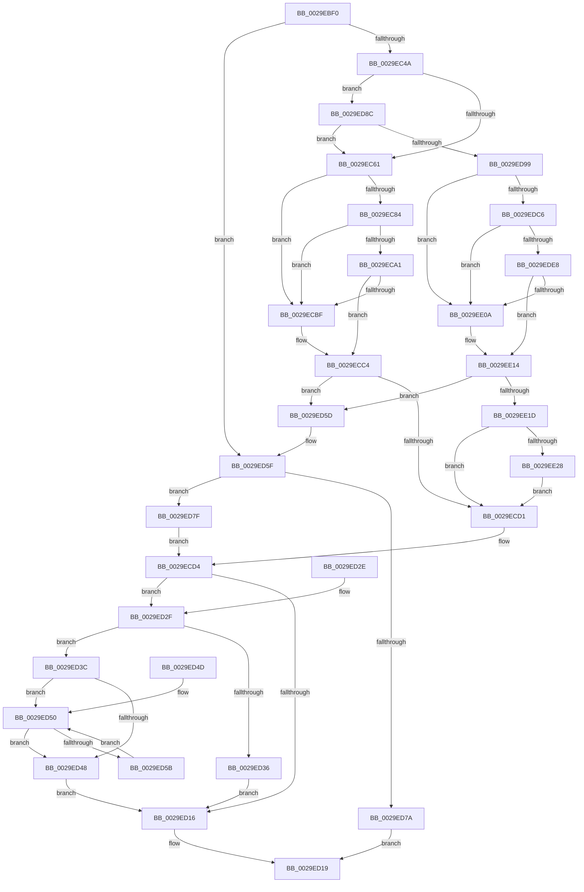

# IoAllocateMdl

- RVA: `0x0029EBF0`–`0x0029EE43` (길이 `595` bytes)
- VA: `0x000000014029EBF0`
- 실행 섹션: `.text`
- PDB 이름 있음: `예`; PDB Function 태그: `아니요`
- unwind 정보 RVA: `0x00068254`
- 디코드: `158`개 명령, `595/595` bytes 표시
- 미해석 바이트: `0` (있으면 어셈블리에 `.byte`로 보존)

> 이 문서는 커널 이미지의 기계어와 PDB 기호를 분석해 생성했습니다. 4번과 5번은 함수 원형과 자료형을 바이너리 사용 방식에서 추정한 C 해석이며 원본 소스 복구 결과는 아닙니다.

## 1. Dependencies

- 직접 호출 지점: **8**; 고유 호출 대상: **4**
- 직접 호출자로 확인된 함수: **51**
- RIP 상대 이미지 참조: **2**

### Outgoing calls
- `0x0029EC77` → [ExpInterlockedPopEntrySList](../6B/ExpInterlockedPopEntrySList_function_006BA570.md) (function, `0x006BA570`)
- `0x0029EC94` → [ExpInterlockedPopEntrySList](../6B/ExpInterlockedPopEntrySList_function_006BA570.md) (function, `0x006BA570`)
- `0x0029ECB2` → [guard_dispatch_icall](../6B/guard_dispatch_icall_function_006BAAD0.md) (function, `0x006BAAD0`)
- `0x0029ED6D` → [ExAllocatePool2](../../poolcode/B8/ExAllocatePool2_function_00B820F0.md) (function, `0x00B820F0`)
- `0x0029EDB9` → [ExpInterlockedPopEntrySList](../6B/ExpInterlockedPopEntrySList_function_006BA570.md) (function, `0x006BA570`)
- `0x0029EDDB` → [ExpInterlockedPopEntrySList](../6B/ExpInterlockedPopEntrySList_function_006BA570.md) (function, `0x006BA570`)
- `0x0029EDFD` → [guard_dispatch_icall](../6B/guard_dispatch_icall_function_006BAAD0.md) (function, `0x006BAAD0`)
- `0x0029EE39` → [VfPtMiscPoolNotification](../3F/VfPtMiscPoolNotification_function_003FF310.md) (function, `0x003FF310`)

### Direct callers
- [IopBuildDeviceIoControlRequest](../20/IopBuildDeviceIoControlRequest_function_00205B00.md) at `0x00205D23`
- [IopBuildAsynchronousFsdRequest](IopBuildAsynchronousFsdRequest_function_0029DD40.md) at `0x0029DE71`
- [CcZeroDataInCache](CcZeroDataInCache_function_0029E894.md) at `0x0029E947`
- [MiZeroPageWrite](MiZeroPageWrite_function_0029F280.md) at `0x0029F309`
- [CcLockSystemCacheBuffer](../3C/CcLockSystemCacheBuffer_function_003CC5B8.md) at `0x003CC5F1`
- [HalBuildMdlFromScatterGatherListV2](../45/HalBuildMdlFromScatterGatherListV2_function_00454670.md) at `0x0045471A`
- [HalBuildMdlFromScatterGatherListV3](../48/HalBuildMdlFromScatterGatherListV3_function_0048B500.md) at `0x0048B5EE`
- [HalBuildMdlFromScatterGatherListV3](../48/HalBuildMdlFromScatterGatherListV3_function_0048B500.md) at `0x0048B6CE`
- [CcPrepareMdlWrite](../49/CcPrepareMdlWrite_function_004996D0.md) at `0x00499856`
- [IoWriteCapturedPristineTriageDumpToDedicatedDumpFile](../59/IoWriteCapturedPristineTriageDumpToDedicatedDumpFile_function_005934C0.md) at `0x005935B9`
- [IopLiveDumpAllocateMappingResources](../59/IopLiveDumpAllocateMappingResources_function_0059A868.md) at `0x0059A91E`
- [MmAllocateMdlForIoSpace](../67/MmAllocateMdlForIoSpace_function_00674E40.md) at `0x00674EDC`
- [MiLockPatchIatForDV](../68/MiLockPatchIatForDV_function_00682050.md) at `0x00682129`
- [MiPrepareImagePagesForHotPatch](../68/MiPrepareImagePagesForHotPatch_function_00683800.md) at `0x00683B80`
- [sub_006E9F12](../6E/Unknown_function_006E9F12.md) at `0x006E9F32`
- [sub_006F17CA](../6F/Unknown_function_006F17CA.md) at `0x006F17D9`
- [HalGetAdapterV3](../../page/70/HalGetAdapterV3_function_00709838.md) at `0x00709A9E`
- [HalGetAdapterV2](../../page/70/HalGetAdapterV2_function_00709DD8.md) at `0x00709F8D`
- [HvlpDynamicUpdateMicrocode](../../page/71/HvlpDynamicUpdateMicrocode_function_007185E8.md) at `0x0071861D`
- [IopAllocateAndLockMdl](../../page/71/IopAllocateAndLockMdl_function_0071AC6C.md) at `0x0071AC8B`
- [IopSetEaOrQuotaInformationFile](../../page/71/IopSetEaOrQuotaInformationFile_function_0071BD70.md) at `0x0071C0E7`
- [IopSetFileObjectIosbRange](../../page/71/IopSetFileObjectIosbRange_function_0071C1C8.md) at `0x0071C385`
- [NtQueryQuotaInformationFile](../../page/72/NtQueryQuotaInformationFile_function_00720FE0.md) at `0x007215D1`
- [PnprInitializeMappingReserve](../../page/73/PnprInitializeMappingReserve_function_00739D24.md) at `0x00739DA7`
- [EtwpBuildMdlForTraceBuffer](../../page/7B/EtwpBuildMdlForTraceBuffer_function_007BEB50.md) at `0x007BEB89`
- [EtwpSavePersistedLogger](../../page/7B/EtwpSavePersistedLogger_function_007BF374.md) at `0x007BF483`
- [NtPssCaptureVaSpaceBulk](../../page/7D/NtPssCaptureVaSpaceBulk_function_007D4EA0.md) at `0x007D5091`
- [MiLockAndMapEntireDriver](../../page/80/MiLockAndMapEntireDriver_function_008015C8.md) at `0x0080163B`
- [MiApplyImageHotPatch](../../page/80/MiApplyImageHotPatch_function_00802330.md) at `0x008023BB`
- [MiMapHotPatchImageInSystemSpace](../../page/80/MiMapHotPatchImageInSystemSpace_function_00806438.md) at `0x0080647A`
- [NtFreeUserPhysicalPages](../../page/80/NtFreeUserPhysicalPages_function_0080AF30.md) at `0x0080B116`
- [IopReadFile](../../page/8A/IopReadFile_function_008AEFF0.md) at `0x008AF7C4`
- [WbCreateHeapExecutedBlock](../../page/8D/WbCreateHeapExecutedBlock_function_008D4BE8.md) at `0x008D4D0C`
- [WbCreateHeapExecutedBlock](../../page/8D/WbCreateHeapExecutedBlock_function_008D4BE8.md) at `0x008D4E4B`
- [WbCreateHeapExecutedBlock](../../page/8D/WbCreateHeapExecutedBlock_function_008D4BE8.md) at `0x008D4FD8`
- [IopXxxControlFile](../../page/8E/IopXxxControlFile_function_008E9AD0.md) at `0x008EA9E7`
- [MiCreateMdl](../../page/98/MiCreateMdl_function_009883A8.md) at `0x009883E7`
- [MiCreateMdl](../../page/98/MiCreateMdl_function_009883A8.md) at `0x009884C2`
- [WbMakeUserExecutablePagesKernelWritable](../../page/9A/WbMakeUserExecutablePagesKernelWritable_function_009A14F4.md) at `0x009A152C`
- [WbMakeUserDataPagesKernelWritable](../../page/9A/WbMakeUserDataPagesKernelWritable_function_009A15FC.md) at `0x009A1674`
- [FsRtlKernelFsControlFile](../../page/A0/FsRtlKernelFsControlFile_function_00A0CA70.md) at `0x00A0CD16`
- [AlpcpInitializeCompletionList](../../page/A1/AlpcpInitializeCompletionList_function_00A1A6D0.md) at `0x00A1A7E4`
- [IopReadFileScatter](../../page/AA/IopReadFileScatter_function_00AA5D78.md) at `0x00AA62BA`
- [IopWriteFileGather](../../page/AA/IopWriteFileGather_function_00AAA95C.md) at `0x00AAAEC4`
- [CcMdlRead](../../page/AB/CcMdlRead_function_00ABA520.md) at `0x00ABA672`
- [PopReadPagesFromHiberFile](../../page/AC/PopReadPagesFromHiberFile_function_00AC8F78.md) at `0x00AC90CF`
- [sub_00B1A404](../../page/B1/Unknown_function_00B1A404.md) at `0x00B1A42B`
- [sub_00B1B9DE](../../page/B1/Unknown_function_00B1B9DE.md) at `0x00B1BA13`
- [sub_00B1D822](../../page/B1/Unknown_function_00B1D822.md) at `0x00B1D837`
- [sub_00B3738C](../../page/B3/Unknown_function_00B3738C.md) at `0x00B373B5`
- [sub_00B41AB2](../../page/B4/Unknown_function_00B41AB2.md) at `0x00B41BA7`
- [IovAllocateMdl](../../pagevrfy/B9/IovAllocateMdl_function_00B92350.md) at `0x00B92393`
- [VfBuildMdlFromScatterGatherList](../../pagevrfy/B9/VfBuildMdlFromScatterGatherList_function_00B95940.md) at `0x00B95A2C`
- [ViAllocateMapRegisterFile](../../pagevrfy/B9/ViAllocateMapRegisterFile_function_00B97E9C.md) at `0x00B97F14`
- [VerifierPortIoAllocateMdl](../../pagevrfy/B9/VerifierPortIoAllocateMdl_function_00B9B190.md) at `0x00B9B1BB`

### Static image references
- `0x0029EC4A` → RVA `0x00F04240` (`.data`; read)
- `0x0029ED8C` → RVA `0x00F04ABC` (`.data`; read)

## 2. Other-region calls and transfers

- 다른 실행 섹션으로 향하는 call: **1**
  - `0x0029ED6D` → [ExAllocatePool2](../../poolcode/B8/ExAllocatePool2_function_00B820F0.md) (`.text` → `POOLCODE`)
- 별도 외부 분기/꼬리 이동을 확인하지 못했습니다.

## 3. Assembly (complete function range)

```asm
0029EBF0  48 89 5C 24 20                  mov qword ptr [rsp + 0x20], rbx
0029EBF5  44 88 44 24 18                  mov byte ptr [rsp + 0x18], r8b
0029EBFA  89 54 24 10                     mov dword ptr [rsp + 0x10], edx
0029EBFE  55                              push rbp
0029EBFF  56                              push rsi
0029EC00  57                              push rdi
0029EC01  41 54                           push r12
0029EC03  41 55                           push r13
0029EC05  41 56                           push r14
0029EC07  41 57                           push r15
0029EC09  48 83 EC 20                     sub rsp, 0x20
0029EC0D  33 ED                           xor ebp, ebp
0029EC0F  8B F2                           mov esi, edx
0029EC11  48 81 C6 FF 0F 00 00            add rsi, 0xfff
0029EC18  8B FA                           mov edi, edx
0029EC1A  44 8B F9                        mov r15d, ecx
0029EC1D  4C 8B F1                        mov r14, rcx
0029EC20  45 8B CF                        mov r9d, r15d
0029EC23  44 0F B7 E5                     movzx r12d, bp
0029EC27  41 81 E1 FF 0F 00 00            and r9d, 0xfff
0029EC2E  49 03 F1                        add rsi, r9
0029EC31  48 C1 EE 0C                     shr rsi, 0xc
0029EC35  44 8D 2C F5 30 00 00 00         lea r13d, [rsi*8 + 0x30]
0029EC3D  41 81 FD B8 00 00 00            cmp r13d, 0xb8
0029EC44  0F 87 15 01 00 00               ja 0x14029ed5f
0029EC4A  40 38 2D EF 55 C6 00            cmp byte ptr [rip + 0xc655ef], bpl
0029EC51  44 8D 65 08                     lea r12d, [rbp + 8]
0029EC55  41 BD B8 00 00 00               mov r13d, 0xb8
0029EC5B  0F 85 2B 01 00 00               jne 0x14029ed8c
0029EC61  65 48 8B 2C 25 20 00 00 00      mov rbp, qword ptr gs:[0x20]
0029EC6A  48 8B BD 30 08 00 00            mov rdi, qword ptr [rbp + 0x830]
0029EC71  48 8B CF                        mov rcx, rdi
0029EC74  FF 47 14                        inc dword ptr [rdi + 0x14]
0029EC77  E8 F4 B8 41 00                  call 0x1406ba570
0029EC7C  48 8B D8                        mov rbx, rax
0029EC7F  48 85 C0                        test rax, rax
0029EC82  75 3B                           jne 0x14029ecbf
0029EC84  FF 47 18                        inc dword ptr [rdi + 0x18]
0029EC87  48 8B BD 38 08 00 00            mov rdi, qword ptr [rbp + 0x838]
0029EC8E  48 8B CF                        mov rcx, rdi
0029EC91  FF 47 14                        inc dword ptr [rdi + 0x14]
0029EC94  E8 D7 B8 41 00                  call 0x1406ba570
0029EC99  48 8B D8                        mov rbx, rax
0029EC9C  48 85 C0                        test rax, rax
0029EC9F  75 1E                           jne 0x14029ecbf
0029ECA1  8B 57 2C                        mov edx, dword ptr [rdi + 0x2c]
0029ECA4  48 8B 47 30                     mov rax, qword ptr [rdi + 0x30]
0029ECA8  44 8B 47 28                     mov r8d, dword ptr [rdi + 0x28]
0029ECAC  8B 4F 24                        mov ecx, dword ptr [rdi + 0x24]
0029ECAF  FF 47 18                        inc dword ptr [rdi + 0x18]
0029ECB2  E8 19 BE 41 00                  call 0x1406baad0
0029ECB7  48 8B D8                        mov rbx, rax
0029ECBA  48 85 C0                        test rax, rax
0029ECBD  74 05                           je 0x14029ecc4
0029ECBF  8B 45 24                        mov eax, dword ptr [rbp + 0x24]
0029ECC2  89 03                           mov dword ptr [rbx], eax
0029ECC4  8B 7C 24 68                     mov edi, dword ptr [rsp + 0x68]
0029ECC8  48 85 DB                        test rbx, rbx
0029ECCB  0F 84 8C 00 00 00               je 0x14029ed5d
0029ECD1  0F B7 03                        movzx eax, word ptr [rbx]
0029ECD4  66 89 43 0C                     mov word ptr [rbx + 0xc], ax
0029ECD8  66 83 C6 06                     add si, 6
0029ECDC  48 8B 84 24 80 00 00 00         mov rax, qword ptr [rsp + 0x80]
0029ECE4  49 81 E6 00 F0 FF FF            and r14, 0xfffffffffffff000
0029ECEB  66 C1 E6 03                     shl si, 3
0029ECEF  41 81 E7 FF 0F 00 00            and r15d, 0xfff
0029ECF6  48 C7 03 00 00 00 00            mov qword ptr [rbx], 0
0029ECFD  66 89 73 08                     mov word ptr [rbx + 8], si
0029ED01  4C 89 73 20                     mov qword ptr [rbx + 0x20], r14
0029ED05  44 89 7B 2C                     mov dword ptr [rbx + 0x2c], r15d
0029ED09  89 7B 28                        mov dword ptr [rbx + 0x28], edi
0029ED0C  66 44 89 63 0A                  mov word ptr [rbx + 0xa], r12w
0029ED11  48 85 C0                        test rax, rax
0029ED14  75 19                           jne 0x14029ed2f
0029ED16  48 8B C3                        mov rax, rbx
0029ED19  48 8B 5C 24 78                  mov rbx, qword ptr [rsp + 0x78]
0029ED1E  48 83 C4 20                     add rsp, 0x20
0029ED22  41 5F                           pop r15
0029ED24  41 5E                           pop r14
0029ED26  41 5D                           pop r13
0029ED28  41 5C                           pop r12
0029ED2A  5F                              pop rdi
0029ED2B  5E                              pop rsi
0029ED2C  5D                              pop rbp
0029ED2D  C3                              ret
0029ED2E  CC                              int3
0029ED2F  80 7C 24 70 00                  cmp byte ptr [rsp + 0x70], 0
0029ED34  75 06                           jne 0x14029ed3c
0029ED36  48 89 58 08                     mov qword ptr [rax + 8], rbx
0029ED3A  EB DA                           jmp 0x14029ed16
0029ED3C  48 8B 48 08                     mov rcx, qword ptr [rax + 8]
0029ED40  48 8B 01                        mov rax, qword ptr [rcx]
0029ED43  48 85 C0                        test rax, rax
0029ED46  75 08                           jne 0x14029ed50
0029ED48  48 89 19                        mov qword ptr [rcx], rbx
0029ED4B  EB C9                           jmp 0x14029ed16
0029ED4D  0F 1F 00                        nop dword ptr [rax]
0029ED50  48 8B C8                        mov rcx, rax
0029ED53  48 8B 00                        mov rax, qword ptr [rax]
0029ED56  48 85 C0                        test rax, rax
0029ED59  74 ED                           je 0x14029ed48
0029ED5B  EB F3                           jmp 0x14029ed50
0029ED5D  33 ED                           xor ebp, ebp
0029ED5F  41 8B D5                        mov edx, r13d
0029ED62  B9 42 00 00 00                  mov ecx, 0x42
0029ED67  41 B8 4D 64 6C 20               mov r8d, 0x206c644d
0029ED6D  E8 7E 33 8E 00                  call 0x140b820f0
0029ED72  48 8B D8                        mov rbx, rax
0029ED75  48 85 C0                        test rax, rax
0029ED78  75 05                           jne 0x14029ed7f
0029ED7A  48 8B C5                        mov rax, rbp
0029ED7D  EB 9A                           jmp 0x14029ed19
0029ED7F  65 8B 04 25 A4 01 00 00         mov eax, dword ptr gs:[0x1a4]
0029ED87  E9 48 FF FF FF                  jmp 0x14029ecd4
0029ED8C  83 3D 29 5D C6 00 01            cmp dword ptr [rip + 0xc65d29], 1
0029ED93  0F 85 C8 FE FF FF               jne 0x14029ec61
0029ED99  65 48 8B 04 25 20 00 00 00      mov rax, qword ptr gs:[0x20]
0029EDA2  48 89 44 24 60                  mov qword ptr [rsp + 0x60], rax
0029EDA7  C6 44 24 68 01                  mov byte ptr [rsp + 0x68], 1
0029EDAC  48 8B A8 30 08 00 00            mov rbp, qword ptr [rax + 0x830]
0029EDB3  48 8B CD                        mov rcx, rbp
0029EDB6  FF 45 14                        inc dword ptr [rbp + 0x14]
0029EDB9  E8 B2 B7 41 00                  call 0x1406ba570
0029EDBE  48 8B D8                        mov rbx, rax
0029EDC1  48 85 C0                        test rax, rax
0029EDC4  75 44                           jne 0x14029ee0a
0029EDC6  FF 45 18                        inc dword ptr [rbp + 0x18]
0029EDC9  48 8B 6C 24 60                  mov rbp, qword ptr [rsp + 0x60]
0029EDCE  48 8B AD 38 08 00 00            mov rbp, qword ptr [rbp + 0x838]
0029EDD5  48 8B CD                        mov rcx, rbp
0029EDD8  FF 45 14                        inc dword ptr [rbp + 0x14]
0029EDDB  E8 90 B7 41 00                  call 0x1406ba570
0029EDE0  48 8B D8                        mov rbx, rax
0029EDE3  48 85 C0                        test rax, rax
0029EDE6  75 22                           jne 0x14029ee0a
0029EDE8  8B 55 2C                        mov edx, dword ptr [rbp + 0x2c]
0029EDEB  44 8B 45 28                     mov r8d, dword ptr [rbp + 0x28]
0029EDEF  8B 4D 24                        mov ecx, dword ptr [rbp + 0x24]
0029EDF2  FF 45 18                        inc dword ptr [rbp + 0x18]
0029EDF5  88 44 24 68                     mov byte ptr [rsp + 0x68], al
0029EDF9  48 8B 45 30                     mov rax, qword ptr [rbp + 0x30]
0029EDFD  E8 CE BC 41 00                  call 0x1406baad0
0029EE02  48 8B D8                        mov rbx, rax
0029EE05  48 85 C0                        test rax, rax
0029EE08  74 0A                           je 0x14029ee14
0029EE0A  48 8B 44 24 60                  mov rax, qword ptr [rsp + 0x60]
0029EE0F  8B 40 24                        mov eax, dword ptr [rax + 0x24]
0029EE12  89 03                           mov dword ptr [rbx], eax
0029EE14  48 85 DB                        test rbx, rbx
0029EE17  0F 84 40 FF FF FF               je 0x14029ed5d
0029EE1D  80 7C 24 68 00                  cmp byte ptr [rsp + 0x68], 0
0029EE22  0F 84 A9 FE FF FF               je 0x14029ecd1
0029EE28  48 0F BF 53 08                  movsx rdx, word ptr [rbx + 8]
0029EE2D  45 33 C9                        xor r9d, r9d
0029EE30  41 B8 4D 64 6C 20               mov r8d, 0x206c644d
0029EE36  48 8B CB                        mov rcx, rbx
0029EE39  E8 D2 04 16 00                  call 0x1403ff310
0029EE3E  E9 8E FE FF FF                  jmp 0x14029ecd1
```

## 4. C-style interpretation (structured pseudocode)

```c
__int64 __fastcall IoAllocateMdl(__int64 a1, int a2, unsigned __int8 a3, __int64 a4, __int64 a5)
{
    __int64 result;
    __int64 v_r14;
    __int64 v_r15;
    __int64 v_rbp;
    __int64 v_rsi;
    __int64 v_rsp;
    unsigned int v_stack_p10;
    unsigned __int8 v_stack_p18;
    unsigned __int64 v_stack_p20;
    unsigned __int64 v_stack_p60;
    unsigned __int8 v_stack_p68;
    unsigned __int8 v_stack_p70;

    v_stack_p20 = v_rbx;
    v_stack_p18 = a3;
    v_stack_p10 = a2;
    v_rsp = (v_rsp) - (32);
    v_rbp = 0;
    v_rsi = ((unsigned int)(a2)) + (0xFFFULL);
    a4 = (unsigned int)(((unsigned int)((unsigned int)((unsigned int)((unsigned int)(a1))))) & (0xFFFULL));
    v_rsi = (v_rsi) + (a4);
    v_rsi = (v_rsi) >> (12);
    if (((unsigned int)(v_rsi * 8 + 48)) > 184) goto loc_0029ED5F;
    if ((*(unsigned __int8 *)(v_rip + 12998127)) != 0) goto loc_0029ED8C;
loc_0029EC61:
    result = ExpInterlockedPopEntrySList(*(unsigned __int64 *)(*(unsigned __int64 *)(gs_base + (0 + 32)) + 2096), a2, a3, a4);
    if (result != 0) goto loc_0029ECBF;
    result = ExpInterlockedPopEntrySList(*(unsigned __int64 *)(*(unsigned __int64 *)(gs_base + (0 + 32)) + 2104), a2, a3, a4);
    if (result != 0) goto loc_0029ECBF;
    result = guard_dispatch_icall((unsigned int)(*(unsigned int *)(*(unsigned __int64 *)(*(unsigned __int64 *)(gs_base + (0 + 32)) + 2104) + 36)), (unsigned int)(*(unsigned int *)(*(unsigned __int64 *)(*(unsigned __int64 *)(gs_base + (0 + 32)) + 2104) + 44)), (unsigned int)(*(unsigned int *)(*(unsigned __int64 *)(*(unsigned __int64 *)(gs_base + (0 + 32)) + 2104) + 40)), a4);
    if (result != 0) {
        result = *(unsigned int *)(*(unsigned __int64 *)(gs_base + (0 + 32)) + 36);
        *(unsigned int *)(result) = (unsigned int)(result);
    }
    if (result == 0) goto loc_0029ED5D;
loc_0029ECD1:
loc_0029ECD4:
    *(unsigned __int16 *)(result + 12) = (unsigned __int16)(*(unsigned __int16 *)(result));
    v_rsi = (unsigned __int16)((v_rsi) + (6));
    v_r14 = (a1) & (0xFFFFFFFFFFFFF000ULL);
    v_rsi = (unsigned __int16)((v_rsi) << (3));
    v_r15 = (unsigned int)(((unsigned int)((unsigned int)(a1))) & (0xFFFULL));
    *(unsigned __int64 *)(result) = 0;
    *(unsigned __int16 *)(result + 8) = (unsigned __int16)(v_rsi);
    *(unsigned __int64 *)(result + 32) = v_r14;
    *(unsigned int *)(result + 44) = (unsigned int)(v_r15);
    *(unsigned int *)(result + 40) = (unsigned int)((unsigned int)(v_stack_p10));
    *(unsigned __int16 *)(result + 10) = (unsigned __int16)(v_rbp + 8);
    if (a5 != 0) goto loc_0029ED2F;
loc_0029ED16:
loc_0029ED19:
    v_rsp = (v_rsp) + (32);
    return result;
loc_0029ED2F:
    if (v_stack_p70 != 0) goto loc_0029ED3C;
    *(unsigned __int64 *)(result + 8) = v_stack_p20;
    goto loc_0029ED16;
loc_0029ED3C:
    if (*(unsigned __int64 *)(*(unsigned __int64 *)(result + 8)) != 0) goto loc_0029ED50;
loc_0029ED48:
    *(unsigned __int64 *)(*(unsigned __int64 *)(result + 8)) = v_stack_p20;
    goto loc_0029ED16;
loc_0029ED50:
    if (*(unsigned __int64 *)(*(unsigned __int64 *)(*(unsigned __int64 *)(result + 8))) == 0) goto loc_0029ED48;
    goto loc_0029ED50;
loc_0029ED5D:
    v_rbp = 0;
loc_0029ED5F:
    result = ExAllocatePool2(66, 184, (unsigned int)(0x206C644DULL), a4);
    if (result != 0) goto loc_0029ED7F;
    goto loc_0029ED19;
loc_0029ED7F:
    goto loc_0029ECD4;
loc_0029ED8C:
    if ((*(unsigned int *)(v_rip + 12999977)) != 1) goto loc_0029EC61;
    v_stack_p60 = *(unsigned __int64 *)(gs_base + (0 + 32));
    v_stack_p68 = 1;
    result = ExpInterlockedPopEntrySList(*(unsigned __int64 *)(*(unsigned __int64 *)(gs_base + (0 + 32)) + 2096), 184, (unsigned int)(0x206C644DULL), a4);
    if (result != 0) goto loc_0029EE0A;
    result = ExpInterlockedPopEntrySList(*(unsigned __int64 *)(v_stack_p60 + 2104), 184, (unsigned int)(0x206C644DULL), a4);
    if (result != 0) goto loc_0029EE0A;
    v_stack_p68 = (unsigned __int8)(result);
    result = guard_dispatch_icall((unsigned int)(*(unsigned int *)(*(unsigned __int64 *)(v_stack_p60 + 2104) + 36)), (unsigned int)(*(unsigned int *)(*(unsigned __int64 *)(v_stack_p60 + 2104) + 44)), (unsigned int)(*(unsigned int *)(*(unsigned __int64 *)(v_stack_p60 + 2104) + 40)), a4);
    if (result != 0) {
        result = v_stack_p60;
        result = *(unsigned int *)(result + 36);
        *(unsigned int *)(result) = (unsigned int)(result);
    }
    if (result == 0) goto loc_0029ED5D;
    if (v_stack_p68 == 0) goto loc_0029ECD1;
    a4 = 0;
    result = VfPtMiscPoolNotification(result, (__int16)(*(unsigned __int16 *)(result + 8)), (unsigned int)(0x206C644DULL), a4);
    goto loc_0029ECD1;
}
```

## 5. (Beta) C Style

```c
int64_t IoAllocateMdl(int64_t Arg1, int32_t Arg2, uint8_t Arg3, int64_t Arg4, int64_t Arg5)
{
    int64_t result;
    int64_t local_r14;
    int64_t local_r15;
    int64_t local_rbp;
    int64_t local_rsi;
    int64_t local_rsp;
    uint32_t v_stack_p10;
    uint8_t v_stack_p18;
    uint64_t v_stack_p20;
    uint64_t v_stack_p60;
    uint8_t v_stack_p68;
    uint8_t v_stack_p70;

    v_stack_p20 = local_rbx;
    v_stack_p18 = Arg3;
    v_stack_p10 = Arg2;
    local_rsp = (local_rsp) - (32);
    local_rbp = 0;
    local_rsi = ((uint32_t)(Arg2)) + (0xFFFULL);
    Arg4 = (uint32_t)(((uint32_t)((uint32_t)((uint32_t)((uint32_t)(Arg1))))) & (0xFFFULL));
    local_rsi = (local_rsi) + (Arg4);
    local_rsi = (local_rsi) >> (12);
    if (((uint32_t)(local_rsi * 8 + 48)) > 184) goto loc_0029ED5F;
    if ((*(uint8_t *)(v_rip + 0xC655EF)) != 0) goto loc_0029ED8C;
loc_0029EC61:
    result = ExpInterlockedPopEntrySList(*(uint64_t *)(*(uint64_t *)(gs_base + (0 + 0x20)) + 0x830), Arg2, Arg3, Arg4);
    if (result != 0) goto loc_0029ECBF;
    result = ExpInterlockedPopEntrySList(*(uint64_t *)(*(uint64_t *)(gs_base + (0 + 0x20)) + 0x838), Arg2, Arg3, Arg4);
    if (result != 0) goto loc_0029ECBF;
    result = guard_dispatch_icall((uint32_t)(*(uint32_t *)(*(uint64_t *)(*(uint64_t *)(gs_base + (0 + 0x20)) + 0x838) + 0x24)), (uint32_t)(*(uint32_t *)(*(uint64_t *)(*(uint64_t *)(gs_base + (0 + 0x20)) + 0x838) + 0x2C)), (uint32_t)(*(uint32_t *)(*(uint64_t *)(*(uint64_t *)(gs_base + (0 + 0x20)) + 0x838) + 0x28)), Arg4);
    if (result != 0) {
        result = *(uint32_t *)(*(uint64_t *)(gs_base + (0 + 0x20)) + 0x24);
        *(uint32_t *)(result) = (uint32_t)(result);
    }
    if (result == 0) goto loc_0029ED5D;
loc_0029ECD1:
loc_0029ECD4:
    *(uint16_t *)(result + 0xC) = (uint16_t)(*(uint16_t *)(result));
    local_rsi = (uint16_t)((local_rsi) + (6));
    local_r14 = (Arg1) & (0xFFFFFFFFFFFFF000ULL);
    local_rsi = (uint16_t)((local_rsi) << (3));
    local_r15 = (uint32_t)(((uint32_t)((uint32_t)(Arg1))) & (0xFFFULL));
    *(uint64_t *)(result) = 0;
    *(uint16_t *)(result + 0x8) = (uint16_t)(local_rsi);
    *(uint64_t *)(result + 0x20) = local_r14;
    *(uint32_t *)(result + 0x2C) = (uint32_t)(local_r15);
    *(uint32_t *)(result + 0x28) = (uint32_t)((uint32_t)(v_stack_p10));
    *(uint16_t *)(result + 0xA) = (uint16_t)(local_rbp + 8);
    if (Arg5 != 0) goto loc_0029ED2F;
loc_0029ED16:
loc_0029ED19:
    local_rsp = (local_rsp) + (32);
    return result;
loc_0029ED2F:
    if (v_stack_p70 != 0) goto loc_0029ED3C;
    *(uint64_t *)(result + 0x8) = v_stack_p20;
    goto loc_0029ED16;
loc_0029ED3C:
    if (*(uint64_t *)(*(uint64_t *)(result + 0x8)) != 0) goto loc_0029ED50;
loc_0029ED48:
    *(uint64_t *)(*(uint64_t *)(result + 0x8)) = v_stack_p20;
    goto loc_0029ED16;
loc_0029ED50:
    if (*(uint64_t *)(*(uint64_t *)(*(uint64_t *)(result + 0x8))) == 0) goto loc_0029ED48;
    goto loc_0029ED50;
loc_0029ED5D:
    local_rbp = 0;
loc_0029ED5F:
    result = ExAllocatePool2(66, 184, (uint32_t)(0x206C644DULL), Arg4);
    if (result != 0) goto loc_0029ED7F;
    goto loc_0029ED19;
loc_0029ED7F:
    goto loc_0029ECD4;
loc_0029ED8C:
    if ((*(uint32_t *)(v_rip + 0xC65D29)) != 1) goto loc_0029EC61;
    v_stack_p60 = *(uint64_t *)(gs_base + (0 + 0x20));
    v_stack_p68 = 1;
    result = ExpInterlockedPopEntrySList(*(uint64_t *)(*(uint64_t *)(gs_base + (0 + 0x20)) + 0x830), 184, (uint32_t)(0x206C644DULL), Arg4);
    if (result != 0) goto loc_0029EE0A;
    result = ExpInterlockedPopEntrySList(*(uint64_t *)(v_stack_p60 + 0x838), 184, (uint32_t)(0x206C644DULL), Arg4);
    if (result != 0) goto loc_0029EE0A;
    v_stack_p68 = (uint8_t)(result);
    result = guard_dispatch_icall((uint32_t)(*(uint32_t *)(*(uint64_t *)(v_stack_p60 + 0x838) + 0x24)), (uint32_t)(*(uint32_t *)(*(uint64_t *)(v_stack_p60 + 0x838) + 0x2C)), (uint32_t)(*(uint32_t *)(*(uint64_t *)(v_stack_p60 + 0x838) + 0x28)), Arg4);
    if (result != 0) {
        result = v_stack_p60;
        result = *(uint32_t *)(result + 0x24);
        *(uint32_t *)(result) = (uint32_t)(result);
    }
    if (result == 0) goto loc_0029ED5D;
    if (v_stack_p68 == 0) goto loc_0029ECD1;
    Arg4 = 0;
    result = VfPtMiscPoolNotification(result, (int16_t)(*(uint16_t *)(result + 0x8)), (uint32_t)(0x206C644DULL), Arg4);
    goto loc_0029ECD1;
}
```

## 6. Execution-region graph

[열기: 2D/3D 그래프와 함수 탐색 컨트롤 패널](../../../control-panel.html?section=text&rva=0x0029EBF0&view=graph)

- 2D 그래프는 위에서 아래로 흐르고, 3D 그래프는 빈 공간을 드래그해 회전합니다. Shift+드래그는 이동, 휠은 확대·축소, 함수 노드 선택은 대상 보고서 이동입니다.

### Static fallback


