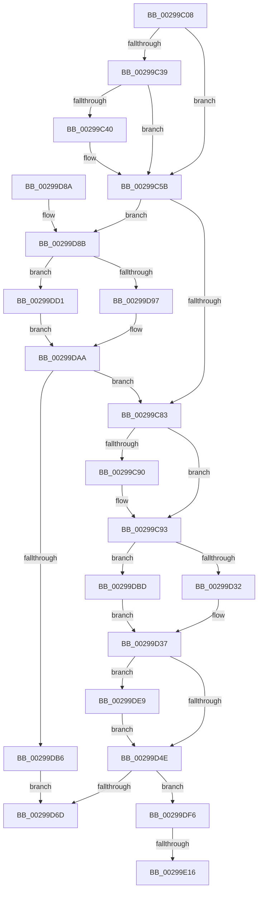

# IoAsynchronousPageWrite

- RVA: `0x00299C08`–`0x00299E23` (길이 `539` bytes)
- VA: `0x0000000140299C08`
- 실행 섹션: `.text`
- PDB 이름 있음: `예`; PDB Function 태그: `예`
- unwind 정보 RVA: `0x00067C6C`
- 디코드: `134`개 명령, `539/539` bytes 표시
- 미해석 바이트: `0` (있으면 어셈블리에 `.byte`로 보존)

> 이 문서는 커널 이미지의 기계어와 PDB 기호를 분석해 생성했습니다. 4번과 5번은 함수 원형과 자료형을 바이너리 사용 방식에서 추정한 C 해석이며 원본 소스 복구 결과는 아닙니다.

## 1. Dependencies

- 직접 호출 지점: **11**; 고유 호출 대상: **11**
- 직접 호출자로 확인된 함수: **2**
- RIP 상대 이미지 참조: **3**

### Outgoing calls
- `0x00299C5B` → [IoGetRelatedDeviceObject](IoGetRelatedDeviceObject_function_0029B120.md) (function, `0x0029B120`)
- `0x00299C6C` → [IopAllocateIrpExReturn](../20/IopAllocateIrpExReturn_function_00207720.md) (function, `0x00207720`)
- `0x00299D32` → [IoSetDiskIoAttributionFromThread](IoSetDiskIoAttributionFromThread_function_0029BF20.md) (function, `0x0029BF20`)
- `0x00299D3A` → [IopQueueThreadIrp](../20/IopQueueThreadIrp_function_002075C0.md) (function, `0x002075C0`)
- `0x00299D54` → [IofCallDriver](IofCallDriver_function_0029B4B0.md) (function, `0x0029B4B0`)
- `0x00299D8E` → [MmIsFileObjectAPagingFile](MmIsFileObjectAPagingFile_function_0029BDAC.md) (function, `0x0029BDAC`)
- `0x00299DA5` → [IopAllocateReserveIrp](IopAllocateReserveIrp_function_0029C218.md) (function, `0x0029C218`)
- `0x00299DC7` → [IopSetDiskIoAttributionExtension](IopSetDiskIoAttributionExtension_function_0029C0E4.md) (function, `0x0029C0E4`)
- `0x00299DE2` → [IopAllocateBackpocketIrp](../59/IopAllocateBackpocketIrp_function_00596CE0.md) (function, `0x00596CE0`)
- `0x00299DEC` → [StRtlIoStorInfoSetNvCachePriority](../6A/StRtlIoStorInfoSetNvCachePriority_function_006A5D50.md) (function, `0x006A5D50`)
- `0x00299E18` → [KiRaiseIrqlProcessIrqlFlags](../4F/KiRaiseIrqlProcessIrqlFlags_function_004F56FC.md) (function, `0x004F56FC`)

### Direct callers
- [MiGatherPagefilePages](../37/MiGatherPagefilePages_function_00372B08.md) at `0x003730E4`
- [MiGatherMappedPages](../40/MiGatherMappedPages_function_00404E80.md) at `0x00405376`

### Static image references
- `0x00299D97` → RVA `0x00F8D8CC` (`.data`; read/write)
- `0x00299DD1` → RVA `0x00F8D8C8` (`.data`; read/write)
- `0x00299E0A` → RVA `0x00FC6D20` (`ALMOSTRO`; read)

## 2. Other-region calls and transfers

- 다른 실행 섹션으로 향하는 call: **0**
- call이 아닌 외부 분기/꼬리 이동: **2**
  - `0x00299E10` → [sub_006DA88A](../6D/Unknown_function_006DA88A.md) (`tail-transfer`)
  - `0x00299E1E` → [sub_006DA88A](../6D/Unknown_function_006DA88A.md) (`tail-transfer`)

## 3. Assembly (complete function range)

```asm
00299C08  48 89 5C 24 08                  mov qword ptr [rsp + 8], rbx
00299C0D  48 89 6C 24 10                  mov qword ptr [rsp + 0x10], rbp
00299C12  48 89 74 24 18                  mov qword ptr [rsp + 0x18], rsi
00299C17  57                              push rdi
00299C18  41 54                           push r12
00299C1A  41 55                           push r13
00299C1C  41 56                           push r14
00299C1E  41 57                           push r15
00299C20  48 83 EC 20                     sub rsp, 0x20
00299C24  48 8B 41 28                     mov rax, qword ptr [rcx + 0x28]
00299C28  4D 8B F9                        mov r15, r9
00299C2B  4D 8B E8                        mov r13, r8
00299C2E  48 8B EA                        mov rbp, rdx
00299C31  48 8B F1                        mov rsi, rcx
00299C34  48 85 C0                        test rax, rax
00299C37  74 22                           je 0x140299c5b
00299C39  48 83 78 08 00                  cmp qword ptr [rax + 8], 0
00299C3E  74 1B                           je 0x140299c5b
00299C40  65 FF 04 25 74 89 00 00         inc dword ptr gs:[0x8974]
00299C48  8B 42 28                        mov eax, dword ptr [rdx + 0x28]
00299C4B  05 FF 0F 00 00                  add eax, 0xfff
00299C50  C1 E8 0C                        shr eax, 0xc
00299C53  65 01 04 25 78 89 00 00         add dword ptr gs:[0x8978], eax
00299C5B  E8 C0 14 00 00                  call 0x14029b120
00299C60  45 33 C0                        xor r8d, r8d
00299C63  48 8B C8                        mov rcx, rax
00299C66  48 8B F8                        mov rdi, rax
00299C69  8A 50 4C                        mov dl, byte ptr [rax + 0x4c]
00299C6C  E8 AF DA F6 FF                  call 0x140207720
00299C71  48 8B D8                        mov rbx, rax
00299C74  41 BE 01 00 00 00               mov r14d, 1
00299C7A  48 85 C0                        test rax, rax
00299C7D  0F 84 08 01 00 00               je 0x140299d8b
00299C83  48 8B 84 24 A0 00 00 00         mov rax, qword ptr [rsp + 0xa0]
00299C8B  48 85 C0                        test rax, rax
00299C8E  74 03                           je 0x140299c93
00299C90  48 89 18                        mov qword ptr [rax], rbx
00299C93  80 4B 47 20                     or byte ptr [rbx + 0x47], 0x20
00299C97  48 8B 8B B8 00 00 00            mov rcx, qword ptr [rbx + 0xb8]
00299C9E  8B 44 24 78                     mov eax, dword ptr [rsp + 0x78]
00299CA2  4C 8B B4 24 98 00 00 00         mov r14, qword ptr [rsp + 0x98]
00299CAA  4C 8B 64 24 70                  mov r12, qword ptr [rsp + 0x70]
00299CAF  48 89 6B 08                     mov qword ptr [rbx + 8], rbp
00299CB3  C1 E0 11                        shl eax, 0x11
00299CB6  05 00 00 02 00                  add eax, 0x20000
00299CBB  83 C8 03                        or eax, 3
00299CBE  89 43 10                        mov dword ptr [rbx + 0x10], eax
00299CC1  65 48 8B 04 25 88 01 00 00      mov rax, qword ptr gs:[0x188]
00299CCA  48 89 83 98 00 00 00            mov qword ptr [rbx + 0x98], rax
00299CD1  48 89 B3 C0 00 00 00            mov qword ptr [rbx + 0xc0], rsi
00299CD8  8B 45 2C                        mov eax, dword ptr [rbp + 0x2c]
00299CDB  48 03 45 20                     add rax, qword ptr [rbp + 0x20]
00299CDF  48 89 43 70                     mov qword ptr [rbx + 0x70], rax
00299CE3  C6 43 40 00                     mov byte ptr [rbx + 0x40], 0
00299CE7  4C 89 73 48                     mov qword ptr [rbx + 0x48], r14
00299CEB  4C 89 7B 58                     mov qword ptr [rbx + 0x58], r15
00299CEF  4C 89 63 60                     mov qword ptr [rbx + 0x60], r12
00299CF3  C6 41 B8 04                     mov byte ptr [rcx - 0x48], 4
00299CF7  8B 45 28                        mov eax, dword ptr [rbp + 0x28]
00299CFA  89 41 C0                        mov dword ptr [rcx - 0x40], eax
00299CFD  49 8B 45 00                     mov rax, qword ptr [r13]
00299D01  48 89 41 D0                     mov qword ptr [rcx - 0x30], rax
00299D05  8A 84 24 88 00 00 00            mov al, byte ptr [rsp + 0x88]
00299D0C  08 41 BA                        or byte ptr [rcx - 0x46], al
00299D0F  48 8B 84 24 90 00 00 00         mov rax, qword ptr [rsp + 0x90]
00299D17  48 89 71 E8                     mov qword ptr [rcx - 0x18], rsi
00299D1B  33 F6                           xor esi, esi
00299D1D  65 48 8B 14 25 88 01 00 00      mov rdx, qword ptr gs:[0x188]
00299D26  48 8B CB                        mov rcx, rbx
00299D29  48 85 C0                        test rax, rax
00299D2C  0F 85 8B 00 00 00               jne 0x140299dbd
00299D32  E8 E9 21 00 00                  call 0x14029bf20
00299D37  48 8B CB                        mov rcx, rbx
00299D3A  E8 81 D8 F6 FF                  call 0x1402075c0
00299D3F  8B 94 24 80 00 00 00            mov edx, dword ptr [rsp + 0x80]
00299D46  85 D2                           test edx, edx
00299D48  0F 85 9B 00 00 00               jne 0x140299de9
00299D4E  48 8B D3                        mov rdx, rbx
00299D51  48 8B CF                        mov rcx, rdi
00299D54  E8 57 17 00 00                  call 0x14029b4b0
00299D59  41 B8 00 00 00 C0               mov r8d, 0xc0000000
00299D5F  8B C8                           mov ecx, eax
00299D61  41 23 C8                        and ecx, r8d
00299D64  41 3B C8                        cmp ecx, r8d
00299D67  0F 84 89 00 00 00               je 0x140299df6
00299D6D  48 8B 5C 24 50                  mov rbx, qword ptr [rsp + 0x50]
00299D72  48 8B 6C 24 58                  mov rbp, qword ptr [rsp + 0x58]
00299D77  48 8B 74 24 60                  mov rsi, qword ptr [rsp + 0x60]
00299D7C  48 83 C4 20                     add rsp, 0x20
00299D80  41 5F                           pop r15
00299D82  41 5E                           pop r14
00299D84  41 5D                           pop r13
00299D86  41 5C                           pop r12
00299D88  5F                              pop rdi
00299D89  C3                              ret
00299D8A  CC                              int3
00299D8B  48 8B CE                        mov rcx, rsi
00299D8E  E8 19 20 00 00                  call 0x14029bdac
00299D93  85 C0                           test eax, eax
00299D95  74 3A                           je 0x140299dd1
00299D97  F0 44 01 35 2D 3B CF 00         lock add dword ptr [rip + 0xcf3b2d], r14d
00299D9F  8A 57 4C                        mov dl, byte ptr [rdi + 0x4c]
00299DA2  45 8B C6                        mov r8d, r14d
00299DA5  E8 6E 24 00 00                  call 0x14029c218
00299DAA  48 8B D8                        mov rbx, rax
00299DAD  48 85 C0                        test rax, rax
00299DB0  0F 85 CD FE FF FF               jne 0x140299c83
00299DB6  B8 9A 00 00 C0                  mov eax, 0xc000009a
00299DBB  EB B0                           jmp 0x140299d6d
00299DBD  4C 8B C2                        mov r8, rdx
00299DC0  45 33 C9                        xor r9d, r9d
00299DC3  48 8B 50 18                     mov rdx, qword ptr [rax + 0x18]
00299DC7  E8 18 23 00 00                  call 0x14029c0e4
00299DCC  E9 66 FF FF FF                  jmp 0x140299d37
00299DD1  F0 44 01 35 EF 3A CF 00         lock add dword ptr [rip + 0xcf3aef], r14d
00299DD9  8A 57 4C                        mov dl, byte ptr [rdi + 0x4c]
00299DDC  45 33 C0                        xor r8d, r8d
00299DDF  48 8B CF                        mov rcx, rdi
00299DE2  E8 F9 CE 2F 00                  call 0x140596ce0
00299DE7  EB C1                           jmp 0x140299daa
00299DE9  48 8B CB                        mov rcx, rbx
00299DEC  E8 5F BF 40 00                  call 0x1406a5d50
00299DF1  E9 58 FF FF FF                  jmp 0x140299d4e
00299DF6  41 89 06                        mov dword ptr [r14], eax
00299DF9  49 89 76 08                     mov qword ptr [r14 + 8], rsi
00299DFD  44 0F 20 C3                     mov rbx, cr8
00299E01  BA 01 00 00 00                  mov edx, 1
00299E06  44 0F 22 C2                     mov cr8, rdx
00299E0A  39 35 10 CF D2 00               cmp dword ptr [rip + 0xd2cf10], esi
00299E10  0F 84 74 0A 44 00               je 0x1406da88a
00299E16  8A CB                           mov cl, bl
00299E18  E8 DF B8 25 00                  call 0x1404f56fc
00299E1D  90                              nop
00299E1E  E9 67 0A 44 00                  jmp 0x1406da88a
```

## 4. C-style interpretation (structured pseudocode)

```c
__int64 __fastcall IoAsynchronousPageWrite(__int64 a1, __int64 a2, __int64 a3, __int64 a4, __int64 a5, unsigned int a6, unsigned int a7, unsigned __int8 a8, __int64 a9, __int64 a10, __int64 a11)
{
    __int64 result;
    __int64 v_rsi;
    __int64 v_rsp;
    unsigned __int64 v_stack_p10;
    unsigned __int64 v_stack_p18;
    unsigned __int64 v_stack_p8;

    v_stack_p8 = v_rbx;
    v_stack_p10 = v_rbp;
    v_stack_p18 = v_rsi;
    v_rsp = (v_rsp) - (32);
    if (*(unsigned __int64 *)(a1 + 40) == 0) goto loc_00299C5B;
    result = *(unsigned __int64 *)(a1 + 40);
    if ((*(unsigned __int64 *)(*(unsigned __int64 *)(a1 + 40) + 8)) != 0) {
        result = *(unsigned int *)(a2 + 40);
        result = (unsigned int)((result) + (0xFFFULL));
        result = (unsigned int)((result) >> (12));
    }
    result = IoGetRelatedDeviceObject(a1, a2, a3, a4);
    a3 = 0;
    result = IopAllocateIrpExReturn(result, *(unsigned __int8 *)(result + 76), a3, a4);
    if (result == 0) goto loc_00299D8B;
loc_00299C83:
    if (a11 != 0) {
        *(unsigned __int64 *)(a11) = result;
    }
    *(unsigned __int64 *)(result + 8) = a2;
    result = (unsigned int)(((unsigned int)(a6)) << (17));
    result = (unsigned int)((result) + (0x20000ULL));
    result = (unsigned int)((result) | (3));
    *(unsigned int *)(result + 16) = (unsigned int)(result);
    *(unsigned __int64 *)(result + 152) = *(unsigned __int64 *)(gs_base + (0 + 392));
    *(unsigned __int64 *)(result + 192) = a1;
    result = ((unsigned int)(*(unsigned int *)(a2 + 44))) + (*(unsigned __int64 *)(a2 + 32));
    *(unsigned __int64 *)(result + 112) = result;
    *(unsigned __int8 *)(result + 64) = 0;
    *(unsigned __int64 *)(result + 72) = a10;
    *(unsigned __int64 *)(result + 88) = a4;
    *(unsigned __int64 *)(result + 96) = a5;
    *(unsigned __int8 *)(*(unsigned __int64 *)(result + 184) - 72) = 4;
    *(unsigned int *)(*(unsigned __int64 *)(result + 184) - 64) = (unsigned int)((unsigned int)(*(unsigned int *)(a2 + 40)));
    *(unsigned __int64 *)(*(unsigned __int64 *)(result + 184) - 48) = *(unsigned __int64 *)(a3);
    *(unsigned __int64 *)(*(unsigned __int64 *)(result + 184) - 24) = a1;
    v_rsi = 0;
    if (a9 != 0) goto loc_00299DBD;
    result = IoSetDiskIoAttributionFromThread(result, *(unsigned __int64 *)(gs_base + (0 + 392)), a3, a4);
loc_00299D37:
    result = IopQueueThreadIrp(result, *(unsigned __int64 *)(gs_base + (0 + 392)), a3, a4);
    if ((unsigned int)((unsigned int)(a7)) != 0) goto loc_00299DE9;
loc_00299D4E:
    result = IofCallDriver(result, result, a3, a4);
    a1 = (unsigned int)(((unsigned int)((unsigned int)(result))) & ((unsigned int)((unsigned int)(0xC0000000ULL))));
    if (((unsigned int)(a1)) == ((unsigned int)((unsigned int)(0xC0000000ULL)))) goto loc_00299DF6;
loc_00299D6D:
    v_rsp = (v_rsp) + (32);
    return result;
loc_00299D8B:
    result = MmIsFileObjectAPagingFile(v_stack_p18, result, (unsigned int)(0xC0000000ULL), a4);
    if ((unsigned int)(result) == 0) goto loc_00299DD1;
    result = IopAllocateReserveIrp(v_stack_p18, *(unsigned __int8 *)(result + 76), (unsigned int)((unsigned int)(a10)), a4);
loc_00299DAA:
    if (result != 0) goto loc_00299C83;
    goto loc_00299D6D;
loc_00299DBD:
    a4 = 0;
    result = IopSetDiskIoAttributionExtension(v_stack_p18, *(unsigned __int64 *)((unsigned int)(0xC000009AULL) + 24), *(unsigned __int8 *)(result + 76), a4);
    goto loc_00299D37;
loc_00299DD1:
    a3 = 0;
    result = IopAllocateBackpocketIrp(result, *(unsigned __int8 *)(result + 76), a3, a4);
    goto loc_00299DAA;
loc_00299DE9:
    result = StRtlIoStorInfoSetNvCachePriority(result, *(unsigned __int8 *)(result + 76), a3, a4);
    goto loc_00299D4E;
loc_00299DF6:
    *(unsigned int *)(a10) = (unsigned int)(result);
    *(unsigned __int64 *)(a10 + 8) = v_stack_p18;
    result = KiRaiseIrqlProcessIrqlFlags((unsigned __int8)(v_cr8), 1, a3, a4);
}
```

## 5. (Beta) C Style

```c
int64_t IoAsynchronousPageWrite(void *Arg1, void *Arg2, void *Arg3, int64_t Arg4, int64_t Arg5, uint32_t Arg6, uint32_t Arg7, uint8_t Arg8, int64_t Arg9, void *Arg10, int64_t Arg11)
{
    uint8_t *arg1 = (uint8_t *)Arg1;
    uint8_t *arg2 = (uint8_t *)Arg2;
    uint8_t *arg3 = (uint8_t *)Arg3;
    uint8_t *arg10 = (uint8_t *)Arg10;

    int64_t result;
    int64_t local_rsi;
    int64_t local_rsp;
    uint64_t v_stack_p10;
    uint64_t v_stack_p18;
    uint64_t v_stack_p8;

    v_stack_p8 = local_rbx;
    v_stack_p10 = local_rbp;
    v_stack_p18 = local_rsi;
    local_rsp = (local_rsp) - (32);
    if (*(uint64_t *)(arg1 + 0x28) == 0) goto loc_00299C5B;
    result = *(uint64_t *)(arg1 + 0x28);
    if ((*(uint64_t *)(*(uint64_t *)(arg1 + 0x28) + 0x8)) != 0) {
        result = *(uint32_t *)(arg2 + 0x28);
        result = (uint32_t)((result) + (0xFFFULL));
        result = (uint32_t)((result) >> (12));
    }
    result = IoGetRelatedDeviceObject(Arg1, Arg2, Arg3, Arg4);
    Arg3 = 0;
    result = IopAllocateIrpExReturn(result, *(uint8_t *)(result + 0x4C), Arg3, Arg4);
    if (result == 0) goto loc_00299D8B;
loc_00299C83:
    if (Arg11 != 0) {
        *(uint64_t *)(Arg11) = result;
    }
    *(void **)(result + 0x8) = Arg2;
    result = (uint32_t)(((uint32_t)(Arg6)) << (17));
    result = (uint32_t)((result) + (0x20000ULL));
    result = (uint32_t)((result) | (3));
    *(uint32_t *)(result + 0x10) = (uint32_t)(result);
    *(uint64_t *)(result + 0x98) = *(uint64_t *)(gs_base + (0 + 0x188));
    *(void **)(result + 0xC0) = Arg1;
    result = ((uint32_t)(*(uint32_t *)(arg2 + 0x2C))) + (*(uint64_t *)(arg2 + 0x20));
    *(uint64_t *)(result + 0x70) = result;
    *(uint8_t *)(result + 0x40) = 0;
    *(void **)(result + 0x48) = Arg10;
    *(uint64_t *)(result + 0x58) = Arg4;
    *(uint64_t *)(result + 0x60) = Arg5;
    *(uint8_t *)(*(uint64_t *)(result + 0xB8) - 0x48) = 4;
    *(uint32_t *)(*(uint64_t *)(result + 0xB8) - 0x40) = (uint32_t)((uint32_t)(*(uint32_t *)(arg2 + 0x28)));
    *(uint64_t *)(*(uint64_t *)(result + 0xB8) - 0x30) = *(uint64_t *)(arg3);
    *(void **)(*(uint64_t *)(result + 0xB8) - 0x18) = Arg1;
    local_rsi = 0;
    if (Arg9 != 0) goto loc_00299DBD;
    result = IoSetDiskIoAttributionFromThread(result, *(uint64_t *)(gs_base + (0 + 0x188)), Arg3, Arg4);
loc_00299D37:
    result = IopQueueThreadIrp(result, *(uint64_t *)(gs_base + (0 + 0x188)), Arg3, Arg4);
    if ((uint32_t)((uint32_t)(Arg7)) != 0) goto loc_00299DE9;
loc_00299D4E:
    result = IofCallDriver(result, result, Arg3, Arg4);
    Arg1 = (uint32_t)(((uint32_t)((uint32_t)(result))) & ((uint32_t)((uint32_t)(0xC0000000ULL))));
    if (((uint32_t)(Arg1)) == ((uint32_t)((uint32_t)(0xC0000000ULL)))) goto loc_00299DF6;
loc_00299D6D:
    local_rsp = (local_rsp) + (32);
    return result;
loc_00299D8B:
    result = MmIsFileObjectAPagingFile(v_stack_p18, result, (uint32_t)(0xC0000000ULL), Arg4);
    if ((uint32_t)(result) == 0) goto loc_00299DD1;
    result = IopAllocateReserveIrp(v_stack_p18, *(uint8_t *)(result + 0x4C), (uint32_t)((uint32_t)(Arg10)), Arg4);
loc_00299DAA:
    if (result != 0) goto loc_00299C83;
    goto loc_00299D6D;
loc_00299DBD:
    Arg4 = 0;
    result = IopSetDiskIoAttributionExtension(v_stack_p18, *(uint64_t *)((uint32_t)(0xC000009AULL) + 0x18), *(uint8_t *)(result + 0x4C), Arg4);
    goto loc_00299D37;
loc_00299DD1:
    Arg3 = 0;
    result = IopAllocateBackpocketIrp(result, *(uint8_t *)(result + 0x4C), Arg3, Arg4);
    goto loc_00299DAA;
loc_00299DE9:
    result = StRtlIoStorInfoSetNvCachePriority(result, *(uint8_t *)(result + 0x4C), Arg3, Arg4);
    goto loc_00299D4E;
loc_00299DF6:
    *(uint32_t *)(arg10) = (uint32_t)(result);
    *(uint64_t *)(arg10 + 0x8) = v_stack_p18;
    result = KiRaiseIrqlProcessIrqlFlags((uint8_t)(v_cr8), 1, Arg3, Arg4);
}
```

### 관측된 메모리 오프셋

구조체 형식이 확인되지 않은 접근은 인자 기준의 오프셋으로만 기록했습니다.

| 기준 인자 | 오프셋 표현 | 폭 (bit) | 접근 |
|---|---:|---:|---|
| `Arg1` | `+ 0x28` | `64` | `R` |
| `Arg2` | `+ 0x20` | `64` | `R` |
| `Arg2` | `+ 0x28` | `32` | `R` |
| `Arg2` | `+ 0x2C` | `32` | `R` |
| `Arg3` | `+ 0x0` | `64` | `R` |
| `Arg10` | `+ 0x0` | `32` | `W` |
| `Arg10` | `+ 0x8` | `64` | `W` |

## 6. Execution-region graph

[열기: 2D/3D 그래프와 함수 탐색 컨트롤 패널](../../../control-panel.html?section=text&rva=0x00299C08&view=graph)

- 2D 그래프는 위에서 아래로 흐르고, 3D 그래프는 빈 공간을 드래그해 회전합니다. Shift+드래그는 이동, 휠은 확대·축소, 함수 노드 선택은 대상 보고서 이동입니다.

### Static fallback


