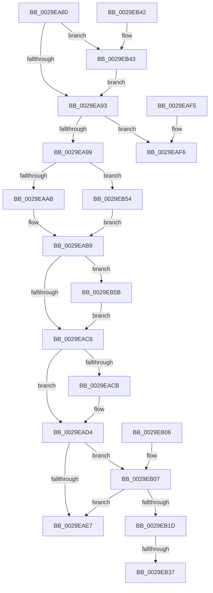

# IoFreeMdl

- RVA: `0x0029EA80`–`0x0029EB68` (길이 `232` bytes)
- VA: `0x000000014029EA80`
- 실행 섹션: `.text`
- PDB 이름 있음: `예`; PDB Function 태그: `아니요`
- unwind 정보 RVA: `0x0006820C`
- 디코드: `62`개 명령, `232/232` bytes 표시
- 미해석 바이트: `0` (있으면 어셈블리에 `.byte`로 보존)

> 이 문서는 커널 이미지의 기계어와 PDB 기호를 분석해 생성했습니다. 4번과 5번은 함수 원형과 자료형을 바이너리 사용 방식에서 추정한 C 해석이며 원본 소스 복구 결과는 아닙니다.

## 1. Dependencies

- 직접 호출 지점: **4**; 고유 호출 대상: **4**
- 직접 호출자로 확인된 함수: **60**
- RIP 상대 이미지 참조: **5**

### Outgoing calls
- `0x0029EAEA` → [ExpInterlockedPushEntrySList](../6B/ExpInterlockedPushEntrySList_function_006BA5B0.md) (function, `0x006BA5B0`)
- `0x0029EAFB` → [ExFreePoolWithTag](../../poolcode/B8/ExFreePoolWithTag_function_00B82870.md) (function, `0x00B82870`)
- `0x0029EB37` → [ExFreePool](../../poolcode/B8/ExFreePool_function_00B82850.md) (function, `0x00B82850`)
- `0x0029EB4A` → [MmUnmapLockedPages](../24/MmUnmapLockedPages_function_00246E60.md) (function, `0x00246E60`)

### Direct callers
- [IopBuildDeviceIoControlRequest](../20/IopBuildDeviceIoControlRequest_function_00205B00.md) at `0x00205D67`
- [IopCompleteRequest](../20/IopCompleteRequest_function_0020AF50.md) at `0x0020B526`
- [sub_002109A2](../21/Unknown_function_002109A2.md) at `0x002109C5`
- [IopCompleteIrpInFileObjectList](../24/IopCompleteIrpInFileObjectList_function_0024F330.md) at `0x0024FA43`
- [IopfCompleteRequest](IopfCompleteRequest_function_0029B5F8.md) at `0x0029B80E`
- [IopBuildAsynchronousFsdRequest](IopBuildAsynchronousFsdRequest_function_0029DD40.md) at `0x0029DEAE`
- [CcZeroDataInCache](CcZeroDataInCache_function_0029E894.md) at `0x0029E9EF`
- [CcZeroDataInCache](CcZeroDataInCache_function_0029E894.md) at `0x0029EA64`
- [IopUnlockAndFreeMdl](IopUnlockAndFreeMdl_function_0029F200.md) at `0x0029F236`
- [MiZeroPageWrite](MiZeroPageWrite_function_0029F280.md) at `0x0029F4A6`
- [CcMdlWriteComplete2](../3C/CcMdlWriteComplete2_function_003CA36C.md) at `0x003CA445`
- [CcMapAndCopyInToCache](../3C/CcMapAndCopyInToCache_function_003CA7F0.md) at `0x003CB0CF`
- [CcCopyBytesToUserBuffer](../3C/CcCopyBytesToUserBuffer_function_003CC3D0.md) at `0x003CC52B`
- [CcLockSystemCacheBuffer](../3C/CcLockSystemCacheBuffer_function_003CC5B8.md) at `0x003CC632`
- [CcLockSystemCacheBuffer](../3C/CcLockSystemCacheBuffer_function_003CC5B8.md) at `0x003CC695`
- [HalPutScatterGatherListV3](../3D/HalPutScatterGatherListV3_function_003DACA8.md) at `0x003DAD60`
- [HalpDmaCheckMdlAccessibility](../3D/HalpDmaCheckMdlAccessibility_function_003DB8A0.md) at `0x003DB923`
- [sub_003DEC40](../3D/Unknown_function_003DEC40.md) at `0x003DEC58`
- [HalpDmaFreeChildAdapter](../55/HalpDmaFreeChildAdapter_function_00550E30.md) at `0x00550E55`
- [CcMdlWriteAbort](../57/CcMdlWriteAbort_function_0057DA70.md) at `0x0057DABD`
- [IoWriteCapturedPristineTriageDumpToDedicatedDumpFile](../59/IoWriteCapturedPristineTriageDumpToDedicatedDumpFile_function_005934C0.md) at `0x00593695`
- [IopLiveDumpFreeMappingResources](../59/IopLiveDumpFreeMappingResources_function_0059BFE0.md) at `0x0059C02E`
- [IopMcReleaseMdl](../5A/IopMcReleaseMdl_function_005A3CE8.md) at `0x005A3D53`
- [DifIoFreeMdlWrapper](../62/DifIoFreeMdlWrapper_function_0062A5D0.md) at `0x0062A696`
- [MiUnlockAndFreeDvPatchImage](../68/MiUnlockAndFreeDvPatchImage_function_00682A78.md) at `0x00682AA0`
- [MiPrepareImagePagesForHotPatch](../68/MiPrepareImagePagesForHotPatch_function_00683800.md) at `0x00683D5C`
- [CcZeroDataInCache$fin$0](../6D/CcZeroDataInCache_fin_0_function_006D1DBC.md) at `0x006D1DFC`
- [CcPrepareMdlWrite$fin$0](../6D/CcPrepareMdlWrite_fin_0_function_006D3DF5.md) at `0x006D3E75`
- [CcPrepareMdlWrite$fin$0](../6D/CcPrepareMdlWrite_fin_0_function_006D3DF5.md) at `0x006D3ECF`
- [sub_006E9CCC](../6E/Unknown_function_006E9CCC.md) at `0x006E9CCF`
- [sub_006E9CCC](../6E/Unknown_function_006E9CCC.md) at `0x006E9CF0`
- [sub_006E9D14](../6E/Unknown_function_006E9D14.md) at `0x006E9EFD`
- [sub_006F17CA](../6F/Unknown_function_006F17CA.md) at `0x006F181C`
- [sub_006F606A](../6F/Unknown_function_006F606A.md) at `0x006F6070`
- [sub_006F88AE](../6F/Unknown_function_006F88AE.md) at `0x006F8F68`
- [FsRtlpFreeMdlChain](../../page/71/FsRtlpFreeMdlChain_function_00716394.md) at `0x007163BA`
- [NT_DISK::Read](../../page/71/NT_DISK_Read_function_00717100.md) at `0x00717172`
- [NT_DISK::Write](../../page/71/NT_DISK_Write_function_007171A0.md) at `0x00717212`
- [HvlpDynamicUpdateMicrocode](../../page/71/HvlpDynamicUpdateMicrocode_function_007185E8.md) at `0x007186A8`
- [IopSetFileObjectIosbRange](../../page/71/IopSetFileObjectIosbRange_function_0071C1C8.md) at `0x0071C617`
- [PnprFreeMappingReserve](../../page/73/PnprFreeMappingReserve_function_0073989C.md) at `0x007398B3`
- [NtPssCaptureVaSpaceBulk](../../page/7D/NtPssCaptureVaSpaceBulk_function_007D4EA0.md) at `0x007D52C8`
- [MiLockAndMapEntireDriver](../../page/80/MiLockAndMapEntireDriver_function_008015C8.md) at `0x00801707`
- [MiUnlockEntireDriver](../../page/80/MiUnlockEntireDriver_function_00801780.md) at `0x008017D0`
- [MiApplyImageHotPatch](../../page/80/MiApplyImageHotPatch_function_00802330.md) at `0x00802565`
- [MiMapHotPatchImageInSystemSpace](../../page/80/MiMapHotPatchImageInSystemSpace_function_00806438.md) at `0x0080656E`
- [NtFreeUserPhysicalPages](../../page/80/NtFreeUserPhysicalPages_function_0080AF30.md) at `0x0080B3DF`
- [IopExceptionCleanupEx](../../page/8A/IopExceptionCleanupEx_function_008AE5C8.md) at `0x008AE606`
- [WbCreateHeapExecutedBlock](../../page/8D/WbCreateHeapExecutedBlock_function_008D4BE8.md) at `0x008D52E6`
- [WbCreateHeapExecutedBlock](../../page/8D/WbCreateHeapExecutedBlock_function_008D4BE8.md) at `0x008D5308`
- [MiCreateNewSection](../../page/98/MiCreateNewSection_function_00985DB0.md) at `0x00986205`
- [MiDeleteImageCreationMdls](../../page/98/MiDeleteImageCreationMdls_function_009884FC.md) at `0x0098854B`
- [sub_009A1390](../../page/9A/Unknown_function_009A1390.md) at `0x009A13A5`
- [IopCleanupFileObjectIosbRange](../../page/9E/IopCleanupFileObjectIosbRange_function_009E88A8.md) at `0x009E8943`
- [AlpcpFreeCompletionList](../../page/A1/AlpcpFreeCompletionList_function_00A1AD08.md) at `0x00A1AD29`
- [CcMdlReadComplete2](../../page/A4/CcMdlReadComplete2_function_00A49298.md) at `0x00A492B8`
- [PopReadPagesFromHiberFile](../../page/AC/PopReadPagesFromHiberFile_function_00AC8F78.md) at `0x00AC9191`
- [MiReleaseHotPatchResources](../../page/AC/MiReleaseHotPatchResources_function_00ACCD60.md) at `0x00ACCDB6`
- [MiReleaseHotPatchResources](../../page/AC/MiReleaseHotPatchResources_function_00ACCD60.md) at `0x00ACCDD9`
- [CcMdlRead$fin$0](../../page/B1/CcMdlRead_fin_0_function_00B139D8.md) at `0x00B13A24`
- [CcMdlRead$fin$0](../../page/B1/CcMdlRead_fin_0_function_00B139D8.md) at `0x00B13A48`
- [sub_00B1B9DE](../../page/B1/Unknown_function_00B1B9DE.md) at `0x00B1BA56`
- [sub_00B2D198](../../page/B2/Unknown_function_00B2D198.md) at `0x00B2D19B`
- [sub_00B2D1A6](../../page/B2/Unknown_function_00B2D1A6.md) at `0x00B2D1A9`
- [sub_00B3733A](../../page/B3/Unknown_function_00B3733A.md) at `0x00B37343`
- [ViAllocateMapRegisterFile](../../pagevrfy/B9/ViAllocateMapRegisterFile_function_00B97E9C.md) at `0x00B98065`
- [ViFreeMapRegisterFile](../../pagevrfy/B9/ViFreeMapRegisterFile_function_00B98B8C.md) at `0x00B98C1E`
- [ViFreeMapRegisterFile](../../pagevrfy/B9/ViFreeMapRegisterFile_function_00B98B8C.md) at `0x00B98CAA`

### Static image references
- `0x0029EA9D` → RVA `0x00FC6A80` (`ALMOSTRO`; read)
- `0x0029EAAE` → RVA `0x00FC8C40` (`ALMOSTRO`; read)
- `0x0029EAB9` → RVA `0x00F04240` (`.data`; read)
- `0x0029EB24` → RVA `0x00B82850` (`ExFreePool`; read)
- `0x0029EB5B` → RVA `0x00F04ABC` (`.data`; read)

## 2. Other-region calls and transfers

- 다른 실행 섹션으로 향하는 call: **2**
  - `0x0029EAFB` → [ExFreePoolWithTag](../../poolcode/B8/ExFreePoolWithTag_function_00B82870.md) (`.text` → `POOLCODE`)
  - `0x0029EB37` → [ExFreePool](../../poolcode/B8/ExFreePool_function_00B82850.md) (`.text` → `POOLCODE`)
- call이 아닌 외부 분기/꼬리 이동: **1**
  - `0x0029EB31` → [sub_0029EBE0](Unknown_function_0029EBE0.md) (`tail-transfer`)

## 3. Assembly (complete function range)

```asm
0029EA80  40 53                           push rbx
0029EA82  48 83 EC 20                     sub rsp, 0x20
0029EA86  F6 41 0A 20                     test byte ptr [rcx + 0xa], 0x20
0029EA8A  48 8B D9                        mov rbx, rcx
0029EA8D  0F 85 B0 00 00 00               jne 0x14029eb43
0029EA93  F6 43 0A 08                     test byte ptr [rbx + 0xa], 8
0029EA97  74 5D                           je 0x14029eaf6
0029EA99  0F B7 4B 0C                     movzx ecx, word ptr [rbx + 0xc]
0029EA9D  8B 05 DD 7F D2 00               mov eax, dword ptr [rip + 0xd27fdd]
0029EAA3  3B C8                           cmp ecx, eax
0029EAA5  0F 83 A9 00 00 00               jae 0x14029eb54
0029EAAB  0F AE E8                        lfence
0029EAAE  48 8D 15 8B A1 D2 00            lea rdx, [rip + 0xd2a18b]
0029EAB5  48 8B 14 CA                     mov rdx, qword ptr [rdx + rcx*8]
0029EAB9  80 3D 80 57 C6 00 00            cmp byte ptr [rip + 0xc65780], 0
0029EAC0  0F 85 95 00 00 00               jne 0x14029eb5b
0029EAC6  48 85 D2                        test rdx, rdx
0029EAC9  75 09                           jne 0x14029ead4
0029EACB  65 48 8B 14 25 20 00 00 00      mov rdx, qword ptr gs:[0x20]
0029EAD4  48 8B 8A 30 08 00 00            mov rcx, qword ptr [rdx + 0x830]
0029EADB  FF 41 1C                        inc dword ptr [rcx + 0x1c]
0029EADE  0F B7 41 10                     movzx eax, word ptr [rcx + 0x10]
0029EAE2  66 39 01                        cmp word ptr [rcx], ax
0029EAE5  73 20                           jae 0x14029eb07
0029EAE7  48 8B D3                        mov rdx, rbx
0029EAEA  E8 C1 BA 41 00                  call 0x1406ba5b0
0029EAEF  48 83 C4 20                     add rsp, 0x20
0029EAF3  5B                              pop rbx
0029EAF4  C3                              ret
0029EAF5  CC                              int3
0029EAF6  33 D2                           xor edx, edx
0029EAF8  48 8B CB                        mov rcx, rbx
0029EAFB  E8 70 3D 8E 00                  call 0x140b82870
0029EB00  48 83 C4 20                     add rsp, 0x20
0029EB04  5B                              pop rbx
0029EB05  C3                              ret
0029EB06  CC                              int3
0029EB07  FF 41 20                        inc dword ptr [rcx + 0x20]
0029EB0A  48 8B 8A 38 08 00 00            mov rcx, qword ptr [rdx + 0x838]
0029EB11  FF 41 1C                        inc dword ptr [rcx + 0x1c]
0029EB14  0F B7 41 10                     movzx eax, word ptr [rcx + 0x10]
0029EB18  66 39 01                        cmp word ptr [rcx], ax
0029EB1B  72 CA                           jb 0x14029eae7
0029EB1D  FF 41 20                        inc dword ptr [rcx + 0x20]
0029EB20  48 8B 41 38                     mov rax, qword ptr [rcx + 0x38]
0029EB24  48 8D 0D 25 3D 8E 00            lea rcx, [rip + 0x8e3d25]
0029EB2B  48 3B C1                        cmp rax, rcx
0029EB2E  48 8B CB                        mov rcx, rbx
0029EB31  0F 85 A9 00 00 00               jne 0x14029ebe0
0029EB37  E8 14 3D 8E 00                  call 0x140b82850
0029EB3C  48 83 C4 20                     add rsp, 0x20
0029EB40  5B                              pop rbx
0029EB41  C3                              ret
0029EB42  CC                              int3
0029EB43  48 8B 49 18                     mov rcx, qword ptr [rcx + 0x18]
0029EB47  48 8B D3                        mov rdx, rbx
0029EB4A  E8 11 83 FA FF                  call 0x140246e60
0029EB4F  E9 3F FF FF FF                  jmp 0x14029ea93
0029EB54  33 D2                           xor edx, edx
0029EB56  E9 5E FF FF FF                  jmp 0x14029eab9
0029EB5B  83 3D 5A 5F C6 00 01            cmp dword ptr [rip + 0xc65f5a], 1
0029EB62  0F 85 5E FF FF FF               jne 0x14029eac6
```

## 4. C-style interpretation (structured pseudocode)

```c
__int64 __fastcall IoFreeMdl(__int64 a1)
{
    __int64 result;
    __int64 v_rsp;

    v_rsp = (v_rsp) - (32);
    if (((*(unsigned __int8 *)(a1 + 10)) & (32)) != 0) goto loc_0029EB43;
loc_0029EA93:
    if (((*(unsigned __int8 *)(a1 + 10)) & (8)) == 0) goto loc_0029EAF6;
    if (((unsigned int)(*(unsigned __int16 *)(a1 + 12))) >= ((unsigned int)((unsigned int)(*(unsigned int *)(v_rip + 13795293))))) goto loc_0029EB54;
loc_0029EAB9:
    if ((*(unsigned __int8 *)(v_rip + 12998528)) != 0) goto loc_0029EB5B;
loc_0029EAC6:
    if (*(unsigned __int64 *)(v_rip + 13803915 + *(unsigned __int16 *)(a1 + 12) * 8) == 0) {
        a2 = *(unsigned __int64 *)(gs_base + (0 + 32));
    }
    if ((*(unsigned __int16 *)(*(unsigned __int64 *)(a2 + 2096))) >= ((unsigned __int16)(*(unsigned __int16 *)(*(unsigned __int64 *)(a2 + 2096) + 16)))) goto loc_0029EB07;
loc_0029EAE7:
    result = ExpInterlockedPushEntrySList(*(unsigned __int64 *)(a2 + 2096), a1, a3, a4);
    v_rsp = (v_rsp) + (32);
    return result;
loc_0029EAF6:
    a2 = 0;
    result = ExFreePoolWithTag(a1, a2, a3, a4);
    v_rsp = (v_rsp) + (32);
    return result;
loc_0029EB07:
    if ((*(unsigned __int16 *)(*(unsigned __int64 *)(a2 + 2104))) < ((unsigned __int16)(*(unsigned __int16 *)(*(unsigned __int64 *)(a2 + 2104) + 16)))) goto loc_0029EAE7;
    result = ExFreePool(a1, a2, a3, a4);
    v_rsp = (v_rsp) + (32);
    return result;
loc_0029EB43:
    result = MmUnmapLockedPages(*(unsigned __int64 *)(a1 + 24), a1, a3, a4);
    goto loc_0029EA93;
loc_0029EB54:
    a2 = 0;
    goto loc_0029EAB9;
loc_0029EB5B:
    if ((*(unsigned int *)(v_rip + 13000538)) != 1) goto loc_0029EAC6;
}
```

## 5. (Beta) C Style

```c
int64_t IoFreeMdl(void *Arg1)
{
    uint8_t *arg1 = (uint8_t *)Arg1;

    int64_t result;
    int64_t local_rsp;

    local_rsp = (local_rsp) - (32);
    if (((*(uint8_t *)(arg1 + 0xA)) & (32)) != 0) goto loc_0029EB43;
loc_0029EA93:
    if (((*(uint8_t *)(arg1 + 0xA)) & (8)) == 0) goto loc_0029EAF6;
    if (((uint32_t)(*(uint16_t *)(arg1 + 0xC))) >= ((uint32_t)((uint32_t)(*(uint32_t *)(v_rip + 0xD27FDD))))) goto loc_0029EB54;
loc_0029EAB9:
    if ((*(uint8_t *)(v_rip + 0xC65780)) != 0) goto loc_0029EB5B;
loc_0029EAC6:
    if (*(uint64_t *)(v_rip + 0xD2A18B + *(uint16_t *)(arg1 + 0xC) * 8) == 0) {
        a2 = *(uint64_t *)(gs_base + (0 + 0x20));
    }
    if ((*(uint16_t *)(*(uint64_t *)(a2 + 0x830))) >= ((uint16_t)(*(uint16_t *)(*(uint64_t *)(a2 + 0x830) + 0x10)))) goto loc_0029EB07;
loc_0029EAE7:
    result = ExpInterlockedPushEntrySList(*(uint64_t *)(a2 + 0x830), Arg1, a3, a4);
    local_rsp = (local_rsp) + (32);
    return result;
loc_0029EAF6:
    a2 = 0;
    result = ExFreePoolWithTag(Arg1, a2, a3, a4);
    local_rsp = (local_rsp) + (32);
    return result;
loc_0029EB07:
    if ((*(uint16_t *)(*(uint64_t *)(a2 + 0x838))) < ((uint16_t)(*(uint16_t *)(*(uint64_t *)(a2 + 0x838) + 0x10)))) goto loc_0029EAE7;
    result = ExFreePool(Arg1, a2, a3, a4);
    local_rsp = (local_rsp) + (32);
    return result;
loc_0029EB43:
    result = MmUnmapLockedPages(*(uint64_t *)(arg1 + 0x18), Arg1, a3, a4);
    goto loc_0029EA93;
loc_0029EB54:
    a2 = 0;
    goto loc_0029EAB9;
loc_0029EB5B:
    if ((*(uint32_t *)(v_rip + 0xC65F5A)) != 1) goto loc_0029EAC6;
}
```

### 관측된 메모리 오프셋

구조체 형식이 확인되지 않은 접근은 인자 기준의 오프셋으로만 기록했습니다.

| 기준 인자 | 오프셋 표현 | 폭 (bit) | 접근 |
|---|---:|---:|---|
| `Arg1` | `+ 0xA` | `8` | `R` |
| `Arg1` | `+ 0xC` | `16` | `R` |
| `Arg1` | `+ 0x18` | `64` | `R` |

## 6. Execution-region graph

[열기: 2D/3D 그래프와 함수 탐색 컨트롤 패널](../../../control-panel.html?section=text&rva=0x0029EA80&view=graph)

- 2D 그래프는 위에서 아래로 흐르고, 3D 그래프는 빈 공간을 드래그해 회전합니다. Shift+드래그는 이동, 휠은 확대·축소, 함수 노드 선택은 대상 보고서 이동입니다.

### Static fallback


