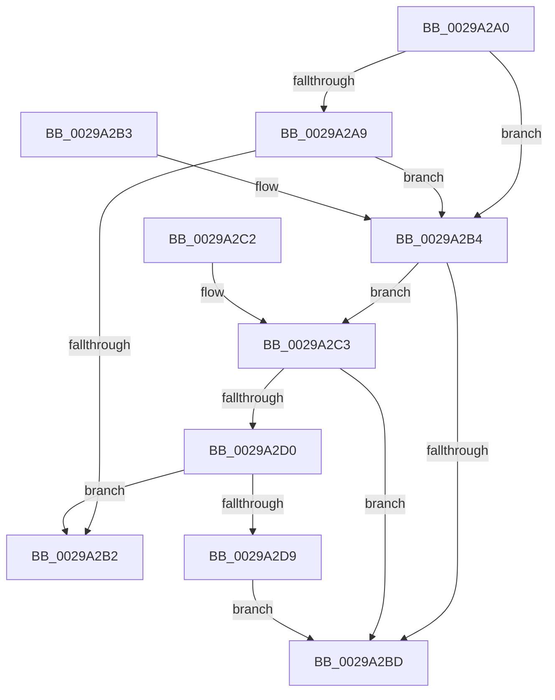

# IoGetBaseFileSystemDeviceObject

- RVA: `0x0029A2A0`–`0x0029A2DB` (길이 `59` bytes)
- VA: `0x000000014029A2A0`
- 실행 섹션: `.text`
- PDB 이름 있음: `예`; PDB Function 태그: `아니요`
- unwind 정보 RVA: `0x000DB714`
- 디코드: `21`개 명령, `59/59` bytes 표시
- 미해석 바이트: `0` (있으면 어셈블리에 `.byte`로 보존)

> 이 문서는 커널 이미지의 기계어와 PDB 기호를 분석해 생성했습니다. 4번과 5번은 함수 원형과 자료형을 바이너리 사용 방식에서 추정한 C 해석이며 원본 소스 복구 결과는 아닙니다.

## 1. Dependencies

- 직접 호출 지점: **0**; 고유 호출 대상: **0**
- 직접 호출자로 확인된 함수: **8**
- RIP 상대 이미지 참조: **0**

### Outgoing calls
- 직접 디코드된 call 명령이 없습니다.

### Direct callers
- [FsRtlReleaseFileForModWrite](FsRtlReleaseFileForModWrite_function_00299100.md) at `0x0029916D`
- [FsRtlAcquireFileForModWriteEx](FsRtlAcquireFileForModWriteEx_function_00299E5C.md) at `0x00299ED1`
- [IopSynchronousServiceTail](../../page/8E/IopSynchronousServiceTail_function_008EB440.md) at `0x008EB6E4`
- [PnpHandleProcessWalkWorker](../../page/91/PnpHandleProcessWalkWorker_function_0091DE30.md) at `0x0091DED0`
- [FsRtlReleaseFile](../../page/98/FsRtlReleaseFile_function_00985B70.md) at `0x00985BD2`
- [FsRtlAcquireFileForCcFlushEx](../../page/9D/FsRtlAcquireFileForCcFlushEx_function_009D72F0.md) at `0x009D7352`
- [FsRtlReleaseFileForCcFlush](../../page/9D/FsRtlReleaseFileForCcFlush_function_009D75A0.md) at `0x009D7602`
- [FsRtlAcquireFileExclusiveCommon](../../page/9D/FsRtlAcquireFileExclusiveCommon_function_009D8E50.md) at `0x009D8EC0`

### Static image references
- 디코드된 RIP-relative 메모리 참조가 없습니다.

## 2. Other-region calls and transfers

- 다른 실행 섹션으로 향하는 call: **0**
- 별도 외부 분기/꼬리 이동을 확인하지 못했습니다.

## 3. Assembly (complete function range)

```asm
0029A2A0  48 8B 41 10                     mov rax, qword ptr [rcx + 0x10]
0029A2A4  48 85 C0                        test rax, rax
0029A2A7  74 0B                           je 0x14029a2b4
0029A2A9  48 8B 40 08                     mov rax, qword ptr [rax + 8]
0029A2AD  48 85 C0                        test rax, rax
0029A2B0  74 02                           je 0x14029a2b4
0029A2B2  C3                              ret
0029A2B3  CC                              int3
0029A2B4  F7 41 50 00 08 00 00            test dword ptr [rcx + 0x50], 0x800
0029A2BB  74 06                           je 0x14029a2c3
0029A2BD  48 8B 41 08                     mov rax, qword ptr [rcx + 8]
0029A2C1  C3                              ret
0029A2C2  CC                              int3
0029A2C3  48 8B 41 08                     mov rax, qword ptr [rcx + 8]
0029A2C7  48 8B 50 38                     mov rdx, qword ptr [rax + 0x38]
0029A2CB  48 85 D2                        test rdx, rdx
0029A2CE  74 ED                           je 0x14029a2bd
0029A2D0  48 8B 42 08                     mov rax, qword ptr [rdx + 8]
0029A2D4  48 85 C0                        test rax, rax
0029A2D7  75 D9                           jne 0x14029a2b2
0029A2D9  EB E2                           jmp 0x14029a2bd
```

## 4. C-style interpretation (structured pseudocode)

```c
__int64 __fastcall IoGetBaseFileSystemDeviceObject(__int64 a1)
{
    if (*(unsigned __int64 *)(a1 + 16) == 0) goto loc_0029A2B4;
    if (*(unsigned __int64 *)(*(unsigned __int64 *)(a1 + 16) + 8) == 0) goto loc_0029A2B4;
loc_0029A2B2:
    return *(unsigned __int64 *)(*(unsigned __int64 *)(a1 + 16) + 8);
loc_0029A2B4:
    if (((*(unsigned int *)(a1 + 80)) & (0x800ULL)) == 0) goto loc_0029A2C3;
loc_0029A2BD:
    return *(unsigned __int64 *)(a1 + 8);
loc_0029A2C3:
    if (*(unsigned __int64 *)(*(unsigned __int64 *)(a1 + 8) + 56) == 0) goto loc_0029A2BD;
    if (*(unsigned __int64 *)(*(unsigned __int64 *)(*(unsigned __int64 *)(a1 + 8) + 56) + 8) != 0) goto loc_0029A2B2;
    goto loc_0029A2BD;
}
```

## 5. (Beta) C Style

```c
int64_t IoGetBaseFileSystemDeviceObject(void *Arg1)
{
    uint8_t *arg1 = (uint8_t *)Arg1;

    if (*(uint64_t *)(arg1 + 0x10) == 0) goto loc_0029A2B4;
    if (*(uint64_t *)(*(uint64_t *)(arg1 + 0x10) + 0x8) == 0) goto loc_0029A2B4;
loc_0029A2B2:
    return *(uint64_t *)(*(uint64_t *)(arg1 + 0x10) + 0x8);
loc_0029A2B4:
    if (((*(uint32_t *)(arg1 + 0x50)) & (0x800ULL)) == 0) goto loc_0029A2C3;
loc_0029A2BD:
    return *(uint64_t *)(arg1 + 0x8);
loc_0029A2C3:
    if (*(uint64_t *)(*(uint64_t *)(arg1 + 0x8) + 0x38) == 0) goto loc_0029A2BD;
    if (*(uint64_t *)(*(uint64_t *)(*(uint64_t *)(arg1 + 0x8) + 0x38) + 0x8) != 0) goto loc_0029A2B2;
    goto loc_0029A2BD;
}
```

### 관측된 메모리 오프셋

구조체 형식이 확인되지 않은 접근은 인자 기준의 오프셋으로만 기록했습니다.

| 기준 인자 | 오프셋 표현 | 폭 (bit) | 접근 |
|---|---:|---:|---|
| `Arg1` | `+ 0x8` | `64` | `R` |
| `Arg1` | `+ 0x10` | `64` | `R` |
| `Arg1` | `+ 0x50` | `32` | `R` |

## 6. Execution-region graph

[열기: 2D/3D 그래프와 함수 탐색 컨트롤 패널](../../../control-panel.html?section=text&rva=0x0029A2A0&view=graph)

- 2D 그래프는 위에서 아래로 흐르고, 3D 그래프는 빈 공간을 드래그해 회전합니다. Shift+드래그는 이동, 휠은 확대·축소, 함수 노드 선택은 대상 보고서 이동입니다.

### Static fallback


