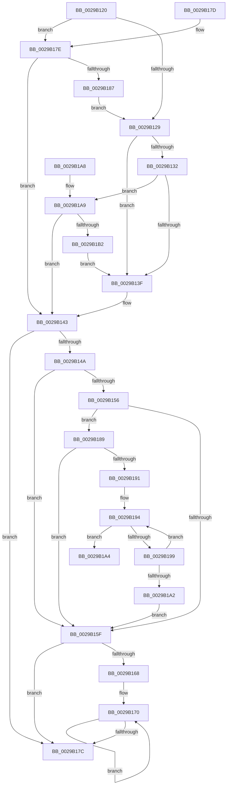

# IoGetRelatedDeviceObject

- RVA: `0x0029B120`–`0x0029B1B4` (길이 `148` bytes)
- VA: `0x000000014029B120`
- 실행 섹션: `.text`
- PDB 이름 있음: `예`; PDB Function 태그: `아니요`
- unwind 정보 RVA: `0x000DB714`
- 디코드: `49`개 명령, `148/148` bytes 표시
- 미해석 바이트: `0` (있으면 어셈블리에 `.byte`로 보존)

> 이 문서는 커널 이미지의 기계어와 PDB 기호를 분석해 생성했습니다. 4번과 5번은 함수 원형과 자료형을 바이너리 사용 방식에서 추정한 C 해석이며 원본 소스 복구 결과는 아닙니다.

## 1. Dependencies

- 직접 호출 지점: **0**; 고유 호출 대상: **0**
- 직접 호출자로 확인된 함수: **79**
- RIP 상대 이미지 참조: **0**

### Outgoing calls
- 직접 디코드된 call 명령이 없습니다.

### Direct callers
- [PnpGetRelatedTargetDevice](../27/PnpGetRelatedTargetDevice_function_00271F54.md) at `0x00271F9A`
- [FsRtlReleaseFileForModWrite](FsRtlReleaseFileForModWrite_function_00299100.md) at `0x00299162`
- [CcSetValidData](CcSetValidData_function_00299420.md) at `0x0029947E`
- [MiIssueAsynchronousFlush](MiIssueAsynchronousFlush_function_00299898.md) at `0x00299935`
- [IoAsynchronousPageWrite](IoAsynchronousPageWrite_function_00299C08.md) at `0x00299C5B`
- [FsRtlAcquireFileForModWriteEx](FsRtlAcquireFileForModWriteEx_function_00299E5C.md) at `0x00299EC6`
- [MiSynchronousPageWrite](MiSynchronousPageWrite_function_0029A2E4.md) at `0x0029A333`
- [MiIssueSynchronousFlush](MiIssueSynchronousFlush_function_0029A588.md) at `0x0029A5F9`
- [IoSynchronousPageWriteEx](IoSynchronousPageWriteEx_function_0029A860.md) at `0x0029A8AF`
- [IoPageReadEx](IoPageReadEx_function_0029ABF0.md) at `0x0029AC64`
- [IopfCompleteRequest](IopfCompleteRequest_function_0029B5F8.md) at `0x0029B8AF`
- [CcZeroData](../38/CcZeroData_function_00387F00.md) at `0x00387FA2`
- [CcZeroData](../38/CcZeroData_function_00387F00.md) at `0x00387FC0`
- [FsRtlGetFileExtents](../58/FsRtlGetFileExtents_function_00580F40.md) at `0x00580F7B`
- [FsRtlMdlReadComplete](../58/FsRtlMdlReadComplete_function_005810B0.md) at `0x005810C0`
- [FsRtlMdlWriteComplete](../../page/71/FsRtlMdlWriteComplete_function_00713B40.md) at `0x00713B58`
- [FsRtlIssueFileNotificationFsctl](../../page/71/FsRtlIssueFileNotificationFsctl_function_007161D8.md) at `0x00716231`
- [IopSetEaOrQuotaInformationFile](../../page/71/IopSetEaOrQuotaInformationFile_function_0071BD70.md) at `0x0071BF44`
- [IopSetRemoteLink](../../page/71/IopSetRemoteLink_function_0071C690.md) at `0x0071C6FE`
- [IoAttachDevice](../../page/71/IoAttachDevice_function_0071CE80.md) at `0x0071CF2F`
- [IoSetInformation](../../page/71/IoSetInformation_function_0071DBF0.md) at `0x0071DCE4`
- [NtQueryQuotaInformationFile](../../page/72/NtQueryQuotaInformationFile_function_00720FE0.md) at `0x00721462`
- [NtSetVolumeInformationFile](../../page/72/NtSetVolumeInformationFile_function_00721750.md) at `0x00721A18`
- [PiPagePathSetState](../../page/72/PiPagePathSetState_function_0072BDE0.md) at `0x0072BE1C`
- [PopGetPolicyDeviceObject](../../page/76/PopGetPolicyDeviceObject_function_00765EB8.md) at `0x00765F81`
- [RawSetInformation](../../page/78/RawSetInformation_function_0078A2A8.md) at `0x0078A2F0`
- [SmKmIsVolumeIoPossible](../../page/7A/SmKmIsVolumeIoPossible_function_007A84BC.md) at `0x007A8552`
- [SmKmSendUsageNotification](../../page/7A/SmKmSendUsageNotification_function_007A8E44.md) at `0x007A8E87`
- [SmKmStoreFileOpenVolume](../../page/7A/SmKmStoreFileOpenVolume_function_007A9C14.md) at `0x007A9D54`
- [SmpUtilsGetControlDevice](../../page/7A/SmpUtilsGetControlDevice_function_007ACBE0.md) at `0x007ACCC6`
- [MiCreatePagingFile](../../page/7F/MiCreatePagingFile_function_007FEFF4.md) at `0x007FF5F8`
- [VhdiMountVhdFile](../../page/83/VhdiMountVhdFile_function_0083BED0.md) at `0x0083C2D7`
- [sub_00863E45](../../page/86/Unknown_function_00863E45.md) at `0x00863E56`
- [IopCloseFile](../../page/86/IopCloseFile_function_008640C0.md) at `0x00864141`
- [IopCloseFile](../../page/86/IopCloseFile_function_008640C0.md) at `0x0086431A`
- [IopGetSetSecurityObject](../../page/87/IopGetSetSecurityObject_function_00873A80.md) at `0x00873B4E`
- [IopParseDevice](../../page/89/IopParseDevice_function_0089E510.md) at `0x0089ED65`
- [IopQueryNameInternal](../../page/8A/IopQueryNameInternal_function_008A6770.md) at `0x008A6937`
- [sub_008A8A27](../../page/8A/Unknown_function_008A8A27.md) at `0x008A8A3A`
- [IopOpenLinkOrRenameTarget](../../page/8A/IopOpenLinkOrRenameTarget_function_008AAC04.md) at `0x008AAE5B`
- [IopOpenLinkOrRenameTarget](../../page/8A/IopOpenLinkOrRenameTarget_function_008AAC04.md) at `0x008AAE66`
- [IopGetBasicInformationFile](../../page/8A/IopGetBasicInformationFile_function_008AC038.md) at `0x008AC058`
- [NtQueryEaFile](../../page/8A/NtQueryEaFile_function_008AC1B0.md) at `0x008AC522`
- [NtQueryVolumeInformationFile](../../page/8A/NtQueryVolumeInformationFile_function_008AC8C0.md) at `0x008ACAFF`
- [IopFlushBuffersFile](../../page/8A/IopFlushBuffersFile_function_008ACFA4.md) at `0x008AD11E`
- [IopGetFileInformation](../../page/8A/IopGetFileInformation_function_008AD4D0.md) at `0x008AD521`
- [NtQueryInformationFile](../../page/8A/NtQueryInformationFile_function_008AD630.md) at `0x008AD778`
- [IopReadFile](../../page/8A/IopReadFile_function_008AEFF0.md) at `0x008AF0FB`
- [IopXxxControlFile](../../page/8E/IopXxxControlFile_function_008E9AD0.md) at `0x008E9E19`
- [IopXxxControlFile](../../page/8E/IopXxxControlFile_function_008E9AD0.md) at `0x008EA8FE`
- [BuildQueryDirectoryIrp](../../page/8E/BuildQueryDirectoryIrp_function_008EC770.md) at `0x008ECBD3`
- [NtCopyFileChunk](../../page/94/NtCopyFileChunk_function_0094B600.md) at `0x0094B89A`
- [NtCopyFileChunk](../../page/94/NtCopyFileChunk_function_0094B600.md) at `0x0094B8BA`
- [IoGetDeviceObjectPointer](../../page/95/IoGetDeviceObjectPointer_function_00953220.md) at `0x009532F1`
- [FsRtlSetFileSize](../../page/98/FsRtlSetFileSize_function_00982B04.md) at `0x00982B48`
- [FsRtlGetFileSize](../../page/98/FsRtlGetFileSize_function_00985150.md) at `0x0098518E`
- [FsRtlReleaseFile](../../page/98/FsRtlReleaseFile_function_00985B70.md) at `0x00985BC7`
- [CmpFileFlushAndPurge](../../page/9B/CmpFileFlushAndPurge_function_009B2BAC.md) at `0x009B2C4E`
- [FsRtlAcquireFileForCcFlushEx](../../page/9D/FsRtlAcquireFileForCcFlushEx_function_009D72F0.md) at `0x009D7347`
- [FsRtlReleaseFileForCcFlush](../../page/9D/FsRtlReleaseFileForCcFlush_function_009D75A0.md) at `0x009D75F7`
- [NtLockFile](../../page/9D/NtLockFile_function_009D86D0.md) at `0x009D88DD`
- [FsRtlAcquireFileExclusiveCommon](../../page/9D/FsRtlAcquireFileExclusiveCommon_function_009D8E50.md) at `0x009D8EB5`
- [NtUnlockFile](../../page/9E/NtUnlockFile_function_009E5DA0.md) at `0x009E5ED3`
- [IopParseFile](../../page/9F/IopParseFile_function_009FDB60.md) at `0x009FDBBC`
- [FsRtlQueryKernelEaFile](../../page/A0/FsRtlQueryKernelEaFile_function_00A0C680.md) at `0x00A0C6D8`
- [FsRtlSetKernelEaFile](../../page/A0/FsRtlSetKernelEaFile_function_00A0C8B0.md) at `0x00A0C901`
- [FsRtlKernelFsControlFile](../../page/A0/FsRtlKernelFsControlFile_function_00A0CA70.md) at `0x00A0CACF`
- [NtNotifyChangeDirectoryFileEx](../../page/A1/NtNotifyChangeDirectoryFileEx_function_00A1DEA0.md) at `0x00A1E03D`
- [IopGetSetObjectId](../../page/A3/IopGetSetObjectId_function_00A37190.md) at `0x00A371DE`
- [IopGetVolumeId](../../page/A3/IopGetVolumeId_function_00A372CC.md) at `0x00A3732E`
- [FsRtlQueryInformationFile](../../page/A3/FsRtlQueryInformationFile_function_00A38780.md) at `0x00A387D8`
- [FsRtlQueryCachedVdl](../../page/A4/FsRtlQueryCachedVdl_function_00A45570.md) at `0x00A455BA`
- [CcMdlReadComplete](../../page/A4/CcMdlReadComplete_function_00A49230.md) at `0x00A49240`
- [FsRtlPrepareMdlWriteEx](../../page/A7/FsRtlPrepareMdlWriteEx_function_00A74200.md) at `0x00A7426B`
- [FsRtlPrepareMdlWrite](../../page/A7/FsRtlPrepareMdlWrite_function_00A742B0.md) at `0x00A742D0`
- [NtSetEaFile](../../page/A7/NtSetEaFile_function_00A788A0.md) at `0x00A78A01`
- [FsRtlMdlReadEx](../../page/A7/FsRtlMdlReadEx_function_00A7CB40.md) at `0x00A7CBAB`
- [FsRtlMdlRead](../../page/A7/FsRtlMdlRead_function_00A7CC40.md) at `0x00A7CC60`
- [CcMdlWriteComplete](../../page/A8/CcMdlWriteComplete_function_00A83BA0.md) at `0x00A83BB8`
- [IopReadFileScatter](../../page/AA/IopReadFileScatter_function_00AA5D78.md) at `0x00AA5DF9`
- [IopWriteFileGather](../../page/AA/IopWriteFileGather_function_00AAA95C.md) at `0x00AAA9DD`
- [WmipGetFilePDO](../../page/AA/WmipGetFilePDO_function_00AAF454.md) at `0x00AAF49B`
- [FsRtlGetDirectImageOriginalBase](../../page/AC/FsRtlGetDirectImageOriginalBase_function_00AC9C70.md) at `0x00AC9CAA`
- [IopFreeBandwidthContract](../../page/AD/IopFreeBandwidthContract_function_00ADC7B4.md) at `0x00ADC82E`

### Static image references
- 디코드된 RIP-relative 메모리 참조가 없습니다.

## 2. Other-region calls and transfers

- 다른 실행 섹션으로 향하는 call: **0**
- 별도 외부 분기/꼬리 이동을 확인하지 못했습니다.

## 3. Assembly (complete function range)

```asm
0029B120  48 8B 41 10                     mov rax, qword ptr [rcx + 0x10]
0029B124  48 85 C0                        test rax, rax
0029B127  75 55                           jne 0x14029b17e
0029B129  F7 41 50 00 08 00 00            test dword ptr [rcx + 0x50], 0x800
0029B130  75 0D                           jne 0x14029b13f
0029B132  48 8B 41 08                     mov rax, qword ptr [rcx + 8]
0029B136  48 8B 40 38                     mov rax, qword ptr [rax + 0x38]
0029B13A  48 85 C0                        test rax, rax
0029B13D  75 6A                           jne 0x14029b1a9
0029B13F  48 8B 41 08                     mov rax, qword ptr [rcx + 8]
0029B143  48 83 78 18 00                  cmp qword ptr [rax + 0x18], 0
0029B148  74 32                           je 0x14029b17c
0029B14A  48 8B 91 D0 00 00 00            mov rdx, qword ptr [rcx + 0xd0]
0029B151  48 85 D2                        test rdx, rdx
0029B154  74 09                           je 0x14029b15f
0029B156  48 8B 4A 10                     mov rcx, qword ptr [rdx + 0x10]
0029B15A  48 85 C9                        test rcx, rcx
0029B15D  75 2A                           jne 0x14029b189
0029B15F  48 8B 48 18                     mov rcx, qword ptr [rax + 0x18]
0029B163  48 85 C9                        test rcx, rcx
0029B166  74 14                           je 0x14029b17c
0029B168  0F 1F 84 00 00 00 00 00         nop dword ptr [rax + rax]
0029B170  48 8B C1                        mov rax, rcx
0029B173  48 8B 49 18                     mov rcx, qword ptr [rcx + 0x18]
0029B177  48 85 C9                        test rcx, rcx
0029B17A  75 F4                           jne 0x14029b170
0029B17C  C3                              ret
0029B17D  CC                              int3
0029B17E  48 8B 40 08                     mov rax, qword ptr [rax + 8]
0029B182  48 85 C0                        test rax, rax
0029B185  75 BC                           jne 0x14029b143
0029B187  EB A0                           jmp 0x14029b129
0029B189  48 8B 11                        mov rdx, qword ptr [rcx]
0029B18C  48 85 D2                        test rdx, rdx
0029B18F  74 CE                           je 0x14029b15f
0029B191  48 8B C8                        mov rcx, rax
0029B194  48 3B CA                        cmp rcx, rdx
0029B197  74 0B                           je 0x14029b1a4
0029B199  48 8B 49 18                     mov rcx, qword ptr [rcx + 0x18]
0029B19D  48 85 C9                        test rcx, rcx
0029B1A0  75 F2                           jne 0x14029b194
0029B1A2  EB BB                           jmp 0x14029b15f
0029B1A4  48 8B C2                        mov rax, rdx
0029B1A7  C3                              ret
0029B1A8  CC                              int3
0029B1A9  48 8B 40 08                     mov rax, qword ptr [rax + 8]
0029B1AD  48 85 C0                        test rax, rax
0029B1B0  75 91                           jne 0x14029b143
0029B1B2  EB 8B                           jmp 0x14029b13f
```

## 4. C-style interpretation (structured pseudocode)

```c
__int64 __fastcall IoGetRelatedDeviceObject(__int64 a1)
{
    if (*(unsigned __int64 *)(a1 + 16) != 0) goto loc_0029B17E;
loc_0029B129:
    if (((*(unsigned int *)(a1 + 80)) & (0x800ULL)) != 0) goto loc_0029B13F;
    if (*(unsigned __int64 *)(*(unsigned __int64 *)(a1 + 8) + 56) != 0) goto loc_0029B1A9;
loc_0029B13F:
loc_0029B143:
    if ((*(unsigned __int64 *)(*(unsigned __int64 *)(a1 + 8) + 24)) == 0) goto loc_0029B17C;
    if (*(unsigned __int64 *)(a1 + 208) == 0) goto loc_0029B15F;
    if (*(unsigned __int64 *)(*(unsigned __int64 *)(a1 + 208) + 16) != 0) goto loc_0029B189;
loc_0029B15F:
    if (*(unsigned __int64 *)(*(unsigned __int64 *)(a1 + 8) + 24) == 0) goto loc_0029B17C;
loc_0029B170:
    if (*(unsigned __int64 *)(*(unsigned __int64 *)(*(unsigned __int64 *)(a1 + 8) + 24) + 24) != 0) goto loc_0029B170;
loc_0029B17C:
    return *(unsigned __int64 *)(*(unsigned __int64 *)(a1 + 8) + 24);
loc_0029B17E:
    if (*(unsigned __int64 *)(*(unsigned __int64 *)(*(unsigned __int64 *)(a1 + 8) + 24) + 8) != 0) goto loc_0029B143;
    goto loc_0029B129;
loc_0029B189:
    if (*(unsigned __int64 *)(*(unsigned __int64 *)(*(unsigned __int64 *)(*(unsigned __int64 *)(a1 + 8) + 24) + 24)) == 0) goto loc_0029B15F;
loc_0029B194:
    if ((*(unsigned __int64 *)(*(unsigned __int64 *)(*(unsigned __int64 *)(a1 + 8) + 24) + 8)) == (*(unsigned __int64 *)(*(unsigned __int64 *)(*(unsigned __int64 *)(*(unsigned __int64 *)(a1 + 8) + 24) + 24)))) goto loc_0029B1A4;
    if (*(unsigned __int64 *)(*(unsigned __int64 *)(*(unsigned __int64 *)(*(unsigned __int64 *)(a1 + 8) + 24) + 8) + 24) != 0) goto loc_0029B194;
    goto loc_0029B15F;
loc_0029B1A4:
    return *(unsigned __int64 *)(*(unsigned __int64 *)(*(unsigned __int64 *)(*(unsigned __int64 *)(a1 + 8) + 24) + 24));
loc_0029B1A9:
    if (*(unsigned __int64 *)(*(unsigned __int64 *)(*(unsigned __int64 *)(*(unsigned __int64 *)(*(unsigned __int64 *)(a1 + 8) + 24) + 24)) + 8) != 0) goto loc_0029B143;
    goto loc_0029B13F;
}
```

## 5. (Beta) C Style

```c
int64_t IoGetRelatedDeviceObject(void *Arg1)
{
    uint8_t *arg1 = (uint8_t *)Arg1;

    if (*(uint64_t *)(arg1 + 0x10) != 0) goto loc_0029B17E;
loc_0029B129:
    if (((*(uint32_t *)(arg1 + 0x50)) & (0x800ULL)) != 0) goto loc_0029B13F;
    if (*(uint64_t *)(*(uint64_t *)(arg1 + 0x8) + 0x38) != 0) goto loc_0029B1A9;
loc_0029B13F:
loc_0029B143:
    if ((*(uint64_t *)(*(uint64_t *)(arg1 + 0x8) + 0x18)) == 0) goto loc_0029B17C;
    if (*(uint64_t *)(arg1 + 0xD0) == 0) goto loc_0029B15F;
    if (*(uint64_t *)(*(uint64_t *)(arg1 + 0xD0) + 0x10) != 0) goto loc_0029B189;
loc_0029B15F:
    if (*(uint64_t *)(*(uint64_t *)(arg1 + 0x8) + 0x18) == 0) goto loc_0029B17C;
loc_0029B170:
    if (*(uint64_t *)(*(uint64_t *)(*(uint64_t *)(arg1 + 0x8) + 0x18) + 0x18) != 0) goto loc_0029B170;
loc_0029B17C:
    return *(uint64_t *)(*(uint64_t *)(arg1 + 0x8) + 0x18);
loc_0029B17E:
    if (*(uint64_t *)(*(uint64_t *)(*(uint64_t *)(arg1 + 0x8) + 0x18) + 0x8) != 0) goto loc_0029B143;
    goto loc_0029B129;
loc_0029B189:
    if (*(uint64_t *)(*(uint64_t *)(*(uint64_t *)(*(uint64_t *)(arg1 + 0x8) + 0x18) + 0x18)) == 0) goto loc_0029B15F;
loc_0029B194:
    if ((*(uint64_t *)(*(uint64_t *)(*(uint64_t *)(arg1 + 0x8) + 0x18) + 0x8)) == (*(uint64_t *)(*(uint64_t *)(*(uint64_t *)(*(uint64_t *)(arg1 + 0x8) + 0x18) + 0x18)))) goto loc_0029B1A4;
    if (*(uint64_t *)(*(uint64_t *)(*(uint64_t *)(*(uint64_t *)(arg1 + 0x8) + 0x18) + 0x8) + 0x18) != 0) goto loc_0029B194;
    goto loc_0029B15F;
loc_0029B1A4:
    return *(uint64_t *)(*(uint64_t *)(*(uint64_t *)(*(uint64_t *)(arg1 + 0x8) + 0x18) + 0x18));
loc_0029B1A9:
    if (*(uint64_t *)(*(uint64_t *)(*(uint64_t *)(*(uint64_t *)(*(uint64_t *)(arg1 + 0x8) + 0x18) + 0x18)) + 0x8) != 0) goto loc_0029B143;
    goto loc_0029B13F;
}
```

### 관측된 메모리 오프셋

구조체 형식이 확인되지 않은 접근은 인자 기준의 오프셋으로만 기록했습니다.

| 기준 인자 | 오프셋 표현 | 폭 (bit) | 접근 |
|---|---:|---:|---|
| `Arg1` | `+ 0x8` | `64` | `R` |
| `Arg1` | `+ 0x10` | `64` | `R` |
| `Arg1` | `+ 0x50` | `32` | `R` |
| `Arg1` | `+ 0xD0` | `64` | `R` |

## 6. Execution-region graph

[열기: 2D/3D 그래프와 함수 탐색 컨트롤 패널](../../../control-panel.html?section=text&rva=0x0029B120&view=graph)

- 2D 그래프는 위에서 아래로 흐르고, 3D 그래프는 빈 공간을 드래그해 회전합니다. Shift+드래그는 이동, 휠은 확대·축소, 함수 노드 선택은 대상 보고서 이동입니다.

### Static fallback


